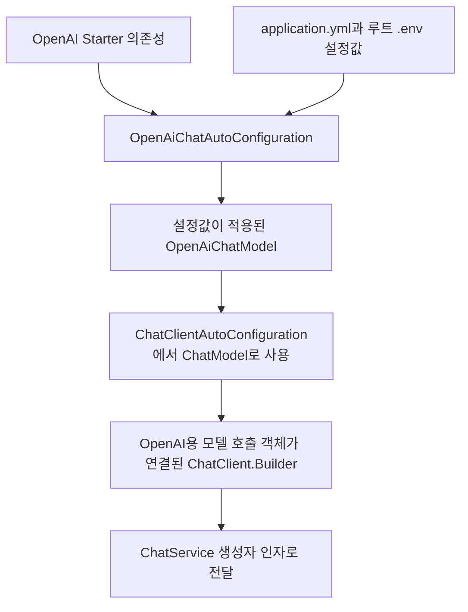

# 02-1. ChatService 생성자에 OpenAI용 Builder가 전달되기까지

이 문서는 02장의 다음 문장을 풀어서 설명합니다.

> ChatClient.Builder는 Spring Boot 자동 설정이 준비하고 생성자로 주입합니다.

핵심은 **OpenAI Starter가 OpenAI용 자동 설정을 제공하고, application.yml이 그 객체의 연결 설정을 제공한다**는 점입니다.
그 결과 준비된 OpenAI 모델 호출 객체가 `ChatClient.Builder`에 연결되고, 이 Builder가 `ChatService`의 생성자 인자로 전달됩니다.

이 문서에서는 Builder의 준비와 생성자 전달까지만 살펴봅니다.
처음에는 각 절의 연결 관계와 5절의 그림을 읽으세요. Properties 클래스와 조건 애너테이션은 펼침 참고로 분리했습니다.

## 1. 생성자가 필요로 하는 객체부터 확인하기

[ChatService.java](../../../labs/02-00-first-chat/src/main/java/com/example/ailearning/ChatService.java)의 생성자는 다음 인자를 받습니다.

```java
public ChatService(ChatClient.Builder builder)
```

이 선언은 “ChatService를 생성하려면 ChatClient.Builder 객체를 전달해야 한다”는 뜻입니다.
하지만 생성자에는 OpenAI라는 이름이 없습니다. `ChatClient.Builder`는 특정 제공 업체의 이름을 드러내지 않는 공통 타입이기 때문입니다.

그렇다면 공통 Builder가 왜 OpenAI에 연결될까요? 생성자보다 앞에서 **어떤 모델 호출 객체를 준비했는지**를 확인해야 합니다.

## 2. OpenAI용 자동 설정은 어디에서 오는가?

[첫 실습의 build.gradle](../../../labs/02-00-first-chat/build.gradle)에 다음 의존성이 있습니다.

```groovy
implementation 'org.springframework.ai:spring-ai-starter-model-openai'
```

이 Starter를 추가하면 관련 라이브러리들이 함께 들어옵니다. 이번 흐름에서 중요한 역할은 다음과 같습니다.

| 함께 들어오는 기능 | 하는 일 |
|---|---|
| OpenAI 연동 구현 | OpenAI API에 요청하고 응답을 읽는 Java 코드 제공 |
| OpenAI 자동 설정 | 설정값을 읽어 OpenAI용 모델 호출 객체 준비 |
| ChatClient 자동 설정 | 준비된 모델 호출 객체를 사용하는 공통 Builder 제공 |

Starter는 우리가 복사해서 작성해야 할 객체 생성·연결 코드를 라이브러리로 제공하는 출발점입니다.
Spring Boot는 애플리케이션을 시작하면서 라이브러리가 등록한 자동 설정을 확인하고, 조건에 맞는 설정을 적용합니다.

**YAML에 `openai`라는 단어가 있다고 OpenAI 라이브러리가 자동으로 설치되는 것은 아닙니다.**
OpenAI용 구현과 자동 설정 코드는 이 Starter 의존성으로 먼저 들어와 있어야 합니다.
YAML은 그 코드가 사용할 설정값을 제공합니다.

## 3. 현재 application.yml은 어떤 값을 제공하는가?

[application.yml](../../../labs/02-00-first-chat/src/main/resources/application.yml)의 모델 연결 관련 부분입니다. 전체 파일에서 발췌했습니다.

```yaml
spring:
  config:
    import: "optional:file:.env[.properties]"
  ai:
    model:
      embedding: none
    openai:
      base-url: https://api.openai.com/v1
      api-key: ${OPENAI_API_KEY}
      timeout: 5s
      chat:
        max-retries: 0
        options:
          model: ${OPENAI_MODEL}
```

먼저 `.env`를 읽어 설정값을 준비하고, `${...}`에 해당하는 값을 찾습니다.
Gradle의 작업 디렉터리는 저장소 루트로 고정되어 있으므로 `.env`도 저장소 루트의 파일입니다.
설정값을 읽는 것 자체가 OpenAI에 질문을 보내는 작업은 아닙니다.

| 설정 | 현재 예제에서의 의미 |
|---|---|
| `spring.config.import` | 루트 `.env`를 properties 형식의 설정 파일로 읽기 |
| `spring.ai.openai.base-url` | OpenAI API 기본 주소. 로컬 테스트에서는 고정 응답 서버 주소로 덮어쓰기 |
| `spring.ai.openai.api-key` | `${OPENAI_API_KEY}`를 찾아 OpenAI 인증에 사용할 값으로 설정 |
| `spring.ai.openai.chat.options.model` | `${OPENAI_MODEL}`을 찾아 OpenAI에 요청할 구체적인 모델 이름으로 설정 |
| `spring.ai.openai.chat.max-retries` | SDK 자동 재시도 횟수를 0으로 설정 |
| `spring.ai.openai.timeout` | OpenAI API 요청 시간 제한을 5초로 설정 |
| `spring.ai.model.embedding: none` | 이번 수업에서 사용하지 않는 임베딩 모델 자동 설정을 끄기. Chat 기능을 끄는 설정은 아님 |

`spring.ai.openai.*` 아래의 값들은 OpenAI 자동 설정이 읽도록 정해진 설정 이름입니다.
Spring Boot는 이 값들을 라이브러리의 설정 객체에 담고, OpenAI 자동 설정 코드는 그 값을 이용해 모델 호출 객체를 준비합니다.
우리가 직접 API 키를 생성자 인자로 조립해 전달할 필요가 없는 이유입니다.

<details><summary>선택 참고: 설정값을 담는 Properties 클래스</summary>

실제 라이브러리에서 설정값을 받는 타입도 다음처럼 구분됩니다.

| 설정 범위 | 설정값을 담는 객체 |
|---|---|
| `spring.ai.openai.*` | `OpenAiCommonProperties`: API 키 같은 OpenAI 공통 연결 설정 |
| `spring.ai.openai.chat.*` | `OpenAiChatProperties`: Chat 모델 이름·시간 제한·재시도 등 Chat 연결 설정 |

이 두 설정 객체를 읽는 `OpenAiChatAutoConfiguration`이 OpenAI용 모델 호출 객체를 준비합니다.
즉, YAML의 값을 읽는 단계와 그 값으로 실제 호출용 Java 객체를 구성하는 단계가 연결되어 있습니다.

</details>

## 4. 왜 다른 제공 업체가 아니라 OpenAI용 객체가 준비되는가?

현재 예제의 조건을 순서대로 보면 다음과 같습니다.

1. Chat용 제공 업체 Starter로 **OpenAI Starter**를 추가했습니다.
2. 따라서 OpenAI용 자동 설정 코드가 실행 후보에 들어갑니다.
3. Chat 제공 업체를 다른 것으로 바꾸는 설정은 작성하지 않았습니다.
4. OpenAI Chat 자동 설정의 기본 활성 조건을 만족하므로, OpenAI용 설정값으로 `OpenAiChatModel`을 준비합니다.

현재는 제공 업체 선택 설정을 생략해도 OpenAI 자동 설정이 활성화되는 기본 조건을 사용합니다.

<details><summary>선택 참고: 자동 설정의 실제 활성 조건</summary>

Spring AI 2.0.2의 `OpenAiChatAutoConfiguration`에는 다음 조건이 붙어 있습니다.
아래는 라이브러리의 실제 조건을 보여 주는 발췌이며 애플리케이션에 추가할 코드는 아닙니다.

```java
@ConditionalOnProperty(
    name = "spring.ai.model.chat",
    havingValue = "openai",
    matchIfMissing = true
)
```

각 항목은 다음처럼 읽습니다.

- `name`: Chat 제공 업체를 선택하는 `spring.ai.model.chat` 설정을 확인합니다.
- `havingValue = "openai"`: 해당 값이 openai이면 이 자동 설정을 적용합니다.
- `matchIfMissing = true`: 해당 설정이 없어도 이 자동 설정의 활성 조건을 만족합니다.

현재 application.yml에는 `spring.ai.model.chat`을 적지 않았습니다.
그런데도 OpenAI용 자동 설정이 활성 조건을 만족하는 이유가 `matchIfMissing = true`입니다.
이는 **현재 예제에 들어 있는 OpenAI 자동 설정의 조건**이며, 모든 제공 업체를 언제나 OpenAI로 선택한다는 뜻은 아닙니다.

</details>

여기서 이름에 model이 들어간 두 설정을 구분해야 합니다.

| 설정 이름 | 결정하는 것 |
|---|---|
| `spring.ai.model.chat` | Chat 기능에 사용할 제공 업체. OpenAI, Ollama 등 중 어떤 연동을 활성화할지 선택 |
| `spring.ai.openai.chat.options.model` | OpenAI에 요청할 구체적인 모델 이름 |

현재 예제는 첫 번째를 생략해 OpenAI 자동 설정의 기본 조건을 사용하고, 두 번째에 `.env`의 `OPENAI_MODEL` 값을 사용합니다.
`OPENAI_MODEL`에 적은 모델 이름만 보고 Spring이 제공 업체를 추측하는 구조가 아닙니다.

현재 설정을 명시적으로 표현한다면 `spring.ai.model.chat: openai`라고 적을 수도 있지만,
이번 설명을 위해 application.yml을 수정할 필요는 없습니다.

## 5. OpenAI용 객체가 공통 Builder에 연결되는 과정

여기서 구분할 객체는 두 가지입니다.

| 타입 | 역할 |
|---|---|
| `ChatModel` | 모델을 호출하는 공통 인터페이스 |
| `OpenAiChatModel` | 그 인터페이스를 OpenAI용으로 구현한 Java 클래스 |

OpenAI 자동 설정이 준비하는 구체적인 모델 호출 객체는 `OpenAiChatModel`입니다.
이 객체는 앞서 읽은 API 키·모델 이름·요청 옵션을 이용해 OpenAI API와 통신할 수 있도록 구성됩니다.
외부 OpenAI 모델 자체를 Java 애플리케이션 안에 생성하거나 학습시키는 것은 아닙니다.

그다음 `ChatClientAutoConfiguration`은 `ChatModel`을 받아 공통 `ChatClient.Builder`를 준비합니다.
현재 예제에서 그 `ChatModel` 자리에 연결되는 구현이 `OpenAiChatModel`입니다.



그림은 애플리케이션 시작 시 Java 객체가 준비되고 연결되는 관계입니다.
외부 모델 서버와 통신하는 실행 순서를 나타내는 그림은 아닙니다.

Builder의 클래스 이름에 OpenAI가 없더라도 OpenAI를 사용할 수 있는 이유는 **이미 OpenAI용 모델 호출 객체가 연결되어 있기 때문**입니다.
공통 인터페이스를 사용하므로 ChatService 생성자는 구체적인 제공 업체 이름을 직접 적을 필요가 없습니다.

## 6. 준비된 Builder를 생성자 인자로 전달하기

Spring이 ChatService를 생성할 때 생성자 매개변수의 타입을 확인합니다.

```java
public ChatService(ChatClient.Builder builder)
```

이 타입에 맞는 Builder를 앞서 준비했으므로, Spring은 그 Builder를 인자로 전달해 ChatService를 생성합니다.
개발자가 별도로 `new ChatService(...)`를 호출하는 코드를 작성하지 않아도 이 연결이 이루어집니다.

**현재 클래스는 생성자가 하나이므로 생성자에 `@Autowired`를 붙이지 않아도 Spring이 주입합니다.**

생성자가 받는 것은 외부 모델 자체가 아니라, OpenAI 호출 객체에 연결된 Builder입니다.

## 선택 학습: 모델을 두 개 이상 사용한다면?

지금까지는 OpenAI 모델 하나와 기본 Builder를 사용했습니다.
OpenAI와 Anthropic을 함께 사용하고 `@Qualifier`로 주입할 ChatClient를 선택하는 방법은
[서로 다른 제공 업체의 모델을 함께 사용하기](04-multiple-models.md)에서 설명합니다. 실행 가능한 별도 실습과 테스트도 포함합니다.

## 확인 질문

1. YAML의 `spring.ai.openai.*` 설정만 있으면 OpenAI Starter가 없어도 동일한 자동 설정이 제공될까요?
2. 현재 파일에는 `spring.ai.model.chat`이 없는데 왜 OpenAI 자동 설정이 활성 조건을 만족할까요?
3. ChatService 생성자에 OpenAiChatModel 대신 ChatClient.Builder를 적어도 OpenAI를 사용할 수 있는 이유는 무엇일까요?

<details>
<summary>해설</summary>

1. 아닙니다. OpenAI용 구현과 자동 설정은 Starter 의존성이 제공하므로 YAML 값만으로 대신할 수 없습니다.
2. OpenAI Chat 자동 설정의 제공 업체 조건에 `matchIfMissing=true`가 있어 현재 예제는 제공 업체 선택 설정을 생략해도 조건을 만족합니다.
3. 자동 설정이 `OpenAiChatModel`을 연결한 `ChatClient.Builder`를 전달하기 때문입니다. 생성자는 공통 Builder 타입을 받아도 현재 설정에 따른 OpenAI 호출을 사용할 수 있습니다.

</details>

설명 확인 기준: 저장소가 사용하는 Spring AI 2.0.2의 Starter 의존성,
`OpenAiChatAutoConfiguration`의 제공 업체 조건, `ChatClientAutoConfiguration`의 Builder 생성 코드를 확인했습니다.

[02장으로 돌아가기](../02-first-call.md) · [실습 설정과 실행 안내](../../../labs/02-00-first-chat/README.md)

[다음: 테스트 코드 읽기 (선택)](02-test-code.md) · [실제 모델 호출](03-live-model-call.md)
