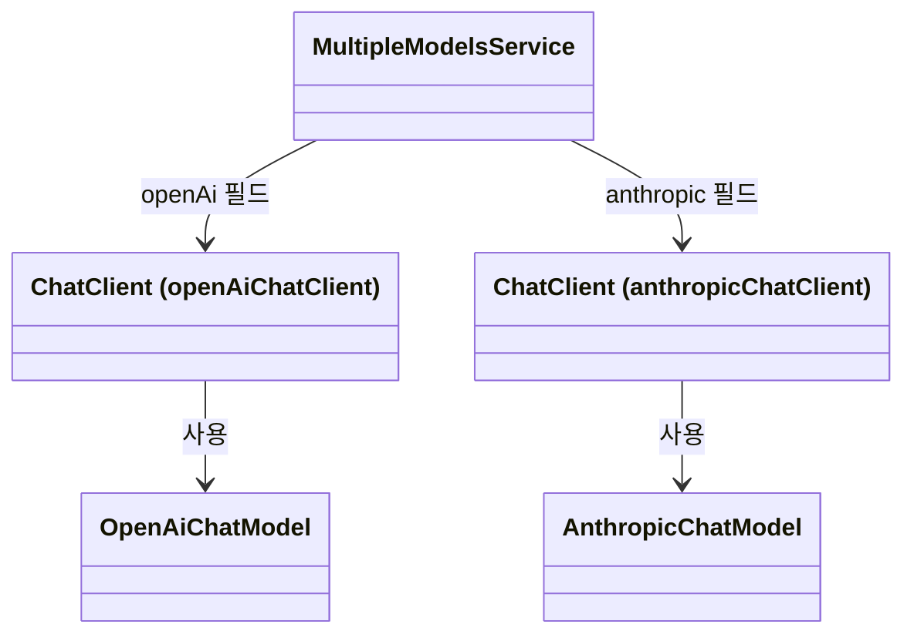

# 02 보충 4. 서로 다른 제공 업체의 모델을 함께 사용하기

[생성자 주입 설명](01-constructor-injection.md)에서 배운 연결 과정을 두 모델로 확장합니다.
이 문서는 선택 학습입니다. 이후 기본 수업을 진행하기 위한 필수 조건은 아닙니다.
실행 예제는 기존 첫 호출 실습과 분리한 [02-multiple-models](../../../labs/02-multiple-models/README.md)에 있습니다.

## 1. 먼저 두 가지 경우를 구분하기

| 상황 | 달라지는 것 | 예 |
|---|---|---|
| 같은 제공 업체의 모델을 여러 개 사용 | 요청의 모델 이름 | OpenAI 계정에서 사용할 수 있는 모델 A와 B |
| 다른 제공 업체의 모델을 사용 | 호출 구현, 인증 정보, 모델 이름 | OpenAI 모델과 Anthropic Claude 모델 |

`ChatClient`는 공통 호출 API입니다. `OpenAiChatModel`과 `AnthropicChatModel`은 각각의 제공 업체 API를 호출하는 Java 객체입니다.
실제 언어 모델은 제공 업체 서버에서 실행됩니다.
OpenAI용 객체에 Anthropic 모델 이름만 넣는다고 Anthropic으로 연결되지는 않습니다.

이번 실습은 **OpenAI와 Anthropic의 호출 객체를 각각 준비하고, 이름으로 구분한 ChatClient 두 개를 주입**합니다.
두 업체의 응답을 합치거나 모델이 스스로 업체를 선택하는 기능은 포함하지 않습니다.

## 2. 두 제공 업체의 Starter 추가하기

실습의 `build.gradle`입니다. 버전은 상위 프로젝트의 Spring AI 2.0.2 설정을 따릅니다.

```groovy
dependencies {
    implementation 'org.springframework.boot:spring-boot-starter-webmvc'
    implementation 'org.springframework.ai:spring-ai-starter-model-openai'
    implementation 'org.springframework.ai:spring-ai-starter-model-anthropic'
}
tasks.named('bootRun') { workingDir rootProject.projectDir }
tasks.named('test') { workingDir rootProject.projectDir }
```
OpenAI Starter가 OpenAI 자동 설정을, Anthropic Starter가 Anthropic 자동 설정을 제공합니다.
두 Starter를 추가했으므로 각각의 설정값으로 두 종류의 모델 호출 객체를 준비할 수 있습니다.

## 3. 제공 업체별 설정 준비하기

실습의 `application.yml` 전체입니다.

```yaml
server:
  address: 127.0.0.1
  port: 8092
spring:
  config:
    import: "optional:file:.env[.properties]"
  ai:
    model:
      embedding: none
    chat:
      client:
        enabled: false
    openai:
      api-key: ${OPENAI_API_KEY}
      chat:
        max-retries: 0
        timeout: 10s
        options:
          model: ${OPENAI_MODEL}
    anthropic:
      api-key: ${ANTHROPIC_API_KEY}
      max-retries: 0
      timeout: 10s
      chat:
        model: ${ANTHROPIC_MODEL}
        max-tokens: 256
```
저장소 루트 `.env`에는 다음 네 값을 준비합니다. 아래 대괄호 부분은 실제 키와 계정에서 사용할 수 있는 모델 ID로 바꿉니다.
키가 담긴 파일은 Git에 커밋하지 않습니다. 이미 있는 OpenAI 설정은 그대로 사용하면 됩니다.

```properties
OPENAI_API_KEY=<OpenAI API 키>
OPENAI_MODEL=<OpenAI 모델 ID>
ANTHROPIC_API_KEY=<Anthropic API 키>
ANTHROPIC_MODEL=<Anthropic 모델 ID>
```

실습의 Gradle `bootRun`과 `test`는 저장소 루트를 작업 디렉터리로 사용합니다.
따라서 `optional:file:.env[.properties]`가 저장소 루트의 `.env`를 읽습니다.
`optional`은 파일이 없어도 읽기 오류를 내지 않는다는 뜻이며, 실제 호출에 필요한 키와 모델 값까지 생략해도 된다는 뜻은 아닙니다.

설정에서 특히 다음 세 가지를 확인하세요.

- **`spring.ai.model.chat`을 지정하지 않습니다.** 이 예제의 두 제공 업체 자동 설정은 이 선택값을 생략하면 각각 활성화됩니다. 여기에 `openai`만 지정하면 Anthropic Chat 자동 설정은 활성화되지 않습니다.
- **`spring.ai.chat.client.enabled: false`로 기본 Builder 자동 설정을 끕니다.** 기본 Builder가 사용할 `ChatModel` 하나를 정할 수 없기 때문입니다. 모델 호출 객체의 자동 설정은 계속 사용하고, 다음 절에서 `ChatClient` 두 개만 직접 만듭니다.
- **각 제공 업체의 설정 구조를 확인합니다.** 이 버전에서 OpenAI 모델 이름은 `spring.ai.openai.chat.options.model`, Anthropic은 `spring.ai.anthropic.chat.model`입니다. 설정 경로가 모두 같지는 않습니다. `embedding: none`은 이번 실습에 필요 없는 임베딩 모델의 자동 설정을 끕니다.

## 4. 모델마다 이름이 있는 ChatClient 만들기

```java
package com.example.ailearning.l02multiple;

import org.springframework.ai.anthropic.AnthropicChatModel;
import org.springframework.ai.chat.client.ChatClient;
import org.springframework.ai.openai.OpenAiChatModel;
import org.springframework.context.annotation.Bean;
import org.springframework.context.annotation.Configuration;

@Configuration
public class ChatClientsConfiguration {
    @Bean("openAiChatClient")
    public ChatClient openAiChatClient(OpenAiChatModel model) {
        return ChatClient.create(model);
    }

    @Bean("anthropicChatClient")
    public ChatClient anthropicChatClient(AnthropicChatModel model) {
        return ChatClient.create(model);
    }
}
```
`openAiChatClient()`의 매개변수는 구체적인 `OpenAiChatModel` 타입입니다.
Spring은 OpenAI 자동 설정이 준비한 객체를 전달합니다. `ChatClient.create(model)`은 전달받은 모델 호출 객체를 사용하는 클라이언트를 만듭니다.
Anthropic도 같은 방식으로 연결됩니다.

두 반환값은 모두 `ChatClient` 타입이지만 `@Bean`에 지정한 이름이 다릅니다.
그 이름이 다음 절의 `@Qualifier`와 정확히 일치해야 합니다.

[공통 그림 기준](../../diagram-guide.md)에 따라, 클래스 그림은 어떤 객체가 무엇을 사용하는지 보여줍니다.
두 ChatClient 상자는 같은 클래스의 서로 다른 인스턴스입니다. 괄호의 이름은 주입할 때 사용하는 이름입니다.



## 5. @Qualifier로 주입받을 ChatClient 지정하기

```java
package com.example.ailearning.l02multiple;

import org.springframework.ai.chat.client.ChatClient;
import org.springframework.beans.factory.annotation.Qualifier;
import org.springframework.stereotype.Service;

@Service
public class MultipleModelsService {
    private final ChatClient openAi;
    private final ChatClient anthropic;

    public MultipleModelsService(
            @Qualifier("openAiChatClient") ChatClient openAi,
            @Qualifier("anthropicChatClient") ChatClient anthropic) {
        this.openAi = openAi;
        this.anthropic = anthropic;
    }

    public String askOpenAi(String question) {
        return openAi.prompt().user(question).call().content();
    }

    public String askAnthropic(String question) {
        return anthropic.prompt().user(question).call().content();
    }
}
```
`ChatClient` 타입만 적으면 후보가 두 개입니다.
`@Qualifier("openAiChatClient")`는 그중 해당 이름의 객체를 생성자 인자로 받겠다는 뜻입니다.
`@Qualifier("anthropicChatClient")`도 같은 방식으로 다른 객체를 선택합니다.

연결은 애플리케이션 시작 시 정해집니다. 이후 `askOpenAi()`는 OpenAI에, `askAnthropic()`은 Anthropic에 요청합니다.
`@Qualifier`가 질문 내용을 분석하거나 매 요청마다 제공 업체를 판단하는 것은 아닙니다.
현재 클래스는 생성자가 하나이므로 생성자에 `@Autowired`를 붙이지 않아도 Spring이 주입합니다.
두 클라이언트를 모두 명시하므로 기본 후보 하나를 지정하는 `@Primary`는 필요하지 않습니다.

## 6. 요청을 받아 실제 모델 호출하기

```java
package com.example.ailearning.l02multiple;

import jakarta.validation.constraints.NotBlank;
import org.springframework.web.bind.annotation.PostMapping;
import org.springframework.web.bind.annotation.RequestBody;
import org.springframework.web.bind.annotation.RequestMapping;
import org.springframework.web.bind.annotation.RestController;

@RestController
@RequestMapping("/api/multi-chat")
public class MultipleModelsController {
    private final MultipleModelsService service;

    public MultipleModelsController(MultipleModelsService service) {
        this.service = service;
    }

    @PostMapping(value = "/openai", consumes = "text/plain", produces = "text/plain;charset=UTF-8")
    public String openAi(@RequestBody @NotBlank String question) {
        return service.askOpenAi(question);
    }

    @PostMapping(value = "/anthropic", consumes = "text/plain", produces = "text/plain;charset=UTF-8")
    public String anthropic(@RequestBody @NotBlank String question) {
        return service.askAnthropic(question);
    }
}
```
각 URL이 호출할 서비스 메서드를 정합니다. 개발자가 URL과 메서드로 제공 업체를 선택하는 구조입니다.
두 API 키와 모델 ID를 준비한 뒤 저장소 루트에서 실행하세요.

```bash
./gradlew :Spring-AI-Agent-Learning:labs:02-multiple-models:bootRun
```

다른 터미널에서 원하는 제공 업체를 호출합니다.

```bash
curl http://localhost:8092/api/multi-chat/openai \
  -H 'Content-Type: text/plain; charset=UTF-8' \
  --data '생성자 주입을 두 문장으로 설명해줘'

curl http://localhost:8092/api/multi-chat/anthropic \
  -H 'Content-Type: text/plain; charset=UTF-8' \
  --data '생성자 주입을 두 문장으로 설명해줘'
```

각 요청의 응답 본문에 해당 모델이 생성한 텍스트가 나옵니다. 문장과 응답 시간은 달라질 수 있고 실제 API 사용 요금이 발생할 수 있습니다.
이 예제의 시작에는 두 제공 업체 설정이 모두 필요합니다.

## 7. 테스트는 무엇을 확인할까?

[MultipleProvidersContractTest](../../../labs/02-multiple-models/src/test/java/com/example/ailearning/l02multiple/MultipleProvidersContractTest.java)는 실제 Spring Boot 서버와 두 Spring AI 제공 업체 어댑터를 사용합니다.
외부 API 주소만 [로컬 고정 응답 서버](../../../labs/02-multiple-models/src/test/java/com/example/ailearning/l02multiple/LocalProvidersServer.java)로 바꿉니다.
실제 키 대신 테스트용 값을 지정하며 저장소의 `.env`를 읽지 않습니다.

```bash
./gradlew :Spring-AI-Agent-Learning:labs:02-multiple-models:test
```

- OpenAI URL 호출: OpenAI 형식의 요청, OpenAI 모델 이름, OpenAI용 인증 정보가 전달되는지 확인합니다. Anthropic 요청은 발생하지 않아야 합니다.
- Anthropic URL 호출: Anthropic 형식의 요청, Anthropic 모델 이름, Anthropic용 인증 정보가 전달되는지 확인합니다. OpenAI 요청은 발생하지 않아야 합니다.

두 테스트는 이름으로 선택한 객체가 올바른 제공 업체 호출로 연결되는지 검증합니다.
실제 외부 모델의 답변 품질이나 API 키 권한은 검증하지 않습니다.

## 8. 같은 업체의 모델 두 개를 쓴다면?

같은 OpenAI 계정에서 모델 A와 B를 사용한다면 두 Starter를 추가할 필요가 없습니다.
OpenAI 호출 구현을 공유하고 요청 옵션으로 모델 ID를 바꾸거나, 기본 모델 옵션이 다른 OpenAI 클라이언트 두 개를 구성할 수 있습니다.
반면 이번 예제는 제공 업체 자체가 달라서 서로 다른 `ChatModel` 구현과 인증 정보를 준비했습니다.
`@Qualifier`는 원격 모델 ID를 지정하는 설정이 아니라 **주입할 Java 객체를 구분하는 이름**이라는 점을 기억하세요.

## 확인 질문

1. 두 객체가 모두 ChatClient인데 생성자에서 어떻게 구분하나요?
2. `spring.ai.chat.client.enabled: false`면 OpenAiChatModel도 만들어지지 않을까요?
3. `/openai` 요청이 Anthropic에 전달되지 않는 이유는 무엇인가요?

<details><summary>확인 해설</summary>

각 `@Bean`의 이름을 생성자 매개변수의 `@Qualifier`에 적어 구분합니다.
해당 설정은 기본 ChatClient.Builder 자동 설정만 끄며 제공 업체 모델 자동 설정은 별개입니다.
`/openai`는 `askOpenAi()`를 호출하고, 그 메서드는 OpenAiChatModel에 연결된 ChatClient를 사용합니다.

</details>

## 적용 범위와 공식 참고 자료

이 예제는 연결 관계를 쉽게 보기 위해 `ChatClient.create(model)`을 사용합니다.
이 방식은 기본 자동 설정 Builder의 커스터마이저와 ChatClient 관측 설정을 자동으로 적용하지 않습니다.
모델 자동 설정과 클라이언트 자동 설정의 역할이 다르기 때문입니다.
기본 Builder의 공통 설정까지 보존하는 확장은 [공식 ChatClient 문서의 여러 모델 구성](https://docs.spring.io/spring-ai/reference/api/chatclient.html)을 참고하세요.
Anthropic 설정 경로는 [공식 Anthropic Chat 문서](https://docs.spring.io/spring-ai/reference/api/chat/anthropic-chat.html)를 기준으로 작성하고, 저장소의 Spring AI 2.0.2에서 테스트했습니다.

[생성자 주입 설명으로 돌아가기](01-constructor-injection.md) · [02장으로 돌아가기](../02-first-call.md)
