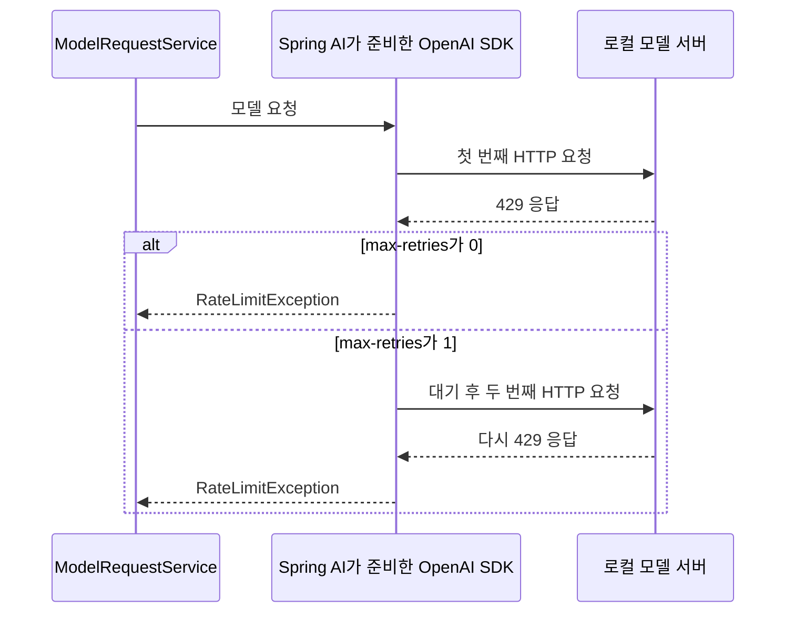

# 02 보충 5. 모델 요청 타임아웃과 재시도

**목표:** 모델 연결의 타임아웃과 재시도를 설정하고, 느린 응답과 오류 응답에서 실제 요청 횟수와 실패 결과를 확인합니다.

첫 모델 호출을 이해했다면 실행할 수 있습니다. [02-05-model-timeout-retry](../../../labs/02-05-model-timeout-retry/README.md)는 기본 Workflow나 도구 제한 모듈을 참조하지 않는 별도 애플리케이션입니다.

## 서로 다른 두 설정

| 설정 | 의미 | 예시 |
|---|---|---|
| `timeout` | OpenAI 클라이언트 통신의 타임아웃 | 응답이 늦으면 통신 실패로 처리 |
| `max-retries` | 재시도 가능한 실패에 대한 최대 추가 시도 수 | 1이면 최초 요청과 재시도를 합쳐 최대 2번 |

Spring AI가 설정을 받아 **내부 OpenAI Java SDK에 전달**하고 SDK가 실제 통신을 제어합니다. 별도의 `Future`나 직접 만든 횟수 계수 객체를 사용하지 않습니다. 제공 업체가 달라지면 그 업체의 설정과 재시도 정책을 확인해야 합니다.

실제 모델 연결에 사용하는 `application.yml`의 설정입니다.

```yaml
spring:
  ai:
    openai:
      base-url: https://api.openai.com/v1
      api-key: ${OPENAI_API_KEY}
      timeout: 30s
      max-retries: 1
      chat:
        options:
          model: ${OPENAI_MODEL}
```

`options.model`은 사용할 모델이고, `timeout`·`max-retries`는 연결 설정입니다. 이 수업은 2.0.2에서 실제 전송에 적용되는 공통 연결 경로인 `spring.ai.openai`를 사용합니다.

타임아웃은 검색·도구 실행·여러 모델 호출을 합친 Workflow 전체의 종료 시각을 정하는 설정이 아닙니다. 재시도에는 추가 대기와 요청이 생길 수 있으므로 전체 소요 시간은 더 길어질 수 있습니다. 응답 대기를 끝내더라도 외부 서버의 처리나 과금 종료까지 보장하는 것은 아닙니다.

## 호출 코드는 첫 실습과 같다

[ModelRequestService.java](../../../labs/02-05-model-timeout-retry/src/main/java/com/example/ailearning/l02requests/ModelRequestService.java)의 전체 코드입니다.

```java
package com.example.ailearning.l02requests;

import org.springframework.ai.chat.client.ChatClient;
import org.springframework.stereotype.Service;

@Service
public class ModelRequestService {
    private final ChatClient chatClient;

    public ModelRequestService(ChatClient.Builder builder) {
        this.chatClient = builder.build();
    }

    public String ask(String question) {
        return chatClient
                .prompt()
                .user(question)
                .call()
                .content();
    }
}
```

재시도용 `for`나 시간 측정 코드를 Service에 추가하지 않습니다. 같은 `ask()`를 두 설정으로 실행하고 로컬 서버가 받은 요청 수를 비교합니다.



429가 계속 오면 재시도 후에도 실패합니다. 재시도는 성공 보장이 아니라 일시적인 실패에 다시 시도할 기회를 주는 기능입니다. 잘못된 요청인 400처럼 같은 요청을 반복해도 해결되지 않는 오류는 이 SDK에서 자동 재시도하지 않습니다.

## 왜 429·500은 다시 요청하고 400은 멈출까?

자동 재시도는 **다시 시도할 가치가 있는 오류인지**와 **추가 시도 횟수가 남았는지**를 함께 판단합니다.
이 실습에서는 Spring AI가 준비한 OpenAI Java SDK가 그 판단과 재요청을 수행합니다.
Service의 `ask()`는 한 번만 호출하며, 테스트에 재요청 루프를 작성하지 않습니다.

`RetryLocalModelTest`는 모든 테스트에 다음 설정을 적용합니다.

```properties
spring.ai.openai.max-retries=1
```

`1`은 전체 요청 수가 아니라 **최대 추가 재시도 수**입니다.
따라서 재시도 대상 오류가 계속 발생하면 최초 요청 1회 + 추가 재시도 1회 = 총 HTTP 요청 2회입니다.
429만 두 번 요청하고 500은 한 번만 요청하는 것이 아닙니다. 두 오류는 같은 횟수 정책을 따릅니다.

| 응답 | 의미와 재시도하는 이유 | 이 테스트의 추가 재시도 | 총 HTTP 요청 |
|---|---|---|---|
| 429 | 요청 한도 초과. 일시적인 속도 제한이라면 잠시 기다린 뒤 처리될 가능성이 있어 SDK의 재시도 대상입니다. | 1회 | 2회 |
| 500 | 모델 서버 내부 오류. 일시적인 서버 문제일 가능성이 있어 SDK의 재시도 대상입니다. | 1회 | 2회 |
| 400 | 요청 형식·인자가 잘못됨. 같은 요청을 다시 보내기보다 내용을 수정해야 하므로 기본 자동 재시도 대상이 아닙니다. | 0회 | 1회 |
| 200 | 요청 성공. 다시 보낼 이유가 없습니다. | 0회 | 1회 |

테스트의 `setHttpStatus(429)`는 첫 요청만 실패시키는 설정이 아니라 **모든 요청에 429를 반환**하는 설정입니다.
500도 마찬가지입니다. 따라서 재시도 후에도 성공하지 않고, 횟수를 소진한 뒤 각 오류에 해당하는 예외가 발생합니다.

```text
429: 최초 요청 → 429 → 대기 후 재시도 → 429 → RateLimitException
500: 최초 요청 → 500 → 대기 후 재시도 → 500 → InternalServerException
400: 최초 요청 → 400 → BadRequestException (추가 요청 없음)
200: 최초 요청 → 정상 답변 (추가 요청 없음)
```

SDK의 기본 재시도 대상에는 연결 오류, 408, 409, 429, 5xx가 포함됩니다.
API가 명시적으로 재시도 여부를 지시하는 경우도 있으나, 이 테스트에서는 그런 지시 없이 상태 코드에 따른 기본 정책을 확인합니다.
[실습에서 사용하는 OpenAI Java SDK 4.80.0의 재시도 정책](https://github.com/openai/openai-java/blob/v4.80.0/README.md#retries)을 참고하세요.

재시도는 성공을 보장하지 않습니다. 예를 들어 429가 계정 사용량 한도 때문이라면 기다리기만 해서는 해결되지 않을 수 있습니다.
또한 `max-retries=1`은 이 실습에서 추가 요청을 한 번만 관찰하도록 정한 값이며, 429나 500의 HTTP 규격이 정한 횟수가 아닙니다.

## 로컬 테스트에서 실패를 재현하기

저장소 루트에서 실행합니다. 고정 응답 서버를 사용하므로 실제 OpenAI 연결이나 API 키가 필요하지 않습니다.

```bash
./gradlew :Spring-AI-Agent-Learning:labs:02-05-model-timeout-retry:test --tests '*LocalModelTest'
```

| 테스트 클래스 | 설정과 응답 | 기대 결과 |
|---|---|---|
| `TimeoutNoRetryLocalModelTest` | timeout 500ms, 재시도 0회, 정상 응답 | 답변 수신, HTTP 요청 1회 |
| 같은 클래스 | 응답을 2초 지연 | SDK 통신 예외, HTTP 요청 1회 |
| 같은 클래스 | 계속 429 반환 | RateLimitException, HTTP 요청 1회 |
| `RetryLocalModelTest` | 재시도 1회, 계속 429 반환 | 최초 1회 + 재시도 1회, 최종 RateLimitException, HTTP 요청 2회 |
| 같은 클래스 | 재시도 1회, 계속 500 반환 | 최초 1회 + 재시도 1회, 최종 InternalServerException, HTTP 요청 2회 |
| 같은 클래스 | 재시도 1회, 400 반환 | BadRequestException, HTTP 요청 1회 |
| 같은 클래스 | 재시도 1회, 정상 응답 | 답변 수신, HTTP 요청 1회 |

[타임아웃·재시도 없음 테스트](../../../labs/02-05-model-timeout-retry/src/test/java/com/example/ailearning/l02requests/TimeoutNoRetryLocalModelTest.java)와 [재시도 테스트](../../../labs/02-05-model-timeout-retry/src/test/java/com/example/ailearning/l02requests/RetryLocalModelTest.java)는 서비스 호출은 그대로 두고 설정만 다르게 합니다. 500ms는 느린 응답을 빨리 재현하기 위한 테스트 설정이며 실제 연결의 권장값은 아닙니다.

이 예제는 SDK의 통신 예외가 서비스 밖으로 전달되면 [ModelRequestController](../../../labs/02-05-model-timeout-retry/src/main/java/com/example/ailearning/l02requests/ModelRequestController.java)에서 `ResponseStatusException(INTERNAL_SERVER_ERROR, ...)`로 바꿉니다. 따라서 외부 모델이 보낸 429를 우리 API의 429로 그대로 전달하는 것은 아닙니다. 컨트롤러 테스트는 이 500 지정과 원인 예외를 직접 확인합니다.

## 실제 모델과 연결하기

루트 `.env`에 `OPENAI_API_KEY`, `OPENAI_MODEL`을 준비합니다. 아래 실행은 실제 API 사용량이 발생합니다.

```bash
./gradlew :Spring-AI-Agent-Learning:labs:02-05-model-timeout-retry:bootRun
curl http://127.0.0.1:8111/api/model-requests \
  -H 'Content-Type: text/plain; charset=UTF-8' \
  --data-raw '짧은 한국어 인사를 해줘.'
```

실제 연결용 [ModelRequestOpenAiLiveTest](../../../labs/02-05-model-timeout-retry/src/test/java/com/example/ailearning/l02requests/ModelRequestOpenAiLiveTest.java)도 제공합니다. 실제 API에 일부러 429를 유발하지 않고, 실패 실험은 로컬 테스트에서 수행합니다.

비교 실험: 먼저 재시도 0회인 테스트의 429 요청 수를 확인하고, 테스트 설정을 1회로 바꿉니다. Spring 컨텍스트를 다시 만드는 테스트 실행으로 요청 수가 2회가 되는지 확인한 뒤 0회로 되돌립니다. 이때 기존 1회 assertion도 기대값이 달라져 실패한다는 점을 함께 확인합니다. 완성된 두 테스트 클래스가 이 비교의 원본입니다.

## 12장에서 다시 활용하기

[12-5 실패 관찰](../12-evaluation/05-failures.md)에서는 이 두 테스트 클래스의 예외와 실제 요청 수를 다시 읽습니다. 토큰 사용량·호출 지표와 연결할 때 **Service의 ask() 호출 1회와 SDK의 HTTP 요청 2회가 다를 수 있음**을 구분합니다. 통신 재시도를 도구 횟수 제한이나 모델 답변 품질 평가와 같은 것으로 해석하지 않습니다.

## 확인 질문

앞서 설명한 연결 설정 중 질문에 필요한 부분입니다. 1·2번은 최초 요청이 각각 HTTP 429·400으로 실패한 경우를 비교합니다.

```yaml
spring:
  ai:
    openai:
      timeout: 30s
      max-retries: 1
```

1. `max-retries: 1`일 때 HTTP 429 응답 후 서버가 받은 요청은 왜 총 2회인가요?
2. 같은 `max-retries: 1` 설정에서 HTTP 400 응답에는 왜 총 1회만 요청하나요?
3. `spring.ai.openai.timeout: 30s`는 Workflow 전체를 30초 안에 끝내는 설정인가요?

<details>
<summary>해설</summary>

1. 최초 요청 1회에 추가 재시도 1회가 더해지므로 서버에는 총 2회 요청합니다.
2. 현재 설정에서 HTTP 400은 재시도 대상이 아니므로 최초 요청 후 다시 요청하지 않습니다.
3. 아닙니다. 해당 모델 HTTP 요청의 타임아웃이며 Workflow 전체의 제한 시간이 아닙니다.

</details>

[Spring AI 연결 설정](https://docs.spring.io/spring-ai/reference/api/chat/openai-chat.html#_connection_properties) · [이전: 다중 모델](04-multiple-models.md) · [02장 목차](../02-first-call.md) · [관련: 도구 호출 제한](../05-tool-calling/05-tool-call-limits.md) · [12장 목차](../12-evaluation.md)
