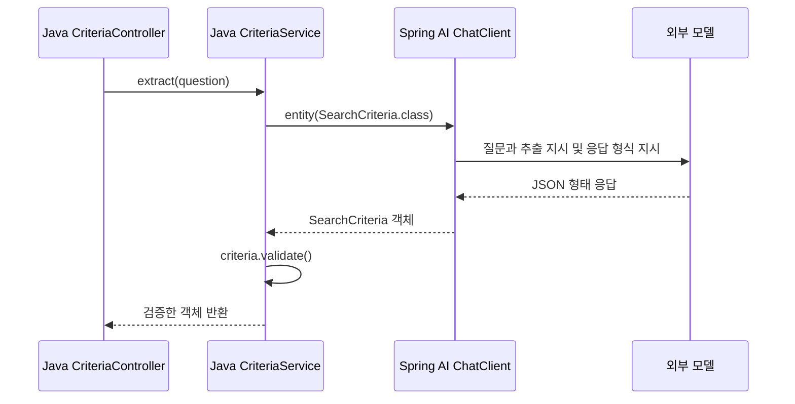

# 04. 구조화 응답: record로 받고 값 검증하기

**실행 코드·설정·테스트:** [labs/04-structured-output](../../labs/04-structured-output/README.md)

**이번 목표:** 모델 응답을 record로 받고, 변환된 값을 Java 코드로 검증하는 흐름을 이해합니다.

## 기초 용어

| 용어 | 의미 |
|---|---|
| JSON | 이름과 값으로 데이터를 표현하는 텍스트 형식. 예: `{"category":"음료","maxPrice":15000}` |
| Java `record` | 관련 값을 필드로 묶는 Java 자료형. 필드 값을 읽는 접근자도 자동으로 제공됩니다. |
| `Integer` | 정수 또는 `null`을 담을 수 있는 Java 자료형. `int`는 `null`을 담지 못합니다. |
| 구조화 응답 | 모델 응답을 정해진 자료형으로 변환해 사용하는 방식. 객체로 변환한 뒤에도 값 검증이 필요합니다. |

## 1. 결과를 담을 record

[SearchCriteria.java](../../labs/04-structured-output/src/main/java/com/example/ailearning/l04structured/SearchCriteria.java)의 전체 코드입니다.
`category`는 상품 카테고리, `maxPrice`는 상품 한 개의 가격 상한(원)입니다.

```java
package com.example.ailearning.l04structured;

import java.util.Set;

/** null은 사용자가 조건을 말하지 않았다는 뜻이다. 0이나 기본 예산으로 채우지 않는다. */
public record SearchCriteria(String category, Integer maxPrice) {
    public void validate() {
        if (category != null && !Set.of("음료", "생활")
                .contains(category)) {
            throw new IllegalArgumentException("category는 음료/생활 또는 null이어야 합니다.");
        }
        if (maxPrice != null && maxPrice < 0) {
            throw new IllegalArgumentException("maxPrice는 0 이상 또는 null이어야 합니다.");
        }
    }
}
```

`validate()`는 카테고리가 음료·생활인지, 가격 상한이 0 이상인지 검사합니다.
사용자가 말하지 않은 조건은 `null`로 둡니다. 가격 조건이 없는 `null`과 가격 상한을 0원으로 지정한 `0`은 다릅니다.

## 2. 문자열과 record로 응답받기

[CriteriaService.java](../../labs/04-structured-output/src/main/java/com/example/ailearning/l04structured/CriteriaService.java)의 전체 코드입니다.
같은 추출 지시를 사용하되, `text()`는 문자열로 받고 `extract()`는 record로 받아 검증합니다.

```java
package com.example.ailearning.l04structured;

import org.springframework.ai.chat.client.ChatClient;
import org.springframework.http.HttpStatus;
import org.springframework.stereotype.Service;
import org.springframework.web.server.ResponseStatusException;

@Service
public class CriteriaService {
    static final String SYSTEM_INSTRUCTION = """
            사용자 요청에서 상품 카테고리(category)와 상품 가격 상한(maxPrice)을 추출하세요.
            category는 음료/생활 중 사용자가 명시한 것만 쓰세요.
            가격은 원 단위 정수입니다. 말하지 않은 필드는 null로 두세요.
            배송비는 계산하지 마세요. 실제 상품을 검색하는 작업도 하지 않습니다.
            """;
    private final ChatClient client;

    public CriteriaService(ChatClient.Builder builder) {
        client = builder.build();
    }

    public String text(String question) {
        return client
                .prompt()
                .system(SYSTEM_INSTRUCTION)
                .user(question)
                .call()
                .content();
    }

    public SearchCriteria extract(String question) {
        SearchCriteria criteria;
        try {
            // Spring AI가 형식 지시를 추가하고 응답을 record로 변환한다.
            criteria = client
                    .prompt()
                    .system(SYSTEM_INSTRUCTION)
                    .user(question)
                    .call()
                    .entity(SearchCriteria.class);
        } catch (RuntimeException error) {
            throw new ResponseStatusException(HttpStatus.BAD_GATEWAY,
                    "모델 응답을 조건 객체로 변환하지 못했습니다.", error);
        }
        if (criteria == null) {
            throw new ResponseStatusException(HttpStatus.BAD_GATEWAY, "모델 응답이 비었습니다.");
        }
        try {
            // Java 객체로 바뀌었어도 업무 규칙은 별도로 검사한다.
            criteria.validate();
        } catch (IllegalArgumentException error) {
            throw new ResponseStatusException(HttpStatus.UNPROCESSABLE_ENTITY, error.getMessage());
        }
        return criteria;
    }
}
```

- `.content()`는 응답 문자열을 반환합니다.
- `.entity(SearchCriteria.class)`는 응답 형식 지시를 추가하고 결과를 record로 변환합니다. 반환 객체의 값은 `category()`, `maxPrice()`로 읽습니다.
- `criteria.validate()`는 변환된 값이 허용 범위에 있는지 검사합니다. 예를 들어 가격이 `-1`이면 숫자로 변환할 수는 있지만 검증에서 거부합니다.

**객체로 변환됐다는 사실만으로 올바른 값이라고 판단할 수는 없습니다.** 검증을 통과한 양수 가격도 사용자가 말한 금액과 다를 수 있습니다.

## 3. 변환과 검증 순서

아래는 정상 응답의 흐름입니다. 형식 변환은 Spring AI가 돕고, 값 검사는 앞의 Java 코드가 수행합니다.



## 4. 실행하고 비교하기

[루트 .env 설정](01-setup.md#4-실제-모델-연결을-위한-설정-준비) 후 저장소 루트에서 실행합니다.
로컬 테스트에는 실제 키가 필요 없고, `bootRun`으로 호출하는 외부 모델에는 비용이 발생할 수 있습니다.

```bash
./gradlew :Spring-AI-Agent-Learning:labs:04-structured-output:test --tests com.example.ailearning.l04structured.StructuredOutputContractTest
./gradlew :Spring-AI-Agent-Learning:labs:04-structured-output:bootRun
```

다른 터미널에서 같은 질문을 두 경로에 보냅니다.

```bash
curl -sS http://127.0.0.1:8094/api/criteria/text \
  -H 'Content-Type: text/plain; charset=UTF-8' \
  --data-raw '음료 중 1만5천원 이하 선물을 찾아줘.'

curl -sS http://127.0.0.1:8094/api/criteria \
  -H 'Content-Type: text/plain; charset=UTF-8' \
  --data-raw '음료 중 1만5천원 이하 선물을 찾아줘.'
```

첫 경로의 Java 반환 타입은 `String`, 두 번째는 `SearchCriteria`입니다. 두 번째 경로는 record를 다음과 같은 HTTP JSON으로 반환합니다.

```json
{"category":"음료","maxPrice":15000}
```

실제 모델 응답은 달라질 수 있습니다. “음료를 추천해줘”로 바꿔 가격 조건이 `null`인지 확인하세요. HTTP JSON에서는 `null` 필드가 생략될 수 있습니다.
서버 종료는 Ctrl+C입니다.

## 5. 실패는 테스트로 확인하기

로컬 테스트의 `MODEL`은 가짜 OpenAI 서버입니다. `MODEL.chat()`에서 채팅 응답을 지정합니다.
다음은 테스트 설정의 발췌이며, 모델이 반환할 문자열을 정하는 코드입니다.

```java
MODEL
        .chat()
        .setResponseText("{\"category\":\"음료\",\"maxPrice\":15000}");
```

테스트는 이 응답을 실제 서비스에 전달해 record 변환과 검증을 확인합니다.
테스트 준비에서 채팅 상태를 비우는 이유와 보조 코드 읽기 순서는 [공통 도구 안내](../../test-support/README.md#04장에서-먼저-읽을-코드)에 있습니다.

[StructuredOutputContractTest](../../labs/04-structured-output/src/test/java/com/example/ailearning/l04structured/StructuredOutputContractTest.java)는 로컬 고정 응답 서버로 다음 동작을 확인합니다.

| 경우 | 결과 |
|---|---|
| 정상 JSON 응답 | record 변환과 응답 형식 지시 전달 확인 |
| 사용자가 조건을 말하지 않음 | 필드를 `null`로 유지 |
| JSON 형식이 잘못됨 | 변환 실패, HTTP 502 |
| 음수 가격 또는 허용하지 않는 카테고리 | 값 검증 실패, HTTP 422 |
| 공백 질문 | Controller가 HTTP 400으로 거부, 모델 호출 없음 |

서비스는 모델 호출·변환 실패도 502로 처리합니다. 실제 모델의 오류를 항상 재현할 수는 없으므로, 실패 경로는 고정 응답으로 검사합니다. 이 테스트가 실제 모델의 추출 정확도까지 보장하지는 않습니다.

## 실제 OpenAI로 확인하기

[StructuredOutputOpenAiLiveTest](../../labs/04-structured-output/src/test/java/com/example/ailearning/l04structured/StructuredOutputOpenAiLiveTest.java)는 같은 질문을 문자열과 record로 받아 케이스 이름과 함께 출력합니다.

```bash
./gradlew :Spring-AI-Agent-Learning:labs:04-structured-output:test --tests com.example.ailearning.l04structured.StructuredOutputOpenAiLiveTest
```

루트 `.env`의 `OPENAI_API_KEY`, `OPENAI_MODEL`을 사용하며 실제 API 사용량이 발생합니다. 로컬 테스트의 고정 응답과 달리 모델의 추출 결과도 검증합니다.

## 확인 질문

1. `text()`와 `extract()`의 반환 타입과 처리 과정은 어떻게 다른가요?
2. `.entity()` 변환에 성공한 뒤에도 `validate()`를 호출하는 이유는 무엇인가요?

[이전: 03. ChatClient와 프롬프트](03-chatclient-and-prompts.md) · [다음: 05. 도구 호출](05-tool-calling.md) · [교육 계획](../curriculum.md)
