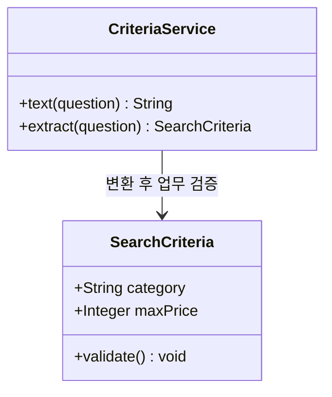
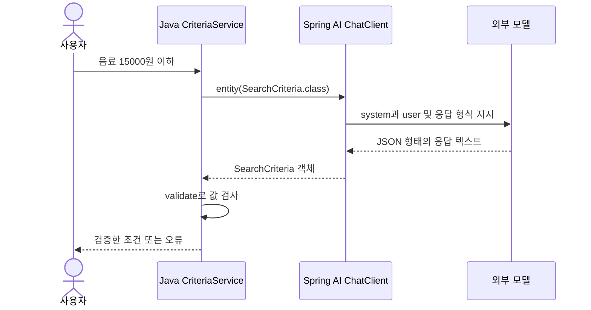

# 04. 구조화 응답: 문장을 Java 객체로 받기

예상 시간: 2시간. 선수 지식: 03장의 ChatClient, system/user 메시지, `.content()`.
이번에는 **응답 문자열을 Java 객체로 바꾸는 것**만 추가합니다. 상품 검색·도구·메모리는 사용하지 않습니다.
[그림 공통 기준](../diagram-guide.md)을 모든 단원에서 같은 방식으로 적용합니다.

## 해결할 문제

“음료 중 1만5천원 이하 선물을 찾아줘”를 Java 코드에서 처리하려면 카테고리와 가격을 각각 읽어야 합니다.
문장을 `split()`으로 나누면 표현이 바뀔 때 깨집니다. 모델에게 필요한 필드를 요청하고 객체로 변환해 보겠습니다.
이 수업의 maxPrice는 **상품 한 개의 가격 상한**입니다. 배송비는 아직 계산하지 않습니다.

## 새 용어: record, JSON, 구조화 응답

- Java `record`는 값을 묶는 자료형입니다. `record SearchCriteria(String category, Integer maxPrice)`는 생성자와 `category()`, `maxPrice()` 접근자를 제공합니다.
- JSON은 이름과 값으로 데이터를 표현하는 텍스트입니다. `{"category":"음료","maxPrice":15000}`처럼 씁니다.
- `Integer`는 정수 또는 null을 담습니다. `int`는 null을 담지 못합니다. null은 “말하지 않음”, 0은 “가격 상한 0원”으로 다릅니다.
- 구조화 응답은 모델의 결과를 정해진 자료형으로 사용하는 방식입니다. 형식이 맞아도 값이 맞는지는 별도 검증합니다.

## 구조와 변환 순서

클래스 그림은 현재 읽을 두 타입만 표시합니다.



시퀀스 그림의 형식 지시 추가와 변환은 `.entity()`가 도와주는 부분입니다.



## 코드 읽는 순서

모듈: `labs/04-structured-output`, 패키지: `com.example.ailearning.l04structured`.
아래 파일은 교육 폴더 기준이며 실제 파일을 그대로 읽을 수 있습니다.

1. [SearchCriteria.java](../../labs/04-structured-output/src/main/java/com/example/ailearning/l04structured/SearchCriteria.java): 결과 형태와 값 검증
2. [CriteriaService.java](../../labs/04-structured-output/src/main/java/com/example/ailearning/l04structured/CriteriaService.java): 모델 요청과 변환
3. [CriteriaController.java](../../labs/04-structured-output/src/main/java/com/example/ailearning/l04structured/CriteriaController.java): HTTP 입력 연결
4. [application.yml](../../labs/04-structured-output/src/main/resources/application.yml), [build.gradle](../../labs/04-structured-output/build.gradle): 01장과 같은 설정, 포트만 8094

### 결과를 담는 record 전체 코드

```java
package com.example.ailearning.l04structured;

import java.util.Set;

/** null은 사용자가 조건을 말하지 않았다는 뜻이다. 0이나 기본 예산으로 채우지 않는다. */
public record SearchCriteria(String category, Integer maxPrice) {
    public void validate() {
        if (category != null && !Set.of("음료", "생활").contains(category)) {
            throw new IllegalArgumentException("category는 음료/생활 또는 null이어야 합니다.");
        }
        if (maxPrice != null && maxPrice < 0) {
            throw new IllegalArgumentException("maxPrice는 0 이상 또는 null이어야 합니다.");
        }
    }
}
```

`validate()`는 객체를 만든 뒤 서비스에서 호출합니다. 검증을 모델 프롬프트에만 맡기지 않습니다.

### 호출을 담당하는 서비스 전체 코드

```java
package com.example.ailearning.l04structured;

import org.springframework.ai.chat.client.ChatClient;
import org.springframework.http.HttpStatus;
import org.springframework.stereotype.Service;
import org.springframework.web.server.ResponseStatusException;

@Service
public class CriteriaService {
    static final String INSTRUCTION = """
            사용자 요청에서 상품 카테고리(category)와 상품 가격 상한(maxPrice)을 추출하세요.
            category는 음료/생활 중 사용자가 명시한 것만 쓰세요.
            가격은 원 단위 정수입니다. 말하지 않은 필드는 null로 두세요.
            배송비는 계산하지 마세요. 실제 상품을 검색하는 작업도 하지 않습니다.
            """;
    private final ChatClient client;

    public CriteriaService(ChatClient.Builder builder) {
        client = builder.build();
    }

    public String text(String question) {
        return client.prompt().system(INSTRUCTION).user(question).call().content();
    }

    public SearchCriteria extract(String question) {
        SearchCriteria criteria;
        try {
            // Spring AI가 형식 지시를 추가하고 응답을 record로 변환한다.
            criteria = client.prompt().system(INSTRUCTION).user(question)
                    .call().entity(SearchCriteria.class);
        } catch (RuntimeException error) {
            throw new ResponseStatusException(HttpStatus.BAD_GATEWAY,
                    "모델 응답을 조건 객체로 변환하지 못했습니다.", error);
        }
        if (criteria == null) {
            throw new ResponseStatusException(HttpStatus.BAD_GATEWAY, "모델 응답이 비었습니다.");
        }
        try {
            // Java 객체로 바뀌었어도 업무 규칙은 별도로 검사한다.
            criteria.validate();
        } catch (IllegalArgumentException error) {
            throw new ResponseStatusException(HttpStatus.UNPROCESSABLE_ENTITY, error.getMessage());
        }
        return criteria;
    }
}
```

`.content()`는 문자열을 반환하고, `.entity(SearchCriteria.class)`는 형식 지시·파싱·타입 변환을 수행합니다.
두 경로는 모델에 전달되는 형식 지시가 다릅니다. 이 실습은 provider-native schema 강제나 자동 교정 재시도를 추가하지 않습니다.
502는 모델 연결/형식 변환 문제, 422는 파싱은 됐지만 업무 값이 허용되지 않는 경우로 나눴습니다.
`try/catch`는 실패를 HTTP 상태로 연결하기 위한 일반 Java/Spring 코드입니다.

## 실행

명령은 모두 **SpringShoppingAI 저장소 루트**에서 실행합니다.
실제 모델을 사용할 때는 [01장 환경 변수 설정](01-setup.md#4-실제-모델을-사용할-때의-환경-변수)을 먼저 합니다.
키나 모델 이름을 소스 파일에 넣지 않습니다.

```bash
./gradlew :Spring-AI-Agent-Learning:labs:04-structured-output:test
./gradlew :Spring-AI-Agent-Learning:labs:04-structured-output:bootRun
```

첫 명령은 실제 키 없이 로컬 고정 응답 서버를 사용합니다. 두 번째 명령은 실제 API를 사용하므로 비용이 발생할 수 있습니다.
다른 터미널에서:

```bash
curl -i http://127.0.0.1:8094/api/criteria \
  -H 'Content-Type: text/plain; charset=UTF-8' \
  --data-raw '음료 중 1만5천원 이하 선물을 찾아줘.'
```

응답 **형태 예시**:

```json
{"category":"음료","maxPrice":15000}
```

원문 응답과 비교하려면 같은 요청을 `/api/criteria/text`에 보내세요. 자연어 응답은 실행마다 달라질 수 있습니다.
종료는 서버 터미널 Ctrl+C입니다. 포트 충돌 시 `LEARNING_PORT=...`를 지정하고 curl 주소도 바꿉니다.

## 실험과 실패 구분

| 입력/실험 | 확인할 것 |
|---|---|
| “선물 추천해줘” | 명시하지 않은 조건은 null. HTTP JSON에서는 null 필드가 생략될 수 있음 |
| “0원 이하 음료” | maxPrice=0과 null의 차이 |
| 모델이 음수 예산/허용되지 않은 카테고리를 반환 | Java 업무 검증으로 422 |
| 모델이 JSON 대신 설명 문장을 반환 | 형식 변환 실패로 502 |
| 공백 질문 | Controller에서 400, 모델 호출 없음 |

실제 모델에게 잘못된 JSON을 요청해도 실패를 항상 재현할 수는 없습니다.
[StructuredOutputContractTest](../../labs/04-structured-output/src/test/java/com/example/ailearning/l04structured/StructuredOutputContractTest.java)는 실제 Spring AI와 로컬 모델 API를 연결해 정상·누락·형식 오류·업무 값 오류를 확정적으로 재현합니다.
이는 자연어 이해 성능 평가가 아닙니다. 잘못 추출한 **양수** 예산은 값 검증을 통과할 수 있으므로 사용자 의도와 맞는지도 확인해야 합니다.

## 확인 질문

1. JSON 텍스트, SearchCriteria 객체, 원래 사용자 문장은 어떻게 다른가요?
2. `.entity()`가 성공했는데 왜 validate()를 호출하나요?
3. 사용자가 가격을 말하지 않았을 때 0으로 채우면 어떤 문제가 생길까요?

<details><summary>해설</summary>

JSON은 데이터 표현 문자열, record는 Java 코드가 접근할 객체, 사용자 문장은 해석할 입력입니다.
파싱 성공은 허용 값·의도 일치를 보장하지 않습니다. 0은 가격 조건이므로 누락과 구분해야 합니다.
문자열 응답과 객체 응답을 직접 비교하고, 테스트에서 실패 유형을 구분하면 완료입니다.
</details>

보충: [공식 Structured Output](https://docs.spring.io/spring-ai/reference/api/structured-output.html).
[이전: 03](03-chatclient-and-prompts.md) · [학습 지도](../curriculum.md)
