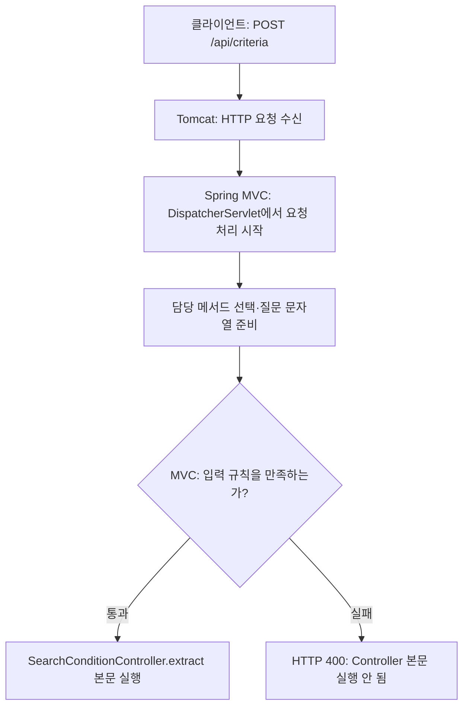

# 0. Spring Boot가 준비해 주는 웹 실행 환경

04장 보충 문서에서 HTTP 400·500·422를 읽기 위한 배경입니다. 웹 서버의 생성 과정 대신, **요청을 누가 받고 Controller가 언제 실행되는지**를 확인합니다.

## 실행하면 무엇이 준비될까?

현재 실습은 `spring-boot-starter-webmvc`와 기본 웹 설정을 사용합니다. 애플리케이션의 `main()`을 실행하면 Spring Boot가 내장 웹 서버인 **Tomcat**과 **Spring MVC의 요청 처리 환경**을 준비합니다.

| 이름 | 현재 실습에서 하는 일 |
|---|---|
| Tomcat | 설정된 포트에서 HTTP 요청을 받는 내장 웹 서버 |
| Servlet | 웹 서버가 HTTP 요청 처리를 맡기는 Java 객체의 규약 |
| DispatcherServlet | Servlet의 하나로, Spring MVC의 요청 처리를 시작하는 객체 |
| Spring MVC | 요청에 맞는 메서드 선택, 입력값 준비·검증, Controller 실행과 응답 처리를 담당하는 웹 프레임워크 |
| SearchConditionController | 입력 검증을 통과한 질문을 서비스에 전달하는 직접 작성한 클래스 |

Tomcat이 현재 API 요청의 처리를 등록된 `DispatcherServlet`에 맡기면, Spring MVC가 담당 Controller 메서드를 찾아 실행을 준비합니다. 이 환경을 실습 코드에서 직접 생성하거나 연결할 필요는 없습니다.

## 요청은 어느 메서드와 연결될까?

[SearchConditionController](../../../labs/04-00-structured-output/src/main/java/com/example/ailearning/l04structured/SearchConditionController.java)의 실제 코드 발췌입니다.

```java
@RestController
@RequestMapping("/api/criteria")
public class SearchConditionController {
    // 필드와 생성자 생략

    @PostMapping(consumes = MediaType.TEXT_PLAIN_VALUE)
    public ProductSearchCondition extractSearchCondition(@RequestBody @NotBlank @Size(max = 2000) String question) {
        return searchConditionExtractor.extractSearchCondition(question);
    }
}
```

| 선언 | 의미 |
|---|---|
| `@RestController` | 요청 처리 메서드를 두고, 반환값을 HTTP 응답 본문으로 쓰는 Controller라는 표시 |
| `@RequestMapping("/api/criteria")` | 이 Controller의 기본 요청 경로 |
| `@PostMapping(consumes = MediaType.TEXT_PLAIN_VALUE)` | 해당 경로의 POST 요청 중 본문 형식이 `text/plain`인 요청을 이 메서드에 연결 |
| `@RequestBody` | 요청 본문을 읽어 `question` 값으로 준비 |
| `@NotBlank`, `@Size(max = 2000)` | 준비한 질문이 공백뿐이지 않은지, 길이가 제한 이내인지 검사할 규칙 |

따라서 기본 실행 설정에서는 `POST http://127.0.0.1:8094/api/criteria`가 `extractSearchCondition()` 메서드에 연결됩니다. 주소만 입력해 브라우저로 여는 GET 요청과는 다릅니다.

## 메서드가 선택되어도 곧바로 본문이 실행되지는 않습니다



`question`이 `"   "`이면 MVC 입력 검증에서 거부됩니다. 그래서 Controller 본문의 `return service.extract(question);`에도 도달하지 않습니다. 질문이 유효하면 Controller와 서비스가 실행되고, 서비스에서 모델 응답 변환과 값 검증을 진행합니다.

서비스가 `ResponseStatusException`을 던지면, 현재 기본 구성의 MVC 오류 처리가 **예외에 담긴 상태를 HTTP 응답에 적용**합니다. 예외가 발생하는 단계와 HTTP 상태를 정하는 코드는 다음 보충 문서에서 구분합니다.

## 실행 결과로 확인하기

일반 애플리케이션 실행은 저장소 루트에서 다음 명령을 사용합니다.

```bash
./gradlew :Spring-AI-Agent-Learning:labs:04-00-structured-output:bootRun
```

[application.yml](../../../labs/04-00-structured-output/src/main/resources/application.yml)의 설정은 다음 의미입니다.

| 설정 | 의미 |
|---|---|
| `server.port: ${LEARNING_PORT:8094}` | `LEARNING_PORT`를 지정하지 않으면 8094 포트 사용 |
| `server.address: 127.0.0.1` | 같은 PC에서 접근하도록 수신 주소 제한 |

기본 포트로 실행했을 때 서버 시작 로그에는 다음과 같은 내용이 나타납니다. 로그 형식은 실행 환경에 따라 달라질 수 있습니다.

```text
Tomcat started on port 8094 (http) with context path '/'
```

이 로그는 **웹 서버가 실행되었다는 증거**입니다. 입력 검증이나 오류 처리가 맞는지는 테스트의 HTTP 상태와 모델 요청 기록으로 확인합니다. 현재 로컬 HTTP 테스트는 임의 포트를 사용하므로 테스트 로그의 포트는 8094와 다를 수 있습니다.

[다음: entity() 변환 실패와 500](01-entity-conversion-500.md) · [04장 본문으로](../04-structured-output.md#5-실패는-테스트로-확인하기)
