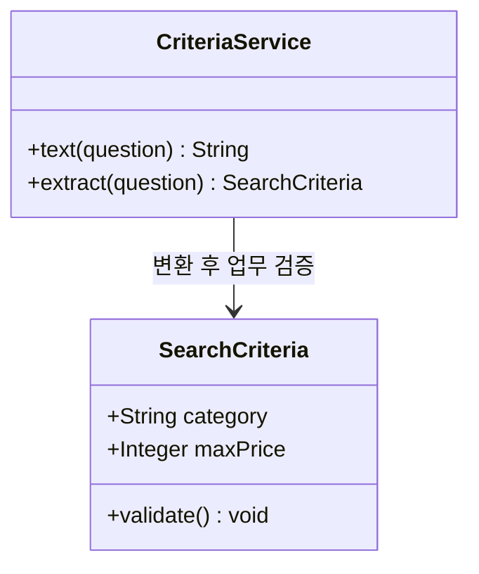
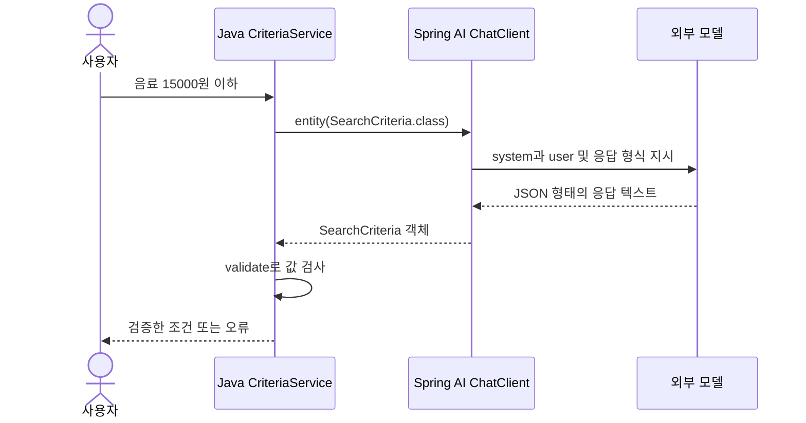

# 04-1. 문자열과 객체는 무엇이 다른가

**실행 코드·설정·테스트:** [labs/04-structured-output](../../../labs/04-structured-output/README.md). 저장소 루트에서 해당 README의 명령으로 실행합니다.

30~45분을 기준으로 한 번에 한 가지 흐름만 읽습니다. 단원 전체 시간은 목차의 기존 예상 시간에 포함됩니다.

**이번 목표:** JSON 형식과 업무 값의 정확성을 구분합니다.

**코드 읽기 안내:** record의 필드는 모델이 채울 답안 칸입니다. 아직 도구나 메모리는 사용하지 않습니다.

## 해결할 문제

“음료 중 1만5천원 이하 선물을 찾아줘”를 Java 코드에서 처리하려면 카테고리와 가격을 각각 읽어야 합니다.
문장을 `split()`으로 나누면 표현이 바뀔 때 깨집니다. 모델에게 필요한 필드를 요청하고 객체로 변환해 보겠습니다.
이 수업의 maxPrice는 **상품 한 개의 가격 상한**입니다. 배송비는 아직 계산하지 않습니다.

## 새 용어: record, JSON, 구조화 응답

- Java `record`는 값을 묶는 자료형입니다. `record SearchCriteria(String category, Integer maxPrice)`는 생성자와 `category()`, `maxPrice()` 접근자를 제공합니다.
- JSON은 이름과 값으로 데이터를 표현하는 텍스트입니다. `{"category":"음료","maxPrice":15000}`처럼 씁니다.
- `Integer`는 정수 또는 null을 담습니다. `int`는 null을 담지 못합니다. null은 “말하지 않음”, 0은 “가격 상한 0원”으로 다릅니다.
- 구조화 응답은 모델의 결과를 정해진 자료형으로 사용하는 방식입니다. 형식이 맞아도 값이 맞는지는 별도 검증합니다.

## 구조와 변환 순서

클래스 그림은 현재 읽을 두 타입만 표시합니다.

시퀀스 그림의 형식 지시 추가와 변환은 `.entity()`가 도와주는 부분입니다.

## 여기서 멈춰 확인하기

코드를 닫고 “이번 입력 → 새로 하는 처리 → 확인할 결과”를 한 문장으로 적어 보세요.
설명하기 어렵다면 위 핵심 메서드만 다시 읽습니다. 테스트용 HTTP 서버 구현을 이해해야 다음으로 갈 수 있는 것은 아닙니다.

[이전](../04-structured-output.md) · [다음](02-convert.md) · [단원 목차](../04-structured-output.md) · [학습 방법](../../learning-guide.md)
