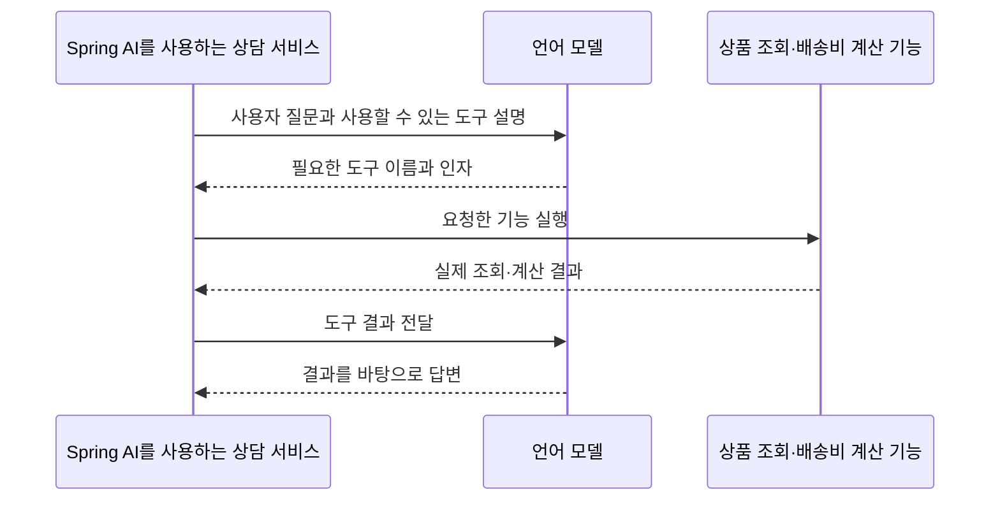

# 05. Tool Calling: 모델이 요청하고 Java가 실행한다

## 개념 먼저 이해하기

**도구(Tool)**는 모델이 사용하도록 애플리케이션이 제공한 기능입니다. 상품 검색, 배송비 계산, 주문 상태 조회처럼 실제 데이터나 정해진 업무 규칙이 필요한 작업을 도구로 연결할 수 있습니다.

“허브티의 배송비 포함 가격을 알려줘”라는 요청에서 모델은 상품 검색과 배송비 조회가 필요하다고 판단할 수 있습니다. 실제 상품을 찾고 금액을 계산하는 일은 연결된 서비스가 수행합니다. **모델은 필요한 도구와 입력값을 요청하고, 애플리케이션은 도구를 실행해 결과를 돌려줍니다.** 이 연결을 도구 호출(Tool Calling)이라고 합니다.

| 용어 | 쉬운 설명 | 쇼핑 서비스 예 |
|---|---|---|
| 도구 | 모델이 요청할 수 있도록 공개한 기능 | 상품 검색, 배송비 계산 |
| 도구 설명 | 어떤 상황에 해당 기능을 쓰는지 알려주는 안내 | “상품 ID로 배송비와 총액을 조회합니다” |
| 인자(arguments) | 기능을 실행하는 데 필요한 입력값 | 카테고리 “음료”, 상품 ID “P01” |
| 도구 결과 | 실제 기능이 실행된 뒤 반환한 데이터 | 상품 가격 12000원, 배송비 3000원 |



Spring AI는 도구의 설명을 모델에 전달하고, 모델이 요청한 기능의 실행과 결과 전달을 연결합니다. 도구가 여러 번 필요하면 이 과정도 반복될 수 있습니다. 기획할 때는 모델이 조회할 정보, 변경할 수 있는 데이터, 오류가 났을 때의 안내를 구분해야 합니다. 이 단원은 상품 정보와 배송비를 조회하는 기능으로 시작합니다.

개념 참고: [Spring AI의 도구 호출 설명](https://docs.spring.io/spring-ai/reference/api/tools.html).

## 실습 안내

`Product`·`ProductCatalog`·`ProductPriceDetail`는 상품 데이터와 검색·가격 계산을 담아 [domain 패키지](../../labs/05-00-tool-calling/src/main/java/com/example/ailearning/l05tools/domain)에 모았습니다. 모델 호출과 도구 연결 코드는 기존 단원 패키지에서 읽습니다.

선수 지식: 04장의 구조화 데이터, 기존 Controller/Service, 프롬프트.
이번에는 **이미 작성한 Java 기능을 모델이 요청할 수 있게 연결**합니다.
[공통 다이어그램 기준](../diagram-guide.md): 클래스는 책임, 시퀀스는 호출 순서를 보여줍니다.


## 작은 수업으로 나누어 읽기

처음에는 아래 순서로 하나씩 학습합니다. 전체 코드를 한 번에 이해하거나 보조 코드를 직접 작성할 필요는 없습니다.

| 순서 | 소수업 | 완료 기준 |
|---|---|---|
| 1 | [모델 없이 상품 서비스를 호출하기](05-tool-calling/01-java.md) | 가격과 배송비의 출처를 일반 Java 코드에서 찾습니다. |
| 2 | [Java 메서드를 도구로 제공하기](05-tool-calling/02-tools.md) | 도구 설명 등록과 실제 메서드 실행을 구분합니다. |
| 3 | [도구 결과가 모델로 돌아가는 과정](05-tool-calling/03-loop.md) | 한 번의 `.call().content()` 실행에서 여러 모델 요청이 생기는 이유를 설명합니다. |
| 4 (선택) | [Spy로 실제 도구 호출 검증하기](05-tool-calling/04-spy-and-inorder.md) | Spy 준비 조건과 호출 순서·인자 검증을 실제 실행과 구분합니다. |
| 5 (선택) | [도구 호출 횟수 제한](05-tool-calling/05-tool-call-limits.md) | 반복되는 도구 실행을 상한으로 차단하고 제한 초과 응답을 구분합니다. |

1~4는 `05-00-tool-calling`, 5는 독립된 `05-05-tool-call-limits` 모듈을 사용합니다. 도구 호출과 결과 전달 흐름을 익힌 뒤 5를 선택하세요.
[공통 학습 방법](../learning-guide.md) · [전체 교육 계획](../curriculum.md)

## 실행 코드와 테스트

[labs/05-00-tool-calling의 실행 안내](../../labs/05-00-tool-calling/README.md)를 확인합니다.
이 단원의 기본 구현은 다음 명령으로 테스트·빌드·실행합니다. 명령은 저장소 루트 기준입니다.

```bash
./gradlew :Spring-AI-Agent-Learning:labs:05-00-tool-calling:test --tests com.example.ailearning.l05tools.ToolCallingLocalModelTest
./gradlew :Spring-AI-Agent-Learning:labs:05-00-tool-calling:bootJar
./gradlew :Spring-AI-Agent-Learning:labs:05-00-tool-calling:bootRun
```
