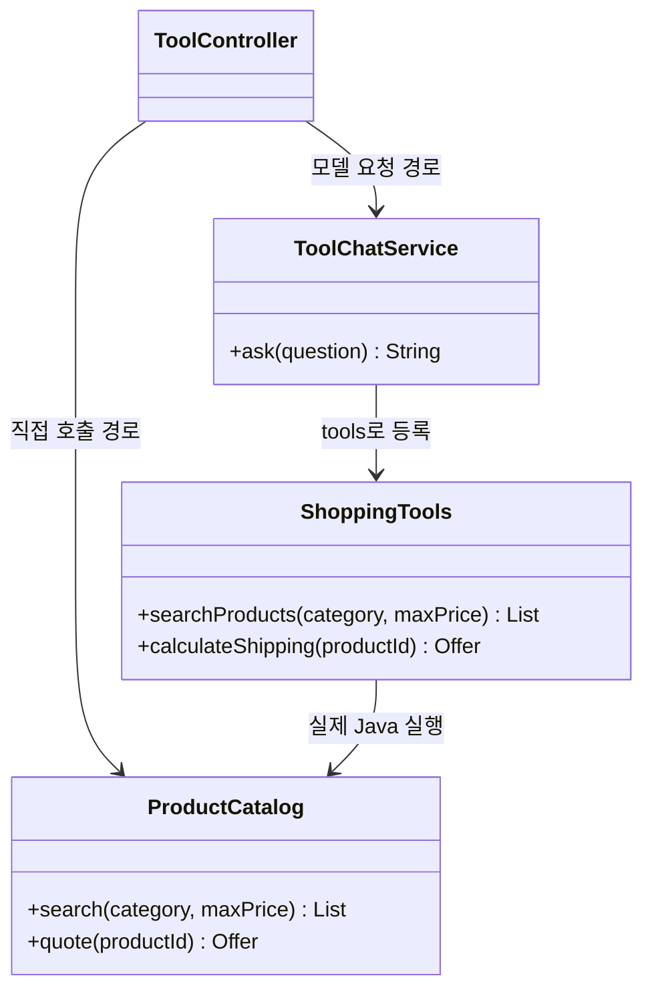
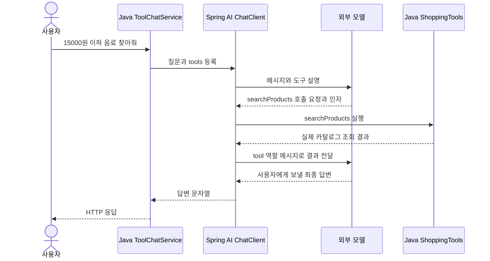

# 05. Tool Calling: 모델이 요청하고 Java가 실행한다

예상 시간: 3시간. 선수 지식: 04장의 구조화 데이터, 기존 Controller/Service, 프롬프트.
이번에는 **이미 작성한 Java 기능을 모델이 요청할 수 있게 연결**합니다. 메모리·MCP·RAG는 사용하지 않습니다.
[공통 다이어그램 기준](../diagram-guide.md): 클래스는 책임, 시퀀스는 호출 순서를 보여줍니다.

## 왜 도구가 필요한가?

모델은 우리 상품 데이터에 직접 접근하지 못합니다. “허브티 가격이 얼마야?”라는 질문만으로 실제 가격을 보장할 수 없습니다.
먼저 Java 상품 서비스를 만들고, 모델에게 이 서비스를 사용할 수 있는 도구 설명을 전달합니다.
모델은 도구 이름과 인자를 응답하고, Spring AI가 Java 메서드를 실행한 뒤 결과를 모델에 다시 보냅니다.

**도구(tool)**는 애플리케이션이 허용한 실행 가능한 기능입니다.
`@Tool`은 메서드를 도구로 설명하고, `@ToolParam`은 인자의 설명이나 생략 가능 여부를 정합니다.
어노테이션을 붙였다고 모든 모델 호출에서 자동으로 노출되지는 않습니다. 이번 요청의 `.tools(tools)`에 명시적으로 등록합니다.

## 먼저 일반 Java 서비스를 읽기

가상 데이터와 배송 정책은 이 단원 폴더 안에 있습니다. 다른 실습을 import하지 않습니다.
상품 한 개씩 비교하며, 국내 기본 배송비는 상품 가격 3만원 이상이면 0원, 미만이면 3000원입니다.
장바구니 합산·지역별 배송비·실제 주문은 구현 범위가 아닙니다.

| ID | 상품 | 카테고리 | 상품 가격 | 배송비 포함 총액 |
|---|---|---|---:|---:|
| P01 | 허브티 | 음료 | 12000 | 15000 |
| P02 | 커피 | 음료 | 28000 | 31000 |
| P03 | 텀블러 | 생활 | 35000 | 35000 |



[ProductCatalog.java](../../labs/05-tool-calling/src/main/java/com/example/ailearning/l05tools/ProductCatalog.java)의 전체 코드입니다.

```java
package com.example.ailearning.l05tools;

import org.springframework.stereotype.Service;
import java.util.List;
import java.util.Set;

@Service
public class ProductCatalog {
    private final List<Product> products = List.of(
            new Product("P01", "허브티", "음료", 12000),
            new Product("P02", "커피", "음료", 28000),
            new Product("P03", "텀블러", "생활", 35000));

    public List<Product> search(String category, Integer maxPrice) {
        if (category != null && !Set.of("음료", "생활").contains(category)) {
            throw new IllegalArgumentException("category는 음료/생활 또는 null입니다.");
        }
        if (maxPrice != null && maxPrice < 0) throw new IllegalArgumentException("가격은 0 이상입니다.");
        return products.stream()
                .filter(product -> category == null || product.category().equals(category))
                .filter(product -> maxPrice == null || product.price() <= maxPrice)
                .toList();
    }

    public Offer quote(String productId) {
        Product product = products.stream().filter(item -> item.id().equals(productId)).findFirst()
                .orElseThrow(() -> new IllegalArgumentException("존재하지 않는 상품입니다."));
        int fee = product.price() >= 30000 ? 0 : 3000;
        return new Offer(product, fee, Math.addExact(product.price(), fee));
    }
}
```

`search()`는 일반 Java 필터입니다. `quote()`는 모델이 보내는 가격을 받지 않고 ID로 조회한 가격으로 계산합니다.
[Product](../../labs/05-tool-calling/src/main/java/com/example/ailearning/l05tools/Product.java)와 [Offer](../../labs/05-tool-calling/src/main/java/com/example/ailearning/l05tools/Offer.java)는 04장에서 배운 record입니다.

## 같은 기능에 도구 설명 붙이기

[ShoppingTools.java](../../labs/05-tool-calling/src/main/java/com/example/ailearning/l05tools/ShoppingTools.java)의 전체 코드입니다.

```java
package com.example.ailearning.l05tools;

import org.springframework.ai.tool.annotation.Tool;
import org.springframework.ai.tool.annotation.ToolParam;
import org.springframework.stereotype.Component;
import java.util.List;

@Component
public class ShoppingTools {
    private final ProductCatalog catalog;

    public ShoppingTools(ProductCatalog catalog) { this.catalog = catalog; }

    @Tool(description = "가상 상품을 검색합니다. category는 음료/생활, maxPrice는 상품 가격 상한입니다. 생략하면 해당 조건은 적용하지 않습니다.")
    public List<Product> searchProducts(
            @ToolParam(required = false) String category,
            @ToolParam(required = false) Integer maxPrice) {
        return catalog.search(category, maxPrice);
    }

    @Tool(description = "존재하는 상품 ID의 국내 기본 배송비와 총액을 조회합니다. 가격을 직접 입력하지 말고 검색 결과의 상품 ID를 사용하세요.")
    public Offer calculateShipping(String productId) { return catalog.quote(productId); }
}
```

새 업무 규칙을 어노테이션 안에 구현한 것이 아닙니다. 원래 Java 서비스로 위임합니다.
`required=false`는 조건 생략을 허용하고, null이면 해당 필터를 적용하지 않습니다.
도구 설명은 모델의 선택을 돕고, Java 검증은 실제 입력과 계산을 보호합니다.

## 모델과 연결하기

[ToolChatService.java](../../labs/05-tool-calling/src/main/java/com/example/ailearning/l05tools/ToolChatService.java)의 전체 코드입니다.

```java
package com.example.ailearning.l05tools;

import org.springframework.ai.chat.client.ChatClient;
import org.springframework.stereotype.Service;

@Service
public class ToolChatService {
    private final ChatClient client;
    private final ShoppingTools tools;

    public ToolChatService(ChatClient.Builder builder, ShoppingTools tools) {
        this.client = builder.build();
        this.tools = tools;
    }

    public String ask(String question) {
        return client.prompt()
                .system("""
                        가상 상품 상담을 합니다. 가격과 배송비는 도구 결과만 사용하세요.
                        필요에 따라 상품 검색과 배송비 조회 도구를 선택하세요.
                        배송비를 물으면 상품 가격과 구분해서 설명하세요.
                        상품 조회가 필요 없는 인사에는 도구 없이 답할 수 있습니다.
                        """)
                .user(question)
                .tools(tools)
                .call().content();
    }
}
```

03장과 비교해 핵심으로 추가된 코드는 `.tools(tools)`입니다.
여기서 `tools`는 ShoppingTools 객체이고, Spring AI는 `@Tool` 메서드에서 도구 설명과 인자 구조를 만듭니다.
모델은 `{"productId":"P02"}` 같은 인자를 요청합니다. Java 객체를 모델 서버로 보내서 실행시키는 방식이 아닙니다.

## 한 번의 사용자 요청에서 생기는 일



이 그림은 **모델이 검색 도구를 한 번 선택한 경우**입니다. 인사는 도구 없이 끝날 수 있고 배송비 질문은 추가 호출이 생길 수 있습니다.
Spring AI 2.0의 도구 루프가 이 반복을 처리합니다. 지금은 사용법을 익히고 Advisor 구조는 08장에서 배웁니다.
최상위 `.call().content()` 한 번에도 실제 모델 요청은 여러 번 발생할 수 있습니다.

## 읽는 순서와 실행

폴더 `labs/05-tool-calling`, 패키지 `com.example.ailearning.l05tools`를 열어보세요.
Product → Offer → ProductCatalog → ShoppingTools → ToolChatService → [ToolController](../../labs/05-tool-calling/src/main/java/com/example/ailearning/l05tools/ToolController.java) 순서입니다.

명령은 모두 저장소 루트에서 실행합니다. `bootRun` 전에는 [01장 환경 변수](01-setup.md#4-실제-모델을-사용할-때의-환경-변수)를 설정하고 도구 호출을 지원하는 Chat 모델을 선택합니다.

```bash
./gradlew :Spring-AI-Agent-Learning:labs:05-tool-calling:test
./gradlew :Spring-AI-Agent-Learning:labs:05-tool-calling:bootRun
```

먼저 모델 없는 Java 호출입니다.

```bash
curl --get http://127.0.0.1:8095/api/tools/direct \
  --data-urlencode 'category=음료' --data-urlencode 'maxPrice=15000'
curl http://127.0.0.1:8095/api/tools/shipping/P02
```

각각 P01만 포함한 상품 목록, P02의 `shippingFee=3000`, `total=31000`을 기대합니다.
그다음 모델이 도구를 선택하도록 요청합니다.

```bash
curl -i http://127.0.0.1:8095/api/tools/chat \
  -H 'Content-Type: text/plain; charset=UTF-8' \
  --data-raw '15000원 이하 음료를 찾아줘. 허브티의 배송비 포함 가격도 알려줘.'
```

실제 자연어 문장은 고정되지 않습니다. 상품 가격과 배송비가 각각 올바른지 확인하세요. 종료는 Ctrl+C입니다.
실제 모델 호출 비용이 발생할 수 있습니다. 테스트는 실제 키 없이 로컬 서버만 사용합니다.

## 실험: 누가 결정하는가?

| 바꿀 것 | 관찰할 것 |
|---|---|
| 질문을 “안녕”으로 변경 | 도구 없이 답할 수 있음 |
| 상품 가격만 질문 → 배송비도 질문 | 선택하는 도구와 모델 왕복 수 차이 |
| 서비스에서 `.tools(tools)` 줄 제거 | 프롬프트에 조회 지시가 있어도 실제 Java 도구는 실행할 수 없음 |
| Java 배송비 기준 변경 | 모델 프롬프트 수정 없이 계산 결과가 달라짐. 실험 후 원복 |

[ToolCallingContractTest](../../labs/05-tool-calling/src/test/java/com/example/ailearning/l05tools/ToolCallingContractTest.java)는 직접 호출 시 모델 요청 0회, 도구 선택 시 결과 재전달, 배송비 근거, 도구 없는 답변과 검증을 확인합니다.
외부 API만 고정 서버로 바꾸고 실제 Spring AI가 콜백을 실행합니다.
가짜 모델은 언어를 이해하지 않습니다. 실제 모델의 도구 선택 품질을 입증하는 테스트는 아닙니다.
잘못된 인자·존재하지 않는 상품은 Java가 거부합니다. 이 입문 실습은 외부 오류의 상세 업무 응답 변환을 추가하지 않아 일반 500으로 보일 수 있습니다.

## 확인 질문

1. 모델이 Java 메서드를 직접 실행하나요?
2. calculateShipping에 상품 가격 대신 상품 ID만 받는 이유는 무엇인가요?
3. 도구 설명만 프롬프트에 쓰고 `.tools()`는 생략해도 실행될까요?

<details><summary>해설</summary>

모델은 호출 요청을 생성하며 애플리케이션/Spring AI가 실행합니다.
상품 ID로 신뢰할 수 있는 카탈로그 가격을 찾아 계산하기 위해서입니다. 등록하지 않은 도구는 설명만으로 실행되지 않습니다.
직접 호출과 도구 루프의 차이를 시퀀스로 설명할 수 있으면 완료입니다.
</details>

보충: [공식 Tool Calling](https://docs.spring.io/spring-ai/reference/api/tools.html)의 정의·Quick Start.
[이전: 04](04-structured-output.md) · [다음: 06. Workflow와 Agent](06-workflow-agent.md) · [학습 지도](../curriculum.md)
