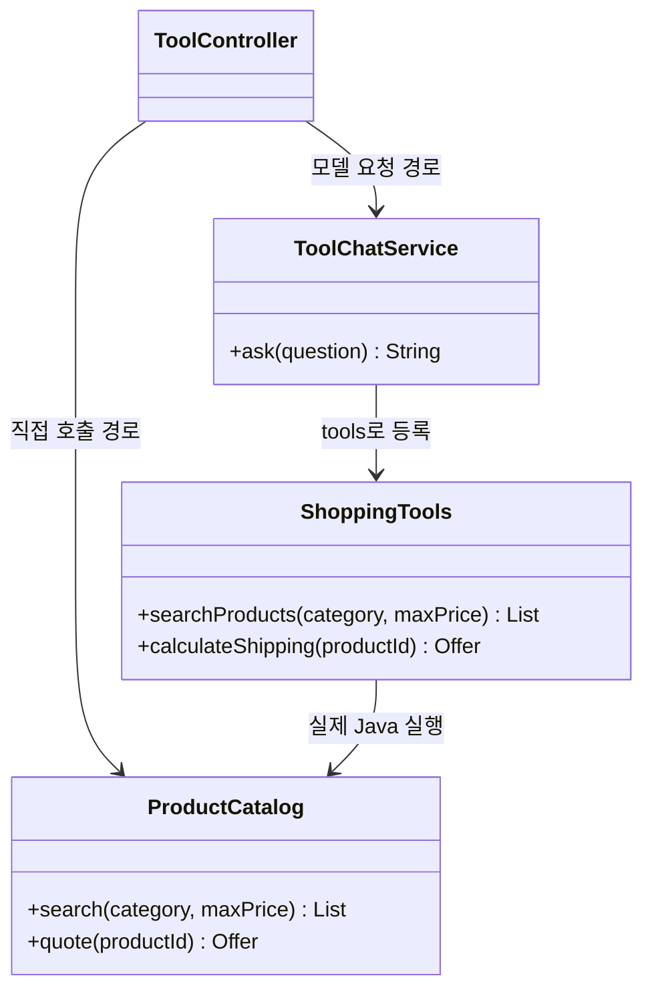

# 05-1. 모델 없이 상품 서비스를 호출하기

**실행 코드·설정·테스트:** [labs/05-tool-calling](../../../labs/05-tool-calling/README.md). 저장소 루트에서 해당 README의 명령으로 실행합니다.

30~45분을 기준으로 한 번에 한 가지 흐름만 읽습니다. 단원 전체 시간은 목차의 기존 예상 시간에 포함됩니다.

**이번 목표:** 가격과 배송비의 출처를 일반 Java 코드에서 찾습니다.

**코드 읽기 안내:** 먼저 Product와 Offer를 읽습니다. 모델을 연결하기 전에 상품 P01의 총액 15000원을 손으로 계산하세요.

## 왜 도구가 필요한가?

모델은 우리 상품 데이터에 직접 접근하지 못합니다. “허브티 가격이 얼마야?”라는 질문만으로 실제 가격을 보장할 수 없습니다.
먼저 Java 상품 서비스를 만들고, 모델에게 이 서비스를 사용할 수 있는 도구 설명을 전달합니다.
모델은 도구 이름과 인자를 응답하고, Spring AI가 Java 메서드를 실행한 뒤 결과를 모델에 다시 보냅니다.

**도구(tool)**는 애플리케이션이 허용한 실행 가능한 기능입니다.
`@Tool`은 메서드를 도구로 설명하고, `@ToolParam`은 인자의 설명이나 생략 가능 여부를 정합니다.
어노테이션을 붙였다고 모든 모델 호출에서 자동으로 노출되지는 않습니다. 이번 요청의 `.tools(tools)`에 명시적으로 등록합니다.

## 먼저 일반 Java 서비스를 읽기

가상 데이터와 배송 정책은 이 단원 폴더 안에 있습니다. 다른 실습을 import하지 않습니다.
상품 한 개씩 비교하며, 국내 기본 배송비는 상품 가격 3만원 이상이면 0원, 미만이면 3000원입니다.
장바구니 합산·지역별 배송비·실제 주문은 구현 범위가 아닙니다.

| ID | 상품 | 카테고리 | 상품 가격 | 배송비 포함 총액 |
|---|---|---|---:|---:|
| P01 | 허브티 | 음료 | 12000 | 15000 |
| P02 | 커피 | 음료 | 28000 | 31000 |
| P03 | 텀블러 | 생활 | 35000 | 35000 |



[ProductCatalog.java](../../../labs/05-tool-calling/src/main/java/com/example/ailearning/l05tools/ProductCatalog.java)의 전체 코드입니다.

```java
package com.example.ailearning.l05tools;

import org.springframework.stereotype.Service;
import java.util.List;
import java.util.Set;

@Service
public class ProductCatalog {
    private final List<Product> products = List.of(
            new Product("P01", "허브티", "음료", 12000),
            new Product("P02", "커피", "음료", 28000),
            new Product("P03", "텀블러", "생활", 35000));

    public List<Product> search(String category, Integer maxPrice) {
        if (category != null && !Set.of("음료", "생활").contains(category)) {
            throw new IllegalArgumentException("category는 음료/생활 또는 null입니다.");
        }
        if (maxPrice != null && maxPrice < 0) throw new IllegalArgumentException("가격은 0 이상입니다.");
        return products.stream()
                .filter(product -> category == null || product.category().equals(category))
                .filter(product -> maxPrice == null || product.price() <= maxPrice)
                .toList();
    }

    public Offer quote(String productId) {
        Product product = products.stream().filter(item -> item.id().equals(productId)).findFirst()
                .orElseThrow(() -> new IllegalArgumentException("존재하지 않는 상품입니다."));
        int fee = product.price() >= 30000 ? 0 : 3000;
        return new Offer(product, fee, Math.addExact(product.price(), fee));
    }
}
```

`search()`는 일반 Java 필터입니다. `quote()`는 모델이 보내는 가격을 받지 않고 ID로 조회한 가격으로 계산합니다.
[Product](../../../labs/05-tool-calling/src/main/java/com/example/ailearning/l05tools/Product.java)와 [Offer](../../../labs/05-tool-calling/src/main/java/com/example/ailearning/l05tools/Offer.java)는 04장에서 배운 record입니다.


## 여기서 멈춰 확인하기

코드를 닫고 “이번 입력 → 새로 하는 처리 → 확인할 결과”를 한 문장으로 적어 보세요.
설명하기 어렵다면 위 핵심 메서드만 다시 읽습니다. 테스트용 HTTP 서버 구현을 이해해야 다음으로 갈 수 있는 것은 아닙니다.

[이전](../05-tool-calling.md) · [다음](02-tools.md) · [단원 목차](../05-tool-calling.md) · [학습 방법](../../learning-guide.md)
