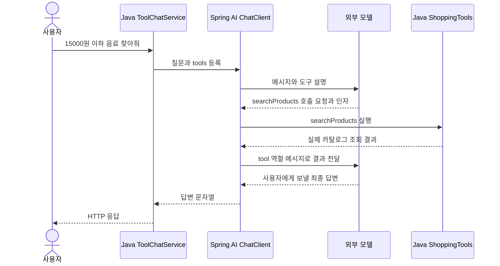

# 05-3. 도구 결과가 모델로 돌아가는 과정

**실행 코드·설정·테스트:** [labs/05-tool-calling](../../../labs/05-tool-calling/README.md). 저장소 루트에서 해당 README의 명령으로 실행합니다.

30~45분을 기준으로 한 번에 한 가지 흐름만 읽습니다. 단원 전체 시간은 목차의 기존 예상 시간에 포함됩니다.

**이번 목표:** 한 번의 call() 안에 여러 모델 요청이 생기는 이유를 설명합니다.

**코드 읽기 안내:** 도구 등록은 호출 강제가 아닙니다. 모델이 바로 답한 실행과 도구를 요청한 실행을 비교합니다.

## 한 번의 사용자 요청에서 생기는 일



이 그림은 **모델이 검색 도구를 한 번 선택한 경우**입니다. 인사는 도구 없이 끝날 수 있고 배송비 질문은 추가 호출이 생길 수 있습니다.
Spring AI 2.0의 도구 루프가 이 반복을 처리합니다. 지금은 사용법을 익히고 Advisor 구조는 08장에서 배웁니다.
최상위 `.call().content()` 한 번에도 실제 모델 요청은 여러 번 발생할 수 있습니다.

## 읽는 순서와 실행

폴더 `labs/05-tool-calling`, 패키지 `com.example.ailearning.l05tools`를 열어보세요.
Product → Offer → ProductCatalog → ShoppingTools → ToolChatService → [ToolController](../../../labs/05-tool-calling/src/main/java/com/example/ailearning/l05tools/ToolController.java) 순서입니다.

명령은 모두 저장소 루트에서 실행합니다. `bootRun` 전에는 [01장 환경 변수](../01-setup.md#4-실제-모델-연결을-위한-설정-준비)를 설정하고 도구 호출을 지원하는 Chat 모델을 선택합니다.

```bash
./gradlew :Spring-AI-Agent-Learning:labs:05-tool-calling:test
./gradlew :Spring-AI-Agent-Learning:labs:05-tool-calling:bootRun
```

먼저 모델 없는 Java 호출입니다.

```bash
curl --get http://127.0.0.1:8095/api/tools/direct \
  --data-urlencode 'category=음료' --data-urlencode 'maxPrice=15000'
curl http://127.0.0.1:8095/api/tools/shipping/P02
```

각각 P01만 포함한 상품 목록, P02의 `shippingFee=3000`, `total=31000`을 기대합니다.
그다음 모델이 도구를 선택하도록 요청합니다.

```bash
curl -i http://127.0.0.1:8095/api/tools/chat \
  -H 'Content-Type: text/plain; charset=UTF-8' \
  --data-raw '15000원 이하 음료를 찾아줘. 허브티의 배송비 포함 가격도 알려줘.'
```

실제 자연어 문장은 고정되지 않습니다. 상품 가격과 배송비가 각각 올바른지 확인하세요. 종료는 Ctrl+C입니다.
실제 모델 호출 비용이 발생할 수 있습니다. 테스트는 실제 키 없이 로컬 서버만 사용합니다.

## 실험: 누가 결정하는가?

| 바꿀 것 | 관찰할 것 |
|---|---|
| 질문을 “안녕”으로 변경 | 도구 없이 답할 수 있음 |
| 상품 가격만 질문 → 배송비도 질문 | 선택하는 도구와 모델 왕복 수 차이 |
| 서비스에서 `.tools(tools)` 줄 제거 | 프롬프트에 조회 지시가 있어도 실제 Java 도구는 실행할 수 없음 |
| Java 배송비 기준 변경 | 모델 프롬프트 수정 없이 계산 결과가 달라짐. 실험 후 원복 |

[ToolCallingContractTest](../../../labs/05-tool-calling/src/test/java/com/example/ailearning/l05tools/ToolCallingContractTest.java)는 직접 호출 시 모델 요청 0회, 도구 선택 시 결과 재전달, 배송비 근거, 도구 없는 답변과 검증을 확인합니다.
외부 API만 고정 서버로 바꾸고 실제 Spring AI가 콜백을 실행합니다.
가짜 모델은 언어를 이해하지 않습니다. 실제 모델의 도구 선택 품질을 입증하는 테스트는 아닙니다.
잘못된 인자·존재하지 않는 상품은 Java가 거부합니다. 이 입문 실습은 외부 오류의 상세 업무 응답 변환을 추가하지 않아 일반 500으로 보일 수 있습니다.

## 확인 질문

1. 모델이 Java 메서드를 직접 실행하나요?
2. calculateShipping에 상품 가격 대신 상품 ID만 받는 이유는 무엇인가요?
3. 도구 설명만 프롬프트에 쓰고 `.tools()`는 생략해도 실행될까요?

<details><summary>해설</summary>

모델은 호출 요청을 생성하며 애플리케이션/Spring AI가 실행합니다.
상품 ID로 신뢰할 수 있는 카탈로그 가격을 찾아 계산하기 위해서입니다. 등록하지 않은 도구는 설명만으로 실행되지 않습니다.
직접 호출과 도구 루프의 차이를 시퀀스로 설명할 수 있으면 완료입니다.
</details>

보충: [공식 Tool Calling](https://docs.spring.io/spring-ai/reference/api/tools.html)의 정의·Quick Start.

## 여기서 멈춰 확인하기

코드를 닫고 “이번 입력 → 새로 하는 처리 → 확인할 결과”를 한 문장으로 적어 보세요.
설명하기 어렵다면 위 핵심 메서드만 다시 읽습니다. 테스트용 HTTP 서버 구현을 이해해야 다음으로 갈 수 있는 것은 아닙니다.

[이전](02-tools.md) · [다음](../05-tool-calling.md) · [단원 목차](../05-tool-calling.md) · [학습 방법](../../learning-guide.md)
