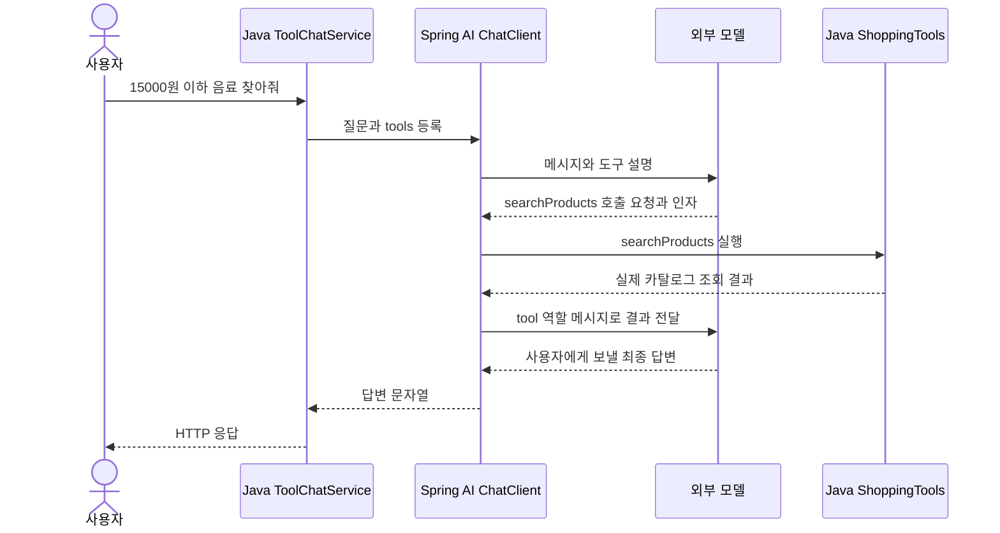

# 05-3. 도구 결과가 모델로 돌아가는 과정

**실행 코드·설정·테스트:** [labs/05-tool-calling](../../../labs/05-tool-calling/README.md). 저장소 루트에서 해당 README의 명령으로 실행합니다.

**이번 목표:** 한 번의 `.call().content()` 실행에서 여러 모델 요청이 생기는 이유를 설명합니다.

**코드 읽기 안내:** 도구 등록은 호출 강제가 아닙니다. 모델이 바로 답한 실행과 도구를 요청한 실행을 비교합니다.

## 한 번의 사용자 요청에서 생기는 일



이 그림은 **모델이 검색 도구를 한 번 선택한 경우**입니다. 인사는 도구 없이 끝날 수 있고 배송비 질문은 추가 호출이 생길 수 있습니다.
Spring AI 2.0의 도구 루프가 이 반복을 처리합니다. 지금은 사용법을 익히고 Advisor 구조는 08장에서 배웁니다.
최상위 `.call().content()` 한 번에도 실제 모델 요청은 여러 번 발생할 수 있습니다.

## 읽는 순서와 실행

폴더 `labs/05-tool-calling`, 패키지 `com.example.ailearning.l05tools`를 열어보세요.
Product → ProductPriceDetails → ProductCatalog → ShoppingTools → ToolChatService → [ToolController](../../../labs/05-tool-calling/src/main/java/com/example/ailearning/l05tools/ToolController.java) 순서입니다.

명령은 모두 저장소 루트에서 실행합니다. `bootRun` 전에는 [01장 루트 .env 설정](../01-setup.md#4-실제-모델-연결을-위한-설정-준비)를 설정하고 도구 호출을 지원하는 Chat 모델을 선택합니다.

```bash
./gradlew :Spring-AI-Agent-Learning:labs:05-tool-calling:test --tests com.example.ailearning.l05tools.ToolCallingLocalModelTest
./gradlew :Spring-AI-Agent-Learning:labs:05-tool-calling:bootRun
```

먼저 모델 없는 Java 호출입니다.

```bash
curl --get http://127.0.0.1:8095/api/tools/direct \
  --data-urlencode 'category=음료' --data-urlencode 'maxPrice=15000'
curl http://127.0.0.1:8095/api/tools/shipping/P02
```

각각 P01만 포함한 상품 목록, P02의 `shippingFee=3000`, `total=31000`을 기대합니다.
그다음 모델이 도구를 선택하도록 요청합니다.

```bash
curl -i http://127.0.0.1:8095/api/tools/chat \
  -H 'Content-Type: text/plain; charset=UTF-8' \
  --data-raw '15000원 이하 음료를 찾아줘. 허브티의 배송비 포함 가격도 알려줘.'
```

실제 자연어 문장은 고정되지 않습니다. 상품 가격과 배송비가 각각 올바른지 확인하세요. 종료는 Ctrl+C입니다.
실제 모델 호출 비용이 발생할 수 있습니다. 로컬 테스트는 실제 키 없이 고정 응답 서버를 사용합니다.

## 실험: 누가 결정하는가?

| 바꿀 것 | 관찰할 것 |
|---|---|
| 질문을 “안녕”으로 변경 | 도구 없이 답할 수 있음 |
| 상품 가격만 질문 → 배송비도 질문 | 답변에서 상품 가격과 배송비가 구분되는지 확인. 실제 호출 기록 확인 방법은 아래 안내 참고 |
| 서비스에서 `.tools(tools)` 줄 제거 | 프롬프트에 조회 지시가 있어도 실제 Java 도구는 실행할 수 없음 |
| Java 배송비 기준 변경 | 모델 프롬프트 수정 없이 계산 결과가 달라짐. 실험 후 원복 |

현재 `/api/tools/chat`은 답변 문자열만 반환합니다. 답변만 보고 도구 선택이나 모델 요청 횟수를 확정할 수는 없습니다.
로컬 테스트의 `모델이_요청한_도구를_실행하고_결과를_다시_전달한다`에서 `MODEL.chat().getRequests()`가 2개인지, 두 번째 요청에 도구 결과가 담겼는지 확인하세요.
`인사는_도구를_호출하지_않고_답할_수_있다`은 요청 1개를 확인합니다. 이는 고정 응답으로 만든 두 흐름의 비교이며 실제 모델의 선택을 측정한 값이 아닙니다.
실제 모델의 도구 이름·결과·호출 횟수를 응답에서 비교하는 실습은 [06-3](../06-workflow-agent/03-hybrid.md#실행과-관찰)에서 진행합니다.
코드를 바꾸는 실험은 서버를 종료한 뒤 다시 시작하고, 실험 후 원복한 코드로도 재시작합니다.

[ToolCallingLocalModelTest](../../../labs/05-tool-calling/src/test/java/com/example/ailearning/l05tools/ToolCallingLocalModelTest.java)는 HTTP 직접 조회 시 모델 요청 0회, 도구 선택 시 결과 재전달, 배송비 근거, 도구 없는 답변과 입력 거부를 확인합니다.
외부 API만 고정 서버로 바꾸고 실제 Spring AI가 콜백을 실행합니다.
가짜 모델은 언어를 이해하지 않습니다. 실제 모델의 도구 선택 품질을 입증하는 테스트는 아닙니다.
잘못된 인자·존재하지 않는 상품은 Java가 거부합니다. 이 입문 실습은 외부 오류의 상세 업무 응답 변환을 추가하지 않아 일반 500으로 보일 수 있습니다.

## Live 테스트의 verify()는 무엇을 확인할까?

[ToolCallingOpenAiLiveTest](../../../labs/05-tool-calling/src/test/java/com/example/ailearning/l05tools/ToolCallingOpenAiLiveTest.java)의 `실제_OpenAI가_상품_검색_결과로_배송비를_조회한다()`는 실제 모델에 상품 검색과 배송비를 질문합니다. 그 뒤 모델의 답변과 별도로 **실제 Java 도구가 호출되었는지** 확인합니다.

### 실제 실행과 호출 기록 검증을 구분하기

테스트의 다음 선언은 실제 `ShoppingTools`를 사용하면서 메서드 호출 기록을 남기게 합니다. 테스트 코드 발췌입니다.

```java
@MockitoSpyBean ShoppingTools shoppingTools;
```

Spy는 실제 객체의 동작을 관찰하는 테스트 도구입니다. 이 테스트는 도구의 반환값을 가짜 값으로 바꾸지 않습니다. `service.ask(...)` 실행 중 모델이 도구 호출을 요청하면, Spring AI가 실제 상품 검색·배송비 계산 메서드를 실행하고 Spy가 그 호출을 기록합니다.

질문 처리가 끝난 **뒤에** 다음 검증 코드를 실행합니다. 실제 테스트의 발췌입니다.

```java
InOrder toolCallOrder = inOrder(shoppingTools);
toolCallOrder
        .verify(shoppingTools)
        .searchProducts("음료", 15000);
toolCallOrder
        .verify(shoppingTools)
        .calculateShipping("P01");
```

| 코드 | 의미 |
|---|---|
| `inOrder(shoppingTools)` | 이 객체의 호출 기록을 순서대로 검사할 검증 객체 생성 |
| `.verify(shoppingTools).searchProducts("음료", 15000)` | 해당 인자로 검색한 호출이 기록되어 있는지 확인 |
| 이어지는 `.verify(shoppingTools).calculateShipping("P01")` | 위에서 확인한 검색 호출 이후 해당 상품의 배송비 조회가 기록되어 있는지 확인 |

**`verify()` 뒤의 메서드 표현은 ‘이렇게 호출했는가?’라는 검증 조건입니다.** Java 메서드 호출과 모양은 비슷하지만, 여기서는 상품을 다시 검색하거나 배송비를 다시 계산하지 않습니다. 기록이 조건과 맞지 않으면 테스트가 실패합니다.

이 코드가 모델에게 검색 다음 배송비 조회를 하도록 명령하는 것도 아닙니다. 실제 도구 선택은 앞선 `service.ask(...)` 실행 중에 끝났으며, `InOrder`는 그 결과로 남은 실행 순서를 확인합니다.

### verify()에서 검색 결과를 받을 수 있을까?

이 검증은 과거 호출의 **인자와 순서**를 확인합니다. 실제 검색 결과를 다시 반환받는 용도로 사용하지 않습니다.

여기서 `"P01"`은 현재 상품 데이터와 검색 조건을 보고 테스트에 지정한 기대값입니다. 앞선 `verify().searchProducts(...)`에서 얻은 상품 ID가 아닙니다. 따라서 이 테스트는 지정한 검색·배송비 호출이 순서대로 있었는지 확인하지만, 검색 반환값의 모든 상품을 처리했는지까지 검증하지는 않습니다.

| 검증 방식 | 이 테스트에서 확인하는 것 |
|---|---|
| `assertThat(answer).isNotBlank()` | 최종 답변이 비어 있지 않음 |
| `InOrder`와 `verify()` | 지정한 인자의 실제 도구 호출이 기대한 순서로 기록되어 있음 |

답변 문장이 비어 있지 않다는 사실만으로는 도구 사용을 증명할 수 없으므로 두 검증을 함께 사용합니다. 이 검증만으로 답변의 모든 가격·설명이 정확하다는 것까지 보장하지는 않습니다.

## 확인 질문

1. 모델이 Java 메서드를 직접 실행하나요?
2. calculateShipping에 상품 가격 대신 상품 ID만 받는 이유는 무엇인가요?
3. 도구 설명만 프롬프트에 쓰고 `.tools()`는 생략해도 실행될까요?

<details><summary>해설</summary>

모델은 호출 요청을 생성하며 애플리케이션/Spring AI가 실행합니다.
상품 ID로 신뢰할 수 있는 카탈로그 가격을 찾아 계산하기 위해서입니다. 등록하지 않은 도구는 설명만으로 실행되지 않습니다.
직접 호출과 도구 루프의 차이를 시퀀스로 설명할 수 있으면 완료입니다.
</details>

보충: [공식 Tool Calling](https://docs.spring.io/spring-ai/reference/api/tools.html)의 정의·Quick Start.

## 여기서 멈춰 확인하기

검색 도구를 한 번 사용한 그림에서 외부 모델 요청이 두 번 필요한 이유를 설명해 보세요.

[이전](02-tools.md) · [다음](../05-tool-calling.md) · [단원 목차](../05-tool-calling.md) · [학습 방법](../../learning-guide.md)
