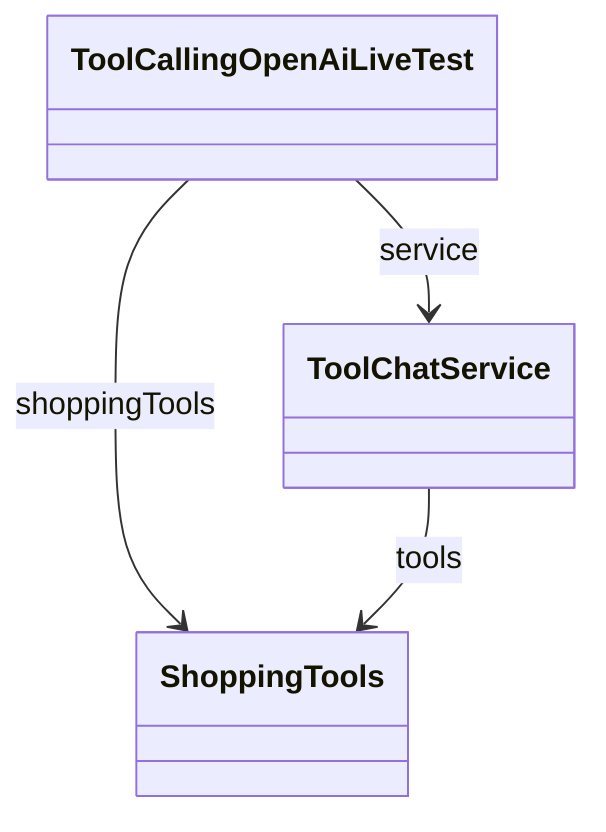

# 05-4. Spy로 실제 도구 호출 순서와 인자 검증하기

[05-3 도구 결과가 모델로 돌아가는 과정](03-loop.md)을 읽은 뒤 보는 **선택 보충**입니다. [ToolCallingOpenAiLiveTest](../../../labs/05-00-tool-calling/src/test/java/com/example/ailearning/l05tools/ToolCallingOpenAiLiveTest.java)의 실제 도구 호출 검증 코드를 설명합니다.

**이번 목표:** 실제 도구 실행과 실행 후 호출 기록 검증을 구분하고, `@MockitoSpyBean`·`InOrder`·`toolCallOrder`의 역할을 이해합니다.

## 1. 답변만 보고 도구 사용을 확인할 수 있을까?

모델이 “허브티의 배송비는 3000원입니다”라고 답해도, 그 문장만으로 Java 배송비 도구를 호출했는지 확정할 수 없습니다. 이 테스트는 답변과 별도로 **어떤 메서드를 어떤 인자로, 어떤 순서로 호출했는지** 검사합니다.

| 이름 | 의미 |
|---|---|
| Spy | 실제 메서드를 실행하면서 호출 기록도 남기는 Mockito 테스트 객체 |
| `@MockitoSpyBean` | Spring 테스트에서 기존 빈을 Spy로 감싸 사용하도록 지정하는 애너테이션 |
| `InOrder` | 이미 실행된 호출을 순서대로 검증하는 Mockito 인터페이스 |
| `toolCallOrder` | 테스트에서 만든 `InOrder` 객체의 변수명. 특별한 예약어나 애너테이션이 아님 |
| `verify()` | 지정한 메서드와 인자로 호출한 기록이 있는지 검사하는 API |

## 2. @MockitoSpyBean으로 관찰 대상 준비하기

현재 테스트의 설정과 필드 선언을 발췌했습니다. import와 테스트 메서드는 생략했습니다. 테스트 이름 출력은 공통 Support를 사용합니다.

```java
@SpringBootTest(webEnvironment = SpringBootTest.WebEnvironment.NONE, properties = {
        "spring.ai.openai.chat.timeout=30s"
})
class ToolCallingOpenAiLiveTest {
    @BeforeEach
    void 테스트_이름_출력(TestInfo testInfo) {
        TestNamePrinter.printTestName(testInfo);
    }

    @Autowired ToolChatService service;

    @MockitoSpyBean ShoppingTools shoppingTools;

    // 테스트 메서드 생략
}
```

`@MockitoSpyBean`은 **테스트를 실행하면 모든 객체를 자동으로 Spy로 만드는 기능이 아닙니다.** 이 선언을 읽은 Spring Test가 대상 빈을 선택해 Spy를 준비합니다.

| 준비 조건 | 현재 코드에서 확인할 곳 |
|---|---|
| Spring 테스트 환경이 있어야 함 | `@SpringBootTest` |
| 관찰할 실제 빈이 등록되어 있어야 함 | [ShoppingTools](../../../labs/05-00-tool-calling/src/main/java/com/example/ailearning/l05tools/ShoppingTools.java)의 `@Component` |
| 관찰 대상을 지정해야 함 | `@MockitoSpyBean ShoppingTools shoppingTools` |
| 후보가 여러 개이면 대상을 하나로 구분해야 함 | 필요시 `@Qualifier` 또는 `@MockitoSpyBean(name = "...")` 사용. 필드명도 후보 선택에 사용됨 |

현재는 `ShoppingTools` 빈이 하나이므로 타입으로 대상을 찾을 수 있습니다. 대상이 없거나 하나로 선택할 수 없으면 테스트 준비에 실패합니다. Spring의 [공식 Spy 빈 설명](https://docs.spring.io/spring-framework/reference/testing/annotations/integration-spring/annotation-mockitobean.html)에서도 기존 빈을 감싸는 방식을 설명합니다.

### 테스트 필드에만 Spy가 들어가는 것은 아닙니다

[ToolChatService](../../../labs/05-00-tool-calling/src/main/java/com/example/ailearning/l05tools/ToolChatService.java)에도 Spy가 적용된 `ShoppingTools` 빈이 연결됩니다. 따라서 실제 서비스가 실행한 도구 호출을 테스트 필드에서 검증할 수 있습니다.



이 그림의 두 참조 경로는 **같은 테스트용 ShoppingTools 빈**을 가리킵니다. 이 테스트는 도구의 반환값을 가짜 값으로 설정하지 않으므로 실제 상품 검색과 배송비 계산이 실행됩니다.

`@Autowired ShoppingTools`만 사용하면 일반 빈을 주입받을 뿐 Mockito 호출 기록은 남지 않습니다. 또한 별도로 `new ShoppingTools(...)`로 만든 객체도 위 애너테이션의 관찰 대상이 되지 않습니다.

Spy는 테스트 메서드마다 반드시 새로 만들어지는 것은 아닙니다. Spring 테스트 환경을 재사용할 수 있으며, 기본 설정은 **각 테스트 메서드가 끝난 뒤 호출 기록과 Mockito 설정을 초기화**합니다. 따라서 다른 테스트의 도구 호출 기록과 섞이지 않도록 합니다.

## 3. 질문을 처리한 뒤 호출 기록 검사하기

다음은 기존 테스트의 핵심 발췌입니다. `service`와 `shoppingTools`는 앞 절처럼 준비되어 있습니다. 테스트 이름은 `@BeforeEach`에서 한 번 출력하므로 테스트 본문이나 출력 보조 메서드에 `TestInfo`를 전달하지 않습니다. import와 메서드 선언은 생략했습니다.

```java
// Given: 검색과 배송비 조회가 필요한 질문 준비
String question = """
        상품 검색 도구로 음료 카테고리에서 상품 가격이 15000원 이하인 상품을 찾아줘.
        상품명, 상품 가격, 배송비, 배송비 포함 총액을 알려줘.
        """;

// When: 모델의 요청에 따라 Spring AI가 실제 Java 도구 실행
String answer = service.ask(question);

// Then: 답변과 @MockitoSpyBean으로 기록한 도구 호출 검증
System.out.printf("답변: %s%n", answer);
assertThat(answer).isNotBlank();

InOrder toolCallOrder = inOrder(shoppingTools);
toolCallOrder
        .verify(shoppingTools)
        .searchProducts("음료", 15000);
toolCallOrder
        .verify(shoppingTools)
        .calculateShipping("P01");
```

`InOrder`의 import는 `org.mockito.InOrder`이고, `inOrder`는 `org.mockito.Mockito.inOrder`의 정적 메서드입니다.

| 코드 | 읽는 방법 |
|---|---|
| `service.ask(question)` | 모델에 질문하고, 모델이 요청한 도구를 Spring AI가 실행하는 단계 |
| `inOrder(shoppingTools)` | ShoppingTools의 호출 기록을 순서대로 검사할 검증 객체 생성 |
| `toolCallOrder.verify(shoppingTools).searchProducts("음료", 15000)` | category가 음료이고 maxPrice가 15000인 검색 호출이 있었는지 확인 |
| 다음 `verify(...).calculateShipping("P01")` | 그 검색 호출 이후 P01의 배송비 조회가 있었는지 확인 |

**`verify()` 뒤의 메서드 표현은 ‘이렇게 호출했는가?’라는 검증 조건입니다.** 검색이나 배송비 계산을 다시 실행하지 않습니다. 해당 호출이 없거나 인자·순서가 기대와 맞지 않으면 테스트가 실패합니다. 이 예시의 `verify()`는 별도 횟수 옵션이 없어 각 검증 단계에서 한 번의 호출을 기대합니다.

또한 `InOrder`가 모델에게 실행 순서를 지시하는 것은 아닙니다. **실제 실행은 `service.ask(...)`에서 끝나고, 그 뒤에 남은 기록을 검사**합니다. 이 코드가 지정한 두 호출 외에 다른 호출이 전혀 없었는지까지 검사하는 것은 아닙니다.

### P01은 어디서 온 값일까?

[ProductCatalog](../../../labs/05-00-tool-calling/src/main/java/com/example/ailearning/l05tools/ProductCatalog.java)의 현재 데이터에서 15000원 이하 음료는 P01 허브티입니다. 따라서 테스트가 `"P01"`을 기대값으로 지정합니다.

이 값은 앞선 `verify().searchProducts(...)`의 반환값에서 얻은 것이 아닙니다. `verify()`는 실제 검색 반환값을 받는 용도로 사용하지 않습니다. 현재 검증은 지정한 상품의 도구 호출 연결을 확인하며, 여러 검색 결과의 모든 상품을 구매 처리했는지 확인하는 테스트는 아닙니다.

## 4. 인사할 때 도구를 사용하지 않았는지 확인하기

같은 Live 클래스의 `실제_OpenAI는_인사에_도구를_호출하지_않고_답한다()`는 다음을 검증합니다. 출력 부분을 생략한 발췌입니다.

```java
String answer = service.ask("안녕하세요! 반갑습니다.");

assertThat(answer).isNotBlank();
verifyNoInteractions(shoppingTools);
```

`verifyNoInteractions`는 `org.mockito.Mockito`의 정적 메서드입니다. 해당 Spy에 기록된 메서드 호출이 하나도 없어야 통과합니다. 이 테스트에서는 최종 답변이 존재하고 상품 도구는 사용하지 않았음을 각각 확인합니다.

## 5. 로컬 테스트와 Live 테스트는 무엇을 다르게 확인할까?

| 테스트 | 확인하는 기록 | 검증하는 내용 |
|---|---|---|
| [ToolCallingLocalModelTest](../../../labs/05-00-tool-calling/src/test/java/com/example/ailearning/l05tools/ToolCallingLocalModelTest.java) | 로컬 고정 응답 서버가 받은 모델 요청 | 도구 실행 후 실제 상품 결과가 tool 메시지로 모델에 재전달됐는지 |
| `ToolCallingOpenAiLiveTest` | Spy에 남은 Java 도구 호출 | 실제 모델이 요청한 도구의 인자와 실행 순서, 또는 도구 미사용 |

로컬 테스트에도 Spy를 사용할 수 있지만 현재 연결은 모델 요청 기록으로 확인하므로 추가하지 않았습니다. Spy로 메서드 실행을 확인하는 것만으로는 그 결과가 모델에게 제대로 재전달됐는지 알 수 없습니다. 반대로 최종 답변이 비어 있지 않다는 검증만으로 도구 호출을 증명할 수도 없습니다.

현재 Live 검증은 모든 답변 문장과 가격의 정확성을 보장하지 않습니다. 모델이 기대한 도구를 선택하지 않으면 실패할 수 있으며, 고정 응답 테스트와 구분해서 결과를 읽습니다.

## 실행과 확인 질문

기존 Live 테스트를 실행하려면 저장소 루트의 `.env` 설정이 필요합니다. **실제 OpenAI API 사용량이 발생합니다.**

```bash
./gradlew :Spring-AI-Agent-Learning:labs:05-00-tool-calling:test --tests com.example.ailearning.l05tools.ToolCallingOpenAiLiveTest
```

빈 줄과 `===== [ 테스트 메서드명 ] ======`이 한 번 출력된 뒤 모델 답변이 출력되고, 조합 테스트는 호출 순서 검증을 통과한 뒤 확인한 도구 호출을 출력합니다. 인사 테스트는 도구 미호출 검증을 통과한 뒤 호출 횟수 0을 출력합니다.

호출 내역 출력은 [공통 ToolCallPrinter](../../../test-support/src/main/java/com/example/ailearning/testsupport/ToolCallPrinter.java)를 사용합니다. 출력과 `verify()` 검증은 같은 Spy에 남은 실행 기록을 읽으며, 도구를 다시 실행하지 않습니다.

```java
ToolCallPrinter.printMockitoDetails(shoppingTools); // 호출 위치·스텁 설정을 포함한 Mockito 상세 내역
ToolCallPrinter.printToolCalls(shoppingTools);      // 실제 호출 횟수와 이름·인자를 실행 순서대로 출력
```

05장 보충 도구 호출 제한 실습도 같은 `printToolCalls(shoppingTools)`를 사용합니다.


1. `@MockitoSpyBean`을 제거하고 `@Autowired`만 쓰면 `verify()`를 사용할 수 있을까요?
2. `toolCallOrder.verify(...).searchProducts(...)`는 검색을 다시 실행할까요?
3. InOrder 검증을 통과하면 답변의 모든 가격까지 정확하다고 볼 수 있을까요?

<details>
<summary>해설</summary>

일반 빈에는 Mockito 호출 기록이 없어 위 검증을 사용할 수 없습니다. `verify()`는 기존 기록을 검사하며 도구를 재실행하지 않습니다. 도구 호출 검증과 답변 내용의 정확성 검증은 별개입니다.

</details>

[이전: 도구 결과가 모델로 돌아가는 과정](03-loop.md) · [다음: 도구 호출 제한](05-tool-call-limits.md) · [05장 목차](../05-tool-calling.md) · [학습 방법](../../learning-guide.md)
