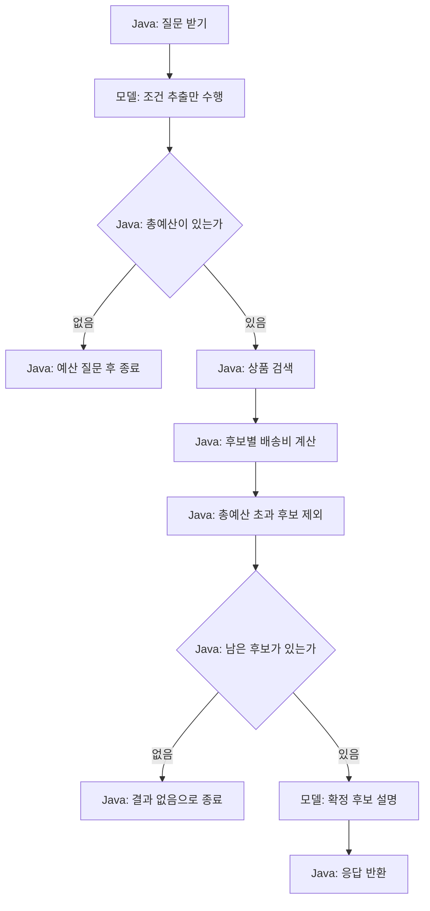
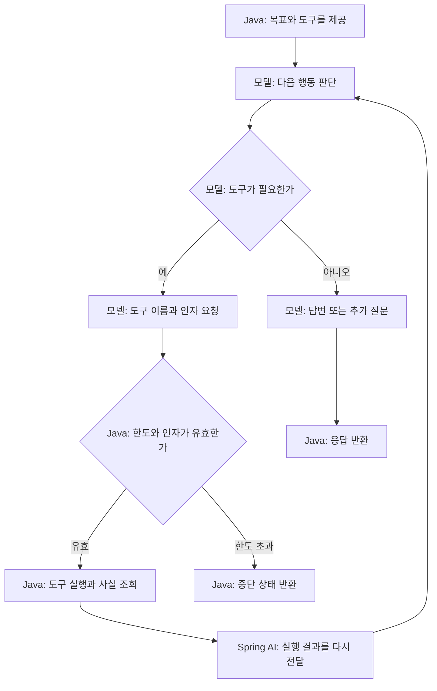
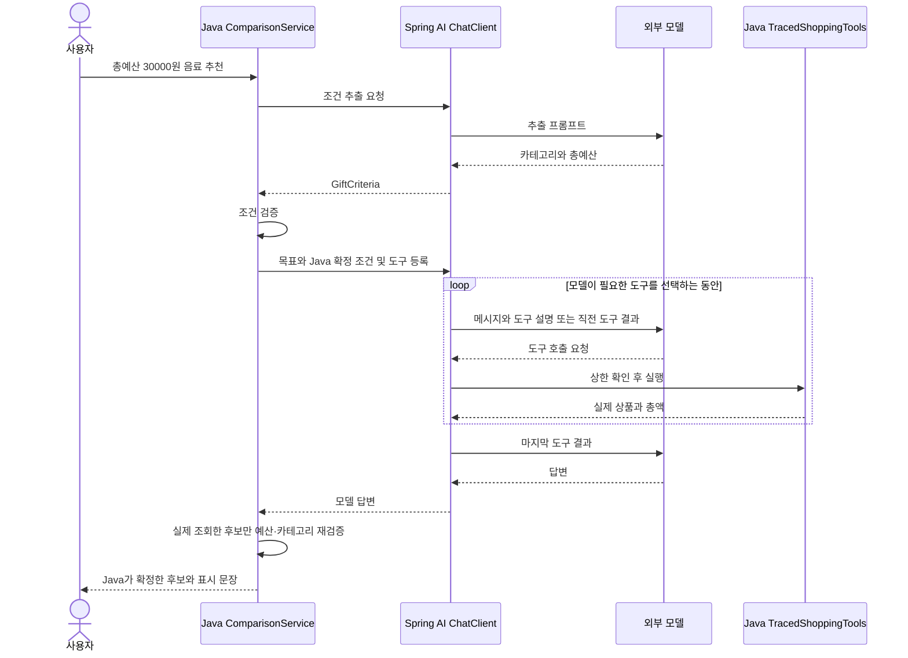

# 06. Workflow와 Agent: 다음 행동을 누가 결정할까?

예상 시간: 3시간. 선수 지식: 04의 조건 추출, 05의 상품 서비스와 도구 호출.
새 라이브러리는 추가하지 않습니다. **같은 요구와 데이터에서 판단 주체만 바꿔 비교**합니다.
05의 Product·Offer·ProductCatalog를 이 단원의 패키지에 복사했습니다. 05 프로젝트를 import하지 않습니다.
[공통 다이어그램 기준](../diagram-guide.md)에 따라 흐름의 판단 주체를 노드에 표시합니다.

## 같은 질문, 세 가지 구현

요청: “배송비 포함 3만원 이하인 음료 선물을 추천해줘.”
가상 상품은 05와 같습니다. 허브티 총 15000원, 커피 총 31000원, 텀블러 총 35000원입니다.
**커피는 상품 가격 28000원이지만 배송비를 더하면 예산을 초과**합니다.
이번 `GiftCriteria.totalBudget`은 04의 상품 가격 상한과 달리 배송비를 포함한 총예산입니다.
배송 정책은 국내 기본 배송으로 고정하며 지역/주소는 입력받지 않습니다.

| 항목 | Workflow | Agent | 혼합(hybrid) |
|---|---|---|---|
| 다음 행동 결정 | Java가 단계와 분기 지정 | 모델이 도구와 다음 행동 선택 | 단계별로 Java·모델의 역할 분리 |
| 모델의 역할 | 조건 추출, 확정 후보 설명 | 조회·재조회·종료 여부 판단 | 조건 추출 후 조회 선택 |
| 최종 후보 필터 | Java가 총액으로 필터 | 모델이 목표를 따르도록 지시 | Java가 조회한 사실을 총액으로 재검증 |
| 프롬프트 | 각 단계의 작업과 출력 형식 | 목표·제약·사용 가능한 도구·종료 기준 | 목표 + Java 확정 조건 |
| 도구 노출 | 추출·설명 요청에는 도구 없음 | 모델 요청에 등록 | 모델 요청에 등록, 검색 조건을 Java에 고정 |

Agent 방식의 모델 답변은 틀릴 수 있습니다. 이 실습은 차이를 관찰하기 위해 자유 판단 경로를 함께 제공합니다.
업무상 예산 준수가 필요하다면 혼합 방식처럼 실행 결과를 코드로 검증합니다.

## Workflow: 코드가 순서를 보장한다



Workflow에도 모델 판단을 넣을 수 있습니다. 여기서는 모델이 조건 값을 추출하지만, 검색·배송비 계산·설명 단계를 실행할 순서는 Java가 정합니다.
프롬프트에 “검색하라”라고 써서 순서를 강제하는 것이 아닙니다.

[ComparisonService.java](../../labs/06-workflow-agent/src/main/java/com/example/ailearning/l06decisions/ComparisonService.java)의 조건 추출과 Workflow 메서드입니다.

```java
private GiftCriteria extract(String question, RunState run) {
        GiftCriteria criteria = client(run).prompt().system(EXTRACT).user(question)
                .call().entity(GiftCriteria.class);
        if (criteria == null) throw new IllegalStateException("조건이 비었습니다.");
        criteria.validate();
        return criteria;
    }

private Draft workflow(String question, RunState run) {
        GiftCriteria criteria = extract(question, run);
        if (criteria.totalBudget() == null) return needsBudget();
        run.startTool("searchProducts", "Java가 순서를 지정");
        List<Product> products = catalog.search(criteria.category(), criteria.totalBudget());
        run.recordToolResult("searchProducts", products);
        List<Offer> offers = products.stream().map(product -> {
            run.startTool("calculateShipping", product.id());
            Offer offer = catalog.quote(product.id());
            run.recordToolResult("calculateShipping", offer);
            return offer;
        }).filter(offer -> offer.total() <= criteria.totalBudget()).toList();
        if (offers.isEmpty()) return new Draft("NO_RESULTS", "예산 안의 후보가 없습니다.", offers);
        String answer = client(run).prompt().system("TASK:SUMMARY\nJava가 검증한 후보만 설명하세요.")
                .user("質問: " + question + "\n확정 후보: " + offers).call().content();
        return new Draft("COMPLETED", answer, offers);
    }
```

`products.stream().map(...)`은 후보 각각에 배송비를 계산하는 Java 반복이고, `filter`는 총액을 비교합니다.
모델은 `.tools()`를 받지 않으므로 여기서 실제 Java 검색을 요청하지 않습니다. Controller가 도구를 대신 실행하는 것도 아닙니다.
서비스 코드가 ProductCatalog를 직접 호출합니다. 기록에서는 비교 편의를 위해 이 업무 기능 실행도 `TOOL`로 표시합니다.

## Agent: 모델이 다음 행동을 선택한다

아래 그림은 가능한 경로입니다. 모든 질문이 같은 순서나 횟수로 도구를 쓰는 것은 아닙니다.



Agent에 전달하는 프롬프트의 핵심은 다음과 같습니다. 실제 문자열은 서비스의 `AGENT_GOAL`에 있습니다.

```text
배송비 포함 예산에 맞는 선물을 추천하세요.
실제 가격은 제공된 도구 결과만 쓰세요.
필요에 따라 상품 검색과 배송비 조회를 선택하고 결과에 따라 다음 행동을 결정하세요.
필수 정보가 부족하면 질문하고, 추천할 수 없으면 이유를 설명하세요.
```

Workflow의 추출 프롬프트는 “카테고리와 총예산을 정해진 형태로 추출”이라는 **현재 단계의 작업**을 지시합니다.
위 프롬프트는 **목표와 행동 기준**을 지시합니다. 단어만 바꾼 것이 아니라 실행 구조도 다릅니다.

```java
private Draft agent(String question, RunState run, GiftCriteria fixed) {
        String answer = client(run).prompt().system(AGENT_GOAL)
                .user(question + (fixed == null ? "" : "\nJava 확정 조건: " + fixed))
                .tools(new TracedShoppingTools(catalog, run, fixed)).call().content();
        // Agent의 자연어가 정확하다는 보장은 없다. offers는 실제 조회한 가격 기록이다.
        return new Draft("COMPLETED", answer, run.quotes());
    }
```

`TracedShoppingTools`가 같은 ProductCatalog를 호출합니다. 한 요청마다 새 도구 객체와 기록을 만들어 다른 요청과 섞이지 않게 합니다.
모델이 도구를 요청하지 않으면 `.tools()`를 등록했어도 조회가 발생하지 않습니다.
`.call().content()` 한 번에서 모델 요청은 여러 번 발생할 수 있습니다.

## 혼합 방식: 선택은 모델, 최종 업무 검증은 Java



반복 구간은 도구가 필요한 경우에만 발생합니다. 모델이 바로 답하면 생략됩니다.
[hybrid 메서드](../../labs/06-workflow-agent/src/main/java/com/example/ailearning/l06decisions/ComparisonService.java)는 아래처럼 구현되어 있습니다.

```java
private Draft hybrid(String question, RunState run) {
        GiftCriteria criteria = extract(question, run);
        if (criteria.totalBudget() == null) return needsBudget();
        agent(question, run, criteria); // 어떤 상품을 조회할지는 모델이 선택한다.
        List<Offer> eligible = run.quotes().stream()
                .filter(offer -> criteria.category() == null || offer.product().category().equals(criteria.category()))
                .filter(offer -> offer.total() <= criteria.totalBudget()).toList();
        // 최종 후보와 표시 문장은 코드로 확정한다. 미조회·예산 초과 상품은 포함하지 않는다.
        return new Draft(eligible.isEmpty() ? "NO_VERIFIED_OFFER" : "COMPLETED",
                eligible.isEmpty() ? "검증된 예산 안의 후보가 없습니다."
                        : "Java 검증 후보: " + eligible.stream().map(offer -> offer.product().id()).toList(), eligible);
    }
```

혼합 방식은 모델의 자유로운 최종 문장을 그대로 사용하지 않고, Java가 통과시킨 상품 ID로 표시 문장도 만듭니다.
아예 도구를 선택하지 않으면 `NO_VERIFIED_OFFER`입니다. 모델이 목표를 이해할 것이라고 가정해 임의 상품을 채우지 않습니다.
모델이 잘못 추출한 양수 예산까지 Java가 사용자의 진짜 의도와 일치하는지 자동 증명하는 것은 아닙니다.

## 실행과 관찰

[01장의 환경 변수](01-setup.md#4-실제-모델을-사용할-때의-환경-변수)를 설정하고 도구 호출 지원 모델을 선택합니다.
모든 명령은 저장소 루트에서 실행합니다.

```bash
./gradlew :Spring-AI-Agent-Learning:labs:06-workflow-agent:test
./gradlew :Spring-AI-Agent-Learning:labs:06-workflow-agent:bootRun
```

```bash
curl -sS http://127.0.0.1:8096/api/compare/workflow \
  -H 'Content-Type: text/plain; charset=UTF-8' \
  --data-raw '배송비 포함 3만원 이하인 음료 선물을 추천해줘.'
```

같은 질문을 `/api/compare/agent`, `/api/compare/hybrid`에도 보냅니다.
실제 모델 호출은 유료일 수 있습니다. 종료는 서버 터미널 Ctrl+C입니다.

| 응답 필드 | 읽는 방법 |
|---|---|
| mode | 실행한 방식 |
| status | COMPLETED, NEEDS_INPUT, NO_RESULTS, NO_VERIFIED_OFFER 또는 중단·실패 상태 |
| answer | Workflow/Agent에서는 모델 문장, hybrid에서는 Java가 만든 확정 문장 |
| offers | Workflow/hybrid는 Java 필터 통과 후보. Agent는 실제 배송비 조회 기록이며 예산 준수 보장은 없음 |
| clientCalls | 최상위 ChatClient 호출 수. 객체 생성 시 한 번씩 기록 |
| modelCalls | 도구 반복을 포함해 실제로 시작한 모델 요청 수 |
| toolCalls | 실제 업무 기능 실행을 시작한 횟수. Workflow의 직접 Java 호출도 포함 |
| steps | MODEL 요청, TOOL 이름·인자, RESULT 결과의 순서 |

정상 고정 테스트에서는 Workflow `clientCalls=2, modelCalls=2`, Agent `clientCalls=1, modelCalls=4`를 확인합니다.
실제 Agent 모델의 횟수는 달라질 수 있습니다. 내부 사고를 요구하는 대신 관찰 가능한 호출과 결과를 비교합니다.

## 프롬프트와 코드의 경계 실험

1. 같은 요청을 세 경로에 보내고 TOOL·RESULT 순서를 적습니다.
2. “선물 추천”처럼 예산을 빼봅니다. Workflow/hybrid는 Java 분기로 NEEDS_INPUT, Agent는 모델이 추가 질문 여부를 선택합니다.
3. “음료 1000원 이하”로 바꿉니다. Workflow는 검색 후 NO_RESULTS로 끝나고 불필요한 설명 호출을 생략합니다.
4. Agent 목표에 “배송비부터 확인”을 추가해 봅니다. 이는 모델에 대한 지시이며 순서 보장은 아닙니다. 반드시 그 순서라면 Java 흐름으로 작성합니다.
5. 테스트의 모델이 커피를 추천하도록 고정한 사례를 읽습니다. hybrid는 총액 31000원을 Java가 제외하고 P01만 반환합니다.

## 실행 상한은 코드로 강제한다

`application.yml`은 기본값으로 모델 요청 8회, 도구 실행 4회, 전체 요청 대기 10000ms를 지정합니다.
프롬프트에 “4번만 실행”이라고 적는 방식이 아닙니다.

- [support/RunState](../../labs/06-workflow-agent/src/main/java/com/example/ailearning/l06decisions/support/RunState.java)는 다음 요청/도구 실행 전 횟수·마감 시간을 확인합니다.
- [support/CountedChatModel](../../labs/06-workflow-agent/src/main/java/com/example/ailearning/l06decisions/support/CountedChatModel.java)은 실제 모델 호출을 위임하면서 기록합니다. 별도 Advisor를 구현하지 않습니다.
- 서비스의 `run()`은 별도 작업을 정해진 시간만 기다리고, 초과 시 취소해 TIMEOUT을 반환합니다. 늦은 응답 뒤에는 새 도구/모델 호출을 시작하지 못하게 합니다.
- 취소가 외부 모델 서버의 계산·과금 중단까지 보장하지는 않습니다. 요청별 SDK 타임아웃도 5초로 설정했습니다. 이 단원의 도구는 빠른 로컬 읽기 전용 기능입니다.

이 보조 코드는 비교 결과를 재현하기 위한 장치입니다. 먼저 `extract → workflow → agent → hybrid`를 읽고 필요할 때 support를 읽으세요.
Thread/Future의 상세 학습을 Spring AI 입문의 선수 지식으로 요구하지 않습니다.

[WorkflowAgentContractTest](../../labs/06-workflow-agent/src/test/java/com/example/ailearning/l06decisions/WorkflowAgentContractTest.java)에서 반복 도구 선택·모델 요청 상한·느린 응답을 고정 서버로 재현합니다.
상한을 넘기면 HTTP 통신 자체는 200이고 본문의 status가 TOOL_LIMIT/MODEL_LIMIT/TIMEOUT입니다. COMPLETED와 구분하세요.
빈 질문은 Controller에서 400입니다. 이 실습에는 이전 대화 기억이 없으며 요청마다 기록과 한도가 초기화됩니다.

## 확인 질문

1. Workflow가 조건 추출에 모델을 썼다면 전체가 자율 Agent일까요?
2. Agent 프롬프트에 순서를 적으면 코드가 그 순서를 강제한 것과 같을까요?
3. 최상위 호출 1회인데 modelCalls가 4인 이유는 무엇인가요?
4. 예산 준수·가격 계산·도구 실행 상한을 코드로 확인해야 하는 이유는 무엇인가요?

<details><summary>해설</summary>

다음 행동을 Java의 미리 정한 경로가 선택하면 Workflow입니다. 프롬프트는 행동 지시이고 코드의 순서 보장과 다릅니다.
도구 결과를 받은 모델이 다시 판단하므로 여러 모델 요청이 발생합니다. 정확한 계산·실행 제한은 모델 문장의 준수 여부와 별도로 강제해야 합니다.
호출 기록에서 각 판단 주체를 찾고 같은 요구에 맞는 방식을 선택하면 완료입니다.
</details>

보충: [공식 Agent 패턴](https://docs.spring.io/spring-ai/reference/api/effective-agents.html), [Tool Calling](https://docs.spring.io/spring-ai/reference/api/tools.html).
[이전: 05](05-tool-calling.md) · [학습 지도](../curriculum.md)
