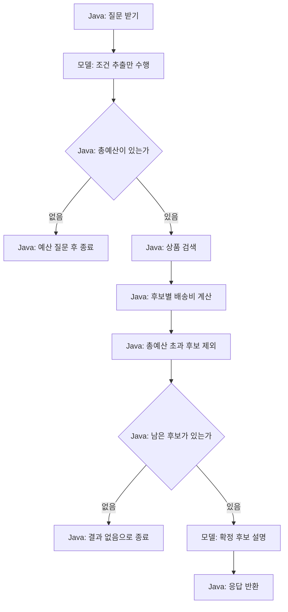

# 06-1. Java가 순서를 정하는 Workflow

**실행 코드·설정·테스트:** [labs/06-workflow-agent](../../../labs/06-workflow-agent/README.md). 저장소 루트에서 해당 README의 명령으로 실행합니다.

30~45분을 기준으로 한 번에 한 가지 흐름만 읽습니다. 단원 전체 시간은 목차의 기존 예상 시간에 포함됩니다.

**이번 목표:** 조건 추출 뒤의 검색·배송비 순서가 Java 코드임을 찾습니다.

**코드 읽기 안내:** RunState는 제공된 실행 기록 보조 코드입니다. 이번에는 catalog 호출과 filter만 따라가세요.

## 같은 질문, 세 가지 구현

요청: “배송비 포함 3만원 이하인 음료 선물을 추천해줘.”
가상 상품은 05와 같습니다. 허브티 총 15000원, 커피 총 31000원, 텀블러 총 35000원입니다.
**커피는 상품 가격 28000원이지만 배송비를 더하면 예산을 초과**합니다.
이번 `GiftCriteria.totalBudget`은 04의 상품 가격 상한과 달리 배송비를 포함한 총예산입니다.
배송 정책은 국내 기본 배송으로 고정하며 지역/주소는 입력받지 않습니다.

| 항목 | Workflow | Agent | 혼합(hybrid) |
|---|---|---|---|
| 다음 행동 결정 | Java가 단계와 분기 지정 | 모델이 도구와 다음 행동 선택 | 단계별로 Java·모델의 역할 분리 |
| 모델의 역할 | 조건 추출, 확정 후보 설명 | 조회·재조회·종료 여부 판단 | 조건 추출 후 조회 선택 |
| 최종 후보 필터 | Java가 총액으로 필터 | 모델이 목표를 따르도록 지시 | Java가 조회한 사실을 총액으로 재검증 |
| 프롬프트 | 각 단계의 작업과 출력 형식 | 목표·제약·사용 가능한 도구·종료 기준 | 목표 + Java 확정 조건 |
| 도구 노출 | 추출·설명 요청에는 도구 없음 | 모델 요청에 등록 | 모델 요청에 등록, 검색 조건을 Java에 고정 |

Agent 방식의 모델 답변은 틀릴 수 있습니다. 이 실습은 차이를 관찰하기 위해 자유 판단 경로를 함께 제공합니다.
업무상 예산 준수가 필요하다면 혼합 방식처럼 실행 결과를 코드로 검증합니다.

## Workflow: 코드가 순서를 보장한다



Workflow에도 모델 판단을 넣을 수 있습니다. 여기서는 모델이 조건 값을 추출하지만, 검색·배송비 계산·설명 단계를 실행할 순서는 Java가 정합니다.
프롬프트에 “검색하라”라고 써서 순서를 강제하는 것이 아닙니다.

[ComparisonService.java](../../../labs/06-workflow-agent/src/main/java/com/example/ailearning/l06decisions/ComparisonService.java)의 조건 추출과 Workflow 메서드입니다.

```java
private GiftCriteria extract(String question, RunState run) {
        GiftCriteria criteria = client(run).prompt().system(EXTRACT).user(question)
                .call().entity(GiftCriteria.class);
        if (criteria == null) throw new IllegalStateException("조건이 비었습니다.");
        criteria.validate();
        return criteria;
    }

private Draft workflow(String question, RunState run) {
        GiftCriteria criteria = extract(question, run);
        if (criteria.totalBudget() == null) return needsBudget();
        run.startTool("searchProducts", "Java가 순서를 지정");
        List<Product> products = catalog.search(criteria.category(), criteria.totalBudget());
        run.recordToolResult("searchProducts", products);
        List<Offer> offers = products.stream().map(product -> {
            run.startTool("calculateShipping", product.id());
            Offer offer = catalog.quote(product.id());
            run.recordToolResult("calculateShipping", offer);
            return offer;
        }).filter(offer -> offer.total() <= criteria.totalBudget()).toList();
        if (offers.isEmpty()) return new Draft("NO_RESULTS", "예산 안의 후보가 없습니다.", offers);
        String answer = client(run).prompt().system("TASK:SUMMARY\nJava가 검증한 후보만 설명하세요.")
                .user("質問: " + question + "\n확정 후보: " + offers).call().content();
        return new Draft("COMPLETED", answer, offers);
    }
```

`products.stream().map(...)`은 후보 각각에 배송비를 계산하는 Java 반복이고, `filter`는 총액을 비교합니다.
모델은 `.tools()`를 받지 않으므로 여기서 실제 Java 검색을 요청하지 않습니다. Controller가 도구를 대신 실행하는 것도 아닙니다.
서비스 코드가 ProductCatalog를 직접 호출합니다. 기록에서는 비교 편의를 위해 이 업무 기능 실행도 `TOOL`로 표시합니다.


## 여기서 멈춰 확인하기

코드를 닫고 “이번 입력 → 새로 하는 처리 → 확인할 결과”를 한 문장으로 적어 보세요.
설명하기 어렵다면 위 핵심 메서드만 다시 읽습니다. 테스트용 HTTP 서버 구현을 이해해야 다음으로 갈 수 있는 것은 아닙니다.

[이전](../06-workflow-agent.md) · [다음](02-agent.md) · [단원 목차](../06-workflow-agent.md) · [학습 방법](../../learning-guide.md)
