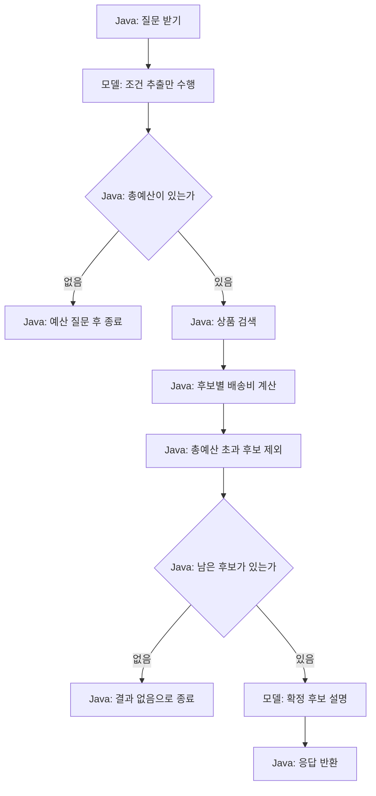

# 06-1. Java가 순서를 정하는 Workflow

**실행 코드·설정·테스트:** [labs/06-00-workflow-agent](../../../labs/06-00-workflow-agent/README.md). 저장소 루트에서 해당 README의 명령으로 실행합니다.

**이번 목표:** 모델로 요청 조건을 추출하고, 상품 검색·배송비 계산·예산 검증·답변 생성을 정해진 순서로 연결하는 Workflow를 구현합니다.

**코드 읽기 안내:** 조건 추출 → 상품 검색 → 배송비 계산 → 예산 검증 → 답변 생성 순서로 읽습니다.

## Java가 처리할 질문과 가격 조건

요청: “배송비 포함 3만원 이하인 음료 선물을 추천해줘.”
가상 상품은 05와 같습니다. 허브티 총 15000원, 커피 총 31000원, 텀블러 총 35000원입니다.
**커피는 상품 가격 28000원이지만 배송비를 더하면 예산을 초과**합니다.
이번 `ProductSelectionCriteria.totalBudget`은 04의 상품 가격 상한과 달리 배송비를 포함한 총예산입니다.
배송 정책은 국내 기본 배송으로 고정하며 지역/주소는 입력받지 않습니다.

## Workflow: 코드가 순서를 보장한다



Workflow에도 모델 판단을 넣을 수 있습니다. 여기서는 모델이 조건 값을 추출하지만, 검색·배송비 계산·설명 단계를 실행할 순서는 Java가 정합니다.
프롬프트에 “검색하라”라고 써서 순서를 강제하는 것이 아닙니다.

[ComparisonService.java](../../../labs/06-00-workflow-agent/src/main/java/com/example/ailearning/l06decisions/ComparisonService.java)의 조건 추출과 Workflow 메서드입니다.

```java
    private ProductSelectionCriteria extractProductSelectionCriteria(String question) {
        ProductSelectionCriteria criteria = chatClient
                .prompt()
                .system(PRODUCT_CRITERIA_EXTRACTION_INSTRUCTION)
                .user(question)
                .call()
                .entity(ProductSelectionCriteria.class);
        if (criteria == null) throw new IllegalStateException("조건이 비었습니다.");
        criteria.validate();
        return criteria;
    }

    private ExecutionResult runWorkflow(String question) {
        ProductSelectionCriteria criteria = extractProductSelectionCriteria(question);
        if (criteria.totalBudget() == null) return createBudgetQuestion();
        List<Product> products = productCatalog.search(criteria.category(), criteria.totalBudget());
        List<ProductPriceDetails> offers = products
                .stream()
                .map(product -> productCatalog.calculatePriceDetails(product.id()))
                .filter(productPriceDetails -> productPriceDetails.total() <= criteria.totalBudget())
                .toList();
        if (offers.isEmpty()) return new ExecutionResult("NO_RESULTS", "예산 안의 후보가 없습니다.", offers);
        String answer = chatClient
                .prompt()
                .system("TASK:SUMMARY\nJava가 검증한 후보만 설명하세요.")
                .user("질문: " + question + "\n확정 후보: " + offers)
                .call()
                .content();
        return new ExecutionResult("COMPLETED", answer, offers);
    }
```

`products.stream().map(...)`은 후보 각각에 배송비를 계산하는 Java 반복이고, `filter`는 총액을 비교합니다.
모델은 `.tools()`를 받지 않으므로 여기서 실제 Java 검색을 요청하지 않습니다. Controller가 도구를 대신 실행하는 것도 아닙니다.
서비스 코드가 `ProductCatalog`를 직접 호출합니다. 모델이 도구를 선택하는 다음 수업과 다른 점입니다.


## 확인 질문

모델에는 조건 추출과 답변 생성을 맡기고, 검색·배송비 계산·예산 검증은 정해진 순서로 연결하려면 Workflow를 어떻게 구성해야 하나요?

<details>
<summary>해설</summary>

모델로 카테고리·예산을 추출한 뒤 Java가 상품 검색 → 각 상품의 배송비 포함 총액 계산 → 예산 초과 후보 제외를 실행합니다. 남은 후보가 있을 때 모델에 설명을 요청합니다.

</details>

[이전](../06-workflow-agent.md) · [다음](02-agent.md) · [단원 목차](../06-workflow-agent.md) · [학습 방법](../../learning-guide.md)
