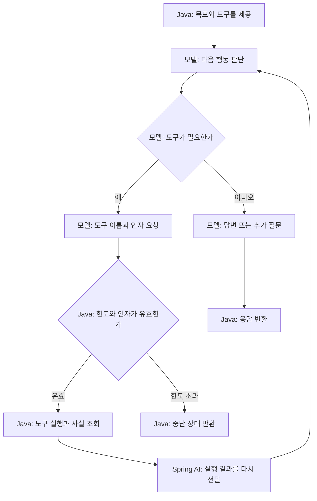

# 06-2. 모델이 다음 도구를 고르는 Agent

**실행 코드·설정·테스트:** [labs/06-workflow-agent](../../../labs/06-workflow-agent/README.md). 저장소 루트에서 해당 README의 명령으로 실행합니다.

**이번 목표:** 단계 지시 프롬프트와 목표·행동 기준 프롬프트를 비교합니다.

**코드 읽기 안내:** agent()의 .tools(...)가 핵심입니다. 다음 메서드를 코드가 직접 호출하는지 모델의 요청을 기다리는지 구분합니다.

## Agent: 모델이 다음 행동을 선택한다

아래 그림은 가능한 경로입니다. 모든 질문이 같은 순서나 횟수로 도구를 쓰는 것은 아닙니다.



Agent에 전달하는 프롬프트의 핵심은 다음과 같습니다. 실제 문자열은 서비스의 `AGENT_GOAL`에 있습니다.

```text
배송비 포함 예산에 맞는 선물을 추천하세요.
실제 가격은 제공된 도구 결과만 쓰세요.
필요에 따라 상품 검색과 배송비 조회를 선택하고 결과에 따라 다음 행동을 결정하세요.
필수 정보가 부족하면 질문하고, 추천할 수 없으면 이유를 설명하세요.
```

Workflow의 추출 프롬프트는 “카테고리와 총예산을 정해진 형태로 추출”이라는 **현재 단계의 작업**을 지시합니다.
위 프롬프트는 **목표와 행동 기준**을 지시합니다. 단어만 바꾼 것이 아니라 실행 구조도 다릅니다.

```java
private Draft agent(String question, RunState run, GiftCriteria fixed) {
        String answer = client(run)
                .prompt()
                .system(AGENT_GOAL)
                .user(question + (fixed == null ? "" : "\nJava 확정 조건: " + fixed))
                .tools(new TracedShoppingTools(catalog, run, fixed))
                .call()
                .content();
        // Agent의 자연어가 정확하다는 보장은 없다. offers는 실제 조회한 가격 기록이다.
        return new Draft("COMPLETED", answer, run.quotes());
    }
```

`TracedShoppingTools`가 같은 ProductCatalog를 호출합니다. 한 요청마다 새 도구 객체와 기록을 만들어 다른 요청과 섞이지 않게 합니다.
모델이 도구를 요청하지 않으면 `.tools()`를 등록했어도 조회가 발생하지 않습니다.
`.call().content()` 한 번에서 모델 요청은 여러 번 발생할 수 있습니다.


## 여기서 멈춰 확인하기

`.tools()`를 등록했는데도 도구 호출이 없을 수 있는 이유를 흐름 그림으로 설명해 보세요.

[이전](01-workflow.md) · [다음](03-hybrid.md) · [단원 목차](../06-workflow-agent.md) · [학습 방법](../../learning-guide.md)
