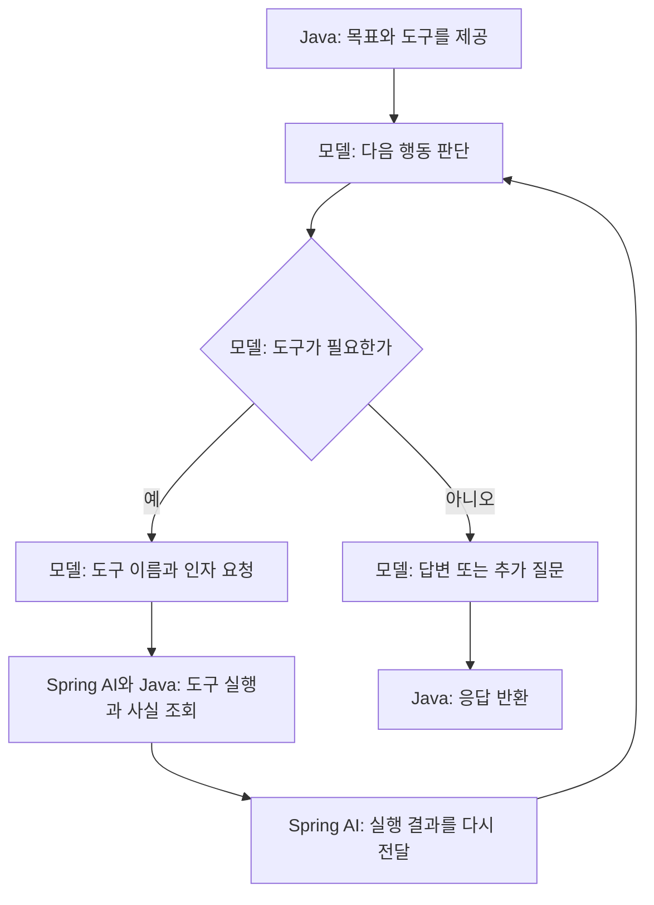

# 06-2. 모델이 다음 도구를 고르는 Agent

**실행 코드·설정·테스트:** [labs/06-00-workflow-agent](../../../labs/06-00-workflow-agent/README.md). 저장소 루트에서 해당 README의 명령으로 실행합니다.

**이번 목표:** 모델에 목표와 도구를 제공하고, 모델이 필요한 도구와 인자를 선택해 요청을 처리하는 Agent를 구현합니다.

**코드 읽기 안내:** runAgent()의 .tools(...)가 핵심입니다. 다음 메서드를 코드가 직접 호출하는지 모델의 요청을 기다리는지 구분합니다.

## Agent: 모델이 다음 행동을 선택한다

아래 그림은 가능한 경로입니다. 모든 질문이 같은 순서나 횟수로 도구를 쓰는 것은 아닙니다.



Agent에 전달하는 프롬프트의 핵심은 다음과 같습니다. 실제 문자열은 서비스의 `SHOPPING_AGENT_INSTRUCTION`에 있습니다.

```text
배송비 포함 예산에 맞는 선물을 추천하세요.
실제 가격은 제공된 도구 결과만 쓰세요.
필요에 따라 상품 검색과 배송비 조회를 선택하고 결과에 따라 다음 행동을 결정하세요.
필수 정보가 부족하면 질문하고, 추천할 수 없으면 이유를 설명하세요.
```

Workflow의 추출 프롬프트는 “카테고리와 총예산을 정해진 형태로 추출”이라는 **현재 단계의 작업**을 지시합니다.
위 프롬프트는 **목표와 행동 기준**을 지시합니다. 단어만 바꾼 것이 아니라 실행 구조도 다릅니다.

다음은 [ShoppingService.java](../../../labs/06-00-workflow-agent/src/main/java/com/example/ailearning/l06decisions/ShoppingService.java)의 Agent 실행 메서드입니다.

```java
    private ExecutionResult runAgent(String question) {
        String answer = chatClient
                .prompt()
                .system(SHOPPING_AGENT_INSTRUCTION)
                .user(question)
                .tools(new ProductTools(productCatalog))
                .call()
                .content();
        return new ExecutionResult("COMPLETED", answer);
    }
```

`ProductTools`는 상품 검색과 배송비 조회를 모델에 공개합니다. 두 메서드는 조회한 값을 반환하며, 호출 결과를 필드에 쌓지 않습니다.

[ProductTools.java](../../../labs/06-00-workflow-agent/src/main/java/com/example/ailearning/l06decisions/ProductTools.java)의 전체 코드입니다.

```java
package com.example.ailearning.l06decisions;

import com.example.ailearning.l06decisions.domain.Product;
import com.example.ailearning.l06decisions.domain.ProductCatalog;
import com.example.ailearning.l06decisions.domain.ProductPriceDetail;
import org.springframework.ai.tool.annotation.Tool;
import org.springframework.ai.tool.annotation.ToolParam;
import java.util.List;

/** 상품 검색과 배송비 조회를 모델에 제공하는 상태 없는 도구입니다. */
public class ProductTools {
    private final ProductCatalog productCatalog;

    public ProductTools(ProductCatalog productCatalog) {
        this.productCatalog = productCatalog;
    }

    @Tool(description = "카테고리와 상품 가격 상한으로 상품을 검색합니다. 가격에 배송비는 포함되지 않습니다.")
    public List<Product> searchProducts(@ToolParam(required = false) String category,
            @ToolParam(required = false) Integer maxPrice) {
        return productCatalog.search(category, maxPrice);
    }

    @Tool(description = "상품 한 개의 정보와 배송비, 배송비 포함 총액을 반환합니다.")
    public ProductPriceDetail calculateShipping(String productId) {
        return productCatalog.calculatePriceDetails(productId);
    }
}
```

`@ToolParam(required = false)`는 모델이 해당 인자를 생략해도 된다는 뜻입니다. 카테고리나 가격 상한을 지정하지 않은 검색도 가능합니다.
`searchProducts`의 가격 상한은 **상품 가격** 기준입니다. 배송비 포함 예산을 판단하려면 `calculateShipping`이 반환한 `total`을 확인해야 합니다.

예를 들어 “친구에게 줄 음료 선물을 찾고 있어요. 배송비까지 3만 원 안에서 추천해 주세요.”에는 검색 후 배송비를 확인할 수 있습니다.
“어떤 음료 상품들이 있나요? 이름만 알려 주세요.”에는 검색만으로 답할 수 있습니다. “안녕하세요!”에는 도구가 필요하지 않습니다.
고객은 원하는 내용을 말하고, 모델이 등록된 도구의 설명을 보고 필요한 조회를 고릅니다.

모델이 도구를 요청하지 않으면 `.tools()`를 등록했어도 조회가 발생하지 않습니다.
`.call().content()` 한 번에서 모델 요청은 여러 번 발생할 수 있습니다.


## 확인 질문

`.tools()`를 등록했는데도 도구 호출이 없을 수 있는 이유를 흐름 그림으로 설명해 보세요.

<details>
<summary>해설</summary>

`.tools()`는 사용할 수 있는 도구를 등록합니다. 도구를 실제로 요청할지는 모델이 판단하므로, 인사처럼 도구가 필요 없는 질문에는 바로 답할 수 있습니다.

</details>

[이전](01-workflow.md) · [다음](03-hybrid.md) · [단원 목차](../06-workflow-agent.md) · [학습 방법](../../learning-guide.md)
