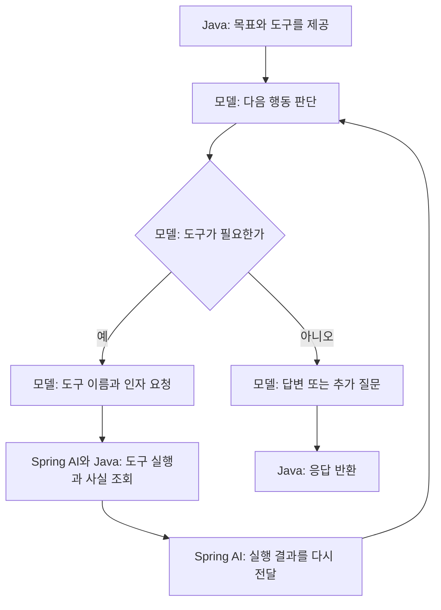

# 06-2. 모델이 다음 도구를 고르는 Agent

**실행 코드·설정·테스트:** [labs/06-00-workflow-agent](../../../labs/06-00-workflow-agent/README.md). 저장소 루트에서 해당 README의 명령으로 실행합니다.

**이번 목표:** 모델에 목표와 도구를 제공하고, 모델이 필요한 도구와 인자를 선택해 요청을 처리하는 Agent를 구현합니다.

**코드 읽기 안내:** agent()의 .tools(...)가 핵심입니다. 다음 메서드를 코드가 직접 호출하는지 모델의 요청을 기다리는지 구분합니다.

## Agent: 모델이 다음 행동을 선택한다

아래 그림은 가능한 경로입니다. 모든 질문이 같은 순서나 횟수로 도구를 쓰는 것은 아닙니다.



Agent에 전달하는 프롬프트의 핵심은 다음과 같습니다. 실제 문자열은 서비스의 `AGENT_GOAL`에 있습니다.

```text
배송비 포함 예산에 맞는 선물을 추천하세요.
실제 가격은 제공된 도구 결과만 쓰세요.
필요에 따라 상품 검색과 배송비 조회를 선택하고 결과에 따라 다음 행동을 결정하세요.
필수 정보가 부족하면 질문하고, 추천할 수 없으면 이유를 설명하세요.
```

Workflow의 추출 프롬프트는 “카테고리와 총예산을 정해진 형태로 추출”이라는 **현재 단계의 작업**을 지시합니다.
위 프롬프트는 **목표와 행동 기준**을 지시합니다. 단어만 바꾼 것이 아니라 실행 구조도 다릅니다.

```java
    private ExecutionResult agent(String question) {
        ShoppingTools shoppingTools = new ShoppingTools(productCatalog);
        String answer = chatClient
                .prompt()
                .system(AGENT_GOAL)
                .user(question)
                .tools(shoppingTools)
                .call()
                .content();
        // 실제 조회한 금액이다. 모델의 추천 문장이나 예산 준수를 검증한 결과는 아니다.
        return new ExecutionResult("COMPLETED", answer, shoppingTools.getPriceDetails());
    }
```

`ShoppingTools`가 같은 `ProductCatalog`를 호출합니다. 도구 객체는 요청마다 새로 만들고, 조회한 금액을 `priceDetails`에 보관합니다. 이 목록은 모델이 실제로 조회한 값이며, 예산 검증을 통과한 최종 추천 목록은 아닙니다.

[ShoppingTools.java](../../../labs/06-00-workflow-agent/src/main/java/com/example/ailearning/l06decisions/ShoppingTools.java)의 전체 코드입니다.

```java
package com.example.ailearning.l06decisions;

import com.example.ailearning.l06decisions.domain.Product;
import com.example.ailearning.l06decisions.domain.ProductCatalog;
import com.example.ailearning.l06decisions.domain.ProductPriceDetails;

import org.springframework.ai.tool.annotation.Tool;
import org.springframework.ai.tool.annotation.ToolParam;
import java.util.ArrayList;
import java.util.List;

/** 요청마다 새로 만든다. 조회한 금액이 다른 요청에 섞이지 않게 한다. */
public class ShoppingTools {
    private final ProductCatalog productCatalog;
    private final List<ProductPriceDetails> priceDetails = new ArrayList<>();

    public ShoppingTools(ProductCatalog productCatalog) {
        this.productCatalog = productCatalog;
    }

    @Tool(description = "상품 검색. category는 음료/생활, maxPrice는 상품 가격 상한. 배송비는 별도로 조회하세요.")
    public List<Product> searchProducts(@ToolParam(required = false) String category,
            @ToolParam(required = false) Integer maxPrice) {
        return productCatalog.search(category, maxPrice);
    }

    @Tool(description = "검색한 상품 ID의 배송비와 배송비 포함 총액을 조회합니다.")
    public ProductPriceDetails calculateShipping(String productId) {
        ProductPriceDetails productPriceDetails = productCatalog.calculatePriceDetails(productId);
        priceDetails.add(productPriceDetails);
        return productPriceDetails;
    }

    /** 이번 요청에서 실제 조회한 금액을 반환한다. 최종 후보 검증에 사용한다. */
    public List<ProductPriceDetails> getPriceDetails() {
        return List.copyOf(priceDetails);
    }
}
```
모델이 도구를 요청하지 않으면 `.tools()`를 등록했어도 조회가 발생하지 않습니다.
`.call().content()` 한 번에서 모델 요청은 여러 번 발생할 수 있습니다.


## 여기서 멈춰 확인하기

`.tools()`를 등록했는데도 도구 호출이 없을 수 있는 이유를 흐름 그림으로 설명해 보세요.

[이전](01-workflow.md) · [다음](03-hybrid.md) · [단원 목차](../06-workflow-agent.md) · [학습 방법](../../learning-guide.md)
