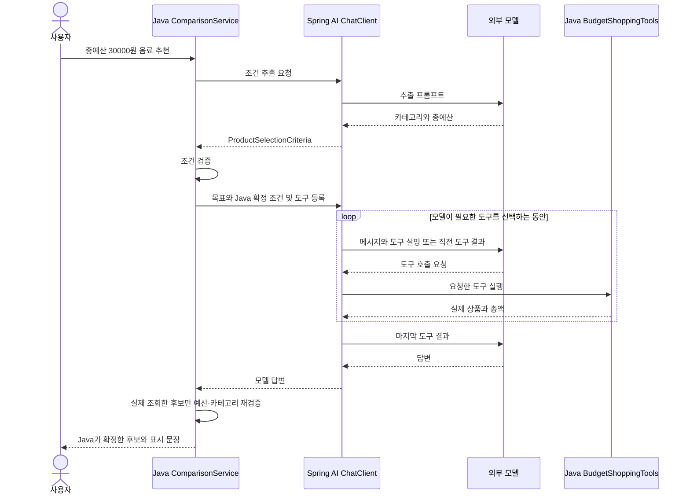

# 06-3. 모델의 선택을 Java로 검증하기

**실행 코드·설정·테스트:** [labs/06-00-workflow-agent](../../../labs/06-00-workflow-agent/README.md). 저장소 루트에서 해당 README의 명령으로 실행합니다.

**이번 목표:** 모델이 상품 조회 도구를 선택하되, 배송비 포함 금액과 카테고리를 코드로 검증해 최종 추천 후보를 확정하는 혼합 방식을 구현합니다.

**코드 읽기 안내:** 도구 선택이 유연해져도 예산 검사를 모델에게만 맡길 필요는 없습니다. 이 수업에서 세 경로를 비교 실행합니다.

## 혼합 방식: 선택은 모델, 최종 업무 검증은 Java



반복 구간은 도구가 필요한 경우에만 발생합니다. 모델이 바로 답하면 생략됩니다.
[hybrid 메서드](../../../labs/06-00-workflow-agent/src/main/java/com/example/ailearning/l06decisions/ComparisonService.java)는 아래처럼 구현되어 있습니다.

```java
    private ExecutionResult runHybrid(String question) {
        ProductSelectionCriteria criteria = extractProductSelectionCriteria(question);
        if (criteria.totalBudget() == null) return createBudgetQuestion();
        BudgetShoppingTools shoppingTools = new BudgetShoppingTools(productCatalog, criteria);
        chatClient
                .prompt()
                .system(SHOPPING_AGENT_INSTRUCTION)
                .user(question + "\n코드로 확정한 조건: " + criteria)
                .tools(shoppingTools)
                .call()
                .content();
        List<ProductPriceDetails> verifiedOffers = shoppingTools
                .getPriceDetails()
                .stream()
                .filter(offer -> criteria.category() == null || offer.product().category().equals(criteria.category()))
                .filter(offer -> offer.total() <= criteria.totalBudget())
                .toList();
        if (verifiedOffers.isEmpty()) {
            return new ExecutionResult("NO_VERIFIED_OFFER", "검증된 예산 안의 후보가 없습니다.", verifiedOffers);
        }

        // 최종 후보와 표시 문장은 코드로 확정한다. 미조회·예산 초과 상품은 포함하지 않는다.
        List<String> productIds = verifiedOffers
                .stream()
                .map(offer -> offer.product().id())
                .toList();
        String answer = "Java 검증 후보: " + productIds;
        return new ExecutionResult("COMPLETED", answer, verifiedOffers);
    }
```


`BudgetShoppingTools`는 이번 혼합 방식에서 추가하는 도구입니다. 검색 인자는 앞에서 추출·검증한 조건으로 고정하고, 배송비 조회와 조회 금액 보관은 `ShoppingTools`에 맡깁니다. 어떤 도구를 요청할지는 여전히 모델이 선택합니다.

```java
package com.example.ailearning.l06decisions;

import com.example.ailearning.l06decisions.domain.Product;
import com.example.ailearning.l06decisions.domain.ProductCatalog;
import com.example.ailearning.l06decisions.domain.ProductPriceDetails;
import com.example.ailearning.l06decisions.domain.ProductSelectionCriteria;

import org.springframework.ai.tool.annotation.Tool;
import org.springframework.ai.tool.annotation.ToolParam;
import java.util.List;

/** 06-3에서 추가하는 도구. 검색 조건은 코드로 고정하고 조회 선택은 모델에 맡긴다. */
public class BudgetShoppingTools {
    private final ShoppingTools shoppingTools;
    private final ProductSelectionCriteria criteria;

    public BudgetShoppingTools(ProductCatalog productCatalog, ProductSelectionCriteria criteria) {
        this.shoppingTools = new ShoppingTools(productCatalog);
        this.criteria = criteria;
    }

    @Tool(description = "확정된 카테고리와 총예산 안에서 상품을 검색합니다. 배송비는 별도로 조회하세요.")
    public List<Product> searchProducts(@ToolParam(required = false) String category,
            @ToolParam(required = false) Integer maxPrice) {
        return shoppingTools.searchProducts(criteria.category(), criteria.totalBudget());
    }

    @Tool(description = "검색한 상품 ID의 배송비와 배송비 포함 총액을 조회합니다.")
    public ProductPriceDetails calculateShipping(String productId) {
        return shoppingTools.calculateShipping(productId);
    }

    public List<ProductPriceDetails> getPriceDetails() {
        return shoppingTools.getPriceDetails();
    }
}
```

혼합 방식은 모델의 자유로운 최종 문장을 그대로 사용하지 않고, Java가 통과시킨 상품 ID로 표시 문장도 만듭니다.
아예 도구를 선택하지 않으면 `NO_VERIFIED_OFFER`입니다. 모델이 목표를 이해할 것이라고 가정해 임의 상품을 채우지 않습니다.
모델이 잘못 추출한 양수 예산까지 Java가 사용자의 진짜 의도와 일치하는지 자동 증명하는 것은 아닙니다.

## 실행과 관찰

[01장의 루트 .env 설정](../01-setup.md#4-실제-모델-연결을-위한-설정-준비)를 설정하고 도구 호출 지원 모델을 선택합니다.
모든 명령은 저장소 루트에서 실행합니다.

```bash
./gradlew :Spring-AI-Agent-Learning:labs:06-00-workflow-agent:test --tests com.example.ailearning.l06decisions.WorkflowAgentLocalModelTest
./gradlew :Spring-AI-Agent-Learning:labs:06-00-workflow-agent:bootRun
```

```bash
curl -sS http://127.0.0.1:8096/api/compare/WORKFLOW \
  -H 'Content-Type: text/plain; charset=UTF-8' \
  --data-raw '배송비 포함 3만원 이하인 음료 선물을 추천해줘.'
```

같은 질문을 `/api/compare/AGENT`, `/api/compare/HYBRID`에도 보냅니다.
실제 모델 호출은 유료일 수 있습니다. 종료는 서버 터미널 Ctrl+C입니다.

| 응답 필드 | 읽는 방법 |
|---|---|
| mode | 실행한 방식 |
| status | COMPLETED, NEEDS_INPUT, NO_RESULTS, NO_VERIFIED_OFFER, FAILED |
| answer | Workflow/Agent에서는 모델 문장, hybrid에서는 Java가 만든 확정 문장 |
| offers | Workflow/hybrid는 Java 필터 통과 후보. Agent는 실제 배송비 조회 기록이며 예산 준수 보장은 없음 |

모델 요청 횟수는 응답 필드 대신 로컬 테스트의 `MODEL.chat().getRequests()`로 확인합니다. 고정 응답 테스트에서 Workflow는 2회, Agent는 4회 요청하지만 실제 모델의 도구 선택과 요청 횟수는 달라질 수 있습니다.

## 프롬프트와 코드의 경계 실험

1. 같은 요청을 세 경로에 보내고 응답의 `answer`와 `offers`를 비교합니다. 테스트에서는 ProductCatalog의 호출 순서와 모델 서버에 전달된 도구 결과를 확인합니다.
2. “선물 추천”처럼 예산을 빼봅니다. Workflow/hybrid는 Java 분기로 NEEDS_INPUT, Agent는 모델이 추가 질문 여부를 선택합니다.
3. “음료 1000원 이하”로 바꿉니다. Workflow는 검색 후 NO_RESULTS로 끝나고 불필요한 설명 호출을 생략합니다.
4. Agent 목표에 “배송비부터 확인”을 추가해 봅니다. 이는 모델에 대한 지시이며 순서 보장은 아닙니다. 반드시 그 순서라면 Java 흐름으로 작성합니다.
5. 테스트의 모델이 커피를 추천하도록 고정한 사례를 읽습니다. hybrid는 총액 31000원을 Java가 제외하고 P01만 반환합니다.


실행 예외가 나면 API에는 기존 `FAILED` 안내를 반환하고 서버 로그에는 실행 방식(`WORKFLOW`, `AGENT`, `HYBRID`)과 예외 타입을 남깁니다. 질문·모델 응답·예외 메시지는 로그에 넣지 않습니다.

## 확인 질문

모델이 조회한 커피의 총액이 31000원이면, 3만원 예산에서 누가 제외하나요?

<details>
<summary>해설</summary>

Java 코드가 실제 조회한 금액을 총예산과 비교해 제외합니다. `ComparisonService.hybrid()`의 `total() <= criteria.totalBudget()` 필터에서 31000원인 커피를 제거합니다.

</details>

[이전](02-agent.md) · [보충: 도구 호출 제한](../05-tool-calling/05-tool-call-limits.md) · [단원 목차](../06-workflow-agent.md) · [학습 방법](../../learning-guide.md)
