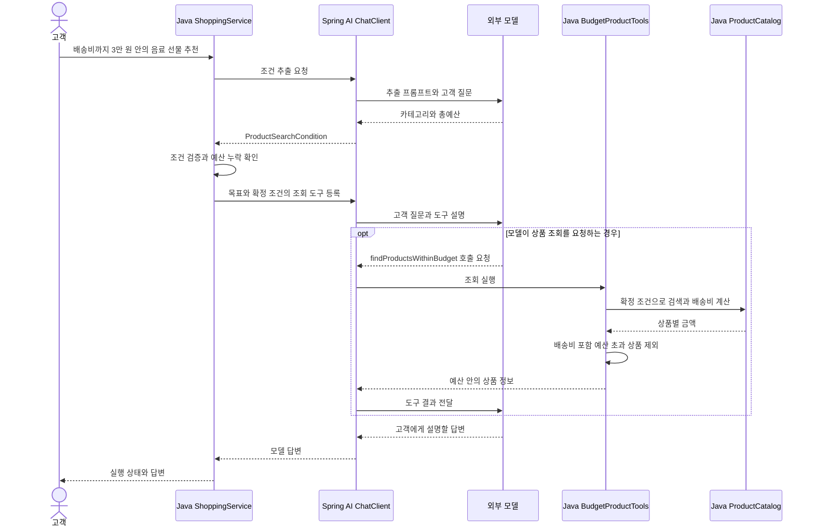

# 06-3. 고정 조건과 모델의 도구 선택 결합하기

**실행 코드·설정·테스트:** [labs/06-00-workflow-agent](../../../labs/06-00-workflow-agent/README.md). 저장소 루트에서 해당 README의 명령으로 실행합니다.

**이번 목표:** 조건 추출·확인은 고정 절차로 실행하고, 모델에는 확정 조건을 지키는 조회 도구를 제공하는 혼합 방식을 구현합니다.

**코드 읽기 안내:** `runHybrid()`가 조건을 확정하는 부분과 `findProductsWithinBudget()`이 배송비 포함 예산을 검사하는 부분을 연결해서 읽습니다.

## 혼합 방식: 조건과 업무 규칙은 Java, 조회 사용과 설명은 모델

고객 요청은 “친구에게 줄 음료 선물을 찾고 있어요. 배송비까지 3만 원 안에서 추천해 주세요.”입니다.
Agent처럼 모델에게 모든 검색 인자를 맡기는 대신, 먼저 카테고리와 예산을 추출하고 Java가 조건을 확인합니다.
그다음 모델에 **그 조건 안의 상품을 조회하는 도구**를 제공합니다. 도구 안의 검색·계산·예산 검사는 정해진 절차로 실행됩니다.



그림은 한 번 조회하는 가능한 경로입니다. 모델이 조회를 생략하거나 반복할 수도 있습니다.
예산이 없으면 Java가 추가 입력을 요청하며, 위 그림의 도구 등록 단계까지 진행하지 않습니다.

## 조건을 확정한 뒤 도구 제공하기

아래는 [ShoppingService.java](../../../labs/06-00-workflow-agent/src/main/java/com/example/ailearning/l06decisions/ShoppingService.java)의 `runHybrid()`입니다.
조건 추출 메서드는 [Workflow 수업](01-workflow.md)과 같습니다.

```java
    private ExecutionResult runHybrid(String question) {
        ProductSearchCondition searchCondition = extractProductSearchCondition(question);
        if (searchCondition.totalBudget() == null) return createBudgetQuestion();
        BudgetProductTools tools = new BudgetProductTools(productCatalog, searchCondition);
        String answer = chatClient
                .prompt()
                .system("""
                        TASK:HYBRID
                        배송비 포함 예산에 맞는 선물을 추천하세요.
                        상품 정보와 금액은 제공된 조회 도구 결과만 사용하세요.
                        도구는 Java가 확정한 카테고리와 예산에 맞는 상품만 반환합니다.
                        조회 결과가 비면 조건에 맞는 상품이 없다고 설명하세요.
                        """)
                .user(question)
                .tools(tools)
                .call()
                .content();
        // Java가 보장하는 범위는 도구가 반환하는 후보 조건입니다. 최종 자연어의 정확성을 검증한 것은 아닙니다.
        return new ExecutionResult("COMPLETED", answer);
    }
```

`.tools(tools)`에 전달하는 객체는 이번 요청에서 확정한 조건을 가집니다. 모델이 검색 조건이나 가격을 인자로 다시 만들어 보낼 필요가 없습니다.
`.content()`로 받은 모델 답변을 `ExecutionResult`에 담아 실제 응답으로 반환합니다.

## 업무 규칙을 지키는 조회 도구

[BudgetProductTools.java](../../../labs/06-00-workflow-agent/src/main/java/com/example/ailearning/l06decisions/BudgetProductTools.java)의 전체 코드입니다.

```java
package com.example.ailearning.l06decisions;

import com.example.ailearning.l06decisions.domain.ProductCatalog;
import com.example.ailearning.l06decisions.domain.ProductPriceDetail;
import com.example.ailearning.l06decisions.domain.ProductSearchCondition;
import org.springframework.ai.tool.annotation.Tool;
import java.util.List;

/** 요청에서 확정한 조건으로 조회합니다. 추천 목록이나 호출 결과를 필드에 저장하지 않습니다. */
public class BudgetProductTools {
    private final ProductCatalog productCatalog;
    private final ProductSearchCondition searchCondition;

    public BudgetProductTools(ProductCatalog productCatalog, ProductSearchCondition searchCondition) {
        this.productCatalog = productCatalog;
        this.searchCondition = searchCondition;
    }

    @Tool(description = "고객 요청에서 확정한 카테고리와 배송비 포함 예산에 맞는 상품을 조회합니다. 결과가 비면 조건에 맞는 상품이 없습니다.")
    public List<ProductPriceDetail> findProductsWithinBudget() {
        return productCatalog.search(searchCondition.category(), searchCondition.totalBudget())
                .stream()
                .map(product -> productCatalog.calculatePriceDetail(product.id()))
                .filter(detail -> detail.total() <= searchCondition.totalBudget())
                .toList();
    }
}
```

`ProductSearchCondition`은 카테고리와 배송비 포함 총예산입니다. `runHybrid()`가 유효한 값인지 확인하고 예산이 있는 경우에만 이 도구를 만듭니다.
`map`은 검색된 상품별 총액을 구하고, `filter`는 총예산 이하인 상품만 남깁니다. 계산 결과를 필드에 저장하지 않고 이번 조회 결과로 반환합니다.

허브티는 12000원 + 배송비 3000원 = 15000원으로 남습니다.
커피는 상품 가격 28000원으로 검색에는 포함되지만 총액 31000원으로 도구 결과에서 제외됩니다.
모델에게 전달되는 상품 정보는 이 필터를 통과한 결과입니다.

이 구조가 보장하는 범위는 **확정 조건으로 조회한 도구 결과의 카테고리와 총액**입니다.
모델이 사용자 의도를 잘못 추출하거나 도구를 생략할 가능성, 최종 문장에서 정보를 잘못 설명할 가능성은 남습니다.
최종 답변까지 검증하는 기능은 이번 예제에 포함하지 않습니다. `COMPLETED`도 실행이 끝났다는 뜻입니다.

## 실행과 관찰

[01장의 .env 설정](../01-setup.md#4-실제-모델-연결을-위한-설정-준비) 후 [실습 README](../../../labs/06-00-workflow-agent/README.md)의 명령으로 실행합니다.

| 입력 | Workflow | Agent | Hybrid |
|---|---|---|---|
| 배송비 포함 3만 원의 음료 선물 추천 | Java가 검색·계산 후 허브티만 설명에 전달 | 모델이 검색·계산 도구와 인자를 선택 | Java가 조건 확정, 조회 도구가 허브티만 반환 |
| 예산 없이 선물 추천 | Java가 예산 질문 | 모델이 추가 질문 여부 판단 | Java가 예산 질문 |
| 배송비 포함 천 원의 음료 추천 | `NO_RESULTS`로 종료, 설명 호출 생략 | 모델이 조회 결과를 보고 설명 | 도구의 빈 결과를 모델이 설명 |
| 상품 이름만 묻기 | 고정 절차에 따라 예산 질문 | 검색만으로 답변 가능 | 고정 절차에 따라 예산 질문 |

응답은 `mode`, `status`, `answer`입니다. `status`는 `COMPLETED`(실행 완료), `NEEDS_INPUT`(예산 필요), `NO_RESULTS`(Workflow의 후보 없음), `FAILED`(실행 실패)입니다.
Hybrid에서 빈 결과를 설명한 경우도 모델 응답까지 마쳤으므로 `COMPLETED`입니다. 상품이 있다는 뜻은 아닙니다.

로컬 테스트의 기본 추천 시나리오는 Workflow 2회, Agent 4회, Hybrid 3회의 모델 HTTP 요청을 지정합니다.
이 횟수는 고정 응답 시나리오의 결과입니다. 실제 모델의 도구 선택과 호출 횟수는 달라질 수 있으며, 서비스 응답 문장만 보고 추정하지 않습니다.
실제 호출은 Live 테스트의 카탈로그 Spy 기록으로, 전달된 도구 결과는 로컬 테스트의 모델 요청 메시지로 확인합니다.

실행 예외는 `FAILED` 안내로 반환하고 서버 로그에 실행 방식과 예외 타입을 남깁니다.

## 확인 질문

3만 원 예산에서 총액 31000원인 커피는 언제 제외되며, 그 검사가 최종 답변의 정확성까지 보장하나요?

<details>
<summary>해설</summary>

`BudgetProductTools`가 도구 결과를 모델에 반환하기 전에 Java 필터로 제외합니다. 모델은 예산을 통과한 후보를 받지만, 최종 문장을 정확히 작성했는지까지 검사하는 것은 아닙니다.

</details>

[이전](02-agent.md) · [보충: 테스트 검증 코드 읽기](04-test-assertions.md) · [단원 목차](../06-workflow-agent.md) · [학습 방법](../../learning-guide.md)
