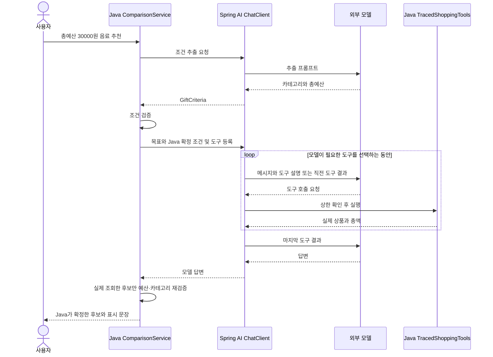

# 06-3. 모델의 선택을 Java로 검증하기

**실행 코드·설정·테스트:** [labs/06-workflow-agent](../../../labs/06-workflow-agent/README.md). 저장소 루트에서 해당 README의 명령으로 실행합니다.

**이번 목표:** 선택과 금액 검증의 책임을 나눕니다.

**코드 읽기 안내:** 도구 선택이 유연해져도 예산 검사를 모델에게만 맡길 필요는 없습니다. 이 수업에서 세 경로를 비교 실행합니다.

## 혼합 방식: 선택은 모델, 최종 업무 검증은 Java



반복 구간은 도구가 필요한 경우에만 발생합니다. 모델이 바로 답하면 생략됩니다.
[hybrid 메서드](../../../labs/06-workflow-agent/src/main/java/com/example/ailearning/l06decisions/ComparisonService.java)는 아래처럼 구현되어 있습니다.

```java
private Draft hybrid(String question, RunState run) {
        GiftCriteria criteria = extract(question, run);
        if (criteria.totalBudget() == null) return needsBudget();
        agent(question, run, criteria); // 어떤 상품을 조회할지는 모델이 선택한다.
        List<Offer> eligible = run
                .quotes()
                .stream()
                .filter(offer -> criteria.category() == null || offer
                        .product()
                        .category()
                        .equals(criteria.category()))
                .filter(offer -> offer.total() <= criteria.totalBudget())
                .toList();
        // 최종 후보와 표시 문장은 코드로 확정한다. 미조회·예산 초과 상품은 포함하지 않는다.
        return new Draft(eligible.isEmpty() ? "NO_VERIFIED_OFFER" : "COMPLETED",
                eligible.isEmpty() ? "검증된 예산 안의 후보가 없습니다."
                        : "Java 검증 후보: " + eligible
                .stream()
                .map(offer -> offer
                        .product()
                        .id())
                .toList(), eligible);
    }
```

혼합 방식은 모델의 자유로운 최종 문장을 그대로 사용하지 않고, Java가 통과시킨 상품 ID로 표시 문장도 만듭니다.
아예 도구를 선택하지 않으면 `NO_VERIFIED_OFFER`입니다. 모델이 목표를 이해할 것이라고 가정해 임의 상품을 채우지 않습니다.
모델이 잘못 추출한 양수 예산까지 Java가 사용자의 진짜 의도와 일치하는지 자동 증명하는 것은 아닙니다.

## 실행과 관찰

[01장의 루트 .env 설정](../01-setup.md#4-실제-모델-연결을-위한-설정-준비)를 설정하고 도구 호출 지원 모델을 선택합니다.
모든 명령은 저장소 루트에서 실행합니다.

```bash
./gradlew :Spring-AI-Agent-Learning:labs:06-workflow-agent:test --tests com.example.ailearning.l06decisions.WorkflowAgentContractTest
./gradlew :Spring-AI-Agent-Learning:labs:06-workflow-agent:bootRun
```

```bash
curl -sS http://127.0.0.1:8096/api/compare/workflow \
  -H 'Content-Type: text/plain; charset=UTF-8' \
  --data-raw '배송비 포함 3만원 이하인 음료 선물을 추천해줘.'
```

같은 질문을 `/api/compare/agent`, `/api/compare/hybrid`에도 보냅니다.
실제 모델 호출은 유료일 수 있습니다. 종료는 서버 터미널 Ctrl+C입니다.

| 응답 필드 | 읽는 방법 |
|---|---|
| mode | 실행한 방식 |
| status | COMPLETED, NEEDS_INPUT, NO_RESULTS, NO_VERIFIED_OFFER 또는 중단·실패 상태 |
| answer | Workflow/Agent에서는 모델 문장, hybrid에서는 Java가 만든 확정 문장 |
| offers | Workflow/hybrid는 Java 필터 통과 후보. Agent는 실제 배송비 조회 기록이며 예산 준수 보장은 없음 |
| clientCalls | 최상위 ChatClient 호출 수. 객체 생성 시 한 번씩 기록 |
| modelCalls | 도구 반복을 포함해 실제로 시작한 모델 요청 수 |
| toolCalls | 실제 업무 기능 실행을 시작한 횟수. Workflow의 직접 Java 호출도 포함 |
| steps | MODEL 요청, TOOL 이름·인자, RESULT 결과의 순서 |

정상 고정 테스트에서는 Workflow `clientCalls=2, modelCalls=2`, Agent `clientCalls=1, modelCalls=4`를 확인합니다.
실제 Agent 모델의 횟수는 달라질 수 있습니다. 내부 사고를 요구하는 대신 관찰 가능한 호출과 결과를 비교합니다.

## 프롬프트와 코드의 경계 실험

1. 같은 요청을 세 경로에 보내고 TOOL·RESULT 순서를 적습니다.
2. “선물 추천”처럼 예산을 빼봅니다. Workflow/hybrid는 Java 분기로 NEEDS_INPUT, Agent는 모델이 추가 질문 여부를 선택합니다.
3. “음료 1000원 이하”로 바꿉니다. Workflow는 검색 후 NO_RESULTS로 끝나고 불필요한 설명 호출을 생략합니다.
4. Agent 목표에 “배송비부터 확인”을 추가해 봅니다. 이는 모델에 대한 지시이며 순서 보장은 아닙니다. 반드시 그 순서라면 Java 흐름으로 작성합니다.
5. 테스트의 모델이 커피를 추천하도록 고정한 사례를 읽습니다. hybrid는 총액 31000원을 Java가 제외하고 P01만 반환합니다.


## 여기서 멈춰 확인하기

모델이 조회한 커피의 총액이 31000원이면, 3만원 예산에서 누가 제외하나요?

[이전](02-agent.md) · [다음](04-limits.md) · [단원 목차](../06-workflow-agent.md) · [학습 방법](../../learning-guide.md)
