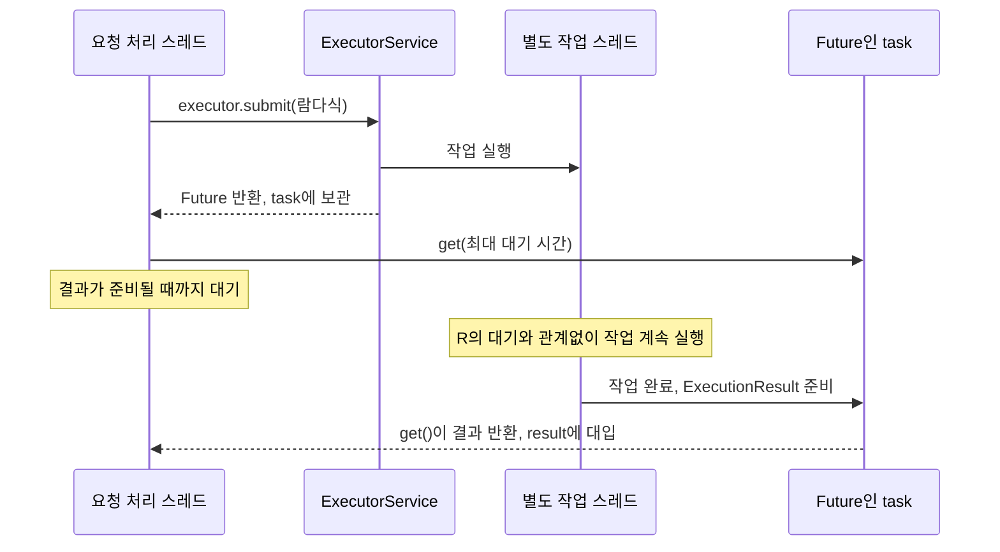

# 06-4. 보충: Future로 작업 결과 기다리기

**이번 목표:** `ComparisonService.run()`에서 작업 제출·결과 대기·취소 요청이 어떻게 연결되는지 이해합니다.
권장 학습 시점은 06-3 이후입니다. 이 문서는 Java 동시성 중 현재 코드에 필요한 부분만 설명합니다.

## Future는 결과 자체가 아니다

시간 제한 없이 모델 응답을 기다리면 요청 처리가 오래 걸릴 수 있습니다. 이 서비스는 별도 스레드에 작업을 맡긴 뒤 정해진 시간까지만 결과를 기다립니다.

| 코드·용어 | 현재 코드에서의 의미 |
|---|---|
| 스레드 | 코드를 실행하는 흐름. 여기서는 요청 처리와 별도 작업을 구분합니다. |
| `ExecutorService` | 제출한 작업을 스레드에서 실행하는 객체 |
| `newVirtualThreadPerTaskExecutor()` | 제출한 작업마다 Java 21의 가상 스레드를 사용하는 실행기 생성 |
| `submit(...)` | 실행할 작업을 제출하고 `Future`를 받음 |
| `Future<ExecutionResult>` | 나중에 반환될 `ExecutionResult` 결과를 기다리거나 작업 취소를 요청하는 객체 |
| `ExecutionResult` | 선택한 방식의 실행 결과. 상태·답변·상품 목록을 담는 이 클래스의 record |

`submit()`이 반환될 때 작업은 이미 끝났을 수도, 실행 중일 수도 있습니다. `Future`를 받았다는 사실만으로 결과가 준비됐다고 판단할 수는 없습니다.

## 실제 run() 코드 읽기

[ComparisonService 전체 소스](../../../labs/06-workflow-agent/src/main/java/com/example/ailearning/l06decisions/ComparisonService.java)의 `run()` 메서드입니다.

```java
public RunResult run(String mode, String question) {
    var state = new RunState(maxModelCalls, maxToolCalls, timeoutMs);
    // 시간 제한을 위한 보조 코드. 학습은 아래 workflow / agent 메서드부터 시작한다.
    ExecutorService executor = Executors.newVirtualThreadPerTaskExecutor();
    Future<ExecutionResult> task = executor.submit(() -> switch (mode) {
        case "workflow" -> workflow(question, state);
        case "agent" -> agent(question, state, null);
        case "hybrid" -> hybrid(question, state);
        default -> throw new IllegalArgumentException("mode는 workflow/agent/hybrid입니다.");
    });
    try {
        ExecutionResult result = task.get(timeoutMs, TimeUnit.MILLISECONDS);
        String status = state.stopped() == null ? result.status() : state.stopped();
        return state.result(mode, status, result.answer(), result.offers());
    } catch (TimeoutException error) {
        state.stop("TIMEOUT");
        task.cancel(true);
        return state.result(mode, "TIMEOUT", "요청 대기 시간 상한에 도달했습니다.", List.of());
    } catch (InterruptedException error) {
        Thread.currentThread()
                .interrupt();
        state.stop("CANCELLED");
        task.cancel(true);
        return state.result(mode, "CANCELLED", "요청이 중단되었습니다.", List.of());
    } catch (ExecutionException error) {
        String status = state.stopped() == null ? "FAILED" : state.stopped();
        return state.result(mode, status, "호출 실패. 조건·모델 연결·실행 기록을 확인하세요.", List.of());
    } finally {
        // close()로 완료를 기다리지 않고 취소한다. 외부 API 측 처리 종료까지 보장하지는 않는다.
        executor.shutdownNow();
    }
}
```

`()` 뒤의 `->`는 실행할 작업을 전달하는 Java 람다입니다. 작업 안의 `switch`는 선택한 mode의 메서드 **하나만** 실행하고 `ExecutionResult`를 반환합니다. 세 방식을 동시에 실행하는 코드가 아닙니다.
`RunState`의 호출 횟수·중단 상태 처리는 다음 06-5에서 연결합니다.

## executor, task, result는 어떻게 연결될까?

위 코드에서 세 변수는 서로 다른 역할을 맡습니다.

| 변수 | 선언·대입 코드 | 역할 |
|---|---|---|
| `executor` | `ExecutorService executor = Executors.newVirtualThreadPerTaskExecutor();` | 작업을 별도 스레드에서 실행할 실행기 |
| `task` | `Future<ExecutionResult> task = executor.submit(...);` | 제출한 작업 하나의 완료를 기다리거나 취소를 요청할 때 사용하는 객체 |
| `result` | `ExecutionResult result = task.get(timeoutMs, TimeUnit.MILLISECONDS);` | 작업이 정상적으로 완료된 뒤 받은 실제 결과 |

먼저 `executor.submit(...)`에 실행할 코드를 전달합니다. 실행기는 그 코드를 별도 스레드에서 실행하도록 하고, 해당 작업을 나타내는 `Future`를 반환합니다. 그 객체를 `task`에 담습니다.

`Future<ExecutionResult>`의 `<ExecutionResult>`는 **이 작업이 정상 완료되면 받을 결과의 타입**입니다. 예를 들어 mode가 `workflow`이면, `workflow(question, state)`가 끝나면서 반환한 `ExecutionResult`를 받게 됩니다.

그 결과를 받는 코드가 `task.get(...)`입니다. 작업이 아직 실행 중이면 기다리고, 정상 완료되면 `ExecutionResult`를 반환해 `result`에 대입합니다. **실행 중간까지의 결과를 반환하는 것은 아닙니다.** 시간 초과나 작업 예외가 발생하면 `get()`이 예외를 던지므로 `result`에는 대입되지 않고 catch로 이동합니다.

이후 `state.result(...)`는 이 완료 결과에 실행 기록 등을 연결해 API 반환용 `RunResult`를 만듭니다. `ExecutionResult`는 선택한 방식의 실행 결과이고, `RunResult`는 호출 횟수·기록 등을 포함한 API 응답입니다. 상품 없음·추가 입력 필요처럼 작업은 끝났지만 사용자 요청이 아직 해결되지 않은 경우도 있습니다.

## 결과를 기다리는 get()

```java
ExecutionResult result = task.get(timeoutMs, TimeUnit.MILLISECONDS);
```

`timeoutMs`는 기다릴 시간이고 `TimeUnit.MILLISECONDS`는 단위가 밀리초임을 뜻합니다.
이미 완료됐다면 바로 결과를 받으며, 완료 전이라면 최대 지정 시간까지 기다립니다.
기본 설정인 10000ms는 **이 get() 호출의 최대 대기 시간**입니다.

정상 완료 흐름은 다음과 같습니다. 실제 스레드 실행 시점에 따라 작업이 `get()`보다 먼저 완료될 수도 있습니다.



그림의 W → F는 작업 완료 결과가 Future에 준비되는 내부 처리를 단순화한 표현입니다. 작업 스레드 W는 실행을 계속하지만 요청 처리 스레드 R은 `get()`에서 기다립니다. HTTP 응답을 즉시 반환하고 나중에 결과를 보내는 구조는 아닙니다.

## 기다리던 작업에 문제가 생기면

| 예외 | 발생 상황 | 현재 서비스의 처리 |
|---|---|---|
| `TimeoutException` | 제한 시간 안에 작업이 완료되지 않음 | TIMEOUT 기록 → 취소 요청 → 시간 초과 결과 반환 |
| `InterruptedException` | 기다리던 요청 처리 스레드가 인터럽트를 받음 | 인터럽트 상태 복원 → CANCELLED 기록 → 취소 요청 |
| `ExecutionException` | 별도 작업 안에서 예외 발생 | 기록된 중단 사유가 있으면 사용하고, 없으면 FAILED 반환 |

시간이 지났다는 이유만으로 `get()`이 작업을 자동 취소하지는 않습니다. 그래서 시간 초과 처리에서 별도로 호출합니다.

```java
task.cancel(true);
```

`true`는 작업이 이미 실행 중이면 그 스레드에 인터럽트를 보내 중단을 시도하라는 뜻입니다. 강제로 즉시 종료하거나 외부 모델 서버의 계산·과금을 중단한다는 보장은 아닙니다.
`finally`의 `shutdownNow()`도 실행기 정리와 진행 중 작업의 중단을 시도합니다. 취소 뒤 새 모델·도구 호출을 막는 코드는 다음 수업에서 확인합니다.

## 확인 질문

1. `task`와 `result`는 각각 무엇인가요?
2. 시간 초과 예외를 받으면 작업도 자동 취소되나요?
3. 이 코드는 Workflow·Agent·하이브리드를 동시에 실행하나요?

<details><summary>해설</summary>

`task`는 작업을 기다리고 취소를 요청할 Future이고, `result`는 정상 완료 후 받은 ExecutionResult입니다.
시간 초과만으로 취소되지는 않으므로 catch에서 cancel(true)를 호출합니다.
switch는 선택된 방식 하나만 실행합니다.
</details>

공식 참고: [Java 21 Future](https://docs.oracle.com/en/java/javase/21/docs/api/java.base/java/util/concurrent/Future.html), [Java 21 Executors](https://docs.oracle.com/en/java/javase/21/docs/api/java.base/java/util/concurrent/Executors.html#newVirtualThreadPerTaskExecutor()).

[이전](03-hybrid.md) · [다음](05-limits.md) · [단원 목차](../06-workflow-agent.md)
