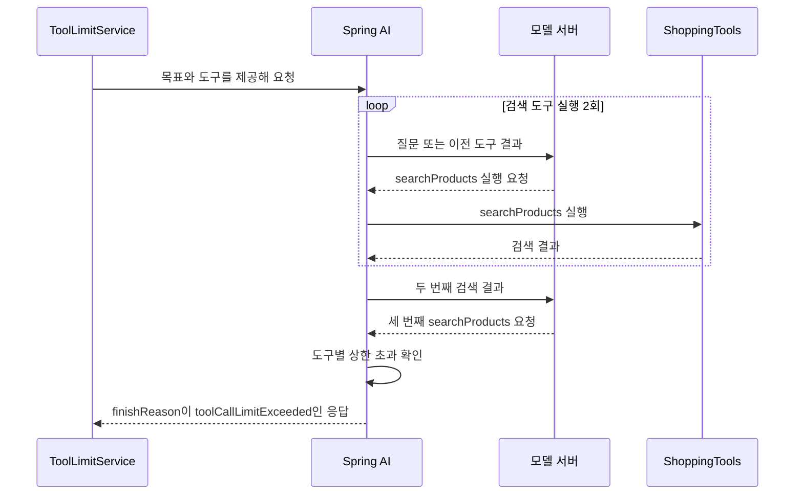

# 06 확장 1. Spring AI로 도구 호출 횟수 제한하기

**목표:** 도구를 반복 요청하는 모델에 대해 도구별·전체 실행 횟수를 제한하고, 상한에 도달한 결과를 처리합니다.

선수 수업은 06-2의 Agent와 05의 도구 호출입니다. 기본 예제를 바꾸지 않고 [06-tool-call-limits](../../../labs/06-tool-call-limits/README.md)를 실행합니다.

## 어떤 횟수를 제한할까?

모델이 같은 검색을 계속 요청하면 비용과 대기가 늘어날 수 있습니다. 프롬프트에 “반복하지 마세요”라고 쓰는 것과 별도로, Spring AI가 도구 실행 전에 횟수를 확인하도록 설정합니다.

| 용어 | 의미 |
|---|---|
| 도구별 상한 | 한 사용자 요청을 처리할 때 같은 도구를 실행할 수 있는 최대 횟수 |
| 전체 상한 | 같은 요청에서 실행하는 모든 도구 횟수의 합계 |
| 모델 요청 횟수 | 모델 서버에 보낸 요청 수. 한 모델 응답에 여러 도구 요청이 있을 수 있어 도구 실행 횟수와 다릅니다. |

## 설정으로 상한 정하기

실습의 `application.yml`에 다음 설정이 있습니다. Spring AI **2.0.2 기본 기능**이며 직접 카운터를 구현하지 않습니다.

```yaml
spring:
  ai:
    tools:
      limits:
        max-calls-per-tool-default: 2
        max-total-tool-calls: 3
        on-limit-exceeded: THROW
```

검색만 반복하면 두 번까지 실행합니다. 검색→배송비→검색까지 세 번 실행한 뒤 배송비를 한 번 더 요청하면 전체 상한에서 차단합니다. 다음 사용자 요청에서는 횟수를 새로 계산합니다.

이 제한은 Spring AI의 도구 실행 경로에 적용됩니다. Workflow에서 `productCatalog.search(...)`를 직접 호출하는 일반 Java 코드는 이 설정의 적용 대상이 아닙니다.



세 번째 검색은 실행하지 않고, 그 뒤 모델에 결과를 다시 보내는 호출도 하지 않습니다. 이 그림의 모델 서버는 로컬 테스트에서 반복 응답하도록 설정합니다.

## 상한 초과를 성공 답변과 구분하기

[ToolLimitService.java](../../../labs/06-tool-call-limits/src/main/java/com/example/ailearning/l06limits/ToolLimitService.java)의 전체 코드입니다.

```java
package com.example.ailearning.l06limits;

import org.springframework.ai.chat.client.ChatClient;
import org.springframework.ai.model.tool.ToolCallLimitExceededException;
import org.springframework.stereotype.Service;

@Service
public class ToolLimitService {
    public record Reply(String status, String answer, String finishReason) {}
    private final ChatClient chatClient;
    private final ShoppingTools shoppingTools;

    public ToolLimitService(ChatClient.Builder builder, ShoppingTools shoppingTools) {
        this.chatClient = builder.build();
        this.shoppingTools = shoppingTools;
    }

    public Reply ask(String question) {
        var response = chatClient
                .prompt()
                .system("필요한 도구로 상품 가격과 배송비를 확인해 답하세요. 일반 인사에는 도구가 필요하지 않습니다.")
                .user(question)
                .tools(shoppingTools)
                .call()
                .chatResponse();
        String finishReason = response.getResult().getMetadata().getFinishReason();
        if (ToolCallLimitExceededException.FINISH_REASON.equals(finishReason)) {
            return new Reply("TOOL_LIMIT", "도구 호출 상한에 도달했습니다.", finishReason);
        }
        return new Reply("COMPLETED", response.getResult().getOutput().getText(), finishReason);
    }
}
```

`THROW`이면 내부 `ToolCallingManager`가 상한 초과 예외를 발생시키지만, 기본 도구 루프의 `ToolCallingAdvisor`가 이를 받아 특별한 종료 사유를 담은 응답으로 반환합니다. 따라서 이 예제에서는 서비스의 `catch` 대신 **`finishReason`을 확인**합니다. `TOOL_LIMIT`은 이를 사용자 응답으로 구분하기 위해 실습에서 정한 상태 이름입니다.

`.content()`만 읽으면 제한 안내 문장도 정상 답변처럼 취급하기 쉽습니다. `.chatResponse()`로 응답의 내용과 종료 사유를 함께 받습니다. 정상 요청에는 `COMPLETED`, 상한 초과에는 `TOOL_LIMIT`을 반환합니다.

도구의 전체 구현은 [ShoppingTools.java](../../../labs/06-tool-call-limits/src/main/java/com/example/ailearning/l06limits/ShoppingTools.java), HTTP 진입점은 [ToolLimitController.java](../../../labs/06-tool-call-limits/src/main/java/com/example/ailearning/l06limits/ToolLimitController.java)에서 확인합니다.

## 실행하고 비교하기

저장소 루트에서 실행합니다. 로컬 테스트는 API 키 없이 고정 응답 서버를 사용합니다.

```bash
./gradlew :Spring-AI-Agent-Learning:labs:06-tool-call-limits:test --tests '*ToolLimitLocalModelTest'
```

| 테스트 입력 상황 | 도구 실제 실행 | 모델 요청 | 결과 |
|---|---|---|---|
| 검색만 계속 요청 | 검색 2회 | 3회 | TOOL_LIMIT |
| 검색→배송비→검색→배송비 요청 | 검색 2회, 배송비 1회 | 4회 | TOOL_LIMIT |
| 검색→배송비→최종 답변 | 검색 1회, 배송비 1회 | 3회 | COMPLETED |
| 인사에 바로 답변 | 0회 | 1회 | COMPLETED |

[ToolLimitLocalModelTest](../../../labs/06-tool-call-limits/src/test/java/com/example/ailearning/l06limits/ToolLimitLocalModelTest.java)는 `@MockitoSpyBean`의 호출 기록으로 실제 실행 수를 검증합니다. 고정 모델이 반복 요청했다는 설정과, 도구가 실제 몇 번 실행됐는지는 다른 확인입니다. 테스트 이름과 결과는 콘솔에 출력됩니다.

실제 모델로 실행하려면 루트 `.env`에 `OPENAI_API_KEY`, `OPENAI_MODEL`을 준비합니다. API 사용량이 발생합니다.

```bash
./gradlew :Spring-AI-Agent-Learning:labs:06-tool-call-limits:bootRun
curl http://127.0.0.1:8110/api/tool-limits \
  -H 'Content-Type: text/plain; charset=UTF-8' \
  --data-raw '음료 상품 가격과 배송비를 알려줘.'
```

실제 모델은 같은 도구를 반복하지 않을 수 있습니다. 반복 차단 검증은 로컬 테스트로 재현하고, Live 테스트는 실제 연결과 정상 도구 활용을 확인합니다.

설정을 도구별 1회로 바꾼 뒤 **애플리케이션을 재시작**하고 같은 입력을 비교하세요. 실행 후 설정을 2회로 되돌립니다. 로컬 테스트도 같은 설정 파일을 읽으므로 실험 뒤 원복해야 표의 기대값과 맞습니다.

## 확인 질문

1. 세 번째 검색 요청이 있어도 실제 검색은 왜 두 번인가요?
2. 상한 초과를 일반 성공과 구분하는 응답 값은 무엇인가요?
3. 모델 요청 횟수까지 2회로 제한되는 설정인가요?

상한을 넘는 도구 실행은 시작 전에 차단합니다. `finishReason=toolCallLimitExceeded`로 구분하며, 모델 요청 횟수 자체를 제한하는 설정은 아닙니다.

[Spring AI 공식 도구 제한](https://docs.spring.io/spring-ai/reference/api/tools.html#_tool_call_limits) · [다음: 확장 2](05-model-timeout-retry.md) · [06장 목차](../06-workflow-agent.md) · [12장에서 재활용](../12-evaluation/05-failures.md)
