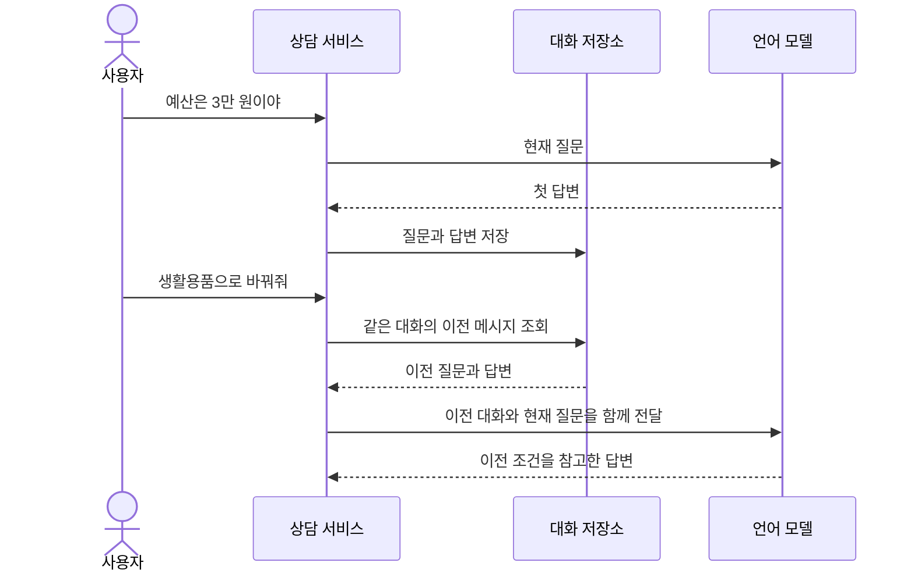

# 07. 대화 메모리: 이전 질문과 답변을 다음 프롬프트에 다시 담기

## 이번 수업의 목표

선수 지식은 03장의 메시지 역할, Java의 List와 생성자 주입, 04장의 record입니다.

- 이전 대화를 다음 요청에 다시 보내야 하는 이유를 설명합니다.
- `ChatMemory`의 보관 정책과 `ChatMemoryRepository`의 저장 역할을 구분합니다.
- 같은 대화의 메시지를 조회·전달·저장하고, 다른 사용자의 대화를 분리합니다.
- 메시지 창에서 사라지는 정보와 전체 대화 이력의 차이를 설명합니다.

기본 실습은 텍스트 대화를 JVM 메모리에 저장합니다. JDBC 저장과 운영 설계는 선택 보충에서 읽고, 메모리 연결을 자동화하는 Advisor는 08장에서 배웁니다.

## 개념 먼저 이해하기

**대화 메모리(Chat Memory)**는 이전 대화에서 필요한 정보를 보관하고, 다음 모델 요청에 다시 포함하는 기능입니다. 모델이 앞선 API 호출을 저절로 기억하거나, 대화할 때마다 새로 학습하는 것은 아닙니다. 애플리케이션이 저장·조회·전달을 담당합니다.

사용자가 먼저 “예산은 3만 원이야”라고 말한 뒤 “생활용품으로 바꿔줘”라고 하면, 서비스는 이전 예산과 현재 변경 요청을 함께 모델에 전달해 후속 질문을 해석할 수 있습니다.

| 용어 | 쉬운 설명 | 서비스에서 정할 것 |
|---|---|---|
| 대화 이력 | 사용자와 모델이 주고받은 전체 기록 | 기록 보관 범위와 기간 |
| 대화 메모리 | 다음 응답에 활용하도록 보관·선택하는 대화 정보 | 모델에게 다시 보낼 내용 |
| 대화 ID | 서로 다른 대화를 구분하는 식별값 | 사용자별·상담별 대화 구분 |
| 메시지 창 | 최근 메시지 중 일정 범위만 유지하는 방식 | 한 번에 전달할 대화의 범위 |



Spring AI는 대화 메시지를 저장하고 조회할 수 있는 기능을 제공합니다. 이전 대화를 많이 보내면 모델이 처리할 정보와 비용도 늘어나므로, 전체 이력을 항상 그대로 보내는 것이 적절하지는 않습니다. 어떤 정보를 이어서 사용할지, 언제 대화를 초기화할지, 다른 사용자의 대화가 섞이지 않게 할지를 정해야 합니다.

이번 실습은 실행 중인 애플리케이션의 메모리에 대화를 보관합니다. 서버 재시작 뒤에도 대화를 유지하려면 그 목적에 맞는 저장소를 연결해야 합니다.

개념 참고: [Spring AI의 대화 메모리 설명](https://docs.spring.io/spring-ai/reference/api/chat-memory.html).

## ChatMemory와 ChatMemoryRepository의 역할

다음 표는 두 인터페이스와 이번 실습에서 사용하는 구현체를 함께 보여줍니다.

| 타입 | 구분                        | 맡은 역할 |
|---|---------------------------|---|
| `ChatMemory` | 인터페이스                     | 대화 ID별 메시지를 추가·조회·삭제하는 사용 계약 |
| `MessageWindowChatMemory` | `ChatMemory` 구현체 (하나만 제공) | 최근 메시지를 정해진 개수 안에서 유지하는 정책 |
| `ChatMemoryRepository` | 인터페이스                     | 메시지 목록을 실제 저장소에 저장·조회하는 계약 |
| `InMemoryChatMemoryRepository` | 저장소 구현체 (다양한 구현체 제공)      | JVM 메모리에 대화별 메시지 목록을 보관 |

`MessageWindowChatMemory`는 **무엇을 남길지**, 저장소는 **어디에 보관할지**를 담당합니다. 서비스가 `ChatMemory`에 메시지를 추가하면 구현체가 보관할 목록을 정하고 저장소에 저장합니다. 저장소가 메모리인지 DB인지는 이 정책과 별도로 선택합니다.

### Spring AI가 제공하는 ChatMemory 구현체

이 프로젝트에서 사용하는 **Spring AI 2.0.2의 기본 제공 `ChatMemory` 구현체는 `MessageWindowChatMemory` 하나 입니다.** [공식 문서의 Memory Types 절](https://docs.spring.io/spring-ai/reference/api/chat-memory.html#_memory_types)에서도 이 구현체를 소개합니다.

| 구현체 | 보관 정책 | 주요 설정 |
|---|---|---|
| `MessageWindowChatMemory` | 메시지 수가 상한을 넘으면 오래된 대화를 턴 단위로 제거하고 시스템 메시지는 유지 | `maxMessages`로 메시지 수 상한 지정. 기본값은 20개이며 이번 실습은 6개 |

`ChatMemory` 인터페이스로 다른 보관 정책도 구현할 수 있습니다. 예를 들어 토큰 수 기준 제한이나 대화 요약이 필요하면 별도 구현 또는 추가 라이브러리의 지원 여부를 확인해야 합니다.

### 저장 위치는 ChatMemoryRepository로 선택

위 표의 `InMemoryChatMemoryRepository`는 이번 실습에서 사용하는 저장소입니다. Spring AI 2.0.2는 InMemory·JDBC·Cassandra·Neo4j·MongoDB·Redis 저장소 구현을 제공합니다. 이들은 보관 정책을 정하는 `ChatMemory` 구현체와 구분합니다.

**`ChatMemoryRepository`의 역할과 구현체별 특징은 [07-01의 저장소 종류](07-chat-memory/01-messages.md#spring-ai가-제공하는-대화-저장소-종류)에서 추가로 설명합니다.**

예를 들어 최근 메시지 6개만 참고하면서 서버 재시작 후에도 대화를 이어가려면, 메시지 창은 유지하고 저장소를 JDBC 구현으로 연결할 수 있습니다. 실제 생성 코드와 메서드는 [07-1](07-chat-memory/01-messages.md), 서비스의 호출 흐름은 [07-3](07-chat-memory/03-store.md)에서 설명합니다.

## 실무에서 대화를 어떻게 활용할까?

쇼핑 상담 화면에 표시할 전체 대화와 모델에게 다시 보낼 대화는 범위가 다릅니다. 사용자는 처음부터 스크롤해 볼 수 있어도 모델에게는 최근 메시지만 보낼 수 있습니다. 예산처럼 계속 필요한 조건은 메시지 창에서 사라질 수 있으므로, 별도 상담 조건으로 관리할지도 결정해야 합니다.

현재 예제는 메시지의 재전달 원리를 관찰하는 구성입니다. 로그인 사용자에게 대화를 연결하고 DB에 보관하는 방법은 [07-5 상용 서비스의 대화 저장과 재사용](07-chat-memory/05-production-memory.md)에 정리했습니다. 공개 연동 자료와 이 교재의 설계 제안을 구분해서 읽습니다.

## 실습 안내

선수 지식: 03의 메시지 역할, Java List와 Service, 04의 record.
이 단원은 **텍스트 대화의 메시지를 직접 조회하고 저장하며 다음 요청에 전달하는 원리**를 익힙니다.
[그림 공통 기준](../diagram-guide.md): 클래스는 객체 책임, 시퀀스는 저장·조회·전달 순서를 나타냅니다.


## 작은 수업으로 나누어 읽기

처음에는 아래 순서로 하나씩 학습합니다. 전체 코드를 한 번에 이해하거나 보조 코드를 직접 작성할 필요는 없습니다.

| 순서 | 소수업 | 완료 기준 |
|---|---|---|
| 1 | [이전 대화와 저장소 생성·연결](07-chat-memory/01-messages.md) | 메시지 재전달과 기본 저장소 생성 위치를 이해합니다. |
| 3 | [메시지 조회·전달·저장 연결하기](07-chat-memory/03-store.md) | 이전 대화를 조회해 새 질문과 함께 전달하고, 새 답변을 저장하는 흐름을 연결합니다. |
| 4 | [대화 구분·삭제·메시지 창 관찰](07-chat-memory/04-isolation.md) | 같은 대화 ID라도 소유자가 다르면 분리되는지 확인합니다. |
| 선택: JDBC | [JDBC 자동 구성으로 저장소 연결](07-chat-memory/01-jdbcRepository.md) | JDBC 저장소 빈을 메시지 창에 연결하고 DB 저장·재조회를 확인합니다. |
| 선택: 저장소 설정 | [YAML로 Redis 또는 InMemory 선택](07-chat-memory/02-RepositorySelection.md) | 설정에 따라 앱 시작 시 사용할 저장소를 선택합니다. |
| 선택 5 | [상용 서비스의 대화 저장과 재사용](07-chat-memory/05-production-memory.md) | 최근 문맥·전체 이력·업무 상태를 구분하고 영구 저장과 운영 기준을 설명합니다. |
| 선택 6 | [의도에 따른 런타임 메모리 선택](../../labs/07-03-runtime-memory/README.md) | 분류한 의도를 Enum 파라미터로 전달하고 요청마다 InMemory 또는 Redis를 선택합니다. |

기본 대화 수업인 1·3·4는 `07-00-chat-memory`를 사용합니다. JDBC 연결·저장소 선택 소주제는 독립 앱 [07-01-JDBC](../../labs/07-01-JDBC/README.md), [07-02-Redis-Selection](../../labs/07-02-Redis-Selection/README.md)에서 실행합니다. 표의 순서대로 개념과 실행 코드를 연결하세요.
[공통 학습 방법](../learning-guide.md) · [전체 교육 계획](../curriculum.md)

## 실행 코드와 테스트

[labs/07-00-chat-memory의 실행 안내](../../labs/07-00-chat-memory/README.md)를 확인합니다.
이 단원의 기본 구현은 다음 명령으로 테스트·빌드·실행합니다. 명령은 저장소 루트 기준입니다.

```bash
./gradlew :Spring-AI-Agent-Learning:labs:07-00-chat-memory:test --tests com.example.ailearning.l07memory.MemoryLocalModelTest --tests com.example.ailearning.l07memory.MemoryBuilderUnitTest
./gradlew :Spring-AI-Agent-Learning:labs:07-00-chat-memory:bootJar
./gradlew :Spring-AI-Agent-Learning:labs:07-00-chat-memory:bootRun
```

`MemoryLocalModelTest`는 고정 HTTP 응답으로 전송 메시지·대화 격리·저장 정책을 검사합니다. `bootRun` 후 질문하면 실제 모델을 호출하므로 루트 `.env` 설정이 필요하고 API 비용이 발생할 수 있습니다. 실행 입력과 확인할 필드는 [07-4](07-chat-memory/04-isolation.md)에 있습니다.

## 확인 질문

1. 최근 메시지 보관 개수와 저장 위치는 각각 어떤 타입의 책임인가요?
2. DB에 대화를 저장하면 모델이 자동으로 이전 대화를 참고하나요?
3. 최근 메시지만 저장하는 메모리를 채팅 화면의 전체 이력으로 사용하면 어떤 문제가 있나요?

<details>
<summary>해설</summary>

1. 이 수업에서는 `MessageWindowChatMemory.maxMessages`가 개수를 정하고, `ChatMemoryRepository` 구현체가 저장 위치를 정합니다.
2. 아닙니다. 같은 대화의 메시지를 읽어 다음 프롬프트에 포함해야 합니다. 07장은 서비스가 직접 연결하고 08장은 Advisor를 사용합니다.
3. 메시지 창에서 제거된 예전 대화를 화면에서도 볼 수 없게 됩니다. 전체 이력을 보관해야 한다면 별도 저장 설계가 필요합니다.

</details>

## 참고 자료

- [Spring AI — Chat Memory](https://docs.spring.io/spring-ai/reference/api/chat-memory.html): API 역할과 저장소 선택의 기준입니다. 예제의 동작은 프로젝트가 사용하는 2.0.2 소스와 대조했습니다.
- [Manfred Ng / Baeldung — Chat Memory in Spring AI](https://www.baeldung.com/spring-ai-chat-memory): 저장소에서 ChatClient 연결로 이어지는 튜토리얼의 설명 순서를 참고했습니다. 1.0.0 기반 코드이므로 설정을 그대로 복사하지 않습니다.
- [Dan Vega — AI for Java Developers 공개 강의 안내](https://www.danvega.dev/newsletter/2025/06/30/ai-for-java-developers-course): 대화 관리가 포함된 강의의 공개 소개를 확인했습니다. 영상 전체를 시청·검증한 자료는 아닙니다.

운영 설계와 심화 예제의 출처·적용 범위는 [선택 보충의 참고 자료](07-chat-memory/05-production-memory.md#참고-자료와-적용-범위)에 모았습니다.

[이전: 06장](06-workflow-agent.md) · [다음: 08장](08-advisors.md) · [전체 교육 계획](../curriculum.md)
