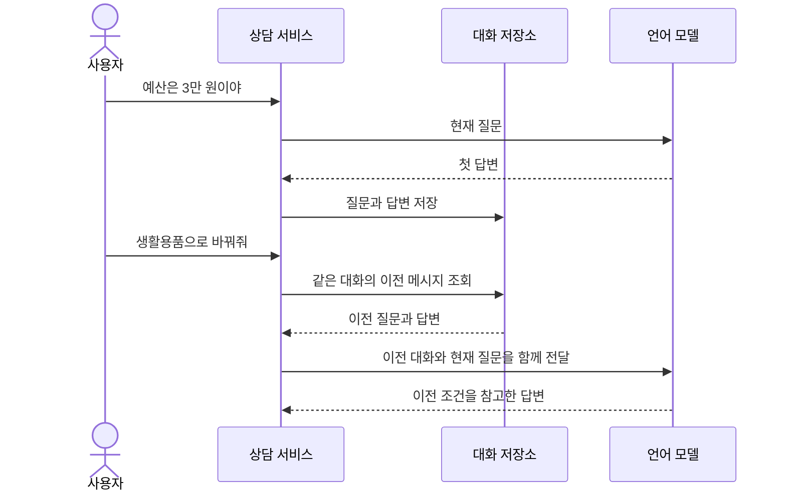

# 07. 대화 메모리: 이전 질문과 답변을 다음 프롬프트에 다시 담기

## 개념 먼저 이해하기

**대화 메모리(Chat Memory)**는 이전 대화에서 필요한 정보를 보관하고, 다음 모델 요청에 다시 포함하는 기능입니다. 모델이 앞선 API 호출을 저절로 기억하거나, 대화할 때마다 새로 학습하는 것은 아닙니다. 애플리케이션이 저장·조회·전달을 담당합니다.

사용자가 먼저 “예산은 3만 원이야”라고 말한 뒤 “생활용품으로 바꿔줘”라고 하면, 서비스는 이전 예산과 현재 변경 요청을 함께 모델에 전달해 후속 질문을 해석할 수 있습니다.

| 용어 | 쉬운 설명 | 서비스에서 정할 것 |
|---|---|---|
| 대화 이력 | 사용자와 모델이 주고받은 전체 기록 | 기록 보관 범위와 기간 |
| 대화 메모리 | 다음 응답에 활용하도록 보관·선택하는 대화 정보 | 모델에게 다시 보낼 내용 |
| 대화 ID | 서로 다른 대화를 구분하는 식별값 | 사용자별·상담별 대화 구분 |
| 메시지 창 | 최근 메시지 중 일정 범위만 유지하는 방식 | 한 번에 전달할 대화의 범위 |



Spring AI는 대화 메시지를 저장하고 조회할 수 있는 기능을 제공합니다. 이전 대화를 많이 보내면 모델이 처리할 정보와 비용도 늘어나므로, 전체 이력을 항상 그대로 보내는 것이 적절하지는 않습니다. 어떤 정보를 이어서 사용할지, 언제 대화를 초기화할지, 다른 사용자의 대화가 섞이지 않게 할지를 정해야 합니다.

이번 실습은 실행 중인 애플리케이션의 메모리에 대화를 보관합니다. 서버 재시작 뒤에도 대화를 유지하려면 그 목적에 맞는 저장소를 연결해야 합니다.

개념 참고: [Spring AI의 대화 메모리 설명](https://docs.spring.io/spring-ai/reference/api/chat-memory.html).

## 실습 안내

선수 지식: 03의 메시지 역할, Java List와 Service, 04의 record.
이 단원은 **텍스트 대화의 메시지를 직접 조회하고 저장하며 다음 요청에 전달하는 원리**를 익힙니다.
[그림 공통 기준](../diagram-guide.md): 클래스는 객체 책임, 시퀀스는 저장·조회·전달 순서를 나타냅니다.


## 작은 수업으로 나누어 읽기

처음에는 아래 순서로 하나씩 학습합니다. 전체 코드를 한 번에 이해하거나 보조 코드를 직접 작성할 필요는 없습니다.

| 순서 | 소수업 | 완료 기준 |
|---|---|---|
| 1 | [이전 대화를 다시 보내는 원리](07-chat-memory/01-messages.md) | 이전 질문과 답변을 저장하고 새 질문의 프롬프트에 다시 담는 원리를 이해합니다. |
| 2 | [메시지 조회·전달·저장 연결하기](07-chat-memory/02-store.md) | 이전 대화를 조회해 새 질문과 함께 전달하고, 새 답변을 저장하는 흐름을 연결합니다. |
| 3 | [대화 구분·삭제·메시지 창 관찰](07-chat-memory/03-isolation.md) | 같은 대화 ID라도 소유자가 다르면 분리되는지 확인합니다. |

각 소수업은 이 단원의 실습 모듈을 함께 사용합니다. 표의 순서대로 개념과 실행 코드를 연결하세요.
[공통 학습 방법](../learning-guide.md) · [전체 교육 계획](../curriculum.md)

## 실행 코드와 테스트

[labs/07-chat-memory의 실행 안내](../../labs/07-chat-memory/README.md)를 확인합니다.
이 단원의 기본 구현은 다음 명령으로 테스트·빌드·실행합니다. 명령은 저장소 루트 기준입니다.

```bash
./gradlew :Spring-AI-Agent-Learning:labs:07-chat-memory:test --tests com.example.ailearning.l07memory.MemoryLocalModelTest
./gradlew :Spring-AI-Agent-Learning:labs:07-chat-memory:bootJar
./gradlew :Spring-AI-Agent-Learning:labs:07-chat-memory:bootRun
```
