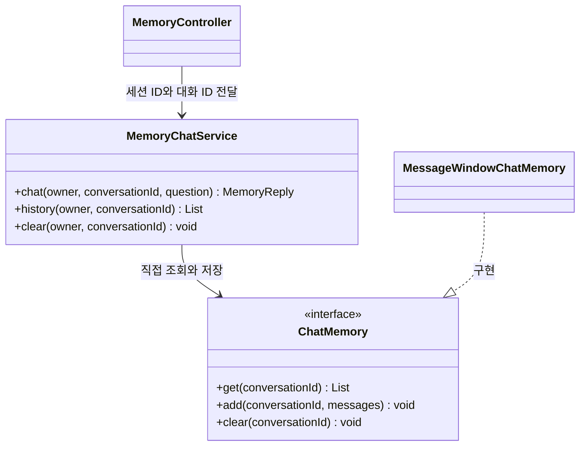
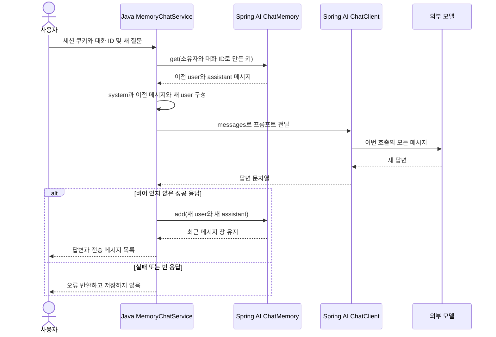

# 07. 대화 메모리: 이전 질문과 답변을 다음 프롬프트에 다시 담기

예상 시간: 2시간. 선수 지식: 03의 메시지 역할, Java List와 Service, 04의 record.
06의 Agent를 먼저 실행해야 하는 것은 아닙니다. 이 단원은 **텍스트 대화만** 사용합니다.
도구·RAG·MCP·Advisor를 조합하지 않고 직접 메시지를 읽고 저장해 원리를 확인합니다.
[그림 공통 기준](../diagram-guide.md): 클래스는 객체 책임, 시퀀스는 저장·조회·전달 순서를 나타냅니다.

## “기억한다”는 말의 실제 의미

첫 요청: “배송비 포함 예산은 3만원이야.”
다음 요청: “그 예산 안에서 음료로 추천해줘.”
두 번째 문장만 보내면 모델은 “그 예산”이 얼마인지 알 수 없습니다.
애플리케이션이 첫 질문과 답변을 저장하고, 두 번째 호출의 프롬프트에 함께 넣어야 합니다.
모델의 가중치를 다시 학습시키거나 이전 HTTP 연결 자체에 기억을 저장하는 것은 아닙니다.

이번 프롬프트는 다음 순서입니다.

| 순서 | 역할 | 내용 예 |
|---|---|---|
| 1 | system | 전달된 이전 대화와 현재 질문을 참고하라는 원칙 |
| 2 | user | 배송비 포함 예산은 3만원이야. |
| 3 | assistant | 네, 총예산 3만원을 참고하겠습니다. |
| 4 | user | 그 예산 안에서 음료로 추천해줘. |

assistant 문장은 **설명용 예시**입니다. 실제 모델의 문장은 달라집니다.
이번 실습은 실제 상품을 조회하지 않으므로, 기억한 예산을 언급했다고 실제 상품 가격까지 검증된 것은 아닙니다.

## 새 용어와 객체 관계

- `ChatMemory`: 대화 ID로 메시지를 저장·조회·삭제하는 Spring AI 인터페이스입니다.
- `MessageWindowChatMemory`: 최근 일정 개수의 메시지를 유지하는 구현체입니다. 여기서는 6개로 설정합니다.
- 대화 ID(conversation ID): 같은 대화를 묶는 이름입니다. 하나의 사용자에게도 여러 대화가 있을 수 있습니다.
- 서버 세션(HttpSession): 브라우저 쿠키로 이어지는 서버 측 방문자 구분입니다. 이 학습용 앱에서는 소유자 구분에 사용하며 로그인 인증을 구현한 것은 아닙니다.



저장소 기본 구현은 프로세스 메모리를 사용합니다. 서버를 종료하면 사라집니다.
ChatMemory는 모델에 보낼 문맥 관리용이며 전체 대화 영구 기록과 다릅니다.

## 코드 읽는 순서

모듈: `labs/07-chat-memory`, 패키지: `com.example.ailearning.l07memory`.

1. [MessageView](../../labs/07-chat-memory/src/main/java/com/example/ailearning/l07memory/MessageView.java), [MemoryReply](../../labs/07-chat-memory/src/main/java/com/example/ailearning/l07memory/MemoryReply.java): HTTP에서 관찰할 record
2. [MemoryChatService](../../labs/07-chat-memory/src/main/java/com/example/ailearning/l07memory/MemoryChatService.java): 조회 → 프롬프트 → 호출 → 성공 시 저장
3. [MemoryController](../../labs/07-chat-memory/src/main/java/com/example/ailearning/l07memory/MemoryController.java): 세션 소유자와 대화 ID 연결

### 서비스 전체 코드

```java
package com.example.ailearning.l07memory;

import org.springframework.ai.chat.client.ChatClient;
import org.springframework.ai.chat.memory.ChatMemory;
import org.springframework.ai.chat.memory.MessageWindowChatMemory;
import org.springframework.ai.chat.messages.*;
import org.springframework.http.HttpStatus;
import org.springframework.stereotype.Service;
import org.springframework.web.server.ResponseStatusException;
import java.util.ArrayList;
import java.util.List;

@Service
public class MemoryChatService {
    private static final String SYSTEM = """
            쇼핑 대화를 돕습니다. 전달된 이전 메시지와 현재 질문을 참고하세요.
            제공된 정보가 없으면 모른다고 말하세요. 실제 상품 조회 기능은 없습니다.
            """;
    private final ChatClient client;
    private final ChatMemory memory = MessageWindowChatMemory.builder().maxMessages(6).build();

    public MemoryChatService(ChatClient.Builder builder) { client = builder.build(); }

    // 입문용 단일 서버: 같은 대화의 동시 저장 충돌을 막기 위해 요청을 직렬 처리한다.
    public synchronized MemoryReply chat(String owner, String conversationId, String question) {
        String key = key(owner, conversationId);
        UserMessage current = new UserMessage(question);
        List<Message> messages = new ArrayList<>();
        messages.add(new SystemMessage(SYSTEM));
        messages.addAll(memory.get(key)); // 1. 이전 질문·응답 조회
        messages.add(current);            // 2. 새 질문 추가

        String answer = client.prompt().messages(messages).call().content(); // 3. 함께 전달
        if (answer == null || answer.isBlank()) {
            throw new ResponseStatusException(HttpStatus.BAD_GATEWAY, "빈 모델 응답은 저장하지 않습니다.");
        }
        // 4. 성공한 질문·응답만 저장. 이 다음 호출에서 재사용한다.
        memory.add(key, List.of(current, new AssistantMessage(answer)));
        return new MemoryReply(answer, messages.stream().map(MessageView::from).toList(), memory.get(key).size());
    }

    public String stateless(String question) {
        // 메모리 없는 비교 경로: 이전 요청을 조회하거나 저장하지 않는다.
        return client.prompt().system(SYSTEM).user(question).call().content();
    }

    public synchronized List<MessageView> history(String owner, String conversationId) {
        return memory.get(key(owner, conversationId)).stream().map(MessageView::from).toList();
    }

    public synchronized void clear(String owner, String conversationId) {
        memory.clear(key(owner, conversationId));
    }

    private String key(String owner, String conversationId) {
        // owner는 요청 본문이 아닌 서버 세션에서 가져온다.
        return owner + ":" + conversationId;
    }
}
```

핵심은 `memory.get(key)` → `messages.addAll(...)` → `client.prompt().messages(messages)` → `memory.add(...)`입니다.
메모리를 만들어 놓는 것만으로 ChatClient에 연결되지는 않습니다. 이번에는 코드가 명시적으로 연결합니다.
저장 전에 모델 응답을 확인하므로 실패한 질문만 대화에 남지 않습니다.

`synchronized`는 이 단일 서버의 메모리 요청을 한 번에 하나씩 처리하여 동시 저장 충돌을 줄이는 일반 Java 장치입니다.
모든 대화가 직렬 처리되어 처리량이 제한됩니다. 분산 서버·영구 저장·세션 만료 정리·대화 수 제한은 구현하지 않은 학습용 구성입니다.

## 한 번의 후속 요청 처리



system은 매 요청에서 한 번 추가하고 메모리에는 저장하지 않습니다. 같은 원칙이 중복 저장되는 일을 피합니다.
API 응답의 `sentMessages`는 이번 프롬프트에 직접 구성한 메시지입니다. 테스트는 **실제 모델 API로 전달된 메시지**도 별도로 확인합니다.
실제 서비스에서는 프롬프트 전체를 사용자에게 노출할지 별도로 결정해야 합니다. 이 로컬 수업은 원리 관찰을 위해 반환합니다.

## 소유자와 대화 ID를 함께 쓰는 이유

브라우저 A와 B가 모두 `demo`라는 대화 ID를 쓰더라도 같은 기억을 읽으면 안 됩니다.
서버가 `session.getId()`로 얻은 소유자와 요청 경로의 대화 ID를 합쳐 내부 키를 만듭니다.
사용자가 JSON에 다른 소유자 이름을 써서 기억을 조회하는 API는 만들지 않습니다.
대화 ID는 영문·숫자·밑줄·하이픈 1~40자로 제한합니다.
조회와 삭제도 같은 소유자 규칙을 적용합니다. 세션 쿠키를 잃으면 이 API로 이전 기억에 접근할 수 없습니다.

## 실행: 기억 없는 경로와 있는 경로 비교

[01장 환경 변수](01-setup.md#4-실제-모델을-사용할-때의-환경-변수)를 설정하고 저장소 루트에서 실행합니다.

```bash
./gradlew :Spring-AI-Agent-Learning:labs:07-chat-memory:test
./gradlew :Spring-AI-Agent-Learning:labs:07-chat-memory:bootRun
```

테스트는 실제 키가 필요 없습니다. bootRun으로 실제 모델을 호출하면 비용이 발생할 수 있습니다.
다른 터미널에서 먼저 기억 없는 경로를 호출합니다.

```bash
curl -sS http://127.0.0.1:8097/api/stateless \
  -H 'Content-Type: text/plain; charset=UTF-8' --data-raw '예산은 3만원이야.'
curl -sS http://127.0.0.1:8097/api/stateless \
  -H 'Content-Type: text/plain; charset=UTF-8' --data-raw '내 예산이 얼마지?'
```

다음은 같은 브라우저처럼 쿠키를 유지하는 경로입니다. `-c`는 쿠키 저장, `-b`는 쿠키 재전송입니다.

```bash
curl -sS -c /tmp/learning07-a.cookies -b /tmp/learning07-a.cookies \
  http://127.0.0.1:8097/api/memory/demo \
  -H 'Content-Type: text/plain; charset=UTF-8' --data-raw '예산은 3만원이야.'
curl -sS -c /tmp/learning07-a.cookies -b /tmp/learning07-a.cookies \
  http://127.0.0.1:8097/api/memory/demo \
  -H 'Content-Type: text/plain; charset=UTF-8' --data-raw '그 예산 안에서 음료로 추천해줘.'
```

두 번째 응답의 `sentMessages`에 이전 user와 assistant가 들어가는지 확인합니다.
모델이 예산을 우연히 맞혔는지가 아니라 **전송한 메시지에 이전 정보가 있는지**가 재사용의 근거입니다.
종료는 서버 터미널 Ctrl+C입니다.

## 격리·조회·삭제 실험

같은 서버에서 쿠키 파일을 다르게 만들어 다른 방문자를 흉내냅니다.

```bash
curl -sS -c /tmp/learning07-b.cookies -b /tmp/learning07-b.cookies \
  http://127.0.0.1:8097/api/memory/demo \
  -H 'Content-Type: text/plain; charset=UTF-8' --data-raw '내 예산이 얼마지?'
```

B의 전송 목록에는 A의 이전 대화가 없어야 합니다. A의 기억을 조회하고 삭제하려면 A의 쿠키를 사용합니다.

```bash
curl -sS -b /tmp/learning07-a.cookies http://127.0.0.1:8097/api/memory/demo
curl -i -X DELETE -b /tmp/learning07-a.cookies http://127.0.0.1:8097/api/memory/demo
```

삭제 후 A의 다음 요청에는 이전 대화가 포함되지 않습니다. B나 같은 소유자의 다른 대화 ID는 지우지 않습니다.
쿠키 파일을 보존하면 다음 실습 실행에서도 같은 브라우저로 취급될 수 있습니다. 새 비교는 별도 파일을 사용하세요.
서버를 재시작하면 메모리와 서버 세션은 초기화됩니다.

## 메시지 창과 토큰 수는 다르다

저장 메시지 상한 6개는 질문·답변 쌍 3회에 해당합니다. system은 저장하지 않습니다.

| 시점 | 저장된 메시지 | 다음 요청에 전달할 수 있는 메시지 |
|---|---:|---|
| 첫 답변 후 | 2 | system + 이전 2개 + 새 질문 |
| 세 번째 답변 후 | 6 | system + 이전 6개 + 새 질문 |
| 네 번째 답변 후 | 6 | 오래된 질문·답변이 제거된 최근 메시지 |

즉 **전송 목록은 최대 8개**, 저장 목록은 최대 6개입니다.
메시지 하나가 길면 토큰도 많아질 수 있습니다. 메시지 수 제한은 토큰 예산 제한과 같지 않습니다.
이 단원은 토큰 계산·요약·장기 기억을 추가하지 않습니다. 오래된 정보가 창 밖으로 사라지는 현상을 먼저 확인합니다.

[MemoryContractTest](../../labs/07-chat-memory/src/test/java/com/example/ailearning/l07memory/MemoryContractTest.java)는 이전 user/assistant 재전달, stateless 비교, 쿠키별 격리, 대화별 삭제, 6개 창, 빈 응답 저장 방지, 입력 검증을 확인합니다.
테스트는 서버가 보낸 실제 모델 API 메시지를 검사하며 고정 응답의 언어 이해 능력을 평가하지 않습니다.

## 확인 질문

1. 이전 대화를 DB에 저장만 하면 모델이 다음 질문에 자동으로 참고할까요?
2. 같은 ChatClient를 재사용하는 것과 같은 대화 ID의 메시지를 전달하는 것은 어떻게 다른가요?
3. A와 B가 같은 대화 ID를 사용할 때 소유자를 키에 포함하지 않으면 어떤 일이 생기나요?
4. 메시지 6개 제한이 모델 토큰 6개 제한인가요?

<details><summary>해설</summary>

저장한 대화를 다음 프롬프트에 실제로 포함해야 합니다. ChatClient 객체 재사용만으로 기억하지 않습니다.
소유자를 구분하지 않으면 다른 방문자의 대화가 섞일 수 있습니다. 메시지와 토큰은 다른 단위입니다.
전송 목록에서 순서와 격리를 확인하고 기억 없는 경로와 비교할 수 있으면 완료입니다.
</details>

보충: [공식 Chat Memory](https://docs.spring.io/spring-ai/reference/api/chat-memory.html).
다음 08에서는 지금 직접 작성한 연결 작업을 Advisor로 확장합니다. 이 단원 코드는 08에 의존하지 않습니다.
[이전: 06](06-workflow-agent.md) · [학습 지도](../curriculum.md)

[다음: 08. Advisor](08-advisors.md)
