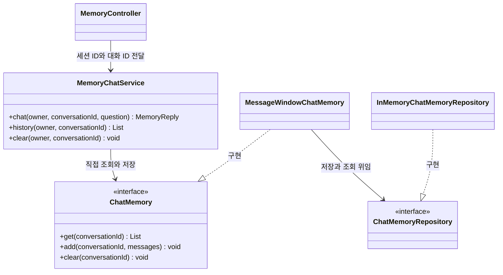

# 07-1. 이전 대화와 저장소 생성·연결

**실행 코드·설정·테스트:** [labs/07-00-chat-memory](../../../labs/07-00-chat-memory/README.md). 저장소 루트에서 해당 README의 명령으로 실행합니다.

**이번 목표:** 이전 대화 재전달의 원리와 기본 저장소의 생성 위치를 이해합니다. 선택 예제에서는 JDBC 자동 구성과 InMemory·Redis 선택을 연결합니다.

**코드 읽기 안내:** 먼저 메시지 순서와 빌더 소스를 읽습니다. JDBC·Redis는 선택 예제로, 필요한 저장소 한 가지씩 실행한 뒤 다음으로 넘어갑니다.

## “기억한다”는 말의 실제 의미

- 첫 요청: “배송비 포함 예산은 3만원이야.”
- 다음 요청: “그 예산 안에서 음료로 추천해줘.”
- 두 번째 문장만 보내면 모델은 “그 예산”이 얼마인지 알 수 없습니다.
- 애플리케이션이 첫 질문과 답변을 저장하고, 두 번째 호출의 프롬프트에 함께 넣어야 합니다.
- 모델의 가중치를 다시 학습시키거나 이전 HTTP 연결 자체에 기억을 저장하는 것은 아닙니다.

이번 프롬프트는 다음 순서입니다.

| 순서 | 역할 | 내용 예 |
|---|---|---|
| 1 | system | 전달된 이전 대화와 현재 질문을 참고하라는 원칙 |
| 2 | user | 배송비 포함 예산은 3만원이야. |
| 3 | assistant | 네, 총예산 3만원을 참고하겠습니다. |
| 4 | user | 그 예산 안에서 음료로 추천해줘. |

assistant 문장은 **설명용 예시**입니다. 실제 모델의 문장은 달라집니다.

## 새 용어와 객체 관계

- `ChatMemory`: 대화 ID로 메시지를 저장·조회·삭제하는 Spring AI 인터페이스입니다.
- `MessageWindowChatMemory`: 최근 일정 개수의 메시지를 유지하는 Spring AI(2.0.2)의 유일한 구현체입니다. 여기서는 6개로 설정합니다.
- `ChatMemoryRepository`: 메시지를 저장·조회하는 인터페이스입니다. 어떤 메시지를 남길지 정하는 정책과 저장 위치를 분리합니다.
- `InMemoryChatMemoryRepository`: 대화별 메시지를 JVM 메모리에 저장하는 구현체입니다.
- 대화 ID(conversation ID): 같은 대화를 묶는 이름입니다. 하나의 사용자에게도 여러 대화가 있을 수 있습니다.
- 서버 세션(HttpSession): 브라우저 쿠키로 이어지는 서버 측 방문자 구분입니다.
  - 이 학습용 앱에서는 소유자 구분에 사용하며 로그인 인증을 구현한 것은 아닙니다.



- 저장소 기본 구현은 프로세스 메모리를 사용합니다. 서버를 종료하면 사라집니다.
- ChatMemory는 모델에 보낼 문맥 관리용이며 전체 대화 영구 기록과 다릅니다.

## Spring AI가 제공하는 대화 저장소 종류

**보관 정책과 저장소 종류를 구분해서 읽습니다.** `MessageWindowChatMemory`는 최근 메시지를 유지하는 `ChatMemory` 구현체이고, 아래 여섯 가지는 메시지를 실제로 보관하는 **`ChatMemoryRepository` 구현체**입니다. 저장소를 바꾸면서 같은 메시지 창 정책을 사용할 수 있습니다.

이 교재가 사용하는 **Spring AI 2.0.2 기준**의 목록입니다.

| 구현체 | 저장 위치 | 알아둘 특징 |
|---|---|---|
| `InMemoryChatMemoryRepository` | JVM 메모리 | 기본 저장소. 프로세스 종료 시 사라지고 서버 간 자동 공유되지 않음 |
| `JdbcChatMemoryRepository` | PostgreSQL·MySQL 등 관계형 DB | JDBC로 메시지 저장. DB 연결·드라이버·스키마 준비 필요 |
| `CassandraChatMemoryRepository` | Cassandra | Cassandra에 대화 메시지를 보관 |
| `Neo4jChatMemoryRepository` | Neo4j | 그래프 DB에 메시지와 관계를 보관 |
| `MongoChatMemoryRepository` | MongoDB | 문서형 DB에 대화 메시지를 보관 |
| `RedisChatMemoryRepository` | Redis Stack | Redis Query Engine·RedisJSON이 필요하며 만료 시간(TTL) 설정 지원 |

InMemory 외의 저장소는 해당 의존성과 외부 저장소 연결 설정이 필요합니다. 여기서는 이름을 외우기보다 기존 인프라·보관 기간·메시지 지원 범위에 맞춰 저장 위치를 선택할 수 있다는 점을 이해합니다. 데이터가 재시작 후 유지되는지는 저장소의 영속화 설정까지 확인해야 합니다.

기본 실습은 InMemory를 사용하고, 이 문서의 선택 예제에서 JDBC 자동 구성과 InMemory·Redis 선택을 실행합니다. [07-4](04-production-memory.md)는 영구 이력·동시 요청 같은 운영 설계를 다룹니다. 다른 저장소를 학습 순서대로 모두 설치할 필요는 없습니다.

별도로 Azure Cosmos DB 팀이 관리하는 외부 모듈의 `CosmosDBChatMemoryRepository`도 있습니다. 위의 Spring AI 기본 제공 구현체와 구분합니다. 출처와 저장소별 설정은 [공식 Chat Memory의 Memory Storage 절](https://docs.spring.io/spring-ai/reference/api/chat-memory.html#_memory_storage)에서 확인합니다. 필요한 경우 인터페이스를 직접 구현해 다른 저장소에 연결할 수도 있습니다.

## 생성 코드에서 기본 저장소가 만들어지는 위치 찾기

기본 실습의 `MemoryChatService`는 다음처럼 메모리를 만듭니다. 저장소를 전달하는 줄은 없습니다.

```java
private final ChatMemory conversationMemory = MessageWindowChatMemory.builder()
        .maxMessages(6)
        .build();
```

### Spring AI 빌더의 실제 코드

다음은 **Spring AI 2.0.2의 `MessageWindowChatMemory` 소스 중 기본 개수 상수와 빌더 부분 발췌**입니다. 들여쓰기만 바꾸었습니다. 출처: [Spring AI 소스](https://github.com/spring-projects/spring-ai/blob/v2.0.2/spring-ai-model/src/main/java/org/springframework/ai/chat/memory/MessageWindowChatMemory.java), Spring 프로젝트 기여자, Apache License 2.0.

```java
private static final int DEFAULT_MAX_MESSAGES = 20;

public static Builder builder() {
    return new Builder();
}

public static final class Builder {

    private ChatMemoryRepository chatMemoryRepository = new InMemoryChatMemoryRepository();

    private int maxMessages = DEFAULT_MAX_MESSAGES;

    private Builder() {
    }

    public Builder chatMemoryRepository(ChatMemoryRepository chatMemoryRepository) {
        this.chatMemoryRepository = chatMemoryRepository;
        return this;
    }

    public Builder maxMessages(int maxMessages) {
        this.maxMessages = maxMessages;
        return this;
    }

    public MessageWindowChatMemory build() {
        return new MessageWindowChatMemory(this.chatMemoryRepository, this.maxMessages);
    }

}
```

호출을 위 코드에 대입하면 다음 순서입니다.

1. `builder()`가 `new Builder()`를 실행합니다.
2. `Builder` 객체를 만들면서 필드의 **`new InMemoryChatMemoryRepository()`가 실행**됩니다. 이때 이미 기본 저장소가 생깁니다.
3. `.maxMessages(6)`은 개수만 바꿉니다. 저장소 필드는 그대로입니다.
4. `.build()`가 저장소 필드와 개수를 `MessageWindowChatMemory` 생성자에 전달합니다.

따라서 저장소 지정 생략은 **빌더가 이미 준비한 InMemory 저장소를 사용하는 것**입니다. Spring이 등록된 빈을 찾아서 넣는 과정은 이 코드에 없습니다.

직접 저장소를 연결하려면 다음처럼 전달합니다. `.chatMemoryRepository(repository)`는 빌더의 저장소 필드를 전달받은 객체로 바꿉니다.

```java
ChatMemoryRepository repository = new InMemoryChatMemoryRepository();
ChatMemory memory = MessageWindowChatMemory.builder()
        .chatMemoryRepository(repository)
        .maxMessages(6)
        .build();
```

서로 다른 빌더의 기본 저장소는 별개입니다. 반대로 같은 `repository`를 두 메모리에 전달하면 같은 저장소를 공유합니다. [MemoryBuilderUnitTest](../../../labs/07-00-chat-memory/src/test/java/com/example/ailearning/l07repositories/MemoryBuilderUnitTest.java)가 두 경우의 저장·조회 결과를 비교합니다.

## JDBC 자동 구성: DB 저장소를 어디서 받을까?

여기부터는 **저장소 연결을 배우는 선택 예제**입니다. 실행 코드는 기본 앱과 구분한 테스트 패키지 `com.example.ailearning.l07repositories`에 있습니다. 기존 채팅 앱의 소스는 바꾸지 않고 모델 API 없이 저장·조회부터 확인합니다. `ApplicationContextRunner`는 테스트에서 필요한 자동 구성과 설정 클래스만 올리는 Spring Boot 도구입니다. JDBC 테스트는 DataSource·JdbcTemplate·JDBC 저장소 자동 구성을 선택하고, Redis 테스트는 두 저장소의 명시적 설정만 선택합니다.

### 1. 의존성과 접속 설정 준비

현재 [build.gradle](../../../labs/07-00-chat-memory/build.gradle)은 다음 의존성을 테스트 범위에 추가했습니다.

```groovy
testImplementation 'org.springframework.ai:spring-ai-starter-model-chat-memory-repository-jdbc'
testRuntimeOnly 'org.hsqldb:hsqldb'
```

HSQLDB는 이 예제에서 실제 SQL을 실행하는 내장 DB입니다. 별도 DB 서버 설치를 줄이기 위해 선택했습니다. [JdbcMemoryRepositoryIntegrationTest](../../../labs/07-00-chat-memory/src/test/java/com/example/ailearning/l07repositories/JdbcMemoryRepositoryIntegrationTest.java)는 아래 설정 값을 `withPropertyValues(...)`로 전달합니다. 다음 YAML은 **같은 값을 읽기 쉽게 표현한 설정 예시**입니다.

```yaml
spring:
  datasource:
    url: jdbc:hsqldb:mem:learning07-memory
    username: sa
    password: ""
  ai:
    chat:
      memory:
        repository:
          jdbc:
            initialize-schema: always
```

이 주소의 `mem:`은 DB도 프로세스 메모리에 존재한다는 뜻입니다. SQL 저장·조회는 실제로 수행하지만 재시작 후 영구 보존을 검증하는 예제는 아닙니다. 영구 보관하려면 파일 DB 또는 외부 DB 주소와 적절한 드라이버·계정을 사용합니다. `initialize-schema: always`는 실습 테이블을 준비하는 설정입니다. 운영에서 스키마를 별도 관리한다면 `never` 등 관리 정책에 맞춥니다.

### 2. 자동 구성된 구현체를 명확히 연결

자동 구성은 다음 연결을 준비합니다.

```text
DataSource 설정 → DB 연결과 JdbcTemplate 준비
               → JdbcChatMemoryRepository 빈 생성
               → 아래 @Bean 메서드의 jdbcRepository로 전달
               → MessageWindowChatMemory에 연결
```

[JdbcMemoryConfiguration.java](../../../labs/07-00-chat-memory/src/test/java/com/example/ailearning/l07repositories/JdbcMemoryConfiguration.java)의 실제 코드입니다. 매개변수를 **`JdbcChatMemoryRepository`**로 선언해 어떤 구현체를 받는지 드러냈습니다.

```java
@Configuration
public class JdbcMemoryConfiguration {
    @Bean
    public ChatMemory jdbcChatMemory(JdbcChatMemoryRepository jdbcRepository) {
        return MessageWindowChatMemory.builder()
                .chatMemoryRepository(jdbcRepository)
                .maxMessages(6)
                .build();
    }
}
```

이 예제에서는 `new JdbcChatMemoryRepository(...)`를 작성하지 않습니다. JDBC 자동 구성이 그 객체를 만들고, 위 메서드는 그 객체를 사용해 메시지 보관 개수 6개인 메모리를 만듭니다. 직접 만든 다른 저장소 빈이 있다면 JDBC 자동 구성의 생성 조건이 달라질 수 있으므로 이 예제와 여러 저장소 예제를 함께 등록하지 않습니다.

### 3. 실제 채팅 서비스에 적용할 때 바꿀 위치

JDBC 구성을 실제 앱에 적용하려면 의존성을 `implementation`·`runtimeOnly`로 옮기고, 접속 값을 `application.yml`에 설정한 뒤 위 설정 클래스를 앱의 탐색 범위에 둡니다. 그다음 `MemoryChatService`의 기존 **필드 초기화와 생성자**를 다음 발췌로 교체합니다.

```java
private final ChatClient chatClient;
private final ChatMemory conversationMemory;

public MemoryChatService(ChatClient.Builder builder, ChatMemory conversationMemory) {
    this.chatClient = builder.build();
    this.conversationMemory = conversationMemory;
}
```

이제 `conversationMemory`에는 위 `@Bean` 메서드가 반환한 메모리가 들어갑니다. 기존 `chat()`의 `get(...)`·프롬프트 전달·`add(...)`는 그대로 사용할 수 있습니다. **필드의 `MessageWindowChatMemory.builder().build()`를 남겨 두면 JDBC 빈을 사용하지 않습니다.** 기본 실습 소스에는 이 변경을 적용하지 않았습니다.

### 4. 실행해서 저장소 확인

저장소 루트에서 실행합니다. 실제 모델이나 외부 DB 서버는 사용하지 않습니다.

```bash
./gradlew :Spring-AI-Agent-Learning:labs:07-00-chat-memory:test --tests com.example.ailearning.l07repositories.MemoryBuilderUnitTest --tests com.example.ailearning.l07repositories.JdbcMemoryRepositoryIntegrationTest
```

JDBC 테스트는 **자동 구성된 클래스 이름, 테이블에 저장된 메시지 행 수 2개, 새 메모리에서 조회한 질문·답변**을 출력하고 검증합니다. 한 메모리 객체의 필드에만 남은 값이 아니라 DB에서 다시 읽는지 확인하는 것입니다.

## InMemory와 Redis를 함께 구성하고 실행 중 선택하기

이 예제는 JDBC 예제와 **별도로** 실행합니다. 두 저장소를 모두 만든 뒤 한 번의 실행 안에서 요청마다 선택합니다. 환경 설정으로 시작 시 한 종류만 고르는 방식과 다릅니다.

### 1. Redis 클라이언트와 실제 구현체 준비

실행 예제는 다음 테스트 의존성을 사용합니다. `RedisChatMemoryRepository` 2.0.2가 선언한 Jedis 버전은 7.4.1입니다. 현재 Boot의 기본 관리 버전 7.0에는 예제에서 사용하는 `RedisClient`가 없으므로 테스트 의존성에 버전을 명시했습니다.

```groovy
testImplementation 'org.springframework.ai:spring-ai-model-chat-memory-repository-redis'
testImplementation 'redis.clients:jedis:7.4.1'
```

일반 Redis만으로는 이 예제를 실행할 수 없습니다. RedisJSON과 검색 기능을 포함한 **Redis Stack**이 필요합니다. import를 포함한 전체 코드는 [SelectableMemoryConfiguration.java](../../../labs/07-00-chat-memory/src/test/java/com/example/ailearning/l07repositories/SelectableMemoryConfiguration.java)입니다.

```java
@Configuration
public class SelectableMemoryConfiguration {
    @Bean
    public InMemoryChatMemoryRepository inMemoryRepository() {
        return new InMemoryChatMemoryRepository();
    }

    @Bean(destroyMethod = "close")
    public RedisClient redisClient(@Value("${learning.redis.host:127.0.0.1}") String host,
            @Value("${learning.redis.port:6379}") int port) {
        return RedisClient.builder()
                .hostAndPort(host, port)
                .build();
    }

    @Bean
    public RedisChatMemoryRepository redisRepository(RedisClient redisClient) {
        return RedisChatMemoryRepository.builder()
                .jedisClient(redisClient)
                .indexName("learning07-memory")
                .keyPrefix("learning07-memory:")
                .initializeSchema(true)
                .build();
    }

    @Bean
    public ChatMemory inMemoryChatMemory(InMemoryChatMemoryRepository inMemoryRepository) {
        return MessageWindowChatMemory.builder()
                .chatMemoryRepository(inMemoryRepository)
                .maxMessages(6)
                .build();
    }

    @Bean
    public ChatMemory redisChatMemory(RedisChatMemoryRepository redisRepository) {
        return MessageWindowChatMemory.builder()
                .chatMemoryRepository(redisRepository)
                .maxMessages(6)
                .build();
    }

    @Bean
    public SelectableMemoryService selectableMemoryService(
            @Qualifier("inMemoryChatMemory") ChatMemory inMemoryChatMemory,
            @Qualifier("redisChatMemory") ChatMemory redisChatMemory) {
        return new SelectableMemoryService(inMemoryChatMemory, redisChatMemory);
    }
}
```

`inMemoryRepository()`는 `new`로 InMemory 구현체를 만들고, `redisRepository()`는 실제 Redis 클라이언트를 넣어 Redis 구현체를 만듭니다. 그 위에 각각 메시지 6개인 메모리를 구성합니다. 여기서는 자동 선택에 맡기지 않고 **두 저장소의 생성과 연결을 명시**했습니다.

두 `ChatMemory` 빈은 타입이 같으므로 `@Qualifier`로 빈 이름을 지정합니다. `@Bean` 이름은 기본적으로 메서드 이름입니다. 예를 들어 `@Qualifier("redisChatMemory")`는 위의 `redisChatMemory()`가 반환한 객체를 뜻합니다.

### 2. 요청마다 사용할 메모리 선택

[MemoryStorage](../../../labs/07-00-chat-memory/src/test/java/com/example/ailearning/l07repositories/MemoryStorage.java)는 `IN_MEMORY`, `REDIS` 두 값을 가진 Enum입니다. [SelectableMemoryService.java](../../../labs/07-00-chat-memory/src/test/java/com/example/ailearning/l07repositories/SelectableMemoryService.java)의 실제 구현은 다음과 같습니다.

```java
public class SelectableMemoryService {
    private final Map<MemoryStorage, ChatMemory> memoriesByStorage;

    public SelectableMemoryService(ChatMemory inMemoryChatMemory, ChatMemory redisChatMemory) {
        memoriesByStorage = Map.of(
                MemoryStorage.IN_MEMORY, inMemoryChatMemory,
                MemoryStorage.REDIS, redisChatMemory);
    }

    public ChatMemory memoryFor(MemoryStorage storage) {
        return memoriesByStorage.get(Objects.requireNonNull(storage, "저장 위치를 지정하세요."));
    }
}
```

다음은 선택·사용 부분의 **설명용 호출 예시**입니다. `memoryService`는 위 설정에서 생성한 서비스입니다.

```java
ChatMemory selectedMemory = memoryService.memoryFor(MemoryStorage.IN_MEMORY);
selectedMemory.add("customer-a:demo", new UserMessage("로컬에 보관할 질문"));

// 앱을 재시작하지 않고 다음 요청에서 Redis 선택
selectedMemory = memoryService.memoryFor(MemoryStorage.REDIS);
selectedMemory.add("customer-a:demo", new UserMessage("Redis에 보관할 질문"));
```

같은 대화 ID여도 저장소가 다르면 다른 목록입니다. Redis를 골랐다고 InMemory의 이전 대화가 복사되지 않습니다. 기존 대화를 이어가려면 처음 선택한 저장소를 대화에 연결해 유지하거나, 별도 이전 절차를 설계해야 합니다. 실제 채팅에서는 한 요청이 끝날 때까지 같은 `selectedMemory`로 이전 대화를 읽고 새 질문·답변을 저장합니다. 권한이 필요한 운영 서비스에서는 저장소 선택도 서버 정책으로 제한합니다.

### 3. Redis Stack으로 선택 결과 확인

Docker가 실행된 환경에서 다른 용도로 쓰지 않는 실습 포트로 Redis Stack을 시작합니다. 아래 컨테이너는 실습 후 제거하므로 영구 보관 설정을 검증하는 구성은 아닙니다.

```bash
docker run --rm -d --name learning07-redis -p 127.0.0.1:16379:6379 redis/redis-stack-server:7.4.0-v3
LEARNING_REDIS_PORT=16379 ./gradlew :Spring-AI-Agent-Learning:labs:07-00-chat-memory:test --tests com.example.ailearning.l07repositories.RedisMemoryRepositoryLiveTest
docker stop learning07-redis
```

테스트는 실제 Redis를 사용합니다. 같은 실행 안에서 로컬에 저장 → Redis에는 없음 확인 → Redis에 다른 대화 저장 → 각각 다시 조회 순서로 검사하고 두 결과를 출력합니다. 테스트가 추가한 임의 대화 ID만 정리하며 다른 대화를 지우지 않습니다. 모델 API 키나 비용은 필요하지 않습니다.

공식 설정·지원 범위: [Spring AI Chat Memory](https://docs.spring.io/spring-ai/reference/api/chat-memory.html). 테스트용 연결 예제와 상용 서비스의 인증·영구 이력·동시 요청 설계는 구분합니다.

## 서비스에서 사용하는 메서드

| 서비스에서 사용하는 메서드 | 의미 | 저장소에 위임하는 처리 |
|---|---|---|
| `add(conversationId, messages)` | 새 메시지를 추가하고, 보관 개수 상한을 넘으면 오래된 대화를 제거 | 기존 목록 조회 후 유지할 목록 저장 |
| `get(conversationId)` | 현재 보관된 메시지 조회 | `findByConversationId(...)` |
| `clear(conversationId)` | 해당 대화의 메모리 삭제 | `deleteByConversationId(...)` |

저장소의 `saveAll(conversationId, messages)`은 **그 대화의 기존 목록을 전달된 목록으로 교체**합니다. 새 메시지만 계속 추가하는 메서드가 아닙니다. 보통 서비스는 `ChatMemory.add(...)`를 사용하고, 저장소를 직접 갱신해 창 정책을 우회하지 않습니다.

`findConversationIds()`는 저장소가 가진 대화 ID 목록을 조회합니다. 현재 로그인 사용자가 읽어도 되는 대화를 걸러 주는 기능은 아니므로, 사용자용 대화 목록 API에는 별도 소유권 검사가 필요합니다.

## 메시지 창은 무엇을 유지할까?

`maxMessages(6)`은 이 객체가 관리하는 **각 대화의 보관 메시지 수 상한**입니다. 전체 사용자 수나 토큰 수를 제한하지 않습니다. 기본값은 20이며, 이 예제는 관찰하기 쉽게 6으로 지정했습니다.

2.0.2는 오래된 메시지를 줄일 때 사용자 질문으로 시작하는 대화 차례의 경계를 고려합니다. 그래서 항상 정확히 상한 개수가 남는 것은 아닙니다. 저장된 system 메시지는 특별히 보존하지만, 이번 서비스는 system을 매 요청에만 넣고 메모리에는 저장하지 않습니다. 이번처럼 질문 하나와 답변 하나씩 저장하면 최근 3회 대화를 관찰할 수 있습니다.

API 계약의 근거: [Spring AI 2.0.2의 메모리 소스](https://github.com/spring-projects/spring-ai/tree/v2.0.2/spring-ai-model/src/main/java/org/springframework/ai/chat/memory). 내부 구현을 외울 필요는 없으며 위의 역할 구분에 집중합니다.


## 확인 질문

1. 이전 대화를 저장만 하고 다음 프롬프트에 보내지 않으면 모델이 그 대화를 참고할 수 있나요?
2. JDBC 저장소 빈이 있는 앱에서 `MessageWindowChatMemory.builder().build()`를 직접 호출하면 그 JDBC 저장소를 자동으로 사용하나요?
3. 실행 중 저장 위치를 InMemory에서 Redis로 바꾸면 기존 대화도 자동으로 옮겨지나요?

<details>
<summary>해설</summary>

1. 아닙니다. 같은 대화의 이전 user·assistant를 읽어 현재 질문과 함께 전달해야 합니다.
2. 아닙니다. 이 빌더는 자체 InMemory 저장소를 생성합니다. JDBC를 쓰려면 자동 구성된 저장소를 받아 `.chatMemoryRepository(jdbcRepository)`로 연결한 메모리를 사용해야 합니다.
3. 아닙니다. 다른 저장소의 메시지 목록을 선택하는 것입니다. 같은 대화를 이어가려면 저장소를 유지하거나 별도의 이전 절차를 설계합니다.

</details>

[이전](../07-chat-memory.md) · [다음](02-store.md) · [단원 목차](../07-chat-memory.md) · [학습 방법](../../learning-guide.md)
