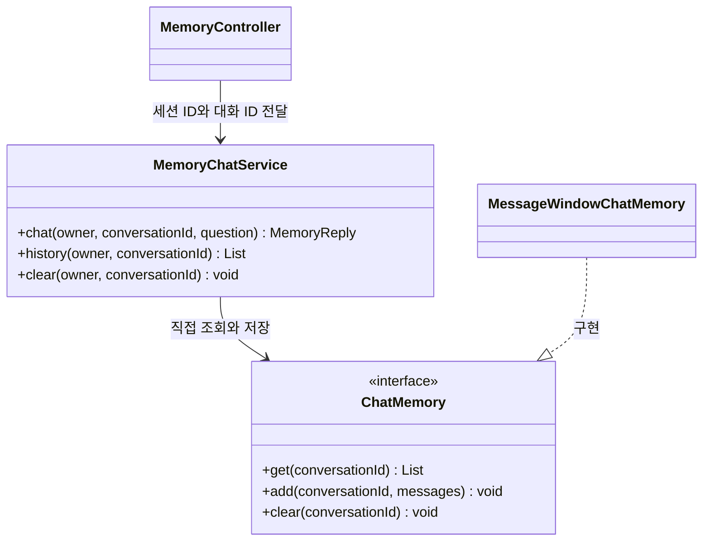

# 07-1. 이전 대화를 다시 보내는 원리

**실행 코드·설정·테스트:** [labs/07-00-chat-memory](../../../labs/07-00-chat-memory/README.md). 저장소 루트에서 해당 README의 명령으로 실행합니다.

**이번 목표:** 이전 질문과 답변을 저장하고 새 질문의 프롬프트에 다시 담는 원리를 이해합니다.

**코드 읽기 안내:** 종이에 system, 이전 user, 이전 assistant, 현재 user 순서로 메시지를 적어 보세요.

## “기억한다”는 말의 실제 의미

첫 요청: “배송비 포함 예산은 3만원이야.”
다음 요청: “그 예산 안에서 음료로 추천해줘.”
두 번째 문장만 보내면 모델은 “그 예산”이 얼마인지 알 수 없습니다.
애플리케이션이 첫 질문과 답변을 저장하고, 두 번째 호출의 프롬프트에 함께 넣어야 합니다.
모델의 가중치를 다시 학습시키거나 이전 HTTP 연결 자체에 기억을 저장하는 것은 아닙니다.

이번 프롬프트는 다음 순서입니다.

| 순서 | 역할 | 내용 예 |
|---|---|---|
| 1 | system | 전달된 이전 대화와 현재 질문을 참고하라는 원칙 |
| 2 | user | 배송비 포함 예산은 3만원이야. |
| 3 | assistant | 네, 총예산 3만원을 참고하겠습니다. |
| 4 | user | 그 예산 안에서 음료로 추천해줘. |

assistant 문장은 **설명용 예시**입니다. 실제 모델의 문장은 달라집니다.

## 새 용어와 객체 관계

- `ChatMemory`: 대화 ID로 메시지를 저장·조회·삭제하는 Spring AI 인터페이스입니다.
- `MessageWindowChatMemory`: 최근 일정 개수의 메시지를 유지하는 구현체입니다. 여기서는 6개로 설정합니다.
- 대화 ID(conversation ID): 같은 대화를 묶는 이름입니다. 하나의 사용자에게도 여러 대화가 있을 수 있습니다.
- 서버 세션(HttpSession): 브라우저 쿠키로 이어지는 서버 측 방문자 구분입니다. 이 학습용 앱에서는 소유자 구분에 사용하며 로그인 인증을 구현한 것은 아닙니다.

저장소 기본 구현은 프로세스 메모리를 사용합니다. 서버를 종료하면 사라집니다.
ChatMemory는 모델에 보낼 문맥 관리용이며 전체 대화 영구 기록과 다릅니다.

## 여기서 멈춰 확인하기

두 번째 질문에 필요한 이전 user·assistant 메시지를 표에서 찾아보세요. 저장만 하고 보내지 않으면 어떻게 될까요?

[이전](../07-chat-memory.md) · [다음](02-store.md) · [단원 목차](../07-chat-memory.md) · [학습 방법](../../learning-guide.md)
