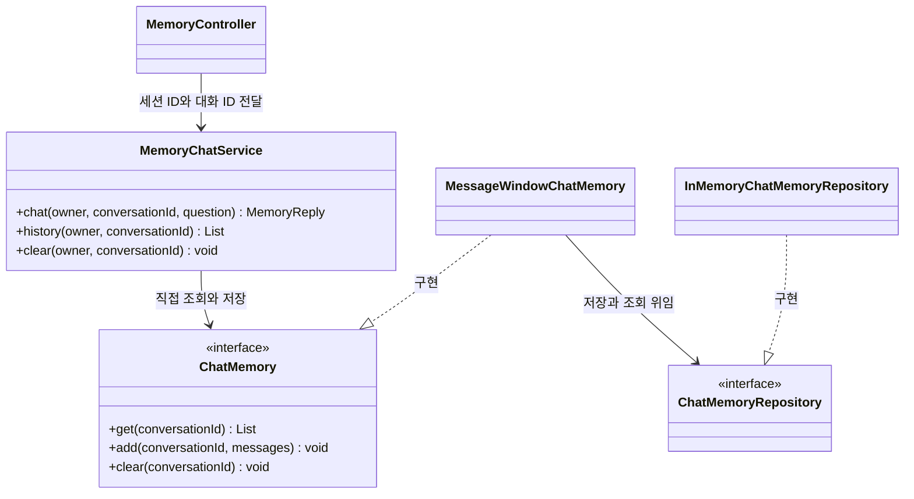

# 07-1. 이전 대화와 저장소 생성·연결

**실행 코드·설정·테스트:** [labs/07-00-chat-memory](../../../labs/07-00-chat-memory/README.md). 저장소 루트에서 해당 README의 명령으로 실행합니다.

**이번 목표:** 이전 대화 재전달의 원리와 기본 저장소의 생성 위치를 이해합니다. 저장소 연결·선택은 별도 소주제에서 학습합니다.

**코드 읽기 안내:** 먼저 메시지 순서와 빌더 소스를 읽습니다. JDBC·Redis 예제는 아래 별도 소주제에서 필요한 저장소 한 가지씩 선택해 학습합니다.

## “기억한다”는 말의 실제 의미

- 첫 요청: “배송비 포함 예산은 3만원이야.”
- 다음 요청: “그 예산 안에서 음료로 추천해줘.”
- 두 번째 문장만 보내면 모델은 “그 예산”이 얼마인지 알 수 없습니다.
- 애플리케이션이 첫 질문과 답변을 저장하고, 두 번째 호출의 프롬프트에 함께 넣어야 합니다.
- 모델의 가중치를 다시 학습시키거나 이전 HTTP 연결 자체에 기억을 저장하는 것은 아닙니다.

이번 프롬프트는 다음 순서입니다.

| 순서 | 역할 | 내용 예 |
|---|---|---|
| 1 | system | 전달된 이전 대화와 현재 질문을 참고하라는 원칙 |
| 2 | user | 배송비 포함 예산은 3만원이야. |
| 3 | assistant | 네, 총예산 3만원을 참고하겠습니다. |
| 4 | user | 그 예산 안에서 음료로 추천해줘. |

assistant 문장은 **설명용 예시**입니다. 실제 모델의 문장은 달라집니다.

## 새 용어와 객체 관계

- `ChatMemory`: 대화 ID로 메시지를 저장·조회·삭제하는 Spring AI 인터페이스입니다.
- `MessageWindowChatMemory`: 최근 일정 개수의 메시지를 유지하는 Spring AI(2.0.2)의 유일한 구현체입니다. 이 실습의 `MemoryChatService`는 대화별로 유지할 최대 메시지 수를 6개로 설정합니다.
- `ChatMemoryRepository`: 메시지를 저장·조회하는 인터페이스입니다. 어떤 메시지를 남길지 정하는 정책과 저장 위치를 분리합니다.
- `InMemoryChatMemoryRepository`: 대화별 메시지를 JVM 메모리에 저장하는 구현체입니다.
- 대화 ID(conversation ID): 같은 대화를 묶는 이름입니다. 하나의 사용자에게도 여러 대화가 있을 수 있습니다.
- 서버 세션(`HttpSession`): 서버가 같은 방문자의 요청 사이에 정보를 유지하는 공간입니다. 브라우저는 보통 쿠키에 세션 ID를 담아 요청마다 보내고, 서버는 이 ID로 해당 세션을 찾습니다. 세션 정보는 서버 측에 보관됩니다.
  - 이 학습용 앱에서는 소유자 구분에 사용하며 로그인 인증을 구현한 것은 아닙니다.



- `InMemoryChatMemoryRepository`는 프로세스 메모리를 사용합니다. 서버를 종료하면 사라집니다.
- ChatMemory는 모델에 보낼 문맥 관리용이며 전체 대화 영구 기록과 다릅니다.

## Spring AI가 제공하는 대화 저장소 종류

**보관 정책과 저장소 종류를 구분해서 읽습니다.** `MessageWindowChatMemory`는 최근 메시지를 유지하는 `ChatMemory` 구현체이고, 아래 여섯 가지는 메시지를 실제로 보관하는 **`ChatMemoryRepository` 구현체**입니다. 저장소를 바꾸면서 같은 메시지 창 정책을 사용할 수 있습니다.

이 교재가 사용하는 **Spring AI 2.0.2 기준**의 목록입니다.

| 구현체 | 저장 위치 | 용도 | 알아둘 특징 |
|---|---|---|---|
| `InMemoryChatMemoryRepository` | JVM 메모리 | 개발·테스트 또는 단일 프로세스에서 영속성이 필요 없는 대화 | 기본 저장소. 프로세스 종료 시 사라지고 서버 간 자동 공유되지 않음 |
| `JdbcChatMemoryRepository` | PostgreSQL·MySQL 등 관계형 DB | 이미 관계형 DB(RDB)를 사용하며 익숙한 SQL·운영 방식으로 대화를 보관할 때 | JDBC로 메시지 저장. DB 연결·드라이버·스키마 준비 필요 |
| `CassandraChatMemoryRepository` | Cassandra | 대규모 쓰기와 분산 저장, 만료 시간(TTL)에 따른 자동 정리가 필요할 때 | Cassandra에 대화 메시지를 보관 |
| `Neo4jChatMemoryRepository` | Neo4j | 이미 그래프 DB를 사용하며 대화를 다른 그래프 데이터와 연결해 분석·활용할 때 | 그래프 DB에 메시지와 관계를 보관. 업무 데이터와의 연결·분석은 별도 구현 필요 |
| `MongoChatMemoryRepository` | MongoDB | 이미 MongoDB를 사용하며 대화를 문서형 데이터로 보관할 때 | 문서형 DB에 대화 메시지를 보관 |
| `RedisChatMemoryRepository` | Redis Stack | 여러 서버가 대화를 공유하며 빠른 조회·저장과 TTL 기반 만료가 필요할 때 | Redis Query Engine·RedisJSON이 필요하며 만료 시간(TTL) 설정 지원 |

InMemory 외의 저장소는 해당 의존성과 외부 저장소 연결 설정이 필요합니다. 여기서는 이름을 외우기보다 기존 인프라·보관 기간·메시지 지원 범위에 맞춰 저장 위치를 선택할 수 있다는 점을 이해합니다. 데이터가 재시작 후 유지되는지는 저장소의 영속화 설정까지 확인해야 합니다.

기본 실습은 InMemory를 사용하고, [JDBC 저장소 연결](02-jdbcRepository.md)과 [YAML로 Redis 또는 InMemory 선택](03-RepositorySelection.md)은 별도 소주제에서 실행합니다. [07-6](06-production-memory.md)는 영구 이력·동시 요청 같은 운영 설계를 다룹니다. 다른 저장소를 학습 순서대로 모두 설치할 필요는 없습니다.

별도로 Azure Cosmos DB 팀이 관리하는 외부 모듈의 `CosmosDBChatMemoryRepository`도 있습니다. 위의 Spring AI 기본 제공 구현체와 구분합니다. 출처와 저장소별 설정은 [공식 Chat Memory의 Memory Storage 절](https://docs.spring.io/spring-ai/reference/api/chat-memory.html#_memory_storage)에서 확인합니다. 필요한 경우 인터페이스를 직접 구현해 다른 저장소에 연결할 수도 있습니다.

## 기본 저장소로 InMemoryChatMemoryRepository가 만들어지는 위치 찾기

기본 실습의 `MemoryChatService`는 다음처럼 메모리를 만듭니다. 저장소를 전달하는 줄은 없습니다.

```java
private final ChatMemory conversationMemory = MessageWindowChatMemory.builder()
        .maxMessages(6)
        .build();
```

### Spring AI 빌더의 실제 코드

다음은 **Spring AI 2.0.2의 `MessageWindowChatMemory` 소스 중 기본 개수 상수와 빌더 부분 발췌**입니다. 들여쓰기만 바꾸었습니다. 출처: [Spring AI 소스](https://github.com/spring-projects/spring-ai/blob/v2.0.2/spring-ai-model/src/main/java/org/springframework/ai/chat/memory/MessageWindowChatMemory.java), Spring 프로젝트 기여자, Apache License 2.0.

```java
private static final int DEFAULT_MAX_MESSAGES = 20;

public static Builder builder() {
    return new Builder();
}

public static final class Builder {

    private ChatMemoryRepository chatMemoryRepository = new InMemoryChatMemoryRepository();

    private int maxMessages = DEFAULT_MAX_MESSAGES;

    private Builder() {
    }

    public Builder chatMemoryRepository(ChatMemoryRepository chatMemoryRepository) {
        this.chatMemoryRepository = chatMemoryRepository;
        return this;
    }

    public Builder maxMessages(int maxMessages) {
        this.maxMessages = maxMessages;
        return this;
    }

    public MessageWindowChatMemory build() {
        return new MessageWindowChatMemory(this.chatMemoryRepository, this.maxMessages);
    }

}
```

호출을 위 코드에 대입하면 다음 순서입니다.

1. `builder()`가 `new Builder()`를 실행합니다.
2. `Builder` 객체를 만들면서 필드의 **`new InMemoryChatMemoryRepository()`가 실행**됩니다. 이때 이미 기본 저장소가 생깁니다.
3. `.maxMessages(6)`은 개수만 바꿉니다. 저장소 필드는 그대로입니다.
4. `.build()`가 저장소 필드와 개수를 `MessageWindowChatMemory` 생성자에 전달합니다.

따라서 저장소 지정 생략은 **빌더가 이미 준비한 InMemory 저장소를 사용하는 것**입니다. Spring이 등록된 빈을 찾아서 넣는 과정은 이 코드에 없습니다.


### Spring 빈 없이 저장소 객체를 직접 전달하기

직접 저장소를 연결하려면 다음처럼 전달합니다. `.chatMemoryRepository(repository)`는 빌더의 저장소 필드를 전달받은 객체로 바꿉니다.

```java
ChatMemoryRepository repository = new InMemoryChatMemoryRepository();
ChatMemory memory = MessageWindowChatMemory.builder()
        .chatMemoryRepository(repository)
        .maxMessages(6)
        .build();
```

저장소를 지정하지 않고 `MessageWindowChatMemory.builder().build()`를 두 번 호출하면, 각각 별도의 `InMemoryChatMemoryRepository` 객체를 사용합니다. 한쪽에서 저장한 메시지를 다른 쪽에서 조회할 수 없습니다.

반면 `MessageWindowChatMemory` 객체를 두 개 생성할 때, 각 빌더의 `.chatMemoryRepository(repository)`에 **동일한 저장소 객체**를 인자로 지정하면 두 객체 모두 그 저장소에서 메시지를 저장·조회합니다. 따라서 한쪽에서 저장한 메시지를 다른 쪽에서도 **같은 대화 ID로** 조회할 수 있습니다. [MemoryBuilderUnitTest](../../../labs/07-00-chat-memory/src/test/java/com/example/ailearning/l07memory/MemoryBuilderUnitTest.java)는 이 두 경우를 검증합니다.

## 대화 의도로 실행 중 저장소를 선택하려면

[07-07-runtime-memory](../../../labs/07-07-runtime-memory/README.md)는 간단한 대화에는 InMemory, 상품 추천에는 Redis를 사용합니다. 두 메모리를 함께 준비하고, 의도 분류 결과를 `MemoryStorage` Enum으로 바꿔 `chat(storage, ...)`에 전달합니다.
07-02가 시작 시 한 저장소를 고르는 것과 달리, 07-03은 같은 실행 안에서 요청마다 고릅니다. 선택한 한 메모리에서 이전 대화를 조회하고 그 메모리에만 새 대화를 저장합니다. 실제 코드·고객 입력·두 저장소의 격리 검증은 해당 README에서 이어서 읽습니다.

## 서비스에서 사용하는 메서드

| 서비스에서 사용하는 메서드 | 의미 | 저장소에 위임하는 처리 |
|---|---|---|
| `add(conversationId, messages)` | 새 메시지를 추가하고, 보관 개수 상한을 넘으면 오래된 대화를 제거 | 기존 목록 조회 후 유지할 목록 저장 |
| `get(conversationId)` | 현재 보관된 메시지 조회 | `findByConversationId(...)` |
| `clear(conversationId)` | 해당 대화의 메모리 삭제 | `deleteByConversationId(...)` |

저장소의 `saveAll(conversationId, messages)`은 **그 대화의 기존 목록을 전달된 목록으로 교체**합니다. 새 메시지만 계속 추가하는 메서드가 아닙니다. 보통 서비스는 `ChatMemory.add(...)`를 사용하고, 저장소를 직접 갱신해 창 정책을 우회하지 않습니다.

`findConversationIds()`는 저장소가 가진 대화 ID 목록을 조회합니다. 현재 로그인 사용자가 읽어도 되는 대화를 걸러 주는 기능은 아니므로, 사용자용 대화 목록 API에는 별도 소유권 검사가 필요합니다.

## 메시지 창은 무엇을 유지할까?

`maxMessages(6)`은 이 객체가 관리하는 **각 대화의 보관 메시지 수 상한**입니다. 전체 사용자 수나 토큰 수를 제한하지 않습니다. 기본값은 20이며, 이 예제는 관찰하기 쉽게 6으로 지정했습니다.

2.0.2는 오래된 메시지를 줄일 때 사용자 질문으로 시작하는 대화 차례의 경계를 고려합니다. 그래서 항상 정확히 상한 개수가 남는 것은 아닙니다. 저장된 system 메시지는 특별히 보존하지만, 이번 서비스는 system을 매 요청에만 넣고 메모리에는 저장하지 않습니다. 이번처럼 질문 하나와 답변 하나씩 저장하면 최근 3회 대화를 관찰할 수 있습니다.

API 계약의 근거: [Spring AI 2.0.2의 메모리 소스](https://github.com/spring-projects/spring-ai/tree/v2.0.2/spring-ai-model/src/main/java/org/springframework/ai/chat/memory). 내부 구현을 외울 필요는 없으며 위의 역할 구분에 집중합니다.


## 확인 질문

1. 이전 대화를 저장만 하고 다음 프롬프트에 보내지 않으면 모델이 그 대화를 참고할 수 있나요?
2. JDBC 저장소 빈이 있는 앱에서 `MessageWindowChatMemory.builder().build()`를 직접 호출하면 그 JDBC 저장소를 자동으로 사용하나요?

<details>
<summary>해설</summary>

1. 아닙니다. 같은 대화의 이전 user·assistant를 읽어 현재 질문과 함께 전달해야 합니다.
2. 아닙니다. 이 빌더는 자체 InMemory 저장소를 생성합니다. JDBC를 쓰려면 자동 구성된 저장소를 받아 `.chatMemoryRepository(jdbcRepository)`로 연결한 메모리를 사용해야 합니다.

</details>

[이전](../07-chat-memory.md) · [다음](04-store.md) · [단원 목차](../07-chat-memory.md) · [학습 방법](../../learning-guide.md)
