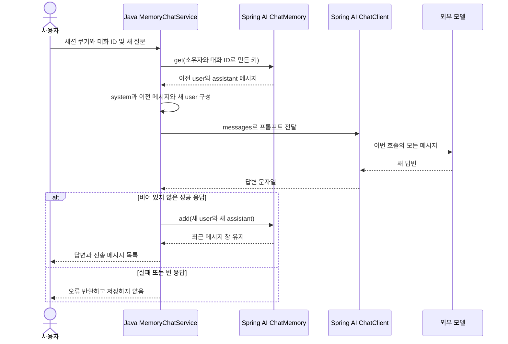

# 07-2. 메시지 조회·전달·저장 연결하기

**실행 코드·설정·테스트:** [labs/07-00-chat-memory](../../../labs/07-00-chat-memory/README.md). 저장소 루트에서 해당 README의 명령으로 실행합니다.

**이번 목표:** 이전 대화를 조회해 새 질문과 함께 전달하고, 새 답변을 저장하는 흐름을 연결합니다.

**코드 읽기 안내:** 전체 클래스는 참고 코드입니다. 첫 읽기에서는 chat()의 이전 메시지 조회와 성공 후 저장만 따라갑니다.

## 코드 읽는 순서

모듈: `labs/07-00-chat-memory`, 패키지: `com.example.ailearning.l07memory`.

1. [MessageView](../../../labs/07-00-chat-memory/src/main/java/com/example/ailearning/l07memory/MessageView.java), [MemoryReply](../../../labs/07-00-chat-memory/src/main/java/com/example/ailearning/l07memory/MemoryReply.java): HTTP에서 관찰할 record
2. [MemoryChatService](../../../labs/07-00-chat-memory/src/main/java/com/example/ailearning/l07memory/MemoryChatService.java): 조회 → 프롬프트 → 호출 → 성공 시 저장
3. [MemoryController](../../../labs/07-00-chat-memory/src/main/java/com/example/ailearning/l07memory/MemoryController.java): 세션 소유자와 대화 ID 연결

### 서비스 전체 코드

```java
package com.example.ailearning.l07memory;

import org.springframework.ai.chat.client.ChatClient;
import org.springframework.ai.chat.memory.ChatMemory;
import org.springframework.ai.chat.memory.MessageWindowChatMemory;
import org.springframework.ai.chat.messages.*;
import org.springframework.http.HttpStatus;
import org.springframework.stereotype.Service;
import org.springframework.web.server.ResponseStatusException;
import java.util.ArrayList;
import java.util.List;

@Service
public class MemoryChatService {
    private static final String SHOPPING_CONVERSATION_INSTRUCTION = """
            쇼핑 대화를 돕습니다. 전달된 이전 메시지와 현재 질문을 참고하세요.
            제공된 정보가 없으면 모른다고 말하세요. 실제 상품 조회 기능은 없습니다.
            """;
    private final ChatClient chatClient;
    private final ChatMemory conversationMemory = MessageWindowChatMemory.builder()
            .maxMessages(6)
            .build();

    public MemoryChatService(ChatClient.Builder builder) { chatClient = builder.build(); }

    // 입문용 단일 서버: 같은 대화의 동시 저장 충돌을 막기 위해 요청을 직렬 처리한다.
    public synchronized MemoryReply chat(String owner, String conversationId, String question) {
        String conversationKey = createConversationKey(owner, conversationId);
        UserMessage currentUserMessage = new UserMessage(question);
        List<Message> requestMessages = new ArrayList<>();
        requestMessages.add(new SystemMessage(SHOPPING_CONVERSATION_INSTRUCTION));
        requestMessages.addAll(conversationMemory.get(conversationKey)); // 1. 이전 질문·응답 조회
        requestMessages.add(currentUserMessage);            // 2. 새 질문 추가

        String answer = chatClient
                .prompt()
                .messages(requestMessages)
                .call()
                .content(); // 3. 함께 전달
        if (answer == null || answer.isBlank()) {
            throw new ResponseStatusException(HttpStatus.INTERNAL_SERVER_ERROR, "빈 모델 응답은 저장하지 않습니다.");
        }
        // 4. 성공한 질문·응답만 저장. 이 다음 호출에서 재사용한다.
        conversationMemory.add(conversationKey, List.of(currentUserMessage, new AssistantMessage(answer)));
        return new MemoryReply(answer, requestMessages
                .stream()
                .map(MessageView::from)
                .toList(), conversationMemory
                .get(conversationKey)
                .size());
    }

    public String chatWithoutMemory(String question) {
        // 메모리 없는 비교 경로: 이전 요청을 조회하거나 저장하지 않는다.
        return chatClient
                .prompt()
                .system(SHOPPING_CONVERSATION_INSTRUCTION)
                .user(question)
                .call()
                .content();
    }

    public synchronized List<MessageView> history(String owner, String conversationId) {
        return conversationMemory
                .get(createConversationKey(owner, conversationId))
                .stream()
                .map(MessageView::from)
                .toList();
    }

    public synchronized void clear(String owner, String conversationId) {
        conversationMemory.clear(createConversationKey(owner, conversationId));
    }

    private String createConversationKey(String owner, String conversationId) {
        // owner는 요청 본문이 아닌 서버 세션에서 가져온다.
        return owner + ":" + conversationId;
    }
}
```

핵심은 `conversationMemory.get(conversationKey)` → `requestMessages.addAll(...)` → `chatClient.prompt().messages(requestMessages)` → `conversationMemory.add(...)`입니다.
메모리를 만들어 놓는 것만으로 ChatClient에 연결되지는 않습니다. 이번에는 코드가 명시적으로 연결합니다.
저장 전에 모델 응답을 확인하므로 실패한 질문만 대화에 남지 않습니다.

### 프레임워크와 서비스가 각각 하는 일

| 처리 | 담당 |
|---|---|
| 이전 메시지의 보관·조회와 창 크기 유지 | Spring AI의 `ChatMemory` 구현과 저장소 |
| system + 이전 대화 + 현재 질문 조합 | 이 예제의 서비스 |
| 모델에 실제 요청 전송 | `ChatClient`와 모델 연동 구현 |
| 빈 답변을 거부하고 성공한 질문·답변만 저장 | 이 예제에서 정한 서비스 정책 |
| 대화 소유자를 확인해 저장 키 구성 | Controller와 서비스 |

`ChatClient`를 한 번 생성해 재사용한다고 이전 대화가 연결되는 것은 아닙니다. 또한 `ChatMemory`를 DB 저장으로 바꾸더라도 `.messages(requestMessages)`로 전달하는 단계는 여전히 필요합니다.

이 연결을 자동화하는 `MessageChatMemoryAdvisor`는 [08-2](../08-advisors/02-memory-loop.md)에서 배웁니다. 직접 저장하는 코드에 Advisor까지 추가하면 같은 메시지가 중복 저장될 수 있으므로 두 방식의 저장 책임을 겹치지 않게 합니다. 기본 Advisor와 이 서비스는 실패 시 질문이 남는 정책도 다릅니다.

## 한 번의 후속 요청 처리



system은 매 요청에서 한 번 추가하고 메모리에는 저장하지 않습니다. 같은 원칙이 중복 저장되는 일을 피합니다.
API 응답의 `sentMessages`는 이번 프롬프트에 직접 구성한 메시지입니다. 테스트는 **실제 모델 API로 전달된 메시지**도 별도로 확인합니다.
실제 서비스에서는 프롬프트 전체를 사용자에게 노출할지 별도로 결정해야 합니다. 이 로컬 수업은 원리 관찰을 위해 반환합니다.


<details><summary>보충: 단일 서버에서의 동시 저장과 처리량</summary>

`synchronized`는 이 단일 서버의 메모리 요청을 한 번에 하나씩 처리하여 동시 저장 충돌을 줄이는 일반 Java 장치입니다.
모든 대화가 직렬 처리되어 처리량이 제한됩니다. 분산 서버·영구 저장·세션 만료 정리·대화 수 제한은 구현하지 않은 학습용 구성입니다.

</details>

## 확인 질문

1. ChatMemory에 저장한 이전 대화를 다음 모델 요청에 어떻게 포함하나요?
2. 이 예제처럼 정상 답변을 확인한 뒤 현재 질문·답변을 함께 저장하면, 질문을 호출 전에 저장하는 방식과 실패 시 어떤 차이가 있나요?

<details>
<summary>해설</summary>

1. 같은 대화의 저장 키로 이전 메시지를 조회하고 현재 질문과 함께 프롬프트에 넣어 전달합니다. 예제에서는 `memory.get(key)`로 읽고 `.messages(messages)`로 포함합니다. ChatMemory에 저장하는 것만으로 다음 모델 요청에 자동 전달되지는 않습니다.
2. 이 예제는 비어 있지 않은 정상 답변을 확인한 뒤 질문과 답변을 함께 저장하므로, 모델 호출이 실패하거나 답변이 비면 이번 질문도 저장하지 않습니다. 질문을 호출 전에 저장한다면 실패 후에도 질문이 남을 수 있습니다. 저장 시점에 따라 다음 대화가 참고하는 문맥이 달라집니다.

</details>

[이전](01-messages.md) · [다음](03-isolation.md) · [단원 목차](../07-chat-memory.md) · [학습 방법](../../learning-guide.md)
