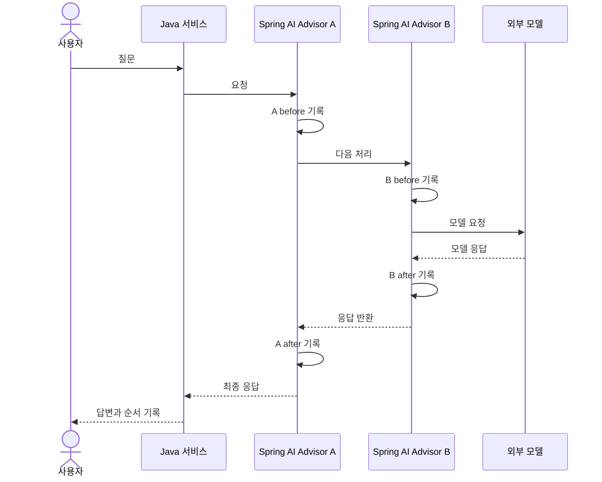
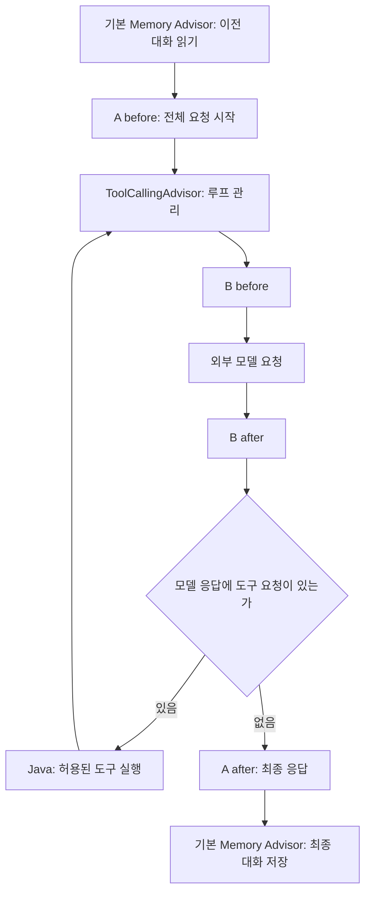

# 08. Advisor: 호출 전후 처리를 조합하기

예상 시간: 1시간. 선수 지식: 07의 직접 메시지 조회·저장, 05의 도구 호출.
이번에는 **반복되는 호출 전후 작업을 Advisor로 옮기는 것**만 추가합니다. 임베딩·RAG는 사용하지 않습니다.
[그림 기준](../diagram-guide.md): 시퀀스는 되돌아오는 순서, 플로우차트는 도구 루프와 처리 위치를 보여줍니다.

## 익숙한 코드에서 출발

07은 메모리 조회 → 이전 메시지 추가 → 모델 호출 → 새 질문·응답 저장을 직접 작성했습니다.
비슷한 작업을 매 서비스에 반복하면 연결을 빠뜨리거나 중복 저장하기 쉽습니다.
**Advisor**는 ChatClient 요청/응답을 중간에서 처리하는 구성 요소입니다. Spring의 필터나 인터셉터처럼 앞뒤 작업을 생각할 수 있지만, 모델 도구 루프에도 참여한다는 차이가 있습니다.

- `CallAdvisor`: 동기 호출 전후 처리를 구현하는 인터페이스.
- `chain.nextCall(request)`: 다음 처리로 요청을 넘기고 결과를 받습니다.
- `getOrder()`: 작은 숫자가 먼저 들어가고, 응답은 반대 순서로 돌아옵니다.
- `MessageChatMemoryAdvisor`: 07에서 직접 연결한 메모리 작업을 제공하는 기본 구현입니다.

## 먼저 A와 B의 순서만 관찰하기



[TraceAdvisor.java](../../labs/08-advisors/src/main/java/com/example/ailearning/l08advisors/TraceAdvisor.java)의 전체 코드입니다.

```java
package com.example.ailearning.l08advisors;

import org.springframework.ai.chat.client.*;
import org.springframework.ai.chat.client.advisor.api.*;
import java.util.List;

/** before는 다음 처리를 호출하기 전, after는 반환되거나 실패한 뒤에 기록한다. */
public record TraceAdvisor(String name, int order, List<String> steps) implements CallAdvisor {
    public String getName() { return name; }
    public int getOrder() { return order; }
    public ChatClientResponse adviseCall(ChatClientRequest request, CallAdvisorChain chain) {
        steps.add(name + ":before");
        try { return chain.nextCall(request); }
        finally { steps.add(name + ":after"); }
    }
}
```

`try/finally`는 다음 처리에서 실패해도 after를 기록합니다. 이 코드는 프롬프트 본문을 로그로 출력하지 않고 순서만 기록합니다.
같은 order 값이면 순서를 보장할 수 없어 A와 B에는 서로 다른 값을 사용합니다.

## 메모리를 연결하고 도구 루프 안팎 비교하기

[AdvisorChatService.java](../../labs/08-advisors/src/main/java/com/example/ailearning/l08advisors/AdvisorChatService.java)의 전체 코드입니다.

```java
package com.example.ailearning.l08advisors;

import org.springframework.ai.chat.client.ChatClient;
import org.springframework.ai.chat.client.advisor.MessageChatMemoryAdvisor;
import org.springframework.ai.chat.client.advisor.ToolCallingAdvisor;
import org.springframework.ai.chat.memory.*;
import org.springframework.stereotype.Service;
import java.util.ArrayList;
import java.util.List;

@Service
public class AdvisorChatService {
    public record Reply(String answer, List<String> steps, int storedMessages) {}
    private final ChatClient client;
    private final ChatMemory memory = MessageWindowChatMemory.builder().maxMessages(6).build();

    public AdvisorChatService(ChatClient.Builder builder) {
        // 07에서 직접 작성했던 메시지 조회·추가·저장을 메모리 Advisor가 담당한다.
        client = builder.defaultSystem("전달된 대화를 참고해 답하세요. 가격은 제공된 도구 결과만 사용하세요.")
                .defaultAdvisors(MessageChatMemoryAdvisor.builder(memory).build()).build();
    }

    public synchronized Reply chat(String owner, String conversationId, String question, boolean useTool) {
        var steps = new ArrayList<String>();
        int loopOrder = ToolCallingAdvisor.DEFAULT_ORDER;
        var request = client.prompt().user(question)
                .advisors(new TraceAdvisor("A", loopOrder - 10, steps),
                        new TraceAdvisor("B", loopOrder + 10, steps))
                .advisors(parameters -> parameters.param(ChatMemory.CONVERSATION_ID, owner + ":" + conversationId));
        if (useTool) request.tools(new PriceTools());
        String answer = request.call().content();
        // memory.add()를 다시 호출하면 중복 저장될 수 있으므로 추가하지 않는다.
        return new Reply(answer, List.copyOf(steps), memory.get(owner + ":" + conversationId).size());
    }

    public synchronized void clear(String owner, String conversationId) { memory.clear(owner + ":" + conversationId); }
}
```

`defaultAdvisors`는 모든 요청에 메모리 연결을 적용하고, 요청별 `.advisors(...)`는 이번 관찰 A/B와 대화 ID를 추가합니다.
**07의 memory.add와 이전 메시지 조립을 함께 사용하지 않습니다.** 둘 다 적용하면 중복 저장/전달이 생길 수 있습니다.
소유자는 이전과 같이 서버 세션 ID에서 얻습니다. 이 수업도 단일 서버·메모리 저장·직렬 처리라는 한계가 있습니다.

A는 자동 ToolCallingAdvisor보다 앞에, B는 뒤에 둡니다. 그래서 A는 전체 요청, B는 반복되는 모델 호출을 관찰합니다.



기본 메모리 Advisor는 도구 루프 밖에 있습니다. 이 구성은 user와 최종 assistant만 저장하며 tool 메시지는 저장하지 않습니다.
도구 결과는 같은 요청 안의 반복에는 전달됩니다. “이번 요청에서 사용”과 “다음 대화에도 저장”을 구분하세요.
메모리를 루프 안으로 이동하는 심화 구성은 이번에 구현하지 않습니다.

## 실행

파일 읽기: TraceAdvisor → AdvisorChatService → [PriceTools](../../labs/08-advisors/src/main/java/com/example/ailearning/l08advisors/PriceTools.java) → [AdvisorController](../../labs/08-advisors/src/main/java/com/example/ailearning/l08advisors/AdvisorController.java).
PriceTools는 05에서 배운 @Tool 방식으로 가상 허브티 가격 12000원을 조회하는 작은 도구입니다.
명령은 저장소 루트에서 실행합니다. bootRun 전 [01장 환경 변수](01-setup.md#4-실제-모델을-사용할-때의-환경-변수)를 설정합니다.

```bash
./gradlew :Spring-AI-Agent-Learning:labs:08-advisors:test
./gradlew :Spring-AI-Agent-Learning:labs:08-advisors:bootRun
curl -sS -c /tmp/learning08.cookies -b /tmp/learning08.cookies \
  http://127.0.0.1:8098/api/advisors/demo \
  -H 'Content-Type: text/plain; charset=UTF-8' --data-raw '예산은 3만원이야.'
curl -sS -c /tmp/learning08.cookies -b /tmp/learning08.cookies \
  http://127.0.0.1:8098/api/advisors/demo \
  -H 'Content-Type: text/plain; charset=UTF-8' --data-raw '내 예산은?'
```

steps는 `A:before → B:before → B:after → A:after`, 두 번째 응답의 storedMessages는 4를 기대합니다.
다음 요청은 도구를 허용합니다. 도구를 지원하는 모델이 필요합니다.

```bash
curl -sS -c /tmp/learning08.cookies -b /tmp/learning08.cookies \
  'http://127.0.0.1:8098/api/advisors/price?tools=true' \
  -H 'Content-Type: text/plain; charset=UTF-8' --data-raw '허브티의 상품 가격을 조회해줘.'
```

도구를 한 번 호출하면 B의 before/after가 두 번, A는 한 번 나타납니다. 실제 모델의 도구 선택 횟수는 달라질 수 있습니다.
실제 호출에는 비용이 발생할 수 있습니다. 종료는 Ctrl+C, DELETE `/api/advisors/demo`는 현재 세션의 해당 대화만 초기화합니다.

## 실험과 테스트

- A/B의 order를 바꾸면 기록 횟수와 순서가 어떻게 바뀌는지 관찰하고 원복합니다.
- `.defaultAdvisors(...)`를 빼면 이전 대화가 자동으로 전달되지 않습니다.
- `memory.add()`를 중복 추가하지 않고 저장 메시지 수를 확인합니다.

[AdvisorContractTest](../../labs/08-advisors/src/test/java/com/example/ailearning/l08advisors/AdvisorContractTest.java)는 순서, 메모리 재전달/중복 방지, 도구 반복 시 안팎 기록, 세션별 격리·삭제를 로컬 모델 API로 검증합니다.
Advisor가 응답의 사실성을 자동 보장하거나 tool 결과 전체를 장기 저장하는 것은 아닙니다.

## 확인 질문

1. order가 작은 Advisor의 after는 언제 실행되나요?
2. 07의 직접 저장과 메모리 Advisor를 함께 사용하면 왜 문제가 될까요?
3. 도구 결과가 모델 재요청에는 있는데 다음 대화 메모리에는 없을 수 있나요?

<details><summary>해설</summary>

요청에는 먼저, 응답에는 나중에 실행됩니다. 수동 저장과 Advisor 저장을 중복 적용하면 같은 턴이 두 번 들어갈 수 있습니다.
현재 구성은 도구 루프 밖에서 user와 최종 assistant만 저장하므로 가능합니다. 다음 단원에서는 모델 호출 없이 검색용 벡터부터 배웁니다.
</details>

보충: [공식 Advisors API](https://docs.spring.io/spring-ai/reference/api/advisors.html).
[이전: 07](07-chat-memory.md) · [학습 지도](../curriculum.md)
