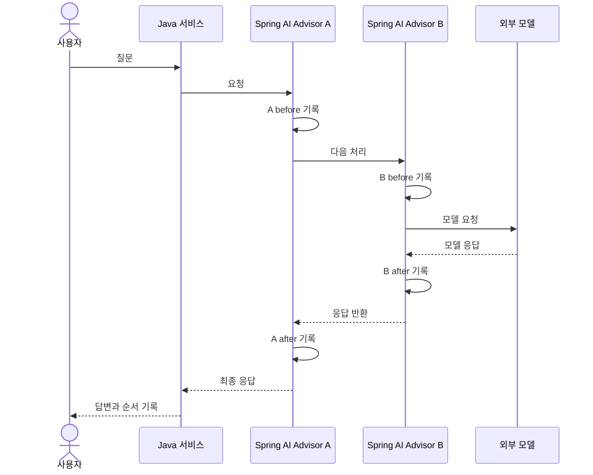

# 08-1. 호출 전후를 감싸는 Advisor

30~45분을 기준으로 한 번에 한 가지 흐름만 읽습니다. 단원 전체 시간은 목차의 기존 예상 시간에 포함됩니다.

**이번 목표:** A before → B before → B after → A after를 설명합니다.

**코드 읽기 안내:** 먼저 도구 없는 호출로 순서만 관찰합니다. TraceAdvisor의 nextCall 앞과 뒤가 이번 핵심입니다.

## 익숙한 코드에서 출발

07은 메모리 조회 → 이전 메시지 추가 → 모델 호출 → 새 질문·응답 저장을 직접 작성했습니다.
비슷한 작업을 매 서비스에 반복하면 연결을 빠뜨리거나 중복 저장하기 쉽습니다.
**Advisor**는 ChatClient 요청/응답을 중간에서 처리하는 구성 요소입니다. Spring의 필터나 인터셉터처럼 앞뒤 작업을 생각할 수 있지만, 모델 도구 루프에도 참여한다는 차이가 있습니다.

- `CallAdvisor`: 동기 호출 전후 처리를 구현하는 인터페이스.
- `chain.nextCall(request)`: 다음 처리로 요청을 넘기고 결과를 받습니다.
- `getOrder()`: 작은 숫자가 먼저 들어가고, 응답은 반대 순서로 돌아옵니다.
- `MessageChatMemoryAdvisor`: 07에서 직접 연결한 메모리 작업을 제공하는 기본 구현입니다.

## 먼저 A와 B의 순서만 관찰하기



[TraceAdvisor.java](../../../labs/08-advisors/src/main/java/com/example/ailearning/l08advisors/TraceAdvisor.java)의 전체 코드입니다.

```java
package com.example.ailearning.l08advisors;

import org.springframework.ai.chat.client.*;
import org.springframework.ai.chat.client.advisor.api.*;
import java.util.List;

/** before는 다음 처리를 호출하기 전, after는 반환되거나 실패한 뒤에 기록한다. */
public record TraceAdvisor(String name, int order, List<String> steps) implements CallAdvisor {
    public String getName() { return name; }
    public int getOrder() { return order; }
    public ChatClientResponse adviseCall(ChatClientRequest request, CallAdvisorChain chain) {
        steps.add(name + ":before");
        try { return chain.nextCall(request); }
        finally { steps.add(name + ":after"); }
    }
}
```

`try/finally`는 다음 처리에서 실패해도 after를 기록합니다. 이 코드는 프롬프트 본문을 로그로 출력하지 않고 순서만 기록합니다.
같은 order 값이면 순서를 보장할 수 없어 A와 B에는 서로 다른 값을 사용합니다.


## 여기서 멈춰 확인하기

코드를 닫고 “이번 입력 → 새로 하는 처리 → 확인할 결과”를 한 문장으로 적어 보세요.
설명하기 어렵다면 위 핵심 메서드만 다시 읽습니다. 테스트용 HTTP 서버 구현을 이해해야 다음으로 갈 수 있는 것은 아닙니다.

[이전](../08-advisors.md) · [다음 소수업](02-memory-loop.md) · [학습 방법](../../learning-guide.md)
