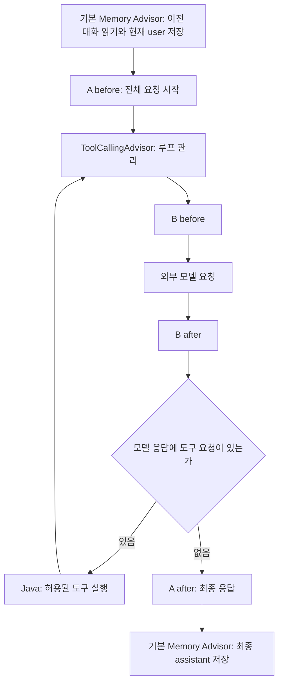

# 08-2. 메모리와 도구 루프의 위치

**실행 코드·설정·테스트:** [labs/08-advisors](../../../labs/08-advisors/README.md). 저장소 루트에서 해당 README의 명령으로 실행합니다.

**이번 목표:** 앞에서 직접 만든 문맥 전달을 Advisor와 연결합니다.

**코드 읽기 안내:** 메모리·A·B가 도구 루프 안팎 중 어디에 놓였는지만 비교합니다.

## 메모리를 연결하고 도구 루프 안팎 비교하기

`MessageChatMemoryAdvisor`는 이전 대화를 조회해 요청에 포함하고, 현재 질문과 모델 응답을 저장하는 Spring AI의 메모리 Advisor입니다.
07장에서 직접 작성한 메시지 조회·전달·저장을 이 Advisor에 연결해 보겠습니다.

[AdvisorChatService.java](../../../labs/08-advisors/src/main/java/com/example/ailearning/l08advisors/AdvisorChatService.java)의 전체 코드입니다.

```java
package com.example.ailearning.l08advisors;

import org.springframework.ai.chat.client.ChatClient;
import org.springframework.ai.chat.client.advisor.MessageChatMemoryAdvisor;
import org.springframework.ai.chat.client.advisor.ToolCallingAdvisor;
import org.springframework.ai.chat.memory.*;
import org.springframework.stereotype.Service;
import java.util.ArrayList;
import java.util.List;

@Service
public class AdvisorChatService {
    public record Reply(String answer, List<String> steps, int storedMessages) {}
    private final ChatClient client;
    private final ChatMemory memory = MessageWindowChatMemory.builder().maxMessages(6).build();

    public AdvisorChatService(ChatClient.Builder builder) {
        // 07에서 직접 작성했던 메시지 조회·추가·저장을 메모리 Advisor가 담당한다.
        client = builder.defaultSystem("전달된 대화를 참고해 답하세요. 가격은 제공된 도구 결과만 사용하세요.")
                .defaultAdvisors(MessageChatMemoryAdvisor.builder(memory).build()).build();
    }

    public synchronized Reply chat(String owner, String conversationId, String question, boolean useTool) {
        var steps = new ArrayList<String>();
        int loopOrder = ToolCallingAdvisor.DEFAULT_ORDER;
        var request = client.prompt().user(question)
                .advisors(new TraceAdvisor("A", loopOrder - 10, steps),
                        new TraceAdvisor("B", loopOrder + 10, steps))
                .advisors(parameters -> parameters.param(ChatMemory.CONVERSATION_ID, owner + ":" + conversationId));
        if (useTool) request.tools(new PriceTools());
        String answer = request.call().content();
        // memory.add()를 다시 호출하면 중복 저장될 수 있으므로 추가하지 않는다.
        return new Reply(answer, List.copyOf(steps), memory.get(owner + ":" + conversationId).size());
    }

    public synchronized void clear(String owner, String conversationId) { memory.clear(owner + ":" + conversationId); }
}
```

`defaultAdvisors`는 모든 요청에 메모리 연결을 적용하고, 요청별 `.advisors(...)`는 이번 관찰 A/B와 대화 ID를 추가합니다.
**07의 memory.add와 이전 메시지 조립을 함께 사용하지 않습니다.** 둘 다 적용하면 중복 저장/전달이 생길 수 있습니다.
소유자는 이전과 같이 서버 세션 ID에서 얻습니다. 이 수업도 단일 서버·메모리 저장·직렬 처리라는 한계가 있습니다.

A는 자동 ToolCallingAdvisor보다 앞에, B는 뒤에 둡니다. 그래서 A는 전체 요청, B는 반복되는 모델 호출을 관찰합니다.



### 07장과 저장 시점이 다릅니다

| 구현 | 호출 전 | 정상 응답 후 | 모델 호출이 실패하면 |
|---|---|---|---|
| 07장의 직접 저장 | 이전 메시지 조회, 새 프롬프트 구성 | user·assistant를 함께 저장 | 이번 질문·답변을 저장하지 않음 |
| 이번 기본 메모리 Advisor | 이전 메시지 조회, 현재 user 저장 | 최종 assistant 저장 | 현재 user가 이미 저장되어 남을 수 있음 |

따라서 07장의 코드를 Advisor로 바꾸면 성공한 대화의 재전달은 간단해지지만, 실패 시 저장 정책까지 같아지는 것은 아닙니다.
[AdvisorContractTest](../../../labs/08-advisors/src/test/java/com/example/ailearning/l08advisors/AdvisorContractTest.java)의 `failedModelCallLeavesUserMessageInMemory`가 실패 뒤 다음 요청의 메시지를 확인합니다.
성공한 대화만 저장해야 하는 요구라면 07장 또는 12장처럼 저장 시점을 직접 제어할 수 있습니다.

기본 메모리 Advisor는 도구 루프 밖에 있습니다. 이 구성은 user와 최종 assistant만 저장하며 tool 메시지는 저장하지 않습니다.
도구 결과는 같은 요청 안의 반복에는 전달됩니다. “이번 요청에서 사용”과 “다음 대화에도 저장”을 구분하세요.
메모리를 루프 안으로 이동하는 심화 구성은 이번에 구현하지 않습니다.


## 여기서 멈춰 확인하기

기본 메모리 Advisor가 user와 assistant를 각각 언제 저장하는지 07장과 비교해 보세요.

[이전](01-chain.md) · [다음](03-observe.md) · [단원 목차](../08-advisors.md) · [학습 방법](../../learning-guide.md)
