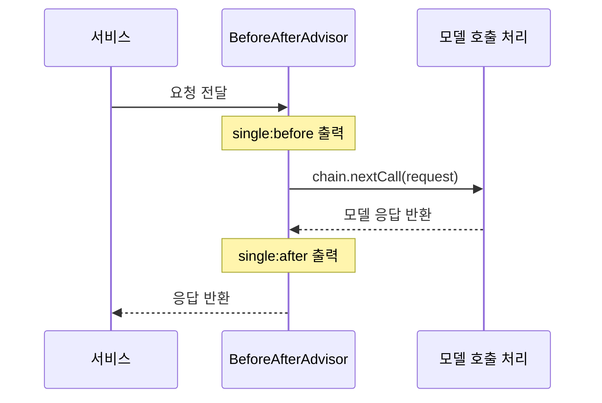

# 08-4. Advisor 하나의 요청 전·응답 후 처리

**이번 목표:** `nextCall(...)` 앞과 뒤의 코드가 언제 실행되는지 설명합니다.<br>
08-1의 기본 로거를 사용해 봤다면, 이제 그와 비슷한 전후 처리를 직접 작성해 봅니다.

**실행 코드:** [Lesson04BeforeAfterChatService](../../../labs/08-00-advisors/src/main/java/com/example/ailearning/l08advisors/lesson04_beforeafter/Lesson04BeforeAfterChatService.java).<br>
**테스트:** [Lesson04BeforeAfterLocalModelTest](../../../labs/08-00-advisors/src/test/java/com/example/ailearning/l08advisors/lesson04_beforeafter/Lesson04BeforeAfterLocalModelTest.java) · [Lesson04BeforeAfterOpenAiLiveTest](../../../labs/08-00-advisors/src/test/java/com/example/ailearning/l08advisors/lesson04_beforeafter/Lesson04BeforeAfterOpenAiLiveTest.java).

## 응답을 기다렸다가 실행을 이어가기

Advisor가 다음 처리를 **감싼다**는 말은 메서드 호출 관계를 뜻합니다.<br>
현재 Advisor는 다음 처리를 호출하고, 그 결과가 돌아오면 남은 코드를 실행합니다.<br>
여기서는 Advisor 하나와 한 번의 정상 모델 호출만 봅니다.



`chain.nextCall(request)`는 현재 Advisor 다음에 연결된 처리를 호출합니다.<br>
이 샘플에서 우리가 등록한 Advisor는 하나이며, Spring AI가 마지막에 준비한 모델 호출 처리가 실제 모델에 연결합니다.

## Advisor 구현

`CallAdvisor`는 동기 호출에 참여하는 인터페이스입니다.<br>
`adviseCall(...)`에 전후 처리와 다음 호출을 작성합니다.<br>
다음은 [BeforeAfterAdvisor](../../../labs/08-00-advisors/src/main/java/com/example/ailearning/l08advisors/lesson04_beforeafter/BeforeAfterAdvisor.java) 전체 코드입니다.

```java
package com.example.ailearning.l08advisors.lesson04_beforeafter;

import org.springframework.ai.chat.client.ChatClientRequest;
import org.springframework.ai.chat.client.ChatClientResponse;
import org.springframework.ai.chat.client.advisor.api.CallAdvisor;
import org.springframework.ai.chat.client.advisor.api.CallAdvisorChain;

/** 08-4: nextCall 앞과 정상 반환 뒤에 작성한 코드의 실행 위치를 확인한다. */
public class BeforeAfterAdvisor implements CallAdvisor {
    @Override
    public String getName() {
        return "single";
    }

    @Override
    public int getOrder() {
        return 0;
    }

    @Override
    public ChatClientResponse adviseCall(ChatClientRequest request, CallAdvisorChain chain) {
        System.out.println("single:before");
        ChatClientResponse response = chain.nextCall(request);
        System.out.println("single:after");
        return response;
    }
}
```

`getName()`은 Advisor의 이름을 반환합니다.<br>
`getOrder()`는 필수 메서드라 지금은 0으로 고정합니다.<br>
여러 Advisor의 숫자를 비교하는 방법은 다음 수업에서 배웁니다.<br>
정상 응답이 돌아오면 `single:after`가 출력됩니다.<br>
`nextCall(...)`이 예외를 던지면 그 아래 코드는 실행되지 않습니다.

## ChatClient에 하나만 등록하기

다음은 서비스 전체 코드입니다.<br>
등록은 08-2에서 배운 `defaultAdvisors(...)`를 사용합니다.

```java
package com.example.ailearning.l08advisors.lesson04_beforeafter;

import org.springframework.ai.chat.client.ChatClient;
import org.springframework.stereotype.Service;

/** 08-4: Advisor 하나의 전후 처리만 사용한다. */
@Service
public class Lesson04BeforeAfterChatService {
    private final ChatClient chatClient;

    public Lesson04BeforeAfterChatService(ChatClient.Builder builder) {
        chatClient = builder
                .defaultAdvisors(new BeforeAfterAdvisor())
                .build();
    }

    public String chat(String question) {
        return chatClient
                .prompt()
                .user(question)
                .call()
                .content();
    }
}
```

콘솔 출력은 다음 순서입니다.<br>
가운데 대괄호는 이해를 위한 설명이며 실제 출력 줄은 아닙니다.

```text
single:before
  [모델 요청과 응답]
single:after
```

## 실행과 확인

저장소 루트에서 실행합니다.<br>
첫 명령은 고정 응답 서버를 사용하며 실제 OpenAI를 호출하지 않습니다.<br>
두 번째 명령은 루트 `.env`로 실제 OpenAI를 호출하므로 API 사용량이 발생합니다.

```bash
./gradlew :Spring-AI-Agent-Learning:labs:08-00-advisors:test --tests '*Lesson04BeforeAfterLocalModelTest'
./gradlew :Spring-AI-Agent-Learning:labs:08-00-advisors:test --tests '*Lesson04BeforeAfterOpenAiLiveTest'
```

로컬 테스트는 전후 출력의 순서와 모델 요청 1회를 확인합니다.<br>
출력 확인에는 08-1에서도 사용한 Spring Boot의 `OutputCaptureExtension`을 사용합니다.<br>
실행 기록을 저장하는 별도 클래스는 만들지 않습니다.

## 확인 질문

`single:after`가 모델 응답보다 먼저 실행되지 않는 이유는 무엇인가요?

<details>
<summary>해설</summary>

`chain.nextCall(request)`의 실행 결과가 반환되어야 그 다음 줄로 진행하기 때문입니다.<br>
앞뒤 처리를 각각 따로 예약하는 것이 아니라 하나의 메서드 안에서 순서대로 실행합니다.

</details>

[이전: 메모리 파라미터](03-memory.md) · [다음: 두 Advisor의 순서](05-advisor-order.md) · [단원 목차](../08-advisors.md)
