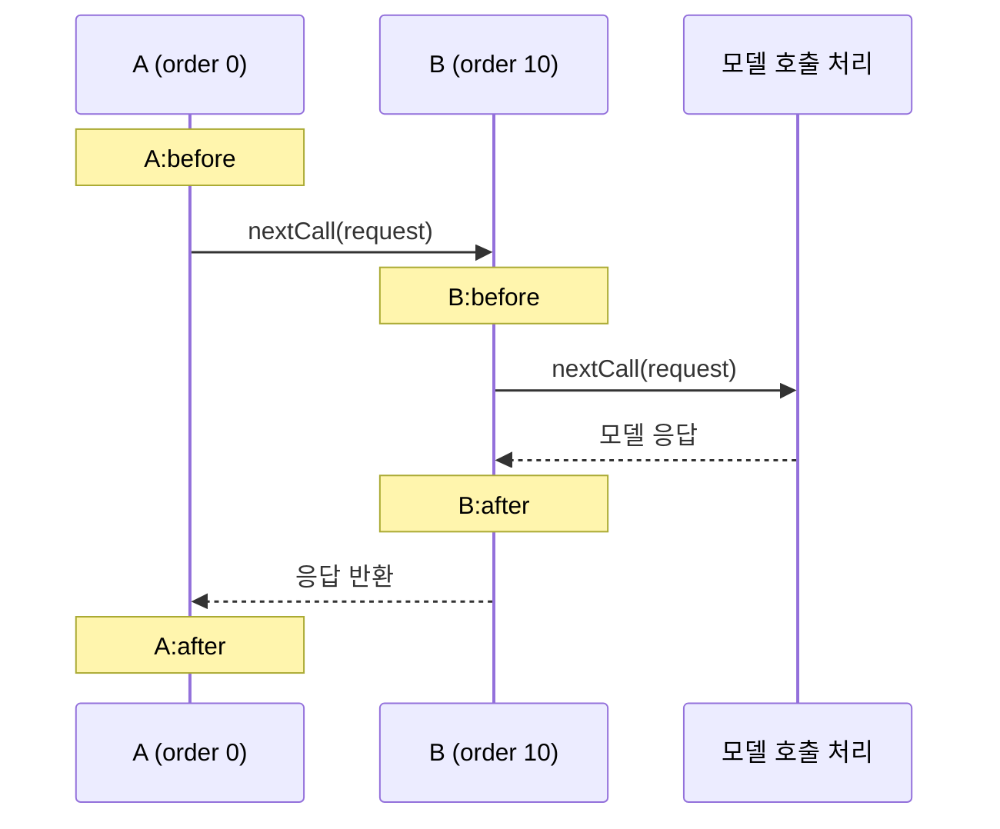

# 08-5. 두 Advisor의 order와 반환 순서

**이번 목표:** 등록한 두 Advisor가 어떤 순서로 진입하고 돌아오는지 예측합니다.<br>
08-4의 전후 처리 코드는 그대로 두고, Advisor의 개수와 순서 값만 비교합니다.

**실행 코드:** [Lesson05AdvisorOrderChatService](../../../labs/08-00-advisors/src/main/java/com/example/ailearning/l08advisors/lesson05_order/Lesson05AdvisorOrderChatService.java).<br>
**테스트:** [Lesson05AdvisorOrderLocalModelTest](../../../labs/08-00-advisors/src/test/java/com/example/ailearning/l08advisors/lesson05_order/Lesson05AdvisorOrderLocalModelTest.java) · [Lesson05AdvisorOrderOpenAiLiveTest](../../../labs/08-00-advisors/src/test/java/com/example/ailearning/l08advisors/lesson05_order/Lesson05AdvisorOrderOpenAiLiveTest.java).

## 순서 값은 진입 순서를 정한다

`getOrder()` 값이 작을수록 먼저 진입합니다.<br>
숫자는 호출 횟수나 모델 요청 번호가 아닙니다.<br>
이 샘플은 B를 먼저 나열하지만 A의 숫자가 더 작으므로 A부터 실행합니다.

| Advisor | 나열 위치 | order | 요청 전 진입 |
|---|---:|---:|---|
| B | 첫 번째 | 10 | 두 번째 |
| A | 두 번째 | 0 | 첫 번째 |

A는 B가 끝날 때까지 기다리고, B는 모델 응답을 기다립니다.<br>
그래서 돌아올 때는 B → A 순서입니다.



## 이름과 order만 바꿀 수 있는 Advisor

[OrderedLogAdvisor](../../../labs/08-00-advisors/src/main/java/com/example/ailearning/l08advisors/lesson05_order/OrderedLogAdvisor.java)는 08-4와 같은 전후 처리에 이름과 순서 값을 받도록 한 클래스입니다.<br>
`record`의 생성자 인자는 `advisorName`과 `advisorOrder` 필드로 보관됩니다.

```java
package com.example.ailearning.l08advisors.lesson05_order;

import org.springframework.ai.chat.client.ChatClientRequest;
import org.springframework.ai.chat.client.ChatClientResponse;
import org.springframework.ai.chat.client.advisor.api.CallAdvisor;
import org.springframework.ai.chat.client.advisor.api.CallAdvisorChain;

/** 08-5: 이름과 순서만 바꾸어 08-4와 같은 전후 처리를 비교한다. */
public record OrderedLogAdvisor(String advisorName, int advisorOrder) implements CallAdvisor {
    @Override
    public String getName() {
        return advisorName;
    }

    @Override
    public int getOrder() {
        return advisorOrder;
    }

    @Override
    public ChatClientResponse adviseCall(ChatClientRequest request, CallAdvisorChain chain) {
        System.out.println(advisorName + ":before");
        ChatClientResponse response = chain.nextCall(request);
        System.out.println(advisorName + ":after");
        return response;
    }
}
```

## 두 객체 등록하기

다음은 서비스 전체 코드입니다.

```java
package com.example.ailearning.l08advisors.lesson05_order;

import org.springframework.ai.chat.client.ChatClient;
import org.springframework.stereotype.Service;

/** 08-5: 등록한 나열 순서와 getOrder가 정하는 진입 순서를 구분한다. */
@Service
public class Lesson05AdvisorOrderChatService {
    private final ChatClient chatClient;

    public Lesson05AdvisorOrderChatService(ChatClient.Builder builder) {
        chatClient = builder
                // B를 먼저 나열해도 order가 작은 A가 먼저 실행된다.
                .defaultAdvisors(new OrderedLogAdvisor("B", 10), new OrderedLogAdvisor("A", 0))
                .build();
    }

    public String chat(String question) {
        return chatClient
                .prompt()
                .user(question)
                .call()
                .content();
    }
}
```

`defaultAdvisors(...)`에 B, A 순서로 적었다고 B부터 실행되는 것은 아닙니다.<br>
Spring AI가 `order`로 정렬하므로 콘솔에는 다음처럼 출력됩니다.

```text
A:before
  B:before
    [모델 요청과 응답]
  B:after
A:after
```

이 예제에는 도구를 등록하지 않았으므로 도구 결과를 전달하기 위한 모델 재요청도 없습니다.<br>
현재 그림은 우리가 등록한 두 Advisor와 모델 호출 사이의 관계를 보여줍니다.<br>
Spring AI의 도구 반복 담당 객체까지 포함한 목록은 08-7에서 확인합니다.

## 실행과 비교

저장소 루트에서 실행합니다.<br>
첫 명령은 고정 응답 서버를 사용하며 실제 OpenAI를 호출하지 않습니다.<br>
두 번째 명령은 루트 `.env`로 실제 OpenAI를 호출하므로 API 사용량이 발생합니다.

```bash
./gradlew :Spring-AI-Agent-Learning:labs:08-00-advisors:test --tests '*Lesson05AdvisorOrderLocalModelTest'
./gradlew :Spring-AI-Agent-Learning:labs:08-00-advisors:test --tests '*Lesson05AdvisorOrderOpenAiLiveTest'
```

로컬 테스트는 실제 출력이 A 전 → B 전 → B 후 → A 후인지, 모델 요청은 한 번인지 확인합니다.<br>
비교하려면 서비스의 A와 B 순서 값을 서로 바꾸고 같은 질문으로 실행해 보세요.<br>
B 전 → A 전 → A 후 → B 후로 달라집니다.<br>
비교 후 A=0, B=10으로 복원합니다.<br>
앱으로 비교했다면 수정 후 서버를 다시 시작해야 합니다.<br>
같은 순서 값을 쓰면 두 객체의 상대 순서를 보장하지 않으므로 이 비교에서는 서로 다른 값을 사용합니다.

## 확인 질문

B를 먼저 나열했는데 A의 요청 전 처리가 먼저 실행되고, A의 응답 후 처리는 나중에 실행되는 이유는 무엇인가요?

<details>
<summary>해설</summary>

A의 order가 더 작아 먼저 진입하고 B를 호출하기 때문입니다.<br>
A는 B의 반환을 기다렸다가 남은 코드를 실행하므로 응답 후 처리는 나중에 실행됩니다.

</details>

[이전: Advisor 하나의 전후 처리](04-chain.md) · [다음: 도구 실행과 모델 재요청](06-tool-loop.md) · [단원 목차](../08-advisors.md)
