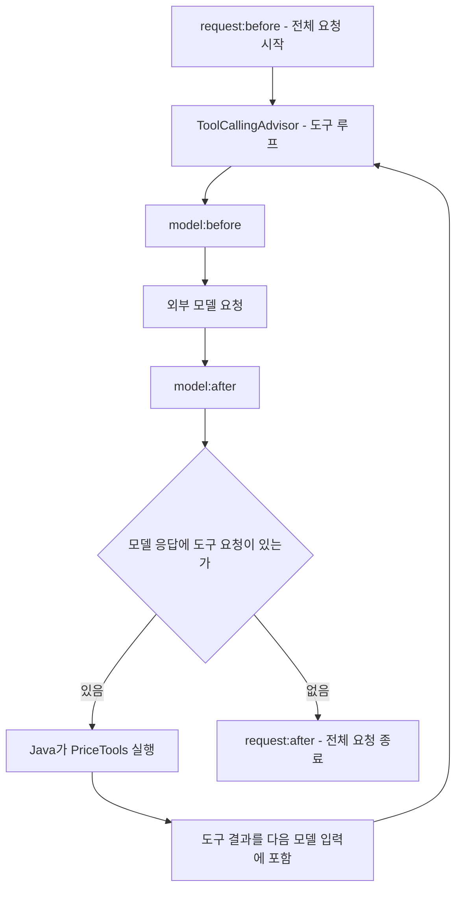

# 08-5. 도구 루프 안팎의 실행 기록 비교하기

**이번 목표:** 전체 사용자 요청과 반복되는 모델 요청을 구분하고, Advisor를 배치하는 위치에 따라 기록 횟수가 달라지는 이유를 설명합니다.

이 수업은 `toolloop` 패키지의 [Lesson05ToolLoopChatService](../../../labs/08-00-advisors/src/main/java/com/example/ailearning/l08advisors/toolloop/Lesson05ToolLoopChatService.java)와 [PriceTools](../../../labs/08-00-advisors/src/main/java/com/example/ailearning/l08advisors/toolloop/PriceTools.java)를 읽습니다. [08-4의 TraceAdvisor](../../../labs/08-00-advisors/src/main/java/com/example/ailearning/l08advisors/chain/TraceAdvisor.java)는 그대로 재사용하며, 대화 메모리는 연결하지 않습니다.

## 한 질문을 처리하면서 모델에 여러 번 요청하는 이유

사용자가 “허브티의 상품 가격은 얼마인가요?”라고 물으면 모델이 가격 조회 도구를 요청할 수 있습니다.
Java가 도구를 실행해 12000원을 반환하면, 그 결과를 모델에 다시 전달해 최종 답변을 받습니다.
05장에서 배운 도구 호출을 이번에는 **실행 기록을 어디에서 남기는가**라는 관점에서 봅니다.

| 이름 | 기록할 범위 |
|---|---|
| `request` Advisor | 도구 반복까지 포함한 전체 요청 |
| `model` Advisor | 도구 결과로 재요청할 때마다 실행되는 모델 호출 |
| `ToolCallingAdvisor` | 도구 요청 처리와 모델 재요청 루프를 연결하는 Spring AI 구성 요소 |

`request`·`model`은 이번 예제의 기록 이름입니다. 둘 다 08-4에서 만든 같은 `TraceAdvisor` 타입이며, 순서 값만 다르게 줍니다.

`AdvisorTrace`는 08-4에서 배운 요청별 기록 객체입니다. 같은 context 파라미터로 기록을 전달하므로 각 요청의 결과가 섞이지 않습니다.

## 실제 서비스와 가격 도구

다음은 `Lesson05ToolLoopChatService`의 전체 코드입니다. 도구는 이 예제에 항상 **등록**하지만, 실제 실행 여부는 모델이 반환한 도구 요청에 따라 달라집니다.

```java
package com.example.ailearning.l08advisors.toolloop;

import com.example.ailearning.l08advisors.chain.TraceAdvisor;
import org.springframework.ai.chat.client.ChatClient;
import org.springframework.ai.chat.client.advisor.ToolCallingAdvisor;
import org.springframework.stereotype.Service;

import com.example.ailearning.l08advisors.chain.support.AdvisorTrace;
import java.util.List;

/** 08-5: 메모리 없이 도구 루프 바깥과 안쪽의 실행 기록만 비교한다. */
@Service
public class Lesson05ToolLoopChatService {
    public record Reply(String answer, List<String> steps) {}

    private final ChatClient chatClient;
    private final PriceTools priceTools;

    public Lesson05ToolLoopChatService(ChatClient.Builder builder, PriceTools priceTools) {
        chatClient = builder
                .defaultSystem("상품 가격은 반드시 제공된 도구로 확인한 값으로 안내하세요.")
                .build();
        this.priceTools = priceTools;
    }

    public Reply chat(String question) {
        var advisorTrace = new AdvisorTrace();
        int toolLoopOrder = ToolCallingAdvisor.DEFAULT_ORDER;
        String answer = chatClient
                .prompt()
                .user(question)
                // request는 전체 요청, model은 도구 결과로 반복되는 모델 요청을 감싼다.
                .advisors(new TraceAdvisor("request", toolLoopOrder - 10),
                        new TraceAdvisor("model", toolLoopOrder + 10))
                .advisors(advisorSpec -> advisorSpec.param(TraceAdvisor.TRACE_CONTEXT_KEY, advisorTrace))
                .tools(priceTools)
                .call()
                .content();
        return new Reply(answer, advisorTrace.steps());
    }
}
```

`ToolCallingAdvisor.DEFAULT_ORDER`를 기준으로 작은 순서의 `request`는 루프 바깥에, 큰 순서의 `model`은 루프 안에 놓입니다.
서비스가 도구 루프를 직접 작성하지는 않습니다. `.tools(priceTools)`로 등록한 도구와 Spring AI의 `ToolCallingAdvisor`가 연결됩니다.

다음은 이 수업의 가상 가격 도구 전체 코드입니다. Spring 빈으로 주입하므로 테스트에서 실제 실행을 유지하는 Spy로 호출 여부를 확인할 수 있습니다.

```java
package com.example.ailearning.l08advisors.toolloop;

import org.springframework.ai.tool.annotation.Tool;
import org.springframework.stereotype.Component;

/** 08-5: 도구 루프를 관찰하기 위한 가상 허브티의 고정 가격 조회 도구다. */
@Component
public class PriceTools {
    @Tool(description = "가상 허브티 P01의 상품 가격만 조회합니다. 배송비는 포함하지 않습니다.")
    public int getTeaPrice() {
        return 12000;
    }
}
```

## 도구를 한 번 실행한 경우의 흐름



LocalModel 테스트에서 **도구 요청 한 번 → 최종 답변**으로 고정한 경우의 결과입니다.

```text
request:before
  model:before
  model:after
  model:before
  model:after
request:after
```

| 고정한 모델 응답 흐름 | 사용자 요청 수 | 가격 도구 실행 수 | request 진입 수 | model 진입 수 |
|---|---:|---:|---:|---:|
| 도구 없이 최종 답변 | 1 | 0 | 1 | 1 |
| 가격 도구 한 번 요청 후 최종 답변 | 1 | 1 | 1 | 2 |

실제 모델은 도구를 다시 요청하거나 도구 없이 답할 수 있습니다. 위 숫자를 모든 Live 호출에 그대로 적용하지 않습니다.
또한 `model:before`는 Advisor 단계의 진입 횟수이며 SDK 내부의 네트워크 재시도 횟수를 세는 별도 기능은 아닙니다.

## 실행하고 테스트와 연결하기

저장소 루트에서 실행합니다. 첫 명령은 고정 모델 응답이며 외부 API를 호출하지 않습니다. 두 번째는 실제 OpenAI를 사용하므로 API 사용량이 발생합니다.

```bash
./gradlew :Spring-AI-Agent-Learning:labs:08-00-advisors:test --tests '*Lesson05ToolLoopAdvisorLocalModelTest'
./gradlew :Spring-AI-Agent-Learning:labs:08-00-advisors:test --tests '*Lesson05ToolLoopAdvisorOpenAiLiveTest'
```

앱을 [실습 README](../../../labs/08-00-advisors/README.md)의 명령으로 실행한 뒤 다음 요청을 보냅니다. 이 요청도 실제 모델을 호출합니다.

```bash
curl -sS http://127.0.0.1:8098/api/advisors/tool-loop \
  -H 'Content-Type: text/plain; charset=UTF-8' --data-raw '허브티의 상품 가격은 얼마인가요?'
```

응답의 `steps`와 테스트가 출력하는 `ToolCallPrinter` 호출 내역을 함께 봅니다.

| 테스트 | 확인하는 동작 |
|---|---|
| [Lesson05ToolLoopAdvisorLocalModelTest](../../../labs/08-00-advisors/src/test/java/com/example/ailearning/l08advisors/toolloop/Lesson05ToolLoopAdvisorLocalModelTest.java) | 고정 응답에서 도구 1회·모델 2회, 실제 가격 도구 실행과 결과 재전달. 도구 미요청 시 미실행 |
| [Lesson05ToolLoopAdvisorOpenAiLiveTest](../../../labs/08-00-advisors/src/test/java/com/example/ailearning/l08advisors/toolloop/Lesson05ToolLoopAdvisorOpenAiLiveTest.java) | 실제 가격 도구 실행, 전체 요청 기록 1회와 반복 모델 기록의 전후 대응 |

먼저 `도구를_한번_실행하면_전체_요청은_한번_모델_요청은_두번_기록한다`를 읽습니다.
`MODEL.chat().setResponseSequence(...)`는 모델의 도구 선택 결과를 고정할 뿐, `PriceTools`의 실행 결과를 대신하지 않습니다. `verify(priceTools).getTeaPrice()`로 실제 Java 도구 실행을 확인합니다.

Live는 `verify(priceTools, atLeastOnce()).getTeaPrice()`로 실제 도구 실행을 요구합니다. 답변에 가격이 있다는 이유만으로 도구가 실행됐다고 판단하지 않습니다.
도구를 재요청할 수 있으므로 `model` 진입을 정확히 2회라고 고정하지 않고 2회 이상인지, 종료 기록도 같은 횟수인지 확인합니다.
`verify`, `atLeastOnce` 설명은 [06장의 테스트 검증 메서드](../06-workflow-agent/04-test-assertions.md)에 있습니다.

## 실무에서 어디에 기록을 둘까?

고객 요청 전체의 시작·종료를 기록하려면 `request`처럼 루프 바깥에 둡니다.
개별 모델 호출을 관찰하려면 `model`처럼 안쪽에 둡니다. 기록 목적에 따라 실행 범위를 먼저 정해야 사용자 질문 수와 모델 호출 수를 혼동하지 않습니다.
이 예제는 기록 범위만 보여줍니다. 실제 처리 시간·사용량 측정은 [12장의 관측 실습](../12-evaluation/04-actuator.md)에서 연결합니다.
상품 예산 판단·주문 승인 같은 업무 결정은 공통 기록 Advisor에 섞지 않고 서비스·도메인에서 처리합니다.

## 확인 질문

다음은 이 수업의 LocalModel 테스트가 고정한 응답 순서입니다.

```text
첫 모델 응답: 가격 조회 도구 요청
두 번째 모델 응답: 최종 답변
```

1. 사용자는 한 번 질문했는데 `model:before`가 두 번 기록되는 이유는 무엇인가요?
2. 실제 모델에서도 언제나 모델 진입 기록을 정확히 두 번으로 검증해야 하나요?
3. 도구를 등록했다는 사실만으로 실제 실행됐다고 판단할 수 있나요?

<details>
<summary>해설</summary>

1. 최초 질문과 도구 실행 결과로 모델을 두 번 호출하기 때문입니다. 사용자 요청 전체를 감싸는 `request`는 한 번 진입합니다.
2. 아닙니다. 위 고정 시나리오에서는 두 번이지만 실제 모델은 도구를 재요청할 수 있습니다. 실제 도구 실행 여부와 관찰한 반복 횟수의 관계를 검사해야 합니다.
3. 아닙니다. 등록은 모델에 사용할 수 있는 도구를 제공하는 것입니다. 모델의 도구 요청과 Java의 실제 도구 실행 기록을 확인해야 합니다.

</details>

참고: [Spring AI의 도구 루프 설명](https://spring.io/blog/2026/06/15/spring-ai-composable-tool-calling/).

[이전: 직접 구현과 순서](04-chain.md) · [단원 목차](../08-advisors.md) · [다음: 09장](../09-embeddings-search.md)

[이전: 직접 구현과 순서](04-chain.md) · [단원 목차](../08-advisors.md) · [다음 단원: 검색](../09-embeddings-search.md)
