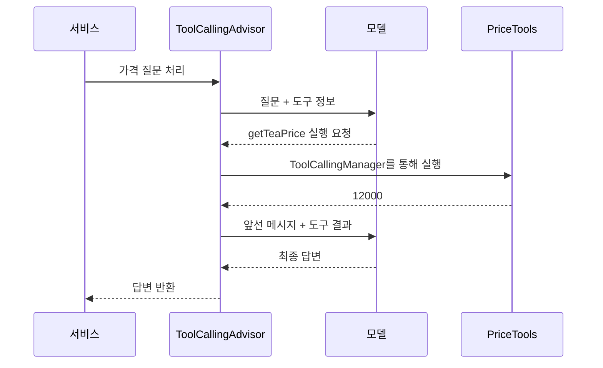

# 08-6. 도구 실행 결과로 모델에 다시 요청하기

**이번 목표:** 사용자 질문 하나를 처리하면서 모델에 두 번 요청하는 이유를 설명합니다.<br>
이 수업에서는 사용자 정의 Advisor를 등록하지 않습니다.<br>
먼저 도구 실행과 모델 재요청 자체를 이해합니다.

**실행 코드:** [Lesson06ToolLoopChatService](../../../labs/08-00-advisors/src/main/java/com/example/ailearning/l08advisors/lesson06_toolloop/Lesson06ToolLoopChatService.java).<br>
**테스트:** [Lesson06ToolLoopLocalModelTest](../../../labs/08-00-advisors/src/test/java/com/example/ailearning/l08advisors/lesson06_toolloop/Lesson06ToolLoopLocalModelTest.java) · [Lesson06ToolLoopOpenAiLiveTest](../../../labs/08-00-advisors/src/test/java/com/example/ailearning/l08advisors/lesson06_toolloop/Lesson06ToolLoopOpenAiLiveTest.java).

## 모델 응답이 곧 최종 답변은 아니다

사용자가 “허브티 가격은 얼마인가요?”라고 질문하면, 첫 번째 모델 응답은 가격이 아니라 **가격 조회 도구를 실행해 달라는 요청**일 수 있습니다.<br>
Java가 도구를 실행한 뒤 결과를 다시 모델에 전달하면, 모델은 그 결과를 바탕으로 사용자에게 줄 답변을 만듭니다.

| 단계 | 입력과 결과 |
|---|---|
| 모델 요청 1 | 사용자 질문과 사용 가능한 가격 도구 정보를 전달 |
| 모델 응답 1 | getTeaPrice 도구 실행을 요청 |
| 도구 실행 | Java 메서드가 12000을 반환 |
| 모델 요청 2 | 앞선 메시지와 도구 실행 결과를 함께 전달 |
| 모델 응답 2 | 허브티 가격을 설명하는 최종 답변 |

한 번의 `chatClient.prompt()...call().content()`가 끝나기 위해 내부에서 모델 요청이 여러 번 발생할 수 있습니다.<br>
같은 질문을 그대로 재전송하는 것이 아니라 **도구 결과를 담은 후속 요청**을 만드는 것입니다.



그림은 도구를 한 번 실행한 경우입니다.<br>
모델이 도구를 다시 요청할 수도 있고, 인사에는 도구를 사용하지 않을 수도 있습니다.

## 반복을 담당하는 ToolCallingAdvisor

Spring AI 2.0.2의 `ChatClient`는 `ToolCallingAdvisor`를 자동으로 연결합니다.<br>
이 객체가 모델 응답에 도구 요청이 있는지 확인하고, 있으면 `ToolCallingManager`에 도구 실행을 맡긴 뒤 결과를 담아 모델에 다시 요청합니다.<br>
응답에 도구 요청이 없으면 반복을 마치고 답변을 반환합니다.<br>
도구 결과를 바로 반환하도록 설정한 경우 등 다른 종료 방식도 있지만, 이 예제에서는 기본 흐름만 사용합니다.

## 서비스와 도구

다음은 서비스 전체 코드입니다.<br>
`.tools(priceTools)`는 모델이 사용할 수 있는 도구를 등록합니다.

```java
package com.example.ailearning.l08advisors.lesson06_toolloop;

import org.springframework.ai.chat.client.ChatClient;
import org.springframework.stereotype.Service;

/** 08-6: 사용자 정의 Advisor 없이 도구 실행과 후속 모델 요청만 확인한다. */
@Service
public class Lesson06ToolLoopChatService {
    private final ChatClient chatClient;
    private final PriceTools priceTools;

    public Lesson06ToolLoopChatService(ChatClient.Builder builder, PriceTools priceTools) {
        chatClient = builder
                .defaultSystem("상품 가격은 반드시 제공된 도구로 확인한 값으로 안내하세요.")
                .build();
        this.priceTools = priceTools;
    }

    public String chat(String question) {
        return chatClient
                .prompt()
                .user(question)
                .tools(priceTools)
                .call()
                .content();
    }
}
```

다음은 가격 조회 도구 전체 코드입니다.<br>
모델이 도구를 선택하며 실제 메서드는 Java에서 실행합니다.

```java
package com.example.ailearning.l08advisors.lesson06_toolloop;

import org.springframework.ai.tool.annotation.Tool;
import org.springframework.stereotype.Component;

/** 08-6·08-7: 도구 루프를 관찰하기 위한 가상 허브티의 고정 가격 조회 도구다. */
@Component
public class PriceTools {
    @Tool(description = "가상 허브티 P01의 상품 가격만 조회합니다. 배송비는 포함하지 않습니다.")
    public int getTeaPrice() {
        return 12000;
    }
}
```

## 실행과 결과 확인

저장소 루트에서 실행합니다.<br>
첫 명령은 고정 응답 서버를 사용하며 실제 OpenAI를 호출하지 않습니다.<br>
두 번째 명령은 루트 `.env`로 실제 OpenAI를 호출하므로 API 사용량이 발생합니다.

```bash
./gradlew :Spring-AI-Agent-Learning:labs:08-00-advisors:test --tests '*Lesson06ToolLoopLocalModelTest'
./gradlew :Spring-AI-Agent-Learning:labs:08-00-advisors:test --tests '*Lesson06ToolLoopOpenAiLiveTest'
```

로컬 테스트는 첫 모델 응답을 도구 실행 요청으로, 다음 응답을 최종 답변으로 지정합니다.<br>
도구 메서드가 실행됐는지와 두 번째 모델 요청에 `tool` 메시지·12000이라는 결과가 포함됐는지를 검사합니다.<br>
인사만 하는 경우에는 도구 미실행과 모델 요청 1회를 별도로 확인합니다.<br>
Spy는 가격 도구의 실제 실행 여부만 검사하며 모델 호출을 별도 보조 객체로 기록하지 않습니다.

`POST /api/advisors/tool-loop`의 응답은 답변 문자열입니다.<br>
Advisor 실행 순서는 다음 수업의 별도 샘플에서 관찰합니다.

## 확인 질문

사용자는 한 번 질문했는데 두 번째 모델 요청이 필요한 이유는 무엇인가요?

<details>
<summary>해설</summary>

첫 모델 응답이 최종 답변이 아니라 도구 실행 요청이기 때문입니다.<br>
Java에서 구한 도구 결과를 모델에 전달해 답변을 생성하도록 다음 요청을 보냅니다.

</details>

[이전: 두 Advisor의 순서](05-advisor-order.md) · [다음: 반복 처리 기준으로 배치](07-tool-loop-order.md) · [단원 목차](../08-advisors.md)
