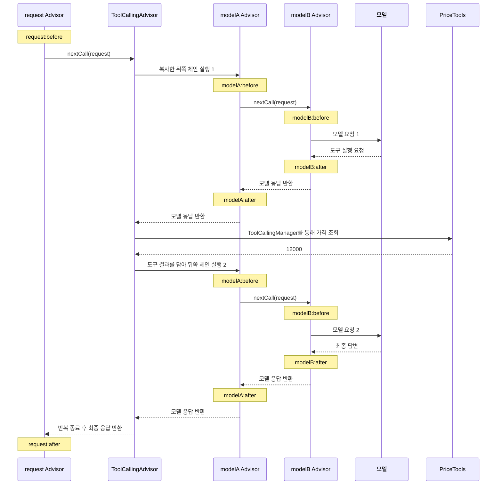

# 08-7. 도구 반복을 기준으로 Advisor 배치하기

**이번 목표:** 같은 Advisor를 도구 반복 담당 객체의 앞과 뒤에 배치했을 때 실행 범위가 달라지는 이유를 설명합니다.<br>
08-5의 `order`와 08-6의 모델 재요청을 먼저 확인하세요.<br>
이번에는 두 동작을 연결해 배치 위치를 비교합니다.

**실행 코드:** [Lesson07ToolLoopOrderChatService](../../../labs/08-00-advisors/src/main/java/com/example/ailearning/l08advisors/lesson07_looporder/Lesson07ToolLoopOrderChatService.java).<br>
**테스트:** [Lesson07ToolLoopOrderLocalModelTest](../../../labs/08-00-advisors/src/test/java/com/example/ailearning/l08advisors/lesson07_looporder/Lesson07ToolLoopOrderLocalModelTest.java) · [Lesson07ToolLoopOrderOpenAiLiveTest](../../../labs/08-00-advisors/src/test/java/com/example/ailearning/l08advisors/lesson07_looporder/Lesson07ToolLoopOrderOpenAiLiveTest.java).

## order와 반복 여부를 먼저 구분하기

| 구분 | 무엇을 정하나요? |
|---|---|
| order | Advisor 목록에서 먼저 진입할 위치 |
| ToolCallingAdvisor의 반복문 | 도구 결과를 담아 뒤쪽 처리를 다시 호출할지 |
| 모델 응답의 도구 요청 | 도구 실행과 다음 모델 요청이 필요한지 |

`order` 숫자가 반복 횟수를 지정하거나, 특정 숫자를 넘으면 재귀 호출이 켜지는 것은 아닙니다.

## DEFAULT_ORDER는 이미 들어 있는 객체의 순서 값이다

08-6에서는 `ToolCallingAdvisor`를 직접 만들지 않았지만 `ChatClient`가 자동으로 연결했습니다.<br>
`ToolCallingAdvisor.DEFAULT_ORDER`는 이 객체가 기본으로 사용하는 순서 값입니다.<br>
실습에서는 기본 설정을 사용하므로 이 값을 기준으로 앞뒤 위치를 지정할 수 있습니다.

```java
int toolLoopOrder = ToolCallingAdvisor.DEFAULT_ORDER;

new OrderedLogAdvisor("request", toolLoopOrder - 10);
new OrderedLogAdvisor("modelA", toolLoopOrder + 10);
new OrderedLogAdvisor("modelB", 1);
```

위는 세 객체를 만드는 부분만 발췌한 코드입니다.<br>
실제 등록은 아래 서비스 전체 코드에서 확인합니다.

| 내가 만든 Advisor의 order | 위치 | 실행 시점 |
|---|---|---|
| `ToolCallingAdvisor.DEFAULT_ORDER`보다 작음 | `ToolCallingAdvisor` 앞 | 요청 처리를 시작할 때 before가 한 번, 모델·도구 처리가 모두 끝나면 after가 한 번 실행 |
| `ToolCallingAdvisor.DEFAULT_ORDER`보다 큼 | `ToolCallingAdvisor` 뒤 | 모델을 요청하기 전에 before, 해당 모델의 응답을 받은 뒤 after 실행. 모델을 다시 요청하면 같은 처리가 반복됨 |
| `ToolCallingAdvisor.DEFAULT_ORDER`와 같음 | 상대 순서를 보장하기 어려움 | order 값만으로는 앞뒤 위치와 실행 횟수를 판단할 수 없어 이 예제에서는 피함 |

이 표는 `ToolCallingAdvisor`가 기본 순서 값을 사용하고, 요청이 예외 없이 완료되는 경우를 설명합니다.<br>
앞에 배치한 `request`는 도구 사용 여부와 관계없이 before와 after가 각각 한 번 실행됩니다.<br>
뒤에 배치한 `modelA`와 `modelB`는 모델을 두 번 요청하면 각각의 before와 after도 두 번 실행됩니다.

### 공식 문서 인용: 메모리 Advisor를 반복 바깥과 안에 배치하기

다음은 [Spring AI 공식 문서의 Memory and the Tool Loop](https://docs.spring.io/spring-ai/reference/api/tools.html#memory-and-the-tool-loop) 중 두 배치 방식에 대한 설명을 번역한 인용입니다.<br>
코드의 `chatModel`과 `chatMemory`는 이미 준비된 객체이며, 등록 부분만 보여 줍니다.

> **반복 바깥에 배치하기 — 기본 동작**
>
> `MessageChatMemoryAdvisor`의 기본 order는 `HIGHEST_PRECEDENCE + 200`입니다.<br>
> `ToolCallingAdvisor`보다 작은 값이므로 반복 바깥에 배치됩니다.<br>
> 이때 메모리 Advisor는 다음과 같이 동작합니다.
>
> - 반복이 시작되기 전에 이전 대화를 한 번 불러옵니다.
> - 반복이 끝난 뒤 마지막 사용자 메시지와 마지막 어시스턴트 메시지만 저장합니다.
> - 도구 호출 요청이나 도구 응답 메시지는 전달받지 않습니다.
>
> 이는 안전한 기본 동작이며 모든 `ChatMemoryRepository` 구현체에서 사용할 수 있습니다.<br>
> 또한 Spring AI 1.x의 동작과도 같습니다.<br>
> 1.x에서는 도구 반복이 각 `ChatModel` 내부에 있어 메모리에서 도구 메시지를 확인할 수 없었습니다.
>
> ```java
> var chatClient = ChatClient.builder(chatModel)
>         // 기본적으로 반복 바깥에 배치됩니다.
>         .defaultAdvisors(MessageChatMemoryAdvisor.builder(chatMemory)
>                 .build())
>         .build();
> ```
>
> **반복 안에 배치하기**
>
> 이후 대화에서도 모델에 전체 도구 실행 대화를 제공하면, 모델이 이미 무엇을 시도했고 어떤 도구를 호출했으며 어떤 결과를 받았는지 판단할 수 있습니다.<br>
> 이를 위해 메모리 Advisor의 order를 `ToolCallingAdvisor.DEFAULT_ORDER`보다 크게 지정해 반복 안에 배치합니다.
>
> ```java
> var chatMemoryAdvisor = MessageChatMemoryAdvisor.builder(chatMemory)
>         // ToolCallingAdvisor 뒤, 즉 반복 안에 배치합니다.
>         .order(BaseAdvisor.HIGHEST_PRECEDENCE + 400)
>         .build();
>
> var chatClient = ChatClient.builder(chatModel)
>         .defaultAdvisors(chatMemoryAdvisor)
>         .build();
> ```

반복 안에 배치할 때는 도구 메시지도 저장할 수 있는 `ChatMemoryRepository`를 사용해야 합니다.<br>
지원되는 저장소와 직접 `ToolCallingAdvisor`를 구성할 때의 설정은 위 공식 문서의 같은 절에서 확인할 수 있습니다.

### 실행 위치가 달라지는 내부 호출

Spring AI 2.1.0의 `DefaultAroundAdvisorChain`은 order가 작은 Advisor부터 실행하도록 정렬합니다.<br>
`ToolCallingAdvisor`는 반복할 때 `copy(this)`로 **자기 뒤에 있는 Advisor들만** 다시 실행하므로, 앞에 있는 Advisor의 before는 반복되지 않습니다.<br>
아래에서 이 내부 호출과 출력 순서를 연결해 설명합니다.<br>
`ToolCallingAdvisor`의 순서 값을 직접 바꿨다면 상수인 `DEFAULT_ORDER` 대신 실제 설정한 값과 비교해야 합니다.

`-10`, `+10`을 그대로 넣은 것이 아니라 **이미 정해진 기본값에서 10을 빼거나 더한 값**입니다.<br>
간격 10에는 특별한 뜻이 없고, 기준보다 작거나 크다는 관계가 중요합니다.

이 기본값은 `Ordered.HIGHEST_PRECEDENCE + 300`인 **-2147483348**입니다.<br>
`modelA`의 값은 이보다 10 큰 -2147483338이고, `modelB`의 값 1도 이 기본값보다 큽니다.<br>
두 Advisor 모두 `ToolCallingAdvisor` 뒤에 배치되고, 그중 값이 작은 `modelA`가 먼저 진입합니다.<br>
음수·양수 여부가 아니라 **기준 Advisor와 비교한 값의 크기**로 위치가 정해집니다.<br>
따라서 08-5에서 생략했던 내부 객체까지 포함하면 실제 목록은 다음 관계입니다.

```text
08-5: ToolCallingAdvisor → A(0) → B(10) → 실제 모델 호출용 Advisor
08-7: request → ToolCallingAdvisor → modelA → modelB → 실제 모델 호출용 Advisor
```

08-5는 도구를 등록하지 않아 도구 결과에 따른 모델 재요청이 없었습니다.<br>
모델 연결은 마지막의 `ChatModelCallAdvisor`가 담당합니다.<br>
이 객체의 order는 `Ordered.LOWEST_PRECEDENCE`라는 가장 큰 값이므로, 위의 Advisor들을 거친 다음 실제 모델을 호출합니다.<br>
`DEFAULT_ORDER`는 첫 모델 요청과 두 번째 모델 요청의 선후를 지정하는 값이 아닙니다.

## 서비스 전체 코드

08-5의 [OrderedLogAdvisor](../../../labs/08-00-advisors/src/main/java/com/example/ailearning/l08advisors/lesson05_order/OrderedLogAdvisor.java)를 그대로 사용합니다.<br>
`request`·`modelA`·`modelB`는 출력할 이름일 뿐 특별한 기능 이름이 아닙니다.

```java
package com.example.ailearning.l08advisors.lesson07_looporder;

import com.example.ailearning.l08advisors.lesson05_order.OrderedLogAdvisor;
import com.example.ailearning.l08advisors.lesson06_toolloop.PriceTools;
import org.springframework.ai.chat.client.ChatClient;
import org.springframework.ai.chat.client.advisor.ToolCallingAdvisor;
import org.springframework.stereotype.Service;

/** 08-7: 08-5의 Advisor를 도구 반복 담당 객체의 앞과 뒤에 배치한다. */
@Service
public class Lesson07ToolLoopOrderChatService {
    private final ChatClient chatClient;
    private final PriceTools priceTools;

    public Lesson07ToolLoopOrderChatService(ChatClient.Builder builder, PriceTools priceTools) {
        chatClient = builder
                .defaultSystem("상품 가격은 반드시 제공된 도구로 확인한 값으로 안내하세요.")
                .build();
        this.priceTools = priceTools;
    }

    public String chat(String question) {
        int toolLoopOrder = ToolCallingAdvisor.DEFAULT_ORDER;
        return chatClient
                .prompt()
                .user(question)
                .advisors(new OrderedLogAdvisor("request", toolLoopOrder - 10),
                        new OrderedLogAdvisor("modelA", toolLoopOrder + 10),
                        new OrderedLogAdvisor("modelB", 1))
                .tools(priceTools)
                .call()
                .content();
    }
}
```

## 왜 앞의 Advisor는 한 번, 뒤의 Advisor는 반복할까?

`request`가 `nextCall(...)`로 호출하는 다음 객체는 `ToolCallingAdvisor`입니다.<br>
따라서 `request`의 응답 후 처리는 그 객체의 반복문 전체가 끝나 반환할 때 실행됩니다.

`ToolCallingAdvisor` 내부 반복문에는 다음 코드가 있습니다.<br>
Spring AI 2.1.0 구현의 핵심 호출 한 줄을 발췌했습니다.

```java
chatClientResponse = callAdvisorChain.copy(this).nextCall(processedChatClientRequest);
```

여기서 `this`는 `ToolCallingAdvisor`입니다.<br>
`copy(this)`는 정렬된 원래 목록에서 **자기 다음부터 마지막까지의 Advisor들로 새 체인을 구성**합니다.<br>
이 예제에서는 `modelA`·`modelB`와 실제 모델 호출 처리만 포함합니다.<br>
Advisor 객체 자체를 새로 생성한다는 뜻은 아니며, 다음 실행에 사용할 목록을 준비하는 것입니다.<br>
`ToolCallingAdvisor.adviseCall()`을 자기 자신 안에서 다시 호출하는 것이 아니라, 반복문에서 뒤쪽 체인을 다시 호출하는 구조입니다.<br>
앞의 `request`를 다시 호출하지 않으므로 `request`는 전체 처리에서 한 번, `modelA`·`modelB`는 각 반복에서 한 번씩 실행됩니다.



도구를 한 번 실행한 경우의 출력과 실제 처리를 나란히 읽어 보세요.<br>
대괄호 줄은 설명이며 Advisor의 출력이 아닙니다.

```text
request:before
  [ToolCallingAdvisor 반복 시작]
    modelA:before
      modelB:before
        [모델 요청 1 → 도구 실행 요청 응답]
      modelB:after
    modelA:after
    [Java 도구 실행 → 12000]
    modelA:before
      modelB:before
        [모델 요청 2 → 도구 결과를 바탕으로 최종 답변]
      modelB:after
    modelA:after
  [반복 종료]
request:after
```

04·05의 반대 순서 반환 규칙은 그대로입니다.<br>
첫 `modelB:after`와 `modelA:after`는 첫 모델 호출의 응답을 받아 되돌아오는 처리입니다.<br>
그 응답이 도구 요청이므로, ToolCallingAdvisor가 도구를 실행하고 뒤쪽 체인을 다시 호출합니다.

## 실행과 비교

저장소 루트에서 실행합니다.<br>
첫 명령은 고정 응답 서버를 사용하며 실제 OpenAI를 호출하지 않습니다.<br>
두 번째 명령은 루트 `.env`로 실제 OpenAI를 호출하므로 API 사용량이 발생합니다.

```bash
./gradlew :Spring-AI-Agent-Learning:labs:08-00-advisors:test --tests '*Lesson07ToolLoopOrderLocalModelTest'
./gradlew :Spring-AI-Agent-Learning:labs:08-00-advisors:test --tests '*Lesson07ToolLoopOrderOpenAiLiveTest'
```

로컬 테스트는 도구 요청·최종 답변을 고정해 `request` 1회, `modelA`·`modelB` 각각 2회의 전후 출력을 확인합니다.<br>
도구 요청이 없는 인사는 세 Advisor 모두 한 번만 실행되는지 검사합니다.<br>
Live 테스트는 실제 도구 사용을 확인하되 모델의 도구 재요청 가능성을 고려해 반복 횟수를 정확히 2회로 고정하지 않습니다.

비교 실험으로 `request`의 order를 기본값 + 20으로 바꾸면 이 Advisor도 반복문 뒤쪽에 들어갑니다.<br>
로컬 테스트를 실행하면 기존의 `request` 1회 기대가 실패하고 콘솔에는 반복되는 진입·반환이 나타납니다.<br>
실험 후 기본값 - 10으로 복원하세요.<br>
직접 서버로 비교했다면 수정 후 재시작합니다.

`POST /api/advisors/tool-loop/order`는 답변 문자열을 반환하며 실행 순서는 서버 콘솔에 출력합니다.

## 확인 질문

1. 기본 순서 값에서 10을 빼면 모델 호출 횟수가 줄어드나요?
2. request와 modelA·modelB가 같은 OrderedLogAdvisor 타입인데 실행 횟수가 다른 이유는 무엇인가요?

<details>
<summary>해설</summary>

1. 그 숫자는 Advisor의 위치를 정합니다.<br>
   모델 재요청 여부는 도구 요청 응답과 ToolCallingAdvisor의 반복 처리로 결정됩니다.
2. request는 반복문을 가진 메서드 전체의 반환을 기다립니다.<br>
   modelA·modelB는 반복문 안에서 실행하는 뒤쪽 체인에 포함되어 각 모델 요청마다 호출됩니다.

</details>

[이전: 도구 실행과 모델 재요청](06-tool-loop.md) · [단원 목차](../08-advisors.md)
