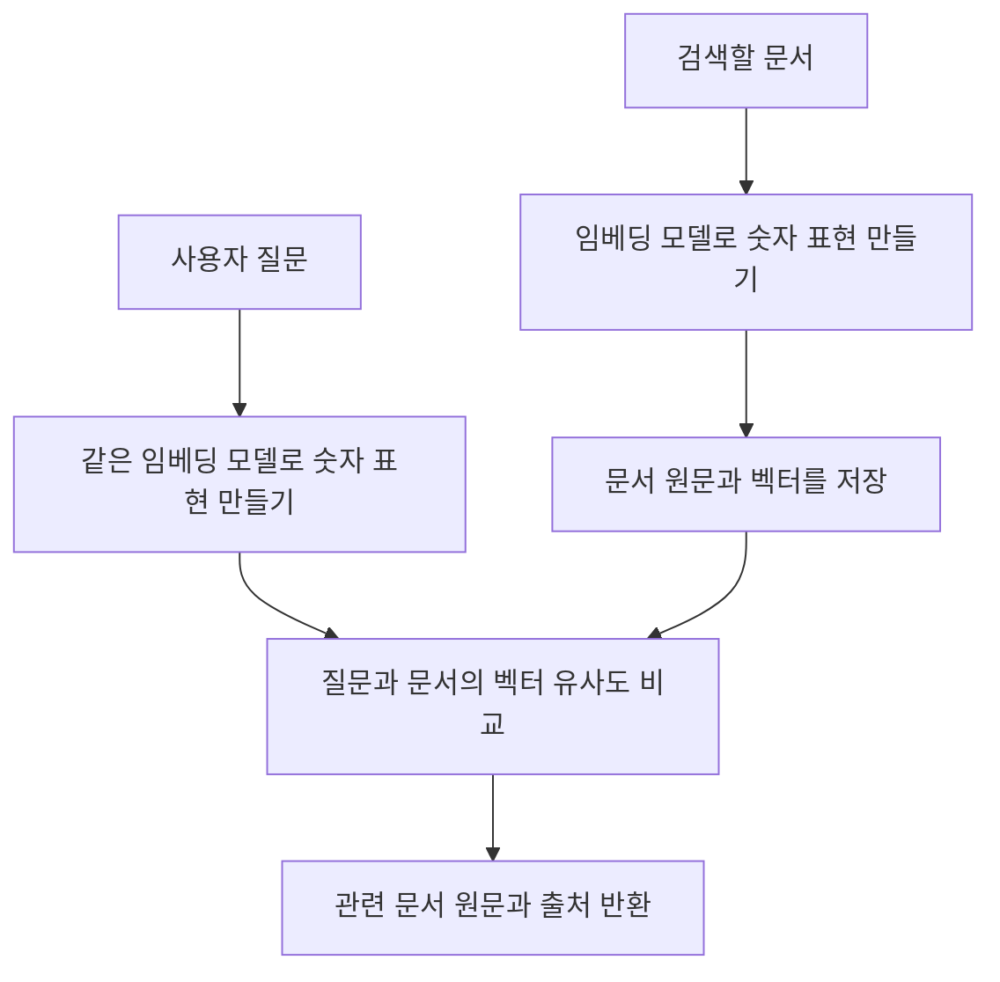

# 09. 임베딩과 검색: 텍스트를 숫자로 비교하기

## 이번 수업의 목표

선수 지식은 Java List·record와 외부 모델 API 설정입니다.

- 텍스트를 임베딩 벡터로 바꾸는 입력·출력을 설명합니다.
- 문서 적재와 질문 검색에서 각각 임베딩하는 시점을 구분합니다.
- 검색 개수·유사도 기준·메타데이터 필터의 역할을 비교합니다.
- 검색 결과를 생성 답변이나 사실성 보장으로 해석하지 않습니다.

## 개념 먼저 이해하기

**임베딩(Embedding)**은 텍스트 등의 정보를 모델을 이용해 숫자 배열로 표현하는 것입니다. 이 숫자 배열을 **벡터(vector)**라고 부릅니다. 벡터를 비교하면 표현이 달라도 내용이 비슷한 자료를 찾는 데 활용할 수 있습니다.

예를 들어 사용자가 “택배비가 얼마야?”라고 물었을 때, 문서 제목이 “배송 요금 안내”여도 관련 내용을 찾아주는 검색을 만들 수 있습니다. 단어가 정확히 같은지 비교하는 검색과 달리, 의미가 비슷한 자료를 찾으려는 방식입니다.

| 용어 | 쉬운 설명 |
|---|---|
| 임베딩 | 내용을 비교하기 위해 모델이 만드는 숫자 표현 |
| 벡터 | 임베딩 결과인 숫자 배열 |
| 유사도 | 두 숫자 표현이 얼마나 비슷한지 비교한 값 |
| 벡터 저장소 | 문서의 벡터와 원문·출처 등을 연결해 보관하고 검색하는 곳 |
| 의미 검색 | 질문과 의미가 가까운 내용을 찾는 검색 방식 |



문서 준비 단계에서 벡터를 만들고, 검색할 때는 질문의 벡터를 만들어 비교합니다. Spring AI는 임베딩 모델 호출과 벡터 저장소 연결을 돕습니다. 이 수업의 저장소는 애플리케이션 메모리에서 동작하므로 별도 데이터베이스를 설치하지 않습니다.

**유사도가 높다는 것은 내용이 질문과 가깝다는 뜻이며, 문서의 사실 여부나 최신성을 증명하는 점수는 아닙니다.** 기획할 때는 검색할 문서의 범위와 업데이트 방법, 반드시 적용할 카테고리 같은 조건도 함께 정해야 합니다.

개념 참고: [Spring AI의 임베딩 설명](https://docs.spring.io/spring-ai/reference/api/embeddings.html).

## 실습 안내

선수 지식: Java List/record, 외부 모델 API 설정.
임베딩으로 **문서를 저장하고 관련 문서를 찾는 방법**을 배웁니다.
[공통 그림 기준](../diagram-guide.md)에 따라 클래스는 자료 흐름, 시퀀스는 적재와 조회의 두 시점을 구분합니다.

## Spring AI API를 코드와 연결하기

| API | 역할 | 실습에서의 사용 |
|---|---|---|
| `EmbeddingModel` | 텍스트를 벡터로 바꾸는 인터페이스 | `embed(text)`의 `float[]` 관찰 |
| `Document` | 본문·ID·메타데이터를 담는 자료형 | 정책 원문과 `category` 보관 |
| `VectorStore` | 문서 적재·삭제와 유사도 검색의 인터페이스 | 실제 저장소를 교체할 수 있는 계약 |
| `SimpleVectorStore` | 메모리에서 벡터를 비교하는 구현체 | 별도 DB 없이 검색 원리 실습 |
| `SearchRequest` | 질의와 검색 조건을 묶는 요청 | `query`, `topK`, `similarityThreshold`, 필터 |

`topK`는 최대 반환 개수이고 threshold는 포함할 유사도 하한입니다. 필터는 카테고리 등 명시적 조건입니다. “반품 문서만”이라는 요구를 유사도 점수만으로 대신하지 않습니다. 코드와 용어를 함께 읽는 위치는 [09-2](09-embeddings-search/02-store.md)입니다.

### 문서가 준비될 때와 질문할 때

시작 시 정책 문서 3개를 적재하면 저장소가 문서 본문을 임베딩합니다. “택배비가 얼마야?”라는 질문에서는 질문을 임베딩한 뒤 기존 벡터와 비교하고 관련 원문을 반환합니다. **이 단계에는 답변 생성용 Chat 모델 호출이 없습니다.** `SimpleVectorStore`를 재생성하면 다시 적재하는 현재 예제의 비용도 구분해서 봅니다.

### 실무에서 검색 자료를 갱신하려면

상용 검색에는 원문 ID·정책 버전·적용일 같은 정보를 함께 보관하고, 변경·폐기된 문서가 계속 검색되지 않게 갱신 절차를 둡니다. 임베딩 모델을 바꾸면 차원이 같아도 벡터 공간이 달라질 수 있으므로 문서도 새 모델로 다시 생성합니다. 외부 저장소를 연결하는 것만으로 검색 품질이 좋아지는 것은 아닙니다. [09-3](09-embeddings-search/03-search.md)의 비교 기준으로 질문별 결과를 확인합니다.


## 작은 수업으로 나누어 읽기

처음에는 아래 순서로 하나씩 학습합니다. 전체 코드를 한 번에 이해하거나 보조 코드를 직접 작성할 필요는 없습니다.

| 순서 | 소수업 | 완료 기준 |
|---|---|---|
| 1 | [텍스트를 숫자 배열로 표현하기](09-embeddings-search/01-vectors.md) | 텍스트가 임베딩 모델을 통해 숫자 배열로 변환되는 과정을 이해합니다. |
| 2 | [문서를 넣고 유사한 문서를 찾기](09-embeddings-search/02-store.md) | 문서를 벡터 저장소에 넣고 질문과 관련된 문서를 검색하는 흐름을 연결합니다. |
| 3 | [검색 결과와 필터 실험](09-embeddings-search/03-search.md) | 질문·결과 개수·유사도 조건을 바꾸며 검색 결과를 비교합니다. |

각 소수업은 이 단원의 실습 모듈을 함께 사용합니다. 표의 순서대로 개념과 실행 코드를 연결하세요.
[공통 학습 방법](../learning-guide.md) · [전체 교육 계획](../curriculum.md)

## 실행 코드와 테스트

[labs/09-00-embeddings-search의 실행 안내](../../labs/09-00-embeddings-search/README.md)를 확인합니다.
이 단원의 기본 구현은 다음 명령으로 테스트·빌드·실행합니다. 명령은 저장소 루트 기준입니다.

```bash
./gradlew :Spring-AI-Agent-Learning:labs:09-00-embeddings-search:test --tests com.example.ailearning.l09search.SearchLocalModelTest
./gradlew :Spring-AI-Agent-Learning:labs:09-00-embeddings-search:bootJar
./gradlew :Spring-AI-Agent-Learning:labs:09-00-embeddings-search:bootRun
```

로컬 테스트는 고정 벡터로 연결과 검색 조건을 검증합니다. 실제 의미 검색 품질은 실제 모델과 질문 세트로 따로 평가합니다. `bootRun`은 시작 시 문서 적재부터 외부 임베딩 API를 사용할 수 있습니다.

## 확인 질문

1. 문서를 적재할 때와 검색할 때 각각 무엇을 임베딩하나요?
2. `topK(3)`으로 검색했는데 결과가 1개라면 반드시 오류인가요?
3. 다른 임베딩 모델의 벡터가 같은 길이면 기존 벡터와 섞어 검색해도 되나요?

<details>
<summary>해설</summary>

1. 적재할 때 문서 본문을, 검색할 때 사용자 질문을 임베딩합니다. 같은 모델의 공간에서 비교하기 위해 두 과정이 필요합니다.
2. 아닙니다. 3은 상한입니다. 문서 수나 유사도 하한·필터 때문에 적게 반환될 수 있습니다.
3. 안 됩니다. 차원이 같아도 숫자가 표현하는 공간이 다를 수 있습니다. 모델 교체 시 문서 벡터도 다시 생성해야 합니다.

</details>

## 참고 자료

- [Spring AI Vector Databases](https://docs.spring.io/spring-ai/reference/api/vectordbs.html): `VectorStore`와 검색 요청의 기준입니다.
- [Oded Shopen / Spring Blog — AI Meets Spring Petclinic, Part II](https://spring.io/blog/2024/09/27/ai-meets-spring-petclinic-implementing-an-ai-assistant-with-spring-ai-part/): 서로 다른 표현을 의미 검색으로 연결하는 업무 예시를 참고했습니다. 2024년 코드를 현재 API의 기준으로 사용하지 않습니다.
- [07~13장 참고 자료 안내](../references.md#0713장-보강에-사용한-교육-자료)

[이전: 08장](08-advisors.md) · [다음: 10장](10-rag.md)
