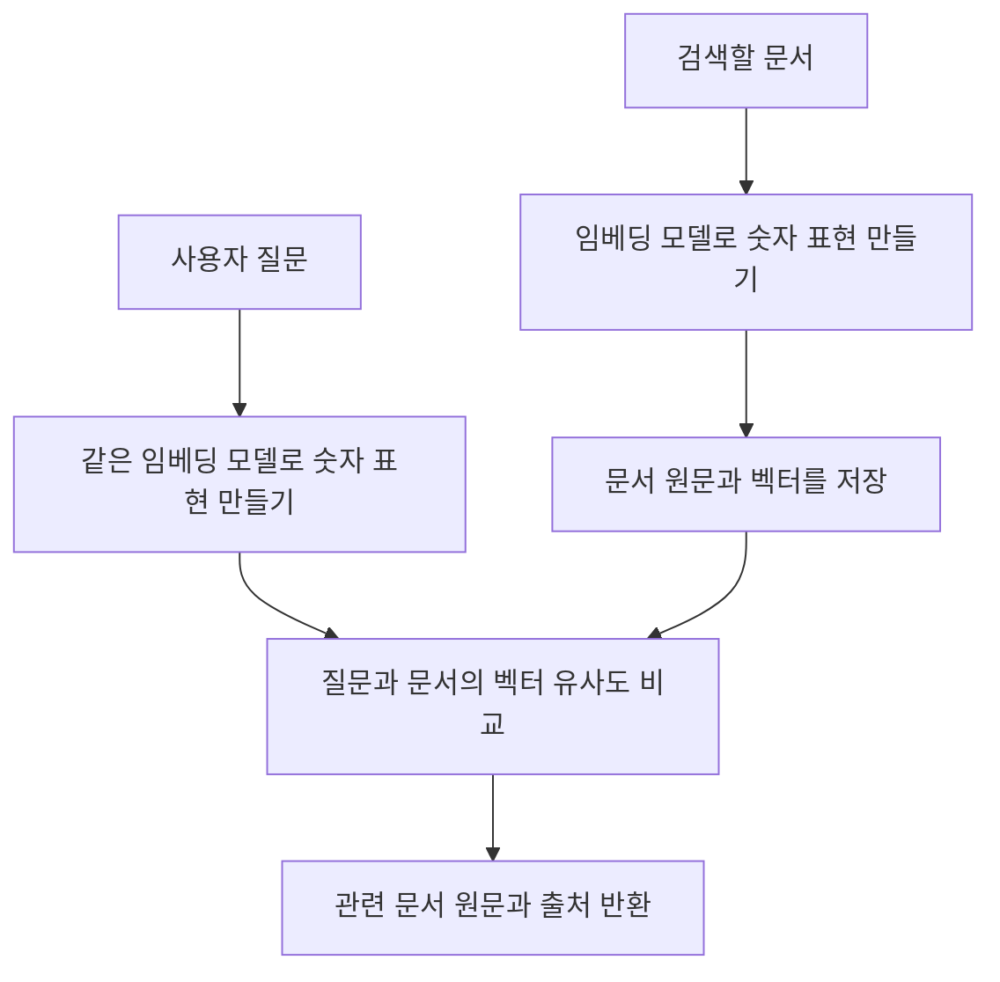

# 09. 임베딩과 검색: 텍스트를 숫자로 비교하기

## 개념 먼저 이해하기

**임베딩(Embedding)**은 텍스트 등의 정보를 모델을 이용해 숫자 배열로 표현하는 것입니다. 이 숫자 배열을 **벡터(vector)**라고 부릅니다. 벡터를 비교하면 표현이 달라도 내용이 비슷한 자료를 찾는 데 활용할 수 있습니다.

예를 들어 사용자가 “택배비가 얼마야?”라고 물었을 때, 문서 제목이 “배송 요금 안내”여도 관련 내용을 찾아주는 검색을 만들 수 있습니다. 단어가 정확히 같은지 비교하는 검색과 달리, 의미가 비슷한 자료를 찾으려는 방식입니다.

| 용어 | 쉬운 설명 |
|---|---|
| 임베딩 | 내용을 비교하기 위해 모델이 만드는 숫자 표현 |
| 벡터 | 임베딩 결과인 숫자 배열 |
| 유사도 | 두 숫자 표현이 얼마나 비슷한지 비교한 값 |
| 벡터 저장소 | 문서의 벡터와 원문·출처 등을 연결해 보관하고 검색하는 곳 |
| 의미 검색 | 질문과 의미가 가까운 내용을 찾는 검색 방식 |



문서 준비 단계에서 벡터를 만들고, 검색할 때는 질문의 벡터를 만들어 비교합니다. Spring AI는 임베딩 모델 호출과 벡터 저장소 연결을 돕습니다. 이 수업의 저장소는 애플리케이션 메모리에서 동작하므로 별도 데이터베이스를 설치하지 않습니다.

**유사도가 높다는 것은 내용이 질문과 가깝다는 뜻이며, 문서의 사실 여부나 최신성을 증명하는 점수는 아닙니다.** 기획할 때는 검색할 문서의 범위와 업데이트 방법, 반드시 적용할 카테고리 같은 조건도 함께 정해야 합니다.

개념 참고: [Spring AI의 임베딩 설명](https://docs.spring.io/spring-ai/reference/api/embeddings.html).

## 실습 안내

선수 지식: Java List/record, 외부 모델 API 설정.
임베딩으로 **문서를 저장하고 관련 문서를 찾는 방법**을 배웁니다.
[공통 그림 기준](../diagram-guide.md)에 따라 클래스는 자료 흐름, 시퀀스는 적재와 조회의 두 시점을 구분합니다.


## 작은 수업으로 나누어 읽기

처음에는 아래 순서로 하나씩 학습합니다. 전체 코드를 한 번에 이해하거나 보조 코드를 직접 작성할 필요는 없습니다.

| 순서 | 소수업 | 완료 기준 |
|---|---|---|
| 1 | [텍스트를 숫자 배열로 표현하기](09-embeddings-search/01-vectors.md) | 텍스트가 임베딩 모델을 통해 숫자 배열로 변환되는 과정을 이해합니다. |
| 2 | [문서를 넣고 유사한 문서를 찾기](09-embeddings-search/02-store.md) | 문서를 벡터 저장소에 넣고 질문과 관련된 문서를 검색하는 흐름을 연결합니다. |
| 3 | [검색 결과와 필터 실험](09-embeddings-search/03-search.md) | 질문·결과 개수·유사도 조건을 바꾸며 검색 결과를 비교합니다. |

각 소수업은 이 단원의 실습 모듈을 함께 사용합니다. 표의 순서대로 개념과 실행 코드를 연결하세요.
[공통 학습 방법](../learning-guide.md) · [전체 교육 계획](../curriculum.md)

## 실행 코드와 테스트

[labs/09-embeddings-search의 실행 안내](../../labs/09-embeddings-search/README.md)를 확인합니다.
이 단원의 기본 구현은 다음 명령으로 테스트·빌드·실행합니다. 명령은 저장소 루트 기준입니다.

```bash
./gradlew :Spring-AI-Agent-Learning:labs:09-embeddings-search:test --tests com.example.ailearning.l09search.SearchLocalModelTest
./gradlew :Spring-AI-Agent-Learning:labs:09-embeddings-search:bootJar
./gradlew :Spring-AI-Agent-Learning:labs:09-embeddings-search:bootRun
```
