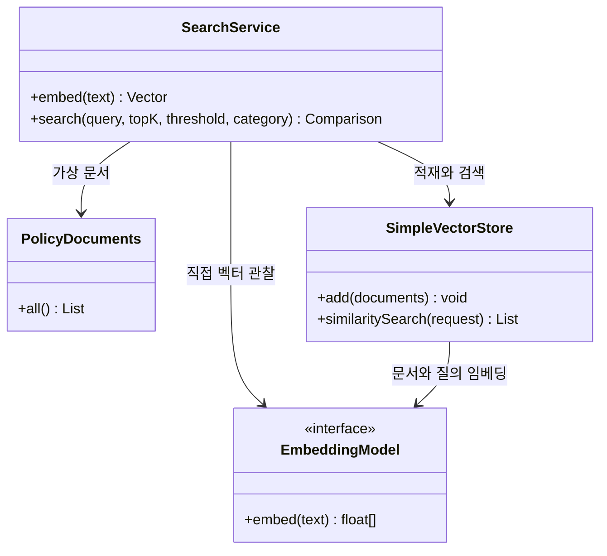
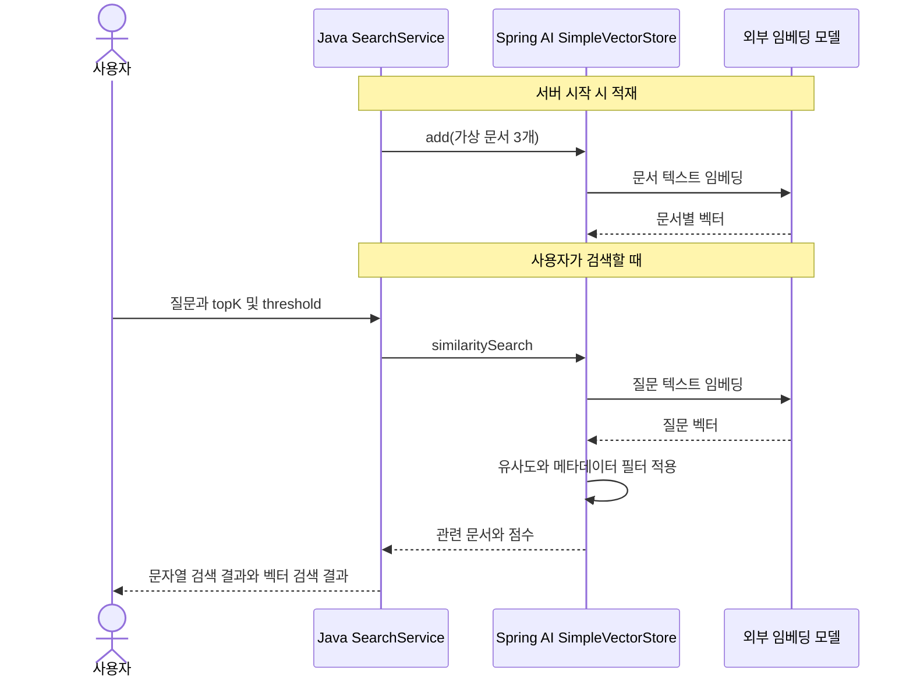

# 09. 임베딩과 검색: 텍스트를 숫자로 비교하기

예상 시간: 2시간. 선수 지식: Java List/record, 외부 모델 API 설정.
이번에는 ChatClient로 답변을 생성하지 않습니다. **문서를 저장하고 관련 문서를 찾는 것**만 배웁니다.
[공통 그림 기준](../diagram-guide.md)에 따라 클래스는 자료 흐름, 시퀀스는 적재와 조회의 두 시점을 구분합니다.

## 왜 문자열 검색만으로는 부족할까?

문서에 “배송비”가 있는데 사용자가 “운송 요금”이라고 묻는 경우를 생각해 보세요.
`text.contains(query)`는 입력 문자열 자체가 문서에 있어야 성공합니다.
임베딩 모델은 텍스트를 숫자 배열인 **벡터**로 바꿉니다. 비슷한 의미가 가까운 방향에 놓이도록 학습한 모델을 사용하면 다른 표현도 검색할 수 있습니다.
실제 의미 검색 품질은 모델·문서·질문에 따라 달라지며 항상 성공하는 것은 아닙니다.

## 새 용어

| 용어 | 뜻 |
|---|---|
| 임베딩(embedding) | 텍스트를 숫자 배열로 표현하는 변환 |
| 차원(dimensions) | 배열의 숫자 개수. “의미 항목의 개수”라고 고정 해석하지 않음 |
| 벡터 저장소(VectorStore) | 문서·메타데이터·임베딩을 저장하고 유사도로 검색하는 구성 요소 |
| 유사도(score) | 벡터의 가까운 정도. 사실일 확률이 아님 |
| topK | 반환할 최대 문서 수 |
| threshold | 결과로 포함할 유사도 하한 |
| metadata filter | 의미 유사도와 별도로 카테고리 등 명시적 조건을 적용하는 필터 |

예를 들어 설명용 벡터 `[1,0]`과 `[0.9,0.1]`은 방향이 가깝고 `[0,1]`은 상대적으로 다릅니다.
이 숫자는 실제 모델 출력이 아닌 원리 설명용입니다. 실제 각 차원의 의미를 사람이 이름 붙여 해석하는 방식은 아닙니다.
SimpleVectorStore는 코사인 유사도로 비교합니다. 본문 검색의 threshold는 0~1 범위를 사용합니다.

## 지금 만들 구조

가상 문서 세 개는 배송 정책, 미개봉 반품, 개봉 반품입니다. 문서 하나가 이미 짧아 아직 분할하지 않습니다.
`Document`는 id·text·metadata를 담는 Spring AI 자료형입니다.



벡터는 **같은 모델과 차원**으로 생성한 것끼리 비교해야 합니다.
모델을 바꾸면 기존 문서도 다시 적재합니다. 차원이 같아도 다른 모델의 벡터를 섞지 않습니다.
이 단원은 서버가 시작할 때 새 저장소를 만들므로 재시작하면 다시 임베딩합니다.



답변 생성용 모델 요청은 없습니다. 검색 결과를 문장으로 답하게 하는 RAG는 다음 단원입니다.
SimpleVectorStore의 “메모리 저장”은 JVM 내부 저장을 뜻하며, 07의 대화 메모리와 역할이 다릅니다.

## 코드 읽기

[PolicyDocuments](../../labs/09-embeddings-search/src/main/java/com/example/ailearning/l09search/PolicyDocuments.java) → SearchService → [SearchController](../../labs/09-embeddings-search/src/main/java/com/example/ailearning/l09search/SearchController.java) 순서로 읽습니다.
이 단원의 핵심 서비스 전체 코드입니다.

```java
package com.example.ailearning.l09search;

import org.springframework.ai.document.Document;
import org.springframework.ai.embedding.EmbeddingModel;
import org.springframework.ai.vectorstore.SimpleVectorStore;
import org.springframework.ai.vectorstore.SearchRequest;
import org.springframework.stereotype.Service;
import java.util.List;
import java.util.Set;

@Service
public class SearchService {
    public record Hit(String id, String text, String category, Double score) {}
    public record Comparison(List<Hit> keywordHits, List<Hit> vectorHits) {}
    public record Vector(int dimensions, float[] values) {}
    private final EmbeddingModel embedding;
    private final SimpleVectorStore store;

    public SearchService(EmbeddingModel embedding) {
        this.embedding = embedding;
        store = SimpleVectorStore.builder(embedding).build();
        store.add(PolicyDocuments.all()); // 시작 시 문서를 임베딩해 인메모리 저장소에 적재한다.
    }

    public Vector embed(String text) {
        float[] values = embedding.embed(text);
        return new Vector(values.length, values);
    }

    public Comparison search(String query, int topK, double threshold, String category) {
        if (category != null && !Set.of("shipping", "returns").contains(category))
            throw new IllegalArgumentException("category는 shipping/returns입니다.");
        List<Hit> keyword = PolicyDocuments.all().stream()
                .filter(doc -> category == null || category.equals(doc.getMetadata().get("category")))
                .filter(doc -> doc.getText().contains(query)).map(this::view).toList();
        var request = SearchRequest.builder().query(query).topK(topK).similarityThreshold(threshold);
        // 허용 목록으로 검사한 메타데이터 값만 필터에 사용한다.
        if (category != null) request.filterExpression("category == '" + category + "'");
        List<Hit> semantic = store.similaritySearch(request.build()).stream().map(this::view).toList();
        return new Comparison(keyword, semantic);
    }

    private Hit view(Document doc) {
        return new Hit(doc.getId(), doc.getText(), (String) doc.getMetadata().get("category"), doc.getScore());
    }
}
```

`store.add()`가 문서를 임베딩하고, `similaritySearch()`가 질문을 임베딩해 검색합니다. 숫자 배열을 수동 저장하지 않아도 됩니다.
카테고리는 shipping/returns 허용 목록으로 검사한 뒤 필터에 사용합니다.
문자열 경로는 단순 contains 비교이며 전문 검색 엔진의 형태소·토큰 검색과는 다릅니다.
score가 없는 문자열 결과는 JSON에서 score가 생략될 수 있습니다.

## 설정과 실행

이 실습에는 Chat 모델 이름이 필요 없습니다. OPENAI_API_KEY와 **OPENAI_EMBEDDING_MODEL**을 지정합니다.
[01장](01-setup.md#4-실제-모델을-사용할-때의-환경-변수)처럼 키를 설정한 뒤, zsh에서는 다음을 사용합니다.

```zsh
read 'OPENAI_EMBEDDING_MODEL?사용 가능한 임베딩 모델 이름: '
export OPENAI_EMBEDDING_MODEL
```

bash에서는 `read -r -p '임베딩 모델 이름: ' OPENAI_EMBEDDING_MODEL` 후 export하세요.
명령은 저장소 루트에서 실행합니다.

```bash
./gradlew :Spring-AI-Agent-Learning:labs:09-embeddings-search:test
./gradlew :Spring-AI-Agent-Learning:labs:09-embeddings-search:bootRun
curl -sS http://127.0.0.1:8099/api/embedding \
  -H 'Content-Type: text/plain; charset=UTF-8' --data-raw '배송비'
curl --get http://127.0.0.1:8099/api/search \
  --data-urlencode 'query=운송 요금' --data-urlencode 'topK=2' --data-urlencode 'threshold=0.5'
```

bootRun은 **시작 시 문서 임베딩부터 실제 API를 호출**합니다. 검색 요청마다 질문 임베딩 호출이 추가됩니다.
따라서 서버 재시작에도 사용량이 발생할 수 있습니다. 테스트는 실제 키 없이 로컬 임베딩 서버를 사용합니다.
실제 결과 점수·배열 길이는 선택한 모델에 따라 다릅니다. 종료는 Ctrl+C입니다.

## 바꾸면서 확인하기

| 바꿀 값 | 관찰할 점 |
|---|---|
| query=배송비 / 운송 요금 | 문자열 결과와 벡터 결과의 차이. 모델이 항상 동의어를 찾는다는 보장은 없음 |
| topK=1 / 3 | 최대 반환 수 차이. threshold로 걸러지면 그보다 적거나 0개 |
| threshold=0.2 / 0.9 | 엄격해질수록 후보가 줄어드는지 확인 |
| category=returns | 배송 문서는 의미가 가까워도 필터에서 제외 |
| query=문서와 무관한 질문 | threshold가 낮으면 무관한 문서도 반환될 수 있음 |

카테고리가 잘못되거나 topK/threshold가 범위를 벗어나면 400입니다.
threshold 숫자는 실제 질문 세트로 조정해야 하며, 이 예제의 0.5는 서비스 품질을 보장하는 값이 아닙니다.

[SearchContractTest](../../labs/09-embeddings-search/src/test/java/com/example/ailearning/l09search/SearchContractTest.java)는 실제 어댑터와 저장소를 사용합니다.
테스트 서버는 정해진 단어군에 3차원 직교 벡터를 반환해 적재·검색·필터를 재현합니다.
이는 실제 모델의 의미 검색 성능을 평가하는 테스트가 아닙니다. 실제 모델 품질은 별도 질문으로 확인해야 합니다.

## 확인 질문

1. 검색할 때 문서뿐 아니라 질문도 임베딩하는 이유는 무엇인가요?
2. topK=3이면 항상 3개가 나오나요?
3. score=0.9는 문서 내용이 90% 확률로 사실이라는 뜻인가요?
4. 같은 차원의 다른 모델로 바꿔도 기존 벡터를 계속 써도 될까요?

<details><summary>해설</summary>

같은 벡터 공간에서 문서와 질문을 비교하기 위해서입니다. 필터/threshold에 따라 0개도 나올 수 있습니다.
유사도는 사실 확률이 아니고, 모델이 바뀌면 같은 차원이어도 문서를 다시 임베딩해야 합니다.
검색 결과의 원문·ID·점수를 확인하면 완료입니다.
</details>

보충: [공식 VectorStore API](https://docs.spring.io/spring-ai/reference/api/vectordbs.html).
[이전: 08](08-advisors.md) · [학습 지도](../curriculum.md)

[다음: 10. RAG](10-rag.md)
