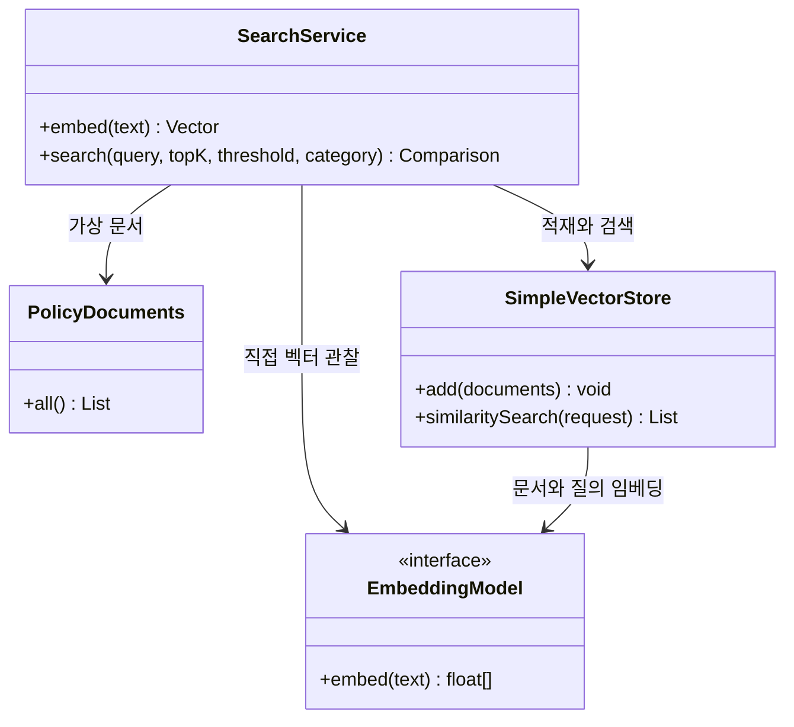
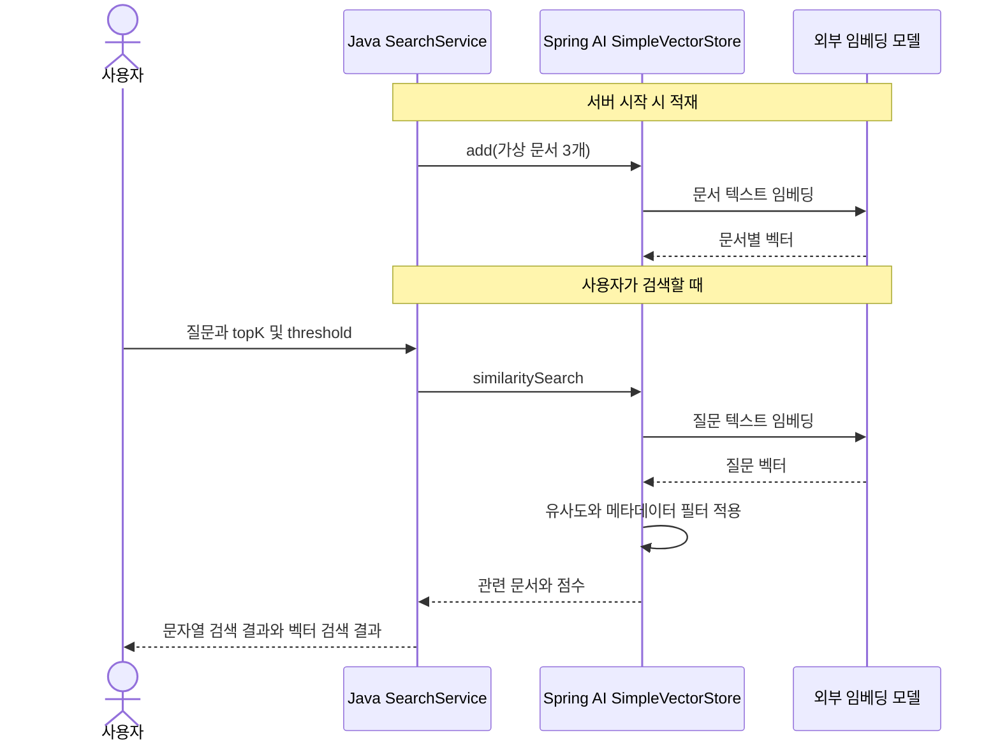

# 09-1. 텍스트를 숫자 배열로 표현하기

**실행 코드·설정·테스트:** [labs/09-embeddings-search](../../../labs/09-embeddings-search/README.md). 저장소 루트에서 해당 README의 명령으로 실행합니다.

30~45분을 기준으로 한 번에 한 가지 흐름만 읽습니다. 읽기와 실습을 합친 시간이며, 단원 전체 예상 시간에 포함됩니다.

**이번 목표:** 문자열 일치와 벡터 유사도가 다른 질문임을 설명합니다.

**코드 읽기 안내:** 벡터 각 숫자에 사람이 단어 뜻을 이름 붙이지 않습니다. 입력 텍스트가 검색 가능한 숫자로 변환된다는 관계만 먼저 이해합니다.

## 왜 문자열 검색만으로는 부족할까?

문서에 “배송비”가 있는데 사용자가 “운송 요금”이라고 묻는 경우를 생각해 보세요.
`text.contains(query)`는 입력 문자열 자체가 문서에 있어야 성공합니다.
임베딩 모델은 텍스트를 숫자 배열인 **벡터**로 바꿉니다. 비슷한 의미가 가까운 방향에 놓이도록 학습한 모델을 사용하면 다른 표현도 검색할 수 있습니다.
실제 의미 검색 품질은 모델·문서·질문에 따라 달라지며 항상 성공하는 것은 아닙니다.

## 새 용어

| 용어 | 뜻 |
|---|---|
| 임베딩(embedding) | 텍스트를 숫자 배열로 표현하는 변환 |
| 차원(dimensions) | 배열의 숫자 개수. “의미 항목의 개수”라고 고정 해석하지 않음 |
| 벡터 저장소(VectorStore) | 문서·메타데이터·임베딩을 저장하고 유사도로 검색하는 구성 요소 |
| 유사도(score) | 벡터의 가까운 정도. 사실일 확률이 아님 |
| topK | 반환할 최대 문서 수 |
| threshold | 결과로 포함할 유사도 하한 |
| metadata filter | 의미 유사도와 별도로 카테고리 등 명시적 조건을 적용하는 필터 |

예를 들어 설명용 벡터 `[1,0]`과 `[0.9,0.1]`은 방향이 가깝고 `[0,1]`은 상대적으로 다릅니다.
이 숫자는 실제 모델 출력이 아닌 원리 설명용입니다. 실제 각 차원의 의미를 사람이 이름 붙여 해석하는 방식은 아닙니다.
SimpleVectorStore는 코사인 유사도로 비교합니다. 본문 검색의 threshold는 0~1 범위를 사용합니다.

## 지금 만들 구조

가상 문서 세 개는 배송 정책, 미개봉 반품, 개봉 반품입니다. 문서 하나가 이미 짧아 아직 분할하지 않습니다.
`Document`는 id·text·metadata를 담는 Spring AI 자료형입니다.

벡터는 **같은 모델과 차원**으로 생성한 것끼리 비교해야 합니다.
모델을 바꾸면 기존 문서도 다시 적재합니다. 차원이 같아도 다른 모델의 벡터를 섞지 않습니다.
이 단원은 서버가 시작할 때 새 저장소를 만들므로 재시작하면 다시 임베딩합니다.

답변 생성용 모델 요청은 없습니다. 검색 결과를 문장으로 답하게 하는 RAG는 다음 단원입니다.
SimpleVectorStore의 “메모리 저장”은 JVM 내부 저장을 뜻하며, 07의 대화 메모리와 역할이 다릅니다.

## 여기서 멈춰 확인하기

문서와 질문을 같은 임베딩 모델로 변환해야 하는 이유를 시퀀스 그림으로 설명해 보세요.

[이전](../09-embeddings-search.md) · [다음](02-store.md) · [단원 목차](../09-embeddings-search.md) · [학습 방법](../../learning-guide.md)
