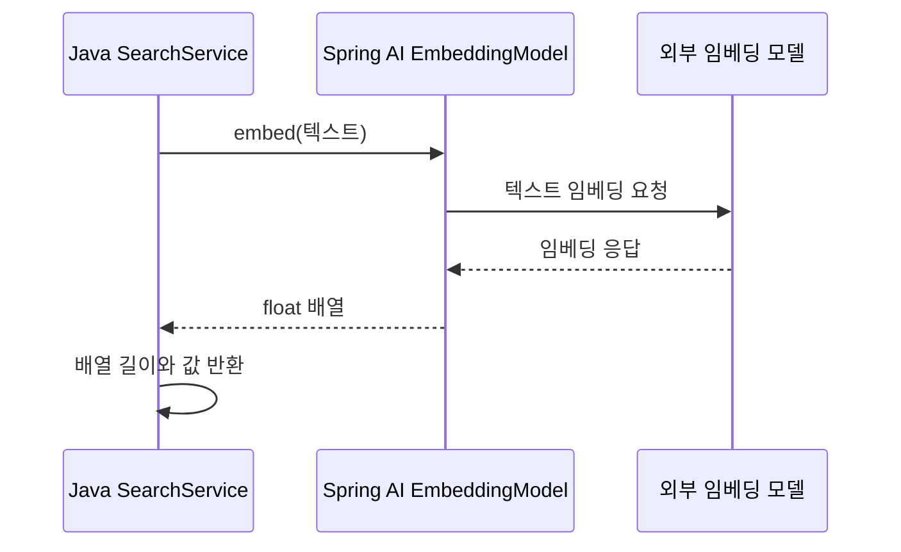

# 09-1. 텍스트를 숫자 배열로 표현하기

**실행 코드·설정·테스트:** [labs/09-00-embeddings-search](../../../labs/09-00-embeddings-search/README.md). 저장소 루트에서 해당 README의 명령으로 실행합니다.

**이번 목표:** 텍스트가 임베딩 모델을 통해 숫자 배열로 변환되는 과정을 이해합니다.

**코드 읽기 안내:** 벡터 각 숫자에 사람이 단어 뜻을 이름 붙이지 않습니다. 입력 텍스트가 검색 가능한 숫자로 변환된다는 관계만 먼저 이해합니다.

## 왜 문자열 검색만으로는 부족할까?

문서에 “배송비”가 있는데 사용자가 “운송 요금”이라고 묻는 경우를 생각해 보세요.
`text.contains(query)`는 입력 문자열 자체가 문서에 있어야 성공합니다.
임베딩 모델은 텍스트를 숫자 배열인 **벡터**로 바꿉니다. 비슷한 의미가 가까운 방향에 놓이도록 학습한 모델을 사용하면 다른 표현도 검색할 수 있습니다.
실제 의미 검색 품질은 모델·문서·질문에 따라 달라지며 항상 성공하는 것은 아닙니다.

## 새 용어

| 용어 | 뜻 |
|---|---|
| 임베딩(embedding) | 텍스트를 숫자 배열로 표현하는 변환 |
| 벡터(vector) | 텍스트를 표현하는 숫자 배열 |
| 차원(dimensions) | 배열의 숫자 개수. “의미 항목의 개수”라고 고정 해석하지 않음 |

예를 들어 설명용 벡터 `[1,0]`과 `[0.9,0.1]`은 방향이 가깝고 `[0,1]`은 상대적으로 다릅니다.
이 숫자는 실제 모델 출력이 아닌 원리 설명용입니다. 실제 각 차원의 의미를 사람이 이름 붙여 해석하는 방식은 아닙니다.
## 텍스트 하나를 변환하는 흐름



[SearchService.java](../../../labs/09-00-embeddings-search/src/main/java/com/example/ailearning/l09search/SearchService.java)의 `embed()` 메서드 발췌입니다.
`embedding`은 생성자로 주입받은 `EmbeddingModel`입니다. 반환 자료형 `Vector`는 배열 길이인 `dimensions`와 배열 자체인 `values`를 담는 record입니다.

```java
public Vector embed(String text) {
    float[] values = embedding.embed(text);
    return new Vector(values.length, values);
}
```

문장을 보내면 `float[]`를 받고 그 길이와 값을 확인할 수 있습니다. 이 호출에도 외부 임베딩 API 사용량이 발생합니다.
실행 설정과 벡터 조회 API는 [09-3의 설정과 실행](03-search.md)에서 확인합니다.

## 확인 질문

`embedding.embed(text)`의 입력과 출력은 무엇이며, 벡터의 차원은 코드에서 어떻게 확인하나요?

<details>
<summary>해설</summary>

입력은 텍스트이고 출력은 `float[]` 숫자 벡터입니다. 반환 배열의 `length`로 차원을 확인하며, 예제의 `SearchService.embed()`는 이를 `dimensions` 필드에 담습니다.

</details>

[이전](../09-embeddings-search.md) · [다음](02-store.md) · [단원 목차](../09-embeddings-search.md) · [학습 방법](../../learning-guide.md)
