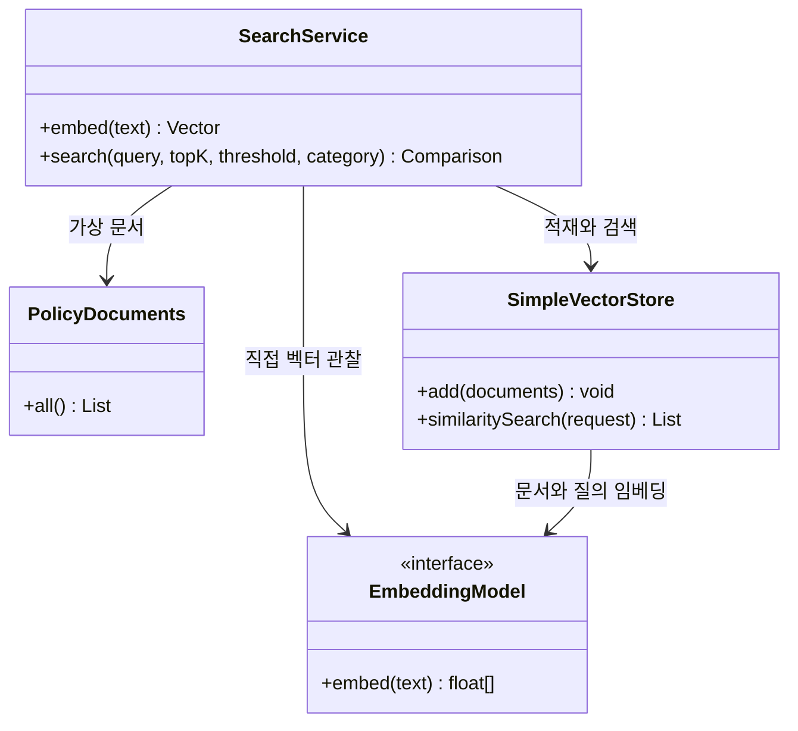
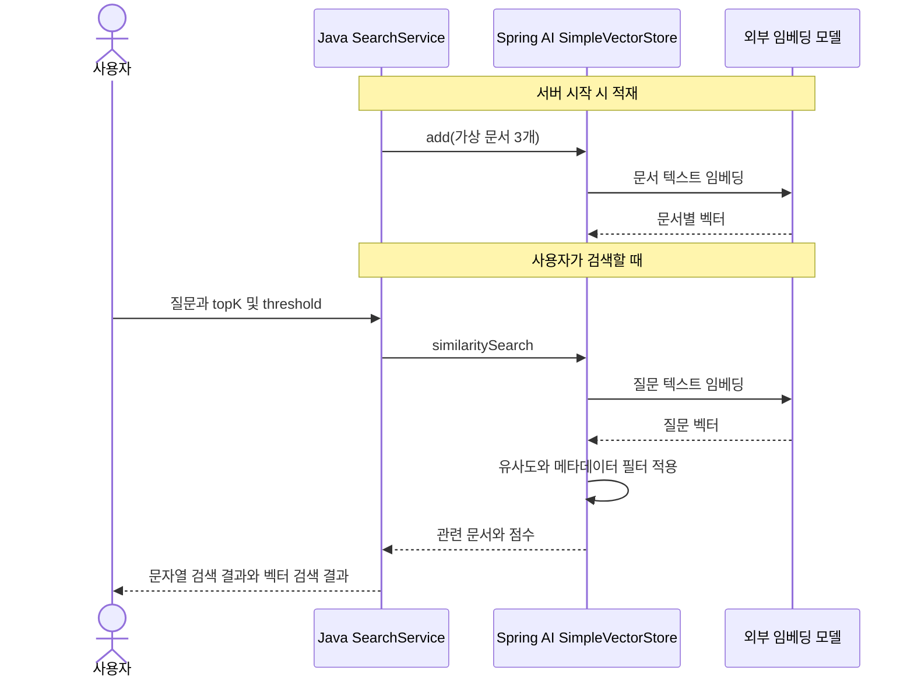

# 09-2. 문서를 넣고 유사한 문서를 찾기

**실행 코드·설정·테스트:** [labs/09-embeddings-search](../../../labs/09-embeddings-search/README.md). 저장소 루트에서 해당 README의 명령으로 실행합니다.

**이번 목표:** 문서를 벡터 저장소에 넣고 질문과 관련된 문서를 검색하는 흐름을 연결합니다.

**코드 읽기 안내:** 처음에는 category 필터를 빼고 query와 topK만 읽습니다. 그 뒤 threshold와 필터를 하나씩 붙여 관찰합니다.

## 검색에 필요한 용어

| 용어 | 뜻 |
|---|---|
| 벡터 저장소(VectorStore) | 문서·메타데이터·임베딩을 저장하고 유사도로 검색하는 구성 요소 |
| 유사도(score) | 벡터의 가까운 정도. 사실일 확률이 아님 |
| topK | 반환할 최대 문서 수 |
| threshold | 결과로 포함할 유사도 하한 |
| metadata filter | 의미 유사도와 별도로 카테고리 등 명시적 조건을 적용하는 필터 |

SimpleVectorStore는 코사인 유사도로 비교합니다. 본문 검색의 threshold는 0~1 범위를 사용합니다.

## 지금 만들 구조

가상 문서 세 개는 배송 정책, 미개봉 반품, 개봉 반품입니다. 문서 하나가 이미 짧아 아직 분할하지 않습니다.
`Document`는 id·text·metadata를 담는 Spring AI 자료형입니다.



벡터는 **같은 모델과 차원**으로 생성한 것끼리 비교해야 합니다.
모델을 바꾸면 기존 문서도 다시 적재합니다. 차원이 같아도 다른 모델의 벡터를 섞지 않습니다.
이 단원은 서버가 시작할 때 새 저장소를 만들므로 재시작하면 다시 임베딩합니다.



답변 생성용 모델 요청은 없습니다. 검색 결과를 문장으로 답하게 하는 RAG는 다음 단원입니다.
SimpleVectorStore의 “메모리 저장”은 JVM 내부 저장을 뜻하며, 07의 대화 메모리와 역할이 다릅니다.


## 코드 읽기

[PolicyDocuments](../../../labs/09-embeddings-search/src/main/java/com/example/ailearning/l09search/PolicyDocuments.java) → SearchService → [SearchController](../../../labs/09-embeddings-search/src/main/java/com/example/ailearning/l09search/SearchController.java) 순서로 읽습니다.
이 단원의 핵심 서비스 전체 코드입니다.

```java
package com.example.ailearning.l09search;

import org.springframework.ai.document.Document;
import org.springframework.ai.embedding.EmbeddingModel;
import org.springframework.ai.vectorstore.SimpleVectorStore;
import org.springframework.ai.vectorstore.SearchRequest;
import org.springframework.stereotype.Service;
import java.util.List;
import java.util.Set;

@Service
public class SearchService {
    public record Hit(String id, String text, String category, Double score) {}
    public record Comparison(List<Hit> keywordHits, List<Hit> vectorHits) {}
    public record Vector(int dimensions, float[] values) {}
    private final EmbeddingModel embedding;
    private final SimpleVectorStore store;

    public SearchService(EmbeddingModel embedding) {
        this.embedding = embedding;
        store = SimpleVectorStore.builder(embedding)
                .build();
        store.add(PolicyDocuments.all()); // 시작 시 문서를 임베딩해 인메모리 저장소에 적재한다.
    }

    public Vector embed(String text) {
        float[] values = embedding.embed(text);
        return new Vector(values.length, values);
    }

    public Comparison search(String query, int topK, double threshold, String category) {
        if (category != null && !Set.of("shipping", "returns")
                .contains(category))
            throw new IllegalArgumentException("category는 shipping/returns입니다.");
        List<Hit> keyword = PolicyDocuments.all()
                .stream()
                .filter(doc -> category == null || category.equals(doc
                                .getMetadata()
                                .get("category")))
                .filter(doc -> doc
                        .getText()
                        .contains(query))
                .map(this::view)
                .toList();
        var request = SearchRequest.builder()
                .query(query)
                .topK(topK)
                .similarityThreshold(threshold);
        // 허용 목록으로 검사한 메타데이터 값만 필터에 사용한다.
        if (category != null) request.filterExpression("category == '" + category + "'");
        List<Hit> semantic = store
                .similaritySearch(request.build())
                .stream()
                .map(this::view)
                .toList();
        return new Comparison(keyword, semantic);
    }

    private Hit view(Document doc) {
        return new Hit(doc.getId(), doc.getText(), (String) doc
                .getMetadata()
                .get("category"), doc.getScore());
    }
}
```

`store.add()`가 문서를 임베딩하고, `similaritySearch()`가 질문을 임베딩해 검색합니다. 숫자 배열을 수동 저장하지 않아도 됩니다.
카테고리는 shipping/returns 허용 목록으로 검사한 뒤 필터에 사용합니다.
문자열 경로는 단순 contains 비교이며 전문 검색 엔진의 형태소·토큰 검색과는 다릅니다.
score가 없는 문자열 결과는 JSON에서 score가 생략될 수 있습니다.


## 여기서 멈춰 확인하기

문서 적재와 질문 검색 중 각각 어느 코드가 임베딩을 요청하나요?

[이전](01-vectors.md) · [다음](03-search.md) · [단원 목차](../09-embeddings-search.md) · [학습 방법](../../learning-guide.md)
