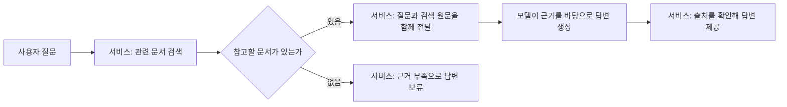

# 10. RAG: 검색한 문서를 근거로 답하기

## 개념 먼저 이해하기

**RAG(Retrieval-Augmented Generation, 검색 증강 생성)**는 질문과 관련된 자료를 먼저 검색하고, 그 자료를 모델에게 함께 전달해 답변을 만드는 방식입니다. 모델이 이미 학습한 지식에 더해 회사의 정책·상품 설명 같은 자료를 참고하게 할 때 사용합니다.

예를 들어 쇼핑몰의 미개봉 반품 기간을 묻는 질문이라면, 먼저 해당 쇼핑몰의 정책 문서를 검색합니다. 그 원문을 질문과 함께 모델에 전달하고, 모델은 제공된 내용을 바탕으로 답변을 작성합니다.

| 용어 | 쉬운 설명 | 역할 |
|---|---|---|
| 검색(retrieval) | 질문에 관련된 자료를 찾는 단계 | 반품 규정 문서 찾기 |
| 청크(chunk) | 검색하기 좋게 나눈 문서의 한 부분 | 반품 조건에 관한 절 |
| 참고 문맥(context) | 답변을 위해 이번 요청에 함께 보낸 자료 | 검색된 정책 원문 |
| 생성(generation) | 모델이 질문과 자료를 읽고 답변을 작성하는 단계 | 규정을 쉬운 문장으로 설명 |
| 출처 | 답변에 사용한 자료를 확인할 수 있는 정보 | 정책 문서 이름과 해당 부분의 식별값 |



09장의 의미 검색이 관련 자료를 찾는 기능이라면, RAG는 그 결과를 모델의 답변 생성까지 연결합니다. RAG의 검색에는 키워드 검색 등도 쓸 수 있으며, 이 교재에서는 09장의 의미 검색을 활용합니다. Spring AI는 검색 결과를 요청에 포함하도록 직접 구성하거나, Advisor로 연결하는 방법을 제공합니다.

자료를 전달하는 것은 모델 자체를 새로 학습시키는 작업과 다릅니다. 정책이 바뀌면 검색에 사용하는 문서와 저장소도 갱신해야 합니다. 또한 **RAG를 적용하거나 출처를 표시했다는 이유만으로 모든 답변이 정확해지는 것은 아닙니다.** 잘못 검색했을 때와 근거가 없을 때의 처리, 실제 원문과 답변의 일치 여부를 확인하는 기준이 필요합니다.

개념 참고: [Spring AI의 RAG 설명](https://docs.spring.io/spring-ai/reference/api/retrieval-augmented-generation.html).

## 실습 안내

선수 지식: 04의 구조화 응답, 08의 Advisor, 09의 검색.
먼저 **검색 → 문맥 조립 → 생성 → 검증**을 직접 따라갑니다.
그다음 표준 API가 그중 어느 역할을 대신하는지 비교합니다.

| 순서 | 소수업 | 실행 모듈 | 완료 기준 |
|---|---|---|---|
| 1 | [문서를 읽고 검색 준비하기](10-rag/01-indexing.md) | `10-00-rag` | 적재와 질문 시 검색 구분 |
| 2 | [검색 결과를 프롬프트에 담기](10-rag/02-generation.md) | `10-00-rag` | 검색·근거 조립·생성 호출 연결 |
| 3 | [출처 확인과 답변 보류](10-rag/03-evidence.md) | `10-00-rag` | 출처 ID 확인과 내용 검증 구분 |
| 4 | [표준 Reader·Splitter로 적재](10-rag/04-standard-indexing.md) | `10-04-rag-advisor` | 읽기·분할·저장 역할 대응 |
| 5 | [QuestionAnswerAdvisor로 연결](10-rag/05-standard-advisor.md) | `10-04-rag-advisor` | 문맥 전달 자동화와 업무 검증 구분 |


[공통 학습 방법](../learning-guide.md) · [전체 교육 계획](../curriculum.md)

## 실행 코드와 테스트

[labs/10-00-rag의 실행 안내](../../labs/10-00-rag/README.md)를 확인합니다.
이 단원의 기본 구현은 다음 명령으로 테스트·빌드·실행합니다. 명령은 저장소 루트 기준입니다.

```bash
./gradlew :Spring-AI-Agent-Learning:labs:10-00-rag:test --tests com.example.ailearning.l10rag.RagLocalModelTest
./gradlew :Spring-AI-Agent-Learning:labs:10-00-rag:bootJar
./gradlew :Spring-AI-Agent-Learning:labs:10-00-rag:bootRun
```

표준 API 추가 수업은 표에 적힌 별도 모듈의 README 명령을 사용합니다.
