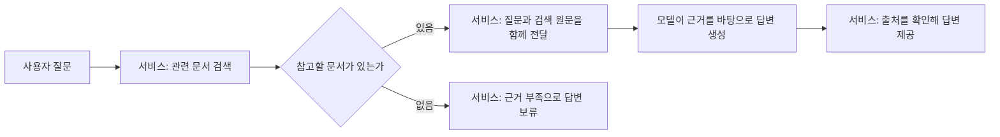

# 10. RAG: 검색한 문서를 근거로 답하기

## 이번 수업의 목표

선수 지식은 04장의 구조화 응답, 08장의 Advisor와 09장의 검색입니다.

- 미리 하는 문서 적재와 질문마다 하는 검색·생성을 구분합니다.
- 검색 원문을 모델 요청에 넣고, 근거가 없을 때의 처리 기준을 설명합니다.
- 직접 구성한 RAG와 Spring AI 표준 Reader·Splitter·Advisor의 역할을 대응합니다.
- 출처 ID 확인과 답변 내용의 정확성 평가를 구분합니다.

## 개념 먼저 이해하기

**RAG(Retrieval-Augmented Generation, 검색 증강 생성)**는 질문과 관련된 자료를 먼저 검색하고, 그 자료를 모델에게 함께 전달해 답변을 만드는 방식입니다. 모델이 이미 학습한 지식에 더해 회사의 정책·상품 설명 같은 자료를 참고하게 할 때 사용합니다.

예를 들어 쇼핑몰의 미개봉 반품 기간을 묻는 질문이라면, 먼저 해당 쇼핑몰의 정책 문서를 검색합니다. 그 원문을 질문과 함께 모델에 전달하고, 모델은 제공된 내용을 바탕으로 답변을 작성합니다.

| 용어 | 쉬운 설명 | 역할 |
|---|---|---|
| 검색(retrieval) | 질문에 관련된 자료를 찾는 단계 | 반품 규정 문서 찾기 |
| 청크(chunk) | 검색하기 좋게 나눈 문서의 한 부분 | 반품 조건에 관한 절 |
| 참고 문맥(context) | 답변을 위해 이번 요청에 함께 보낸 자료 | 검색된 정책 원문 |
| 생성(generation) | 모델이 질문과 자료를 읽고 답변을 작성하는 단계 | 규정을 쉬운 문장으로 설명 |
| 출처 | 답변에 사용한 자료를 확인할 수 있는 정보 | 정책 문서 이름과 해당 부분의 식별값 |



09장의 의미 검색이 관련 자료를 찾는 기능이라면, RAG는 그 결과를 모델의 답변 생성까지 연결합니다. RAG의 검색에는 키워드 검색 등도 쓸 수 있으며, 이 교재에서는 09장의 의미 검색을 활용합니다. Spring AI는 검색 결과를 요청에 포함하도록 직접 구성하거나, Advisor로 연결하는 방법을 제공합니다.

자료를 전달하는 것은 모델 자체를 새로 학습시키는 작업과 다릅니다. 정책이 바뀌면 검색에 사용하는 문서와 저장소도 갱신해야 합니다. 또한 **RAG를 적용하거나 출처를 표시했다는 이유만으로 모든 답변이 정확해지는 것은 아닙니다.** 잘못 검색했을 때와 근거가 없을 때의 처리, 실제 원문과 답변의 일치 여부를 확인하는 기준이 필요합니다.

개념 참고: [Spring AI의 RAG 설명](https://docs.spring.io/spring-ai/reference/api/retrieval-augmented-generation.html).

## Spring AI API를 코드와 연결하기

| API | 역할 | 이 단원의 위치 |
|---|---|---|
| `TextReader` | 텍스트 자원을 `Document`로 읽기 | 10-4의 표준 적재 |
| `TokenTextSplitter` | 긴 문서를 검색·전달할 조각으로 나누기 | 10-4의 분할 |
| `VectorStore` / `SearchRequest` | 문서를 적재하고 조건에 맞는 근거 검색 | 09장 복습과 10-1~2 |
| `ChatClient` | 질문과 근거를 모델에 전달해 답변 요청 | 10-2의 직접 연결 |
| `QuestionAnswerAdvisor` | 검색과 검색 원문의 프롬프트 포함을 연결 | 10-5의 표준 연결 |

Reader는 모델에 답변을 요청하지 않습니다. Splitter도 임베딩 모델이 아니며 문서를 조각으로 나눕니다. 문서 적재에서 임베딩이 실행되고, 사용자 질문에서는 검색용 임베딩과 답변 생성 호출이 각각 생길 수 있습니다.

### 같은 질문을 두 구현에서 비교하기

“미개봉 상품의 반품 기간은?”이라는 질문을 보내면 먼저 정책 원문을 검색합니다. 직접 구현은 근거가 비었을 때 생성 호출을 건너뛰고 보류하도록 구성했습니다. 반면 10-5의 간단한 `QuestionAnswerAdvisor` 예제는 빈 검색이어도 생성 호출이 발생합니다. 두 구현이 같은 업무 정책까지 제공한다고 가정하지 않습니다.

본문의 source ID 검사는 검색된 ID를 사용했는지 확인하는 검사입니다. 그 원문이 최신인지, 답변의 모든 주장이 원문과 맞는지는 별도의 평가 항목입니다. 검색·근거·생성 중 어디서 실패했는지 나눠 확인하는 운영 예시는 [10-6](10-rag/06-production-rag.md)에 있습니다.

## 실습 안내

선수 지식: 04의 구조화 응답, 08의 Advisor, 09의 검색.
먼저 **검색 → 문맥 조립 → 생성 → 검증**을 직접 따라갑니다.
그다음 표준 API가 그중 어느 역할을 대신하는지 비교합니다.

| 순서 | 소수업 | 실행 모듈 | 완료 기준 |
|---|---|---|---|
| 1 | [문서를 읽고 검색 준비하기](10-rag/01-indexing.md) | `10-00-rag` | 적재와 질문 시 검색 구분 |
| 2 | [검색 결과를 프롬프트에 담기](10-rag/02-generation.md) | `10-00-rag` | 검색·근거 조립·생성 호출 연결 |
| 3 | [출처 확인과 답변 보류](10-rag/03-evidence.md) | `10-00-rag` | 출처 ID 확인과 내용 검증 구분 |
| 4 | [표준 Reader·Splitter로 적재](10-rag/04-standard-indexing.md) | `10-04-rag-advisor` | 읽기·분할·저장 역할 대응 |
| 5 | [QuestionAnswerAdvisor로 연결](10-rag/05-standard-advisor.md) | `10-04-rag-advisor` | 문맥 전달 자동화와 업무 검증 구분 |
| 선택 6 | [상용 RAG의 자료 갱신과 품질 확인](10-rag/06-production-rag.md) | 설계 보충 | 적재·검색·생성의 실패를 구분하고 개선 대상을 정함 |


[공통 학습 방법](../learning-guide.md) · [전체 교육 계획](../curriculum.md)

## 실행 코드와 테스트

[labs/10-00-rag의 실행 안내](../../labs/10-00-rag/README.md)를 확인합니다.
이 단원의 기본 구현은 다음 명령으로 테스트·빌드·실행합니다. 명령은 저장소 루트 기준입니다.

```bash
./gradlew :Spring-AI-Agent-Learning:labs:10-00-rag:test --tests com.example.ailearning.l10rag.RagLocalModelTest
./gradlew :Spring-AI-Agent-Learning:labs:10-00-rag:bootJar
./gradlew :Spring-AI-Agent-Learning:labs:10-00-rag:bootRun
```

표준 API 추가 수업은 표에 적힌 별도 모듈의 README 명령을 사용합니다.

로컬 테스트는 고정 응답과 벡터로 연결·분기·출처 검사를 확인합니다. 실제 검색과 답변의 품질은 별도 질문 세트로 평가해야 합니다. `bootRun`은 적재·질문 과정에서 외부 API를 사용할 수 있습니다.

## 확인 질문

1. 정책 원문이 바뀌었을 때 모델을 다시 학습시키면 이 RAG 저장소도 자동으로 갱신되나요?
2. 검색된 출처 ID를 사용했다는 것만으로 답변 전체가 정확하다고 볼 수 있나요?
3. 검색 결과가 없을 때 답변을 보류하는 책임은 어디에 두어야 하나요?

<details>
<summary>해설</summary>

1. 아닙니다. 이 RAG는 모델 학습과 별도로 문서를 적재합니다. 변경된 원문을 반영하고 오래된 검색 자료를 갱신해야 합니다.
2. 아닙니다. ID 검사는 참조한 자료의 범위만 확인합니다. 최신성·질문 적합성·주장과 원문의 일치는 별도 확인 대상입니다.
3. 서비스의 업무 정책으로 정하고 해당 RAG 구성에 구현·검증해야 합니다. 기본 Advisor가 직접 구현의 보류 정책까지 대신한다고 가정하지 않습니다.

</details>

## 참고 자료

- [Spring AI RAG](https://docs.spring.io/spring-ai/reference/api/retrieval-augmented-generation.html): 표준 API와 확장 흐름의 기준입니다.
- [Christian Tzolov / Spring Blog — Modular RAG](https://spring.io/blog/2026/10/02/spring-ai-modular-rag-typesafe-jev/): 검색된 문서가 주제와 비슷해도 답변 근거로 유용하지 않을 수 있다는 설명을 참고했습니다. 해당 글의 확장 모듈은 이번 실습에 추가하지 않습니다.
- [07~13장 참고 자료 안내](../references.md#0713장-보강에-사용한-교육-자료)

[이전: 09장](09-embeddings-search.md) · [다음: 11장](11-mcp-workflow-agent.md)
