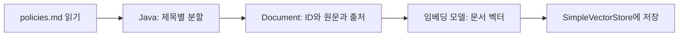

# 10-1. 문서를 읽고 검색 준비하기

30~45분을 기준으로 한 번에 한 가지 흐름만 읽습니다. 단원 전체 시간은 목차의 기존 예상 시간에 포함됩니다.

**이번 목표:** 미리 하는 문서 적재와 질문마다 하는 검색을 구분합니다.

**코드 읽기 안내:** PolicyLoader의 구분자는 이 예제를 위한 단순한 규칙입니다. 범용 문서 파서나 표준 청킹 알고리즘이라고 생각하지 마세요.

## 검색과 생성은 다른 작업이다

09는 관련 문서를 찾아 반환했습니다. RAG(Retrieval Augmented Generation)는 이 문서를 참고 자료로 모델에 전달해 답변을 생성하는 방식입니다.
모델을 새로 학습시키는 것이 아닙니다. 이번 호출의 컨텍스트에 자료를 추가합니다.
“찾은 문서가 있다”, “답변을 만들었다”, “답변의 주장이 사실이다”는 서로 다른 확인 사항입니다.

## 먼저 문서를 읽고 나누기

`src/main/resources/policies.md`에는 학습용 배송·반품 정책이 있습니다.
하나의 긴 문서보다 질문에 필요한 작은 부분을 검색하도록 나누는 단위를 **청크(chunk)**라고 부릅니다.
이번 문서는 짧아 `##` 제목별로 분할합니다. 일반 PDF·웹 문서의 범용 분할기를 구현한 것은 아닙니다.
읽기 → 분할/메타데이터 부여 → 저장을 문서 적재 파이프라인이라고 이해하면 됩니다.



[PolicyLoader.java](../../../labs/10-rag/src/main/java/com/example/ailearning/l10rag/PolicyLoader.java)의 전체 코드입니다.

```java
package com.example.ailearning.l10rag;

import org.springframework.ai.document.Document;
import org.springframework.core.io.ClassPathResource;
import java.nio.charset.StandardCharsets;
import java.io.IOException;
import java.util.ArrayList;
import java.util.List;
import java.util.Map;

/** 읽기 → 제목 단위 분할 → 출처 메타데이터 부여. 짧은 학습 문서 전용이다. */
public final class PolicyLoader {
    private PolicyLoader() {}
    public static List<Document> load() throws IOException {
        String markdown;
        try (var input = new ClassPathResource("policies.md").getInputStream()) {
            markdown = new String(input.readAllBytes(), StandardCharsets.UTF_8);
        }
        var documents = new ArrayList<Document>();
        String[] sections = markdown.split("(?m)^## ");
        for (int i = 1; i < sections.length; i++) {
            String[] parts = sections[i].strip().split("\n", 2);
            if (parts.length != 2 || parts[1].isBlank()) throw new IllegalStateException("정책 절이 비었습니다.");
            String id = parts[0].strip();
            documents.add(Document.builder().id(id).text(parts[1].strip())
                    .metadata(Map.of("source", "policies.md#" + id)).build());
        }
        return List.copyOf(documents);
    }
}
```

출처는 실제 리소스 위치와 청크 ID로 만듭니다. 모델이 파일 이름을 임의로 생성하도록 맡기지 않습니다.
서버 시작 때 적재하고, 프로세스 메모리에만 보관합니다. 재시작하면 다시 임베딩합니다.


## 여기서 멈춰 확인하기

코드를 닫고 “이번 입력 → 새로 하는 처리 → 확인할 결과”를 한 문장으로 적어 보세요.
설명하기 어렵다면 위 핵심 메서드만 다시 읽습니다. 테스트용 HTTP 서버 구현을 이해해야 다음으로 갈 수 있는 것은 아닙니다.

[이전](../10-rag.md) · [다음 소수업](02-generation.md) · [학습 방법](../../learning-guide.md)
