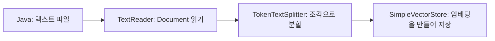

# 10-4. 직접 읽던 문서를 표준 Reader·Splitter로 바꾸기

**실행 코드·설정·테스트:** [labs/10-04-rag-advisor](../../../labs/10-04-rag-advisor/README.md). 저장소 루트에서 해당 README의 명령으로 실행합니다.

먼저 10-1의 문서 적재를 이해합니다. 이번 목표는 **읽기·분할·저장 역할을 표준 타입과 연결**하는 것입니다.
이 수업과 다음 수업은 독립 실행 모듈 `labs/10-04-rag-advisor`를 공유합니다.

## 먼저 역할을 대응시키기

| 10-1의 직접 구현 | 이번 표준 API | 반환/처리 |
|---|---|---|
| 파일 문자열 읽기 | `TextReader.get()` | 텍스트와 메타데이터를 가진 Document 목록 |
| `##` 기준 구분 | `TokenTextSplitter.apply(...)` | 토큰 크기와 문장 경계를 고려한 조각 목록 |
| 저장소 적재 | `store.add(...)` | 각 조각의 임베딩 생성과 저장 |

이름을 한 번에 외우지 말고, `get()`의 반환값이 다음 `apply()`의 인자로 들어가는지 보세요.
원문을 읽고 준비하는 시작 단계와 질문마다 검색하는 단계를 구분합니다.



[AdvisorRagService](../../../labs/10-04-rag-advisor/src/main/java/com/example/ailearning/l10advisor/AdvisorRagService.java)의 생성자에서 아래 부분만 먼저 읽습니다.

```java
        var reader = new TextReader(new ClassPathResource("return-policy.txt"));
        var splitter = TokenTextSplitter.builder()
                .build();
        var store = SimpleVectorStore.builder(embeddingModel)
                .build();
        store.add(splitter.apply(reader.get()));
```

`ClassPathResource`는 애플리케이션에 포함한 리소스 파일을 찾는 Spring 타입입니다.
전체 원문은 `src/main/resources/return-policy.txt`입니다. 짧아서 한 조각만 나올 수 있습니다.
테스트에서는 긴 문장을 넣어 여러 조각으로 나뉘는 것도 확인합니다.
분할은 문서를 모델에 맞게 다시 쓰는 요약 작업이 아니며, 이 단계 자체는 Chat 모델을 호출하지 않습니다.
`store.add`는 Embedding 모델을 호출하므로 실제 실행에서는 시작 시에도 API 사용량이 생깁니다.

## 실행해서 연결 확인하기

저장소 루트에서:

```bash
./gradlew :Spring-AI-Agent-Learning:labs:10-04-rag-advisor:test --tests com.example.ailearning.l10advisor.AdvisorRagLocalModelTest
```

`AdvisorRagLocalModelTest`는 실제 Reader·Splitter·저장소·OpenAI 어댑터에 로컬 고정 응답 서버를 연결합니다.
문서 원문이 임베딩 요청에 포함되고, 질문 검색 뒤 모델 프롬프트에 들어가는지 확인합니다.
통합 테스트 서버 구현은 제공된 보조 코드입니다.

## 문서 분할만 테스트하기

[TokenTextSplitterUnitTest](../../../labs/10-04-rag-advisor/src/test/java/com/example/ailearning/l10advisor/TokenTextSplitterUnitTest.java)는 긴 문서를 여러 조각으로 나누는 객체 기능만 검사합니다. Spring·임베딩·채팅 모델은 사용하지 않습니다.

```bash
./gradlew :Spring-AI-Agent-Learning:labs:10-04-rag-advisor:test --tests com.example.ailearning.l10advisor.TokenTextSplitterUnitTest
```

Reader·Splitter·저장소·Advisor가 함께 동작하는지는 `AdvisorRagLocalModelTest`에서 확인합니다.

확인 질문: 문서 내용이 바뀌면 어느 단계를 다시 수행해야 할까요?

<details><summary>해설</summary>
읽기·분할·임베딩 적재를 다시 해야 새 문서가 검색됩니다. 질문을 다시 보내는 것만으로 저장된 벡터가 새 원문으로 바뀌지는 않습니다.
</details>

[이전](03-evidence.md) · [다음](05-standard-advisor.md) · [단원 목차](../10-rag.md) · [학습 방법](../../learning-guide.md)
