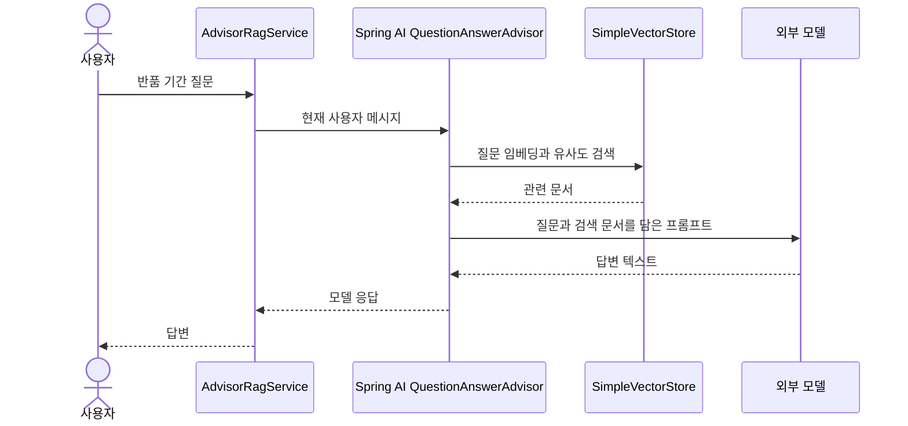

# 10-5. 검색과 프롬프트 조립을 Advisor에 맡기기

30~45분. 선수 지식: 08의 Advisor, 10-2의 직접 만든 RAG, 10-4의 문서 적재.
이번 목표는 **같은 검색·프롬프트 조립을 QuestionAnswerAdvisor로 연결**하는 것입니다.
새로운 Agent나 공통 실행 프레임워크는 만들지 않습니다.

## 어떤 일을 대신하는가?

| 직접 RAG의 코드 | Advisor를 사용한 코드 |
|---|---|
| 질문 벡터 검색 | Advisor가 VectorStore에 검색 요청 |
| 검색 결과를 context 문자열로 조립 | Advisor가 모델에 보낼 프롬프트에 문서를 추가 |
| 모델 호출 | Service에서는 기존 `user(...).call().content()` 유지 |
| 출처·값 검증과 답변 보류 | 이 단순 예제에는 추가하지 않음. 10-3의 업무 규칙은 별도 책임 |



그림은 동작의 책임을 요약합니다. 실제 모델 호출은 Advisor 뒤의 Spring AI 체인을 통해 실행됩니다.
Service 전체는 아래처럼 짧게 유지합니다. 먼저 생성자 끝의 Advisor 설정과 `answer()`를 읽고, 적재 부분은 앞 수업과 대응시킵니다.

```java
package com.example.ailearning.l10advisor;

import org.springframework.ai.chat.client.ChatClient;
import org.springframework.ai.chat.client.advisor.vectorstore.QuestionAnswerAdvisor;
import org.springframework.ai.embedding.EmbeddingModel;
import org.springframework.ai.reader.TextReader;
import org.springframework.ai.transformer.splitter.TokenTextSplitter;
import org.springframework.ai.vectorstore.SearchRequest;
import org.springframework.ai.vectorstore.SimpleVectorStore;
import org.springframework.core.io.ClassPathResource;
import org.springframework.stereotype.Service;

@Service
public class AdvisorRagService {
    private final ChatClient client;

    public AdvisorRagService(ChatClient.Builder builder, EmbeddingModel embeddingModel) {
        // 시작 시: 읽기 → 분할 → 저장. 작은 파일은 한 조각일 수도 있습니다.
        var reader = new TextReader(new ClassPathResource("return-policy.txt"));
        var splitter = TokenTextSplitter.builder().build();
        var store = SimpleVectorStore.builder(embeddingModel).build();
        store.add(splitter.apply(reader.get()));

        // 질문 시: Advisor가 검색 결과를 프롬프트에 추가합니다.
        var advisor = QuestionAnswerAdvisor.builder(store)
                .searchRequest(SearchRequest.builder().topK(1).similarityThreshold(0.7).build())
                .build();
        client = builder.defaultAdvisors(advisor).build();
    }

    public String answer(String question) {
        return client.prompt().user(question).call().content();
    }
}
```

`topK(1)`은 최대 문서 수, `similarityThreshold(0.7)`은 유사도 기준입니다.
이 수치는 모든 임베딩 모델에 최적인 값이 아니며 실제 질문 세트로 조정합니다.
기본 Advisor가 빈 검색 결과에서 생성 호출을 생략하거나 출처 ID를 검증한다고 가정하지 마세요.
이 예제의 빈 검색 테스트에서도 모델 호출은 1회 발생합니다. 10-3의 보류 규칙과 비교하는 학습 지점입니다.

## 실제 실행

루트 `.env`의 `OPENAI_API_KEY`, `OPENAI_MODEL`을 사용합니다.
추가로 `OPENAI_EMBEDDING_MODEL`을 파일 또는 실행 환경에 설정합니다. 실제 키를 코드에 적지 않습니다.
새 모듈은 첫 실습과 같은 이름을 사용하며, 기존 04~12 모듈의 설정을 일괄 변경하지 않습니다.

```bash
./gradlew :Spring-AI-Agent-Learning:labs:10-rag-advisor:bootRun
```

다른 터미널에서:

```bash
curl -sS http://127.0.0.1:8103/api/advisor-rag \
  -H 'Content-Type: text/plain; charset=UTF-8' --data-raw '미개봉 반품 기간이 언제까지야?'
```

시작 시 문서 임베딩, 질문 시 검색 임베딩과 Chat 호출이 실제 API를 사용합니다.
짧은 정책에서 미개봉 7일을 근거로 답하는지 관찰하고, 다음에는 정책에 없는 질문을 보내 비교합니다.
모델이 실제로 생성한 문장을 미리 보장하지 않습니다.

## 테스트와 작은 실험

계약 테스트 4개: 실제 문서의 적재·프롬프트 전달, 긴 문서 분할, 빈 검색 시 생성 호출, 빈 입력 거부.
고정 서버는 한국어 이해나 의미 검색 품질을 증명하지 않습니다. 실제 모델은 bootRun에서 별도로 관찰합니다.

1. 파일의 기간만 수정하고 재시작합니다. 새로운 근거가 전달되는지 확인합니다.
2. `topK`만 바꿔 검색 결과 수와 프롬프트를 비교합니다.
3. 빈 검색 시 생성 자체를 생략해야 하는 업무라면 10-2의 어느 분기를 유지할지 설명합니다.

확인 질문: Advisor를 쓴다고 출처가 올바르고 답변 내용도 정확하다고 결론 내릴 수 있을까요?

<details><summary>해설</summary>
아닙니다. Advisor는 검색과 문맥 전달을 조합합니다. 출처 확인·답변 품질 평가는 애플리케이션 요구에 맞게 별도로 검증합니다.
</details>

보충: [공식 RAG API](https://docs.spring.io/spring-ai/reference/api/retrieval-augmented-generation.html).
[이전](04-standard-indexing.md) · [10단원 목차](../10-rag.md) · [다음: 평가](../11-evaluation.md)
